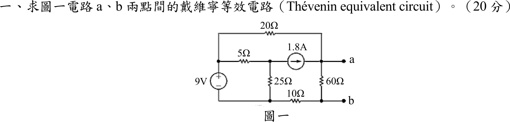
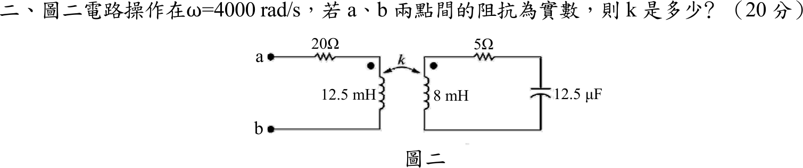
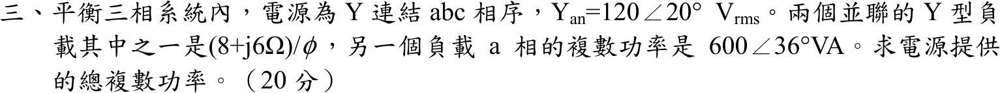
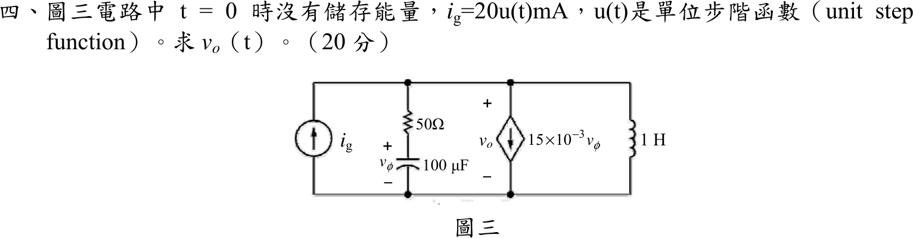
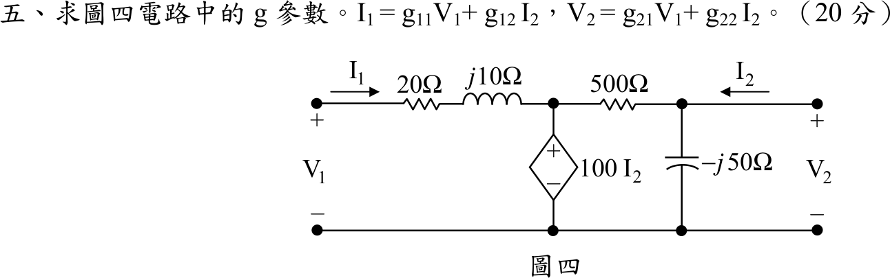

# 104 年電機工程技師｜電路學逐題詳解

> 本頁由題級 canonical 筆記組合；每題保留官方裁切圖、校驗狀態與可追溯的推導。

## 題目導覽
- [[#一、104 年電路學第 1 題｜橋接電路戴維寧等效|第 1 題：橋接電路戴維寧等效]]
- [[#二、104 年電路學第 2 題｜互感耦合電路與純電阻輸入阻抗|第 2 題：互感耦合電路與純電阻輸入阻抗]]
- [[#三、104 年電路學第 3 題｜三相 Y 接並聯負載複數功率|第 3 題：三相 Y 接並聯負載複數功率]]
- [[#四、104 年電路學第 4 題｜相依源 RLC 二階暫態|第 4 題：相依源 RLC 二階暫態]]
- [[#五、104 年電路學第 5 題｜雙埠網路逆混合 g 參數|第 5 題：雙埠網路逆混合 g 參數]]

---

## 一、104 年電路學第 1 題｜橋接電路戴維寧等效

> 題級識別：EE-104-01-1
> canonical 來源：[[canonical/EE-104-01-1.md]]
> 題級校驗狀態：verified

### 已知與所求

\(9\ \mathrm V\) 源（上正下負）在左側；上方 \(20\ \Omega\) 由 \(9\ \mathrm V\) 正端接到 \(a\) 節點；\(5\ \Omega\) 由 \(9\ \mathrm V\) 正端接到中節點 \(c\)，\(c\) 經 \(25\ \Omega\) 接 \(9\ \mathrm V\) 負端，並經 \(1.8\ \mathrm A\) 電流源（箭頭向右）接到 \(a\)；\(60\ \Omega\) 接 \(a\) 與 \(b\)；\(10\ \Omega\) 接 \(9\ \mathrm V\) 負端與 \(b\)。求 \(a\)–\(b\) 兩點間的戴維寧等效電路（20 分）。

### 考場標準作答

#### 步驟 1：節點命名與參考方向

電源皆為理想獨立源，\(V_{th}\) 以節點分析求 \(V_a-V_b\)，\(R_{th}\) 將電壓源短路、電流源開路後化簡。

畫法：

- \(9\ \mathrm V\) 負端為地，正端節點電壓固定為 \(9\ \mathrm V\)；中節點電壓 \(V_c\)，兩端點電壓 \(V_a\)、\(V_b\)。
- 支路電流參考方向：\(I_{20}\) 由 \(9\ \mathrm V\) 正端經 \(20\ \Omega\) 流向 \(a\)；\(I_{60}\) 由 \(a\) 向下流到 \(b\)；\(I_{10}\) 由 \(b\) 經 \(10\ \Omega\) 流回地。開路時 \(a\)、\(b\) 端無外接電流。
- \(1.8\ \mathrm A\) 電流源由 \(c\) 流向 \(a\)，不論 \(V_c\) 為何，流入 \(a\) 的電流都固定為 \(1.8\ \mathrm A\)；所以 \(5\ \Omega\)、\(25\ \Omega\) 只決定 \(V_c\)（電流源端電壓），不影響 \(V_a\)、\(V_b\)，求 \(V_{th}\) 時不必解 \(V_c\)。

#### 步驟 2：開路電壓 \(V_{th}\)

\(b\) 節點只接 \(60\ \Omega\) 與 \(10\ \Omega\)，KCL（流入 = 流出）：
\[
I_{60}=I_{10}\ \Rightarrow\ \frac{V_a-V_b}{60}=\frac{V_b}{10}
\]
兩邊乘 60：
\[
V_a-V_b=6V_b\ \Rightarrow\ V_b=\frac{V_a}{7}
\]
所以
\[
I_{60}=\frac{V_a-V_a/7}{60}=\frac{6V_a/7}{60}=\frac{V_a}{70}
\]
\(a\) 節點 KCL（流入 \(1.8\ \mathrm A\) 與 \(I_{20}\)，流出 \(I_{60}\)）：
\[
1.8 + \frac{9-V_a}{20}=\frac{V_a}{70}
\]
兩邊乘 140：
\[
252+7(9-V_a)=2V_a
\]
\[
252+63=7V_a+2V_a\ \Rightarrow\ 315=9V_a
\]
\[
V_a=\frac{315}{9}=35\ \mathrm V,\qquad V_b=\frac{35}{7}=5\ \mathrm V
\]
回代 \(I_{20}\)：
\[
I_{20}=\frac{9-V_a}{20}=\frac{9-35}{20}=-1.30\ \mathrm A
\]
負號表示實際電流由 \(a\) 經 \(20\ \Omega\) 流回 \(9\ \mathrm V\) 正端，與圖 1 的參考箭頭相反；核 \(a\) 節點：\(1.8+(-1.30)=0.50\ \mathrm A=I_{60}=\frac{35}{70}\ \mathrm A\)。
\[
V_{th}=V_a-V_b=35-5=30\ \mathrm V\quad(a\text{ 端為正})
\]

#### 步驟 3：等效電阻 \(R_{th}\)

\(9\ \mathrm V\) 短路使其正端節點與地同電位；\(1.8\ \mathrm A\) 開路後，節點 \(c\) 只經 \(5\ \Omega\)、\(25\ \Omega\) 接回地，與 \(a\)、\(b\) 之間沒有通路，這兩個電阻不計入。由 \(a\) 到 \(b\) 有兩條路徑：

- 直接經 \(60\ \Omega\)；
- \(a\to20\ \Omega\to\) 地 \(\to10\ \Omega\to b\)，串聯 \(20+10=30\ \Omega\)。

\[
R_{th}=60\parallel30=\frac{60\times30}{60+30}=\frac{1800}{90}=20\ \Omega
\]

#### 戴維寧等效電路（20 分）

\[
\boxed{V_{th}=30\ \mathrm V\ (a\text{ 端為正})},\qquad \boxed{R_{th}=20\ \Omega}
\]
畫法：\(30\ \mathrm V\) 理想電壓源正端經 \(20\ \Omega\) 接 \(a\)，負端接 \(b\)；開路時 \(R_{th}\) 無電流，\(V_{ab}=30\ \mathrm V\)，與步驟 2 一致。

### 驗算

重疊定理。僅 \(9\ \mathrm V\) 作用（電流源開路）：外迴路 \(20+60+10=90\ \Omega\)，電流 \(9/90=0.10\ \mathrm A\)，\(60\ \Omega\) 端電壓 \(0.10\times60=6\ \mathrm V\)。僅 \(1.8\ \mathrm A\) 作用（\(9\ \mathrm V\) 短路）：電流進入 \(a\) 後分兩路回地，經 \(20\ \Omega\) 或經 \(60+10=70\ \Omega\)，流過 \(60\ \Omega\) 的分流 \(1.8\times\dfrac{20}{20+70}=0.40\ \mathrm A\)，端電壓 \(0.40\times60=24\ \mathrm V\)。相加 \(6+24=30\ \mathrm V\)，與 \(V_{th}\) 相同。另：\(c\) 節點 KCL \(\frac{9-V_c}{5}=\frac{V_c}{25}+1.8\) 得 \(V_c=0\)，只是電流源端電壓，確實不影響 \(V_{th}\)。

### 失分點

- \(V_{th}\) 取 \(V_a-V_b\)（\(35-5\)），不是 \(V_a=35\ \mathrm V\)；\(10\ \Omega\) 在 \(b\) 與地之間，\(b\) 不是地。
- 求 \(R_{th}\) 時漏掉 \(10\ \Omega\) 會得 \(60\parallel20=15\ \Omega\)；把 \(5\ \Omega\)、\(25\ \Omega\) 併入（電流源未開路）也會算錯。
- 電流源支路串了 \(5\ \Omega\)、\(25\ \Omega\) 仍是固定 \(1.8\ \mathrm A\) 流入 \(a\)，不要把它們併進 \(a\) 節點的 KCL。

---

## 二、104 年電路學第 2 題｜互感耦合電路與純電阻輸入阻抗

> 題級識別：EE-104-01-2
> canonical 來源：[[canonical/EE-104-01-2.md]]
> 題級校驗狀態：verified

### 已知與所求

\(\omega=4000\ \mathrm{rad/s}\)。一次側：\(a\) 端串 \(20\ \Omega\) 接 \(L_1=12.5\ \mathrm{mH}\)，再回到 \(b\)；二次側：\(L_2=8\ \mathrm{mH}\) 串 \(5\ \Omega\) 與 \(C=12.5\ \mu\mathrm F\) 成閉迴路；兩線圈同名端都在上端，耦合係數 \(k\)。求使 \(Z_{ab}\) 為實數的 \(k\)（20 分）。

### 考場標準作答

#### 步驟 1：電抗

以弦波穩態相量分析，設線圈、電容皆為理想元件。

\[
\omega L_1=4\ \mathrm{krad/s}\times12.5\ \mathrm{mH}=50\ \Omega
\]
\[
\omega L_2=4\ \mathrm{krad/s}\times8\ \mathrm{mH}=32\ \Omega
\]
\[
\frac{1}{\omega C}=\frac{1}{4\ \mathrm{krad/s}\times12.5\ \mu\mathrm F}=\frac{1}{50\ \mathrm{mS}}=20\ \Omega
\]

#### 步驟 2：網目 KVL 與 \(Z_{ab}\)

畫法：

- 在 \(a\)、\(b\) 外加電壓 \(\mathbf V_{ab}\)（\(a\) 正），一次側網目電流 \(\mathbf I_1\) 順時針：由 \(a\) 流入，經 \(20\ \Omega\) 後向下流過 \(L_1\)，即由 \(L_1\) 的點端流入。
- 二次側網目電流 \(\mathbf I_2\) 也取順時針：向上流過 \(L_2\)，即由 \(L_2\) 的點端流出。
- 一個電流由點端流入、另一個由點端流出，互感電壓與自感電壓反號，互阻抗取 \(-j\omega M\)。

二次側迴路阻抗：
\[
Z_{22}=5+j\omega L_2-j\frac{1}{\omega C}=5+j32-j20=5+j12\ \Omega
\]
兩網目 KVL：
\[
\begin{aligned}
\mathbf V_{ab}&=(20+j50)\mathbf I_1-j\omega M\,\mathbf I_2\\
0&=-j\omega M\,\mathbf I_1+(5+j12)\mathbf I_2
\end{aligned}
\]
由第二式：
\[
\mathbf I_2=\frac{j\omega M}{5+j12}\mathbf I_1
\]
代入第一式：
\[
\mathbf V_{ab}=(20+j50)\mathbf I_1-j\omega M\cdot\frac{j\omega M}{5+j12}\mathbf I_1=\left[20+j50+\frac{(\omega M)^2}{5+j12}\right]\mathbf I_1
\]
（\(-j\omega M\cdot j\omega M=-j^2(\omega M)^2=(\omega M)^2\)；若互感改取 \(+j\omega M\)，兩式的互感項同時變號，乘積不變，所以答案與同名端極性無關。）
\[
Z_{ab}=\frac{\mathbf V_{ab}}{\mathbf I_1}=20+j50+\frac{(\omega M)^2}{5+j12}
\]

#### 耦合係數 \(k\)（20 分）

有理化：
\[
\frac{1}{5+j12}=\frac{5-j12}{(5+j12)(5-j12)}=\frac{5-j12}{25+144}=\frac{5-j12}{169}
\]
反射阻抗乘開：
\[
\frac{(\omega M)^2}{5+j12}=\frac{(\omega M)^2(5-j12)}{169}=\frac{5(\omega M)^2}{169}-j\frac{12(\omega M)^2}{169}
\]
加上 \(20+j50\)，實部、虛部分別合併：
\[
Z_{ab}=20+\frac{5(\omega M)^2}{169}+j\left[50-\frac{12(\omega M)^2}{169}\right]
\]
令虛部為零：
\[
50-\frac{12(\omega M)^2}{169}=0
\]
\[
(\omega M)^2=\frac{50\times169}{12}=\frac{8450}{12}=\frac{4225}{6}\ \Omega^2
\]
由 \(M=k\sqrt{L_1L_2}\)：
\[
(\omega M)^2=k^2(\omega L_1)(\omega L_2)=k^2\times50\times32=1600k^2
\]
\[
1600k^2=\frac{4225}{6}
\]
\[
k^2=\frac{4225}{6\times1600}=\frac{4225}{9600}=\frac{169}{384}
\]
\[
k=\sqrt{\frac{169}{384}}=\frac{13}{\sqrt{384}}=\frac{13}{8\sqrt6}=\frac{13}{19.596}=0.6634
\]
\[
\boxed{k=\frac{13}{8\sqrt6}\approx0.66}
\]

\(0<k\le1\)，合理。

### 驗算

代回 \(k^2=169/384\)：\((\omega M)^2=\tfrac{169}{384}\times1600=\tfrac{4225}{6}\)，而 \(\tfrac{4225}{6}\div169=\tfrac{25}{6}\)，故
\(\mathrm{Im}\,Z_{ab}=50-12\times\tfrac{25}{6}=50-50=0\)，\(Z_{ab}=20+5\times\tfrac{25}{6}=20+20.83=40.83\ \Omega\)（純電阻）。互感量 \(M=k\sqrt{L_1L_2}=0.6634\times\sqrt{12.5\times8}\ \mathrm{mH}=0.6634\times10=6.634\ \mathrm{mH}\)。

### 失分點

- 二次側含電容，\(Z_{22}=5+j(32-20)\)，不是 \(5+j32\)；漏掉 \(-j20\) 會得 \((\omega M)^2=1639.06\ \Omega^2\)、\(k=1.01>1\)，不合理。
- 反射阻抗為 \((\omega M)^2/Z_{22}\)，要有理化後才能分出實、虛部，且 \(M=k\sqrt{L_1L_2}\) 要換算回 \(k\)。
- 反射阻抗是 \(+(\omega M)^2/Z_{22}\)，不是 \(-(\omega M)^2/Z_{22}\)；\((j\omega M)^2=-(\omega M)^2\) 的負號與 KVL 中互感項的減號相乘後為正。

---

## 三、104 年電路學第 3 題｜三相 Y 接並聯負載複數功率

> 題級識別：EE-104-01-3
> canonical 來源：[[canonical/EE-104-01-3.md]]
> 題級校驗狀態：verified

### 已知與所求

平衡三相，Y 接電源，\(abc\) 相序，\(V_{an}=120\angle20^\circ\ \mathrm{V_{rms}}\)（裁切圖印作 \(Y_{an}\)，依文意為相電壓 \(V_{an}\)）。兩個並聯 Y 型負載：負載 1 每相 \(Z_1=(8+j6)\ \Omega\)；負載 2 的 \(a\) 相複數功率為 \(600\angle36^\circ\ \mathrm{VA}\)。求電源提供的總複數功率（20 分）。

### 考場標準作答

#### 步驟 1：\(a\) 相單相等效

系統平衡，各相功率相同，取 \(a\) 相計算再乘 3；電壓為有效值，故 \(S=VI^*\) 不必再除 2。

畫法：

- Y–Y 平衡系統中，電源中性點與兩負載中性點同電位，\(a\) 相可單獨畫成 \(V_{an}\) 跨接兩並聯負載。
- 負載 1 每相 \(Z_1=8+j6\ \Omega\)；負載 2 以每相複數功率 \(S_{2\phi}=600\angle36^\circ\ \mathrm{VA}\) 表示。

#### 步驟 2：負載 1 每相複數功率 \(S_{1\phi}\)

\[
S_{1\phi}=V_{an}I_1^*=V_{an}\left(\frac{V_{an}}{Z_1}\right)^*=\frac{|V_{an}|^2}{Z_1^*}
\]
\[
S_{1\phi}=\frac{120^2}{8-j6}=\frac{14400}{8-j6}
\]
分子分母同乘 \(8+j6\)，分母 \(8^2+6^2=100\)：
\[
S_{1\phi}=\frac{14400(8+j6)}{100}=144(8+j6)=1152+j864\ \mathrm{VA}
\]

#### 步驟 3：負載 2 每相複數功率 \(S_{2\phi}\)

\[
S_{2\phi}=600\angle36^\circ=600\cos36^\circ+j600\sin36^\circ
\]
\[
600\cos36^\circ=600\times0.80902=485.41\ \mathrm W
\]
\[
600\sin36^\circ=600\times0.58779=352.67\ \mathrm{var}
\]
\[
S_{2\phi}=485.41+j352.67\ \mathrm{VA}
\]

#### 電源總複數功率（20 分）

並聯負載的複數功率直接相加，每相總功率：
\[
S_\phi=S_{1\phi}+S_{2\phi}=(1152+485.41)+j(864+352.67)=1637.41+j1216.67\ \mathrm{VA}
\]
三相總功率：
\[
S_T=3S_\phi=3\times1637.41+j3\times1216.67=4912.23+j3650.01\ \mathrm{VA}
\]
化成極座標：
\[
|S_T|=\sqrt{4912.23^2+3650.01^2}=6119.85\ \mathrm{VA}
\]
\[
\theta=\tan^{-1}\frac{3650.01}{4912.23}=\tan^{-1}0.7430=36.61^\circ
\]
\[
\boxed{S_T=4912.23+j3650.01\ \mathrm{VA}=6.12\angle36.61^\circ\ \mathrm{kVA}}
\]
即 \(P_T=4.91\ \mathrm{kW}\)、\(Q_T=3.65\ \mathrm{kvar}\)（感性）。

### 驗算

改用線電流：負載 1 電流 \(I_1=\dfrac{120\angle20^\circ}{10\angle36.87^\circ}=12\angle-16.87^\circ\ \mathrm A\)；負載 2 電流 \(I_2=\left(\dfrac{S_{2\phi}}{V_{an}}\right)^*=\left(5\angle16^\circ\right)^*=5\angle-16^\circ\ \mathrm A\)。\(I_a=I_1+I_2=12\angle-16.87^\circ+5\angle-16^\circ=17.00\angle-16.61^\circ\ \mathrm A\)，\(S_T=3V_{an}I_a^*=3(120)(17.00)\angle(20^\circ+16.61^\circ)=6.12\angle36.61^\circ\ \mathrm{kVA}\)，與上式相同。

### 失分點

- 題目所給是「\(a\) 相」複數功率，電源總功率必須乘 3，不能只加單相。
- 複數功率用 \(S=|V|^2/Z^*\)（共軛），不是 \(|V|^2/Z\)；後者會得 \(1152-j864\)，\(Q\) 變負。
- 角度 \(36^\circ\) 換直角座標時計算機須在 DEG 模式，否則 \(\cos36\) 會以弧度計算。

---

## 四、104 年電路學第 4 題｜相依源 RLC 二階暫態

> 題級識別：EE-104-01-4
> canonical 來源：[[canonical/EE-104-01-4.md]]
> 題級校驗狀態：verified

### 已知與所求

\(t=0\) 時無儲能，\(i_g=20u(t)\ \mathrm{mA}\)（向上注入頂節點）。頂節點對地並聯四支路：\(i_g\)；\(50\ \Omega\) 串 \(100\ \mu\mathrm F\)（電容電壓 \(v_\phi\)，上正）；相依電流源 \(15\times10^{-3}v_\phi\)（向下）；\(1\ \mathrm H\) 電感。\(v_o\) 為頂節點對地電壓（上正）。求 \(v_o(t)\)（20 分）。

### 考場標準作答

#### 步驟 1：\(s\) 域電路

只有一個非參考節點（頂節點），用 \(s\) 域節點分析；電流以 A、電壓以 V 計。

畫法：

- \(i_g=0.02u(t)\ \mathrm A\Rightarrow I_g(s)=\dfrac{0.02}{s}\)，向上注入頂節點。
- \(C=100\ \mu\mathrm F=10^{-4}\ \mathrm F\)：\(\dfrac1{sC}=\dfrac{1}{10^{-4}s}=\dfrac{10000}{s}\ \Omega\)；\(L=1\ \mathrm H\)：\(sL=s\ \Omega\)。
- 無儲能，故電容、電感都不加初值源；\(V_\phi\) 為電容上的電壓（上正），\(V_o\) 為頂節點對地電壓。

#### 步驟 2：各支路以 \(V_o\) 表示

\(RC\) 支路阻抗：
\[
Z_{RC}=50+\frac{10000}{s}=\frac{50s+10000}{s}=\frac{50(s+200)}{s}
\]
\(RC\) 支路電流（向下）：
\[
\frac{V_o}{Z_{RC}}=\frac{s}{50(s+200)}V_o=\frac{0.02s}{s+200}V_o
\]
控制量 \(V_\phi\) 由分壓：
\[
V_\phi=V_o\frac{10000/s}{50(s+200)/s}=V_o\frac{10000}{50(s+200)}=\frac{200}{s+200}V_o
\]
相依源電流（向下）：
\[
15\times10^{-3}V_\phi=0.015\times\frac{200}{s+200}V_o=\frac{3}{s+200}V_o
\]
電感電流（向下）：
\[
\frac{V_o}{sL}=\frac{V_o}{s}
\]

#### 輸出電壓 \(v_o(t)\)（20 分）

頂節點 KCL：
\[
\frac{0.02}{s}=V_o\left[\frac{0.02s}{s+200}+\frac{3}{s+200}+\frac1s\right]
\]
前兩項同分母相加：
\[
\frac{0.02s}{s+200}+\frac{3}{s+200}=\frac{0.02s+3}{s+200}
\]
再與 \(\dfrac1s\) 通分：
\[
\frac{0.02s+3}{s+200}+\frac1s=\frac{s(0.02s+3)+(s+200)}{s(s+200)}=\frac{0.02s^2+4s+200}{s(s+200)}
\]
分子提出 0.02：
\[
0.02s^2+4s+200=0.02(s^2+200s+10000)=0.02(s+100)^2
\]
所以
\[
\frac{0.02}{s}=V_o\,\frac{0.02(s+100)^2}{s(s+200)}
\]
\[
V_o(s)=\frac{0.02}{s}\times\frac{s(s+200)}{0.02(s+100)^2}=\frac{s+200}{(s+100)^2}
\]
部分分式：分子 \(s+200=(s+100)+100\)，
\[
V_o(s)=\frac{s+100}{(s+100)^2}+\frac{100}{(s+100)^2}=\frac{1}{s+100}+\frac{100}{(s+100)^2}
\]
反拉氏轉換（\(\frac1{s+a}\leftrightarrow e^{-at}\)，\(\frac1{(s+a)^2}\leftrightarrow te^{-at}\)）：
\[
v_o(t)=e^{-100t}+100te^{-100t}
\]
\[
\boxed{v_o(t)=(1+100t)e^{-100t}\,u(t)\ \mathrm V}
\]
特徵式 \((s+100)^2=0\) 為重根 \(s=-100\)，屬臨界阻尼。

### 驗算

初值：\(t=0^+\) 電容電壓連續為 0（相當短路），\(v_\phi=0\)，相依源為 0；電感電流連續為 0（相當開路），\(20\ \mathrm{mA}\) 全經 \(50\ \Omega\)，\(v_o(0^+)=0.02\times50=1\ \mathrm V\)，與 \((1+0)e^0=1\) 一致。終值：\(t\to\infty\) 電感短路，\(v_o\to0\)，與 \(e^{-100t}\) 衰減一致；終值定理 \(\lim_{s\to0}sV_o(s)=0\) 亦同。

### 失分點

- 相依源電流 \(15\times10^{-3}v_\phi\) 受電容電壓 \(v_\phi\) 控制，而非 \(v_o\)；須先以分壓 \(V_\phi=\dfrac{200}{s+200}V_o\) 換成 \(V_o\)。
- 分母整理後為 \(0.02(s+100)^2\)（\(s^2+200s+10000\)），重根；若誤得兩相異根會寫成雙指數。
- 重根部分分式漏掉 \(\dfrac{100}{(s+100)^2}\) 項，會少掉 \(100te^{-100t}\)。

---

## 五、104 年電路學第 5 題｜雙埠網路逆混合 g 參數

> 題級識別：EE-104-01-5
> canonical 來源：[[canonical/EE-104-01-5.md]]
> 題級校驗狀態：verified

### 已知與所求

埠 1：\(V_1\)、\(I_1\)（向右流入），串聯 \(20\ \Omega\) 與 \(j10\ \Omega\) 到中間節點 \(P\)；\(P\) 對地為相依電壓源 \(100I_2\)（上正）；\(P\) 與輸出節點 \(Q\) 間 \(500\ \Omega\)；\(Q\) 對地並聯 \(-j50\ \Omega\)；埠 2：\(V_2\) 在 \(Q\)、\(I_2\) 向左流入 \(Q\)。求 \(I_1=g_{11}V_1+g_{12}I_2\)、\(V_2=g_{21}V_1+g_{22}I_2\) 的 \(g\) 參數（20 分）。

### 考場標準作答

#### 步驟 1：節點與參考方向

\(g\) 參數以 \(V_1\)、\(I_2\) 為自變數，求 \(I_1\)、\(V_2\)；全題為相量，阻抗以 \(\Omega\)、導納以 S 表示。

畫法：

- 下方導線為參考；\(P\) 為 \(j10\ \Omega\) 右端節點，\(Q\) 為輸出端上方節點（\(V_2\) 即 \(Q\) 的電壓）。
- \(I_1\) 由埠 1 正端流入，\(I_2\) 由埠 2 正端流入 \(Q\)（依題圖）。
- \(I_C\)：自 \(Q\) 向下流過 \(-j50\ \Omega\)；\(I_R\)：自 \(Q\) 經 \(500\ \Omega\) 流向 \(P\)。
- 相依源上正下負接在 \(P\) 與參考之間，故 \(V_P=100I_2\)（係數 100 的單位為 \(\Omega\)）。

#### g 參數（20 分）

**(a) 輸入迴路求 \(g_{11}\)、\(g_{12}\)**

由埠 1 經 \(20\ \Omega\)、\(j10\ \Omega\) 到 \(P\)，再經相依源回參考：
\[
V_1=(20+j10)I_1+V_P=(20+j10)I_1+100I_2
\]
移項解 \(I_1\)：
\[
I_1=\frac{1}{20+j10}V_1-\frac{100}{20+j10}I_2
\]
有理化（\(|20+j10|^2=20^2+10^2=500\)）：
\[
\frac{1}{20+j10}=\frac{20-j10}{500}=0.04 - j0.02\ \mathrm S
\]
\[
\boxed{g_{11}=\frac{1}{20+j10}=0.04 - j0.02\ \mathrm S}
\]
\[
-\frac{100}{20+j10}=-100\times(0.04-j0.02)=-4+j2
\]
\[
\boxed{g_{12}=-\frac{100}{20+j10}=-4+j2\ \text{（無因次）}}
\]

**(b) 節點 \(Q\) 求 \(g_{21}\)、\(g_{22}\)**

\(Q\) 的 KCL（流入 \(I_2\) = 流出 \(I_C+I_R\)）：
\[
I_2=I_C+I_R=\frac{V_2}{-j50}+\frac{V_2-V_P}{500}
\]
代入 \(V_P=100I_2\)，並逐項化簡：
\[
\frac{1}{-j50}=\frac{j}{50}=j0.02\ \mathrm S,\qquad \frac{1}{500}=0.002\ \mathrm S,\qquad \frac{100I_2}{500}=0.2I_2
\]
\[
I_2=j0.02V_2+0.002V_2-0.2I_2
\]
\[
1.2I_2=(0.002+j0.02)V_2
\]
\[
V_2=\frac{1.2}{0.002+j0.02}I_2=\frac{600}{1+j10}I_2
\]
此式不含 \(V_1\)：\(P\) 點電壓由 \(I_2\) 決定，\(V_1\) 只改變 \(I_1\)，影響不到 \(Q\)。
\[
\boxed{g_{21}=0}
\]
有理化（\(|1+j10|^2=1+100=101\)）：
\[
\frac{600}{1+j10}=\frac{600(1-j10)}{101}=\frac{600}{101}-j\frac{6000}{101}
\]
\[
\boxed{g_{22}=\frac{600}{1+j10}=\frac{600}{101}-j\frac{6000}{101}\approx5.94-j59.41\ \Omega}
\]

### 驗算

依定義測試：\(I_2=0\)（埠 2 開路）時 \(V_P=0\)，\(I_1=V_1/(20+j10)\)，\(g_{11}\) 成立；\(Q\) 無激勵，\(V_2=0\)，\(g_{21}=0\)。\(V_1=0\)、注入 \(I_2=1\ \mathrm A\) 時 \(V_P=100\ \mathrm V\)，\(I_1=-100/(20+j10)=-4+j2\ \mathrm A\) 即 \(g_{12}\)；\(V_2=600/(1+j10)=5.94-j59.41\ \mathrm V\)，代回 KCL：\(V_2(0.002+j0.02)=(5.94-j59.41)(0.002+j0.02)=0.0119+1.1882+j(0.1188-0.1188)\approx1.20\ \mathrm A=1.2I_2\)，成立。

### 失分點

- 混合單位：\(g_{11}\) 單位 S、\(g_{22}\) 單位 \(\Omega\)，\(g_{12}\)、\(g_{21}\) 無因次，作答要逐一標註。
- 相依源 \(100I_2\) 使 \(V_P\) 與 \(V_1\) 無關，\(g_{21}=0\)；不要以為 \(V_1\) 會經 \(500\ \Omega\) 影響埠 2。
- \(Q\) 的 KCL 要包含相依源造成的 \(-0.2I_2\) 項，漏掉會得 \(1/(0.002+j0.02)\) 而非乘以 \(1.2\)。

---
