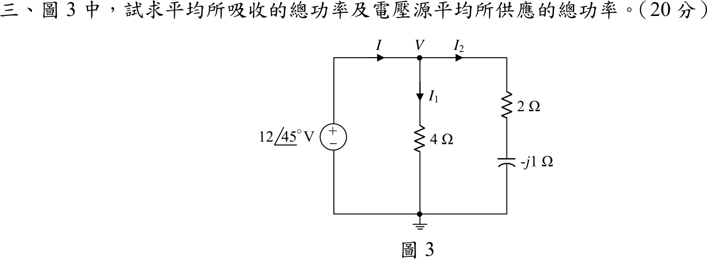

# 105 年電機工程技師｜電路學逐題詳解

> 本頁由題級 canonical 筆記組合；每題保留官方裁切圖、校驗狀態與可追溯的推導。

## 題目導覽
- [[#一、105 年電路學第 1 題｜多網目直流電路節點分析|第 1 題：多網目直流電路節點分析]]
- [[#二、105 年電路學第 2 題｜相依源戴維寧等效電阻|第 2 題：相依源戴維寧等效電阻]]
- [[#三、105 年電路學第 3 題｜交流穩態複數功率|第 3 題：交流穩態複數功率]]
- [[#四、105 年電路學第 4 題｜三相功率因數改善與 Y 接電容|第 4 題：三相功率因數改善與 Y 接電容]]
- [[#五、105 年電路學第 5 題｜串聯 RLC 帶通濾波器設計|第 5 題：串聯 RLC 帶通濾波器設計]]

---

## 一、105 年電路學第 1 題｜多網目直流電路節點分析

> 題級識別：EE-105-01-1
> canonical 來源：[[canonical/EE-105-01-1.md]]
> 題級校驗狀態：verified

### 已知與所求

下方水平導線為參考節點。\(2\ \mathrm{mA}\) 電流源由下往上注入左節點 \(V_1\)；\(V_1\) 與中節點 \(V_2\) 間為 \(1\ \mathrm{k\Omega}\)；\(V_2\) 經 \(2\ \mathrm{k\Omega}\) 接地（\(I_O\) 向下）；\(4\ \mathrm{mA}\) 電流源由 \(V_2\) 指向右節點 \(V_3\)，\(V_3\) 經 \(2\ \mathrm{k\Omega}\) 接地；上方支路由 \(V_1\) 經 \(6\ \mathrm V\)（左負右正）與 \(1\ \mathrm{k\Omega}\) 接到 \(V_3\)。求 \(I_O\)（20 分）。

### 考場標準作答

**解題邏輯**：三個非參考節點 \(V_1,V_2,V_3\)，用節點分析：先把上方支路（6 V 源串 \(1\ \mathrm{k\Omega}\)）的電流寫成節點電壓式 → 三個節點各列 KCL → 化成整數係數聯立式並消去 → 由 \(V_2\) 求 \(I_O=V_2/2\ \mathrm{k\Omega}\)。電壓以 V、電阻以 \(\mathrm{k\Omega}\)、電流以 mA 計（\(\mathrm V/\mathrm{k\Omega}=\mathrm{mA}\)）；電源皆為理想源。

#### 步驟 1：節點命名與參考方向

畫法：

- 下方導線為參考地；左、中、右節點電壓分別為 \(V_1\)、\(V_2\)、\(V_3\)。
- 上方支路電流 \(I_T\) 參考方向取由 \(V_1\) 向右流到 \(V_3\)；\(I_O\) 依題圖向下流過中間 \(2\ \mathrm{k\Omega}\)。
- KCL 一律寫「流入 = 流出」。

#### 步驟 2：上方支路電流 \(I_T\)

由 \(V_1\) 向右經過 6 V 源（左負右正），電位升高 6 V，到達 \(1\ \mathrm{k\Omega}\) 左端時為 \(V_1+6\)；再經 \(1\ \mathrm{k\Omega}\) 到 \(V_3\)：
\[
I_T=\frac{(V_1+6)-V_3}{1}=V_1+6-V_3\ \ (\mathrm{mA})
\]

#### 電流 \(I_O\)（20 分）

**邏輯**：三個節點 KCL 構成三元一次聯立式；先各乘以 2 消去分母，再用兩式相減消去 \(V_1\)，最後回代求 \(V_2\)；\(I_O\) 就是 \(V_2\) 經 \(2\ \mathrm{k\Omega}\) 對地的電流。

三個節點 KCL（流入 = 流出）：
\[
\begin{aligned}
V_1\text{ 節點：}&\ 2=\frac{V_1-V_2}{1}+I_T\\
V_2\text{ 節點：}&\ \frac{V_1-V_2}{1}=\frac{V_2}{2}+4\\
V_3\text{ 節點：}&\ 4+I_T=\frac{V_3}{2}
\end{aligned}
\]
代入 \(I_T=V_1+6-V_3\) 並整理：

- \(V_1\) 節點：\(2=V_1-V_2+V_1+6-V_3\Rightarrow 2V_1-V_2-V_3=-4\) …(1)
- \(V_2\) 節點：兩邊乘 2，\(2V_1-2V_2=V_2+8\Rightarrow 2V_1-3V_2=8\) …(2)
- \(V_3\) 節點：兩邊乘 2，\(8+2V_1+12-2V_3=V_3\Rightarrow 2V_1-3V_3=-20\) …(3)

(2) − (3) 消去 \(V_1\)：
\[
-3V_2+3V_3=8-(-20)=28
\]
\[
V_3=V_2+\frac{28}{3}
\]
由 (2)：
\[
V_1=\frac{8+3V_2}{2}=4+1.5V_2
\]
代入 (1)：
\[
2(4+1.5V_2)-V_2-\left(V_2+\frac{28}{3}\right)=-4
\]
\[
8+3V_2-2V_2-\frac{28}{3}=-4
\]
\[
V_2=-4-8+\frac{28}{3}=-12+\frac{28}{3}=-\frac{8}{3}\ \mathrm V
\]
回代：
\[
V_1=4+1.5\times\left(-\frac83\right)=4-4=0\ \mathrm V,\qquad V_3=-\frac83+\frac{28}{3}=\frac{20}{3}\ \mathrm V
\]
\(I_O\) 向下流過 \(2\ \mathrm{k\Omega}\)：
\[
I_O=\frac{V_2-0}{2}=\frac{-8/3}{2}
\]
\[
\boxed{I_O=-\frac{4}{3}\ \mathrm{mA}\approx-1.33\ \mathrm{mA}}
\]

負號表示實際電流由地向上流過該 \(2\ \mathrm{k\Omega}\)。同理上方支路 \(I_T=-\tfrac23\ \mathrm{mA}\) 也為負，實際方向與圖 1 的參考方向相反（見驗算）。

### 驗算

支路電流：\(I_T=V_1+6-V_3=0+6-\tfrac{20}{3}=-\tfrac23\ \mathrm{mA}\)（實際由右向左 \(0.67\ \mathrm{mA}\)，由正端流入 6 V 源）；中間 \(1\ \mathrm{k\Omega}\) 向右 \(\tfrac{0-(-8/3)}{1}=\tfrac83\ \mathrm{mA}\)；右側 \(2\ \mathrm{k\Omega}\) 向下 \(\tfrac{20/3}{2}=\tfrac{10}{3}\ \mathrm{mA}\)。

- KCL：\(V_2\) 節點 \(\tfrac83=-\tfrac43+4\)；\(V_3\) 節點 \(4+(-\tfrac23)=\tfrac{10}{3}\)。
- 功率：電阻吸收 \(\tfrac49+\tfrac{64}{9}+\tfrac{32}{9}+\tfrac{200}{9}=\tfrac{300}{9}=33.33\ \mathrm{mW}\)，加 6 V 源吸收 \(6\times\tfrac23=4\ \mathrm{mW}\)，共 \(37.33\ \mathrm{mW}\)；\(4\ \mathrm{mA}\) 源供出 \(4(V_3-V_2)=4\times\tfrac{28}{3}=37.33\ \mathrm{mW}\)，\(2\ \mathrm{mA}\) 源端電壓 \(V_1=0\) 故供出 \(0\)，兩側相等。

### 失分點

- 6 V 左負右正，上方支路電流是 \(V_1+6-V_3\)；寫成 \(V_1-6-V_3\) 會使 \(V_2\) 錯誤。
- \(I_O\) 箭頭向下，\(V_2<0\) 故答案為負，不要為了「好看」取絕對值。
- \(4\ \mathrm{mA}\) 源在 \(V_2\) 節點是流出、在 \(V_3\) 節點是流入，兩處符號相反。

---

## 二、105 年電路學第 2 題｜相依源戴維寧等效電阻

> 題級識別：EE-105-01-2
> canonical 來源：[[canonical/EE-105-01-2.md]]
> 題級校驗狀態：verified

### 已知與所求

左側為相依電壓源 $2000I_x$（上正下負），$I_x$ 為流經 $1\ \mathrm{k\Omega}$ 向下的電流；$2\ \mathrm{k\Omega}$ 接於相依源與中節點 $V_1$ 之間，$1\ \mathrm{k\Omega}$ 自 $V_1$ 接地，$3\ \mathrm{k\Omega}$ 接 $V_1$ 與 $A$，$2\ \mathrm{k\Omega}$ 接 $A$ 與 $B$。電路無獨立源，求 $A$–$B$ 端 $R_{TH}$（20 分）。

### 考場標準作答

無獨立源，相依源保留，在 $A$–$B$ 端加測試電壓 $V_t$（$B$ 為地），求測試電流 $I_t$。單位用 V、kΩ、mA。

$I_x=V_1/1$，故相依源電壓 $2000I_x=2V_1$（V）。對 $V_1$ 節點 KCL：

$$
\frac{2V_1-V_1}{2}=\frac{V_1}{1}+\frac{V_1-V_t}{3}
\ \Rightarrow\ 0=\frac{V_1}{2}+\frac{V_1-V_t}{3}
\ \Rightarrow\ V_1=0.40V_t
$$

$$
I_t=\frac{V_t}{2}+\frac{V_t-V_1}{3}=0.50V_t+0.20V_t=0.70V_t\ \ (\mathrm{mA})
$$

$$
\boxed{R_{TH}=\frac{V_t}{I_t}=\frac{1}{0.70}\ \mathrm{k\Omega}=\frac{10000}{7}\ \Omega\approx1.43\ \mathrm{k\Omega}}
$$

### 驗算

改用測試電流源：自 $A$ 灌入 $I_t=1\ \mathrm{mA}$，令 $V_B=0$。$V_1$ 節點仍給 $V_1=0.40V_A$；$A$ 節點 $1=\dfrac{V_A}{2}+\dfrac{V_A-0.40V_A}{3}=0.70V_A$，得 $V_A=1.43\ \mathrm V$，故 $R_{TH}=1.43\ \mathrm{k\Omega}$。另因電路無獨立源，$V_{oc}=0$，不能用 $V_{oc}/I_{sc}$。

### 失分點

- 相依源不可像獨立電壓源那樣短路；它受 $I_x$ 控制，必須保留並用測試源求解。
- $I_x$ 單位：$2000I_x$ 的 $I_x$ 以 A 計；用 mA 代入時須換算成 $2V_1$（V）。

---

## 三、105 年電路學第 3 題｜交流穩態複數功率

> 題級識別：EE-105-01-3
> canonical 來源：[[canonical/EE-105-01-3.md]]
> 題級校驗狀態：needs_manual_review
> [!WARNING] 本題仍有官方資料缺口或事件定義歧義；請以 canonical 條件式解答為準。

### 已知與所求

電壓源 $12\angle45^\circ\ \mathrm V$ 並聯兩支路：$4\ \Omega$（電流 $I_1$）與 $2\ \Omega$ 串 $-j1\ \Omega$（電流 $I_2$），電源電流 $I=I_1+I_2$。求負載平均吸收總功率與電壓源平均供應總功率（20 分）。題目未註明相量為有效值或峰值（見「條件與疑義」）。

### 考場標準作答

裁切圖未說明 $12\angle45^\circ\ \mathrm V$ 是有效值或峰值，以下兩種讀法並列作答。先以有效值相量計算：

$$
I_1=\frac{12\angle45^\circ}{4}=3\angle45^\circ\ \mathrm A,\qquad
I_2=\frac{12\angle45^\circ}{2-j1}=\frac{12}{\sqrt5}\angle71.57^\circ\ \mathrm A
$$

$$
P_{4\Omega}=|I_1|^2\cdot4=36\ \mathrm W,\quad
P_{2\Omega}=|I_2|^2\cdot2=\tfrac{144}{5}\cdot2=57.60\ \mathrm W,\quad P_C=0
$$

電源電流 $I=12\angle45^\circ(0.25+\tfrac{2+j1}{5})=12\angle45^\circ(0.65+j0.20)$，$S=VI^*=144(0.65-j0.20)=93.60-j28.80\ \mathrm{VA}$。

- 有效值相量讀法：$\boxed{P_{\text{吸收}}=P_{\text{供應}}=93.60\ \mathrm W}$
- 峰值（振幅）相量讀法：平均功率為 $\tfrac12\mathrm{Re}\{VI^*\}$，所有功率減半，$\boxed{P_{\text{吸收}}=P_{\text{供應}}=46.80\ \mathrm W}$（$S=46.80-j14.40\ \mathrm{VA}$）

### 驗算

改用輸入導納：$Y_{in}=\tfrac14+\tfrac{1}{2-j1}=0.25+\tfrac{2+j1}{5}=0.65+j0.20\ \mathrm S$，$S=|V|^2Y_{in}^*=144(0.65-j0.20)=93.60-j28.80\ \mathrm{VA}$，實部與支路法 $36+57.60$ 相同，電源供應等於電阻吸收。

### 失分點

- $-j1\ \Omega$ 電容不吸收平均功率；只算 $2\ \Omega$ 的 $|I_2|^2R$。
- $|I_2|=12/\sqrt5$，平方為 $144/5$，不是 $144/\sqrt5$。

### 條件與疑義

同卷第 4 題明確標示 $34.5\ \mathrm{kV_{rms}}$，本題對 $12\angle45^\circ\ \mathrm V$ 則未標示，故有效值與峰值兩種讀法皆可能，答案為 $93.60\ \mathrm W$ 或 $46.80\ \mathrm W$，需依出題者意圖確認。

---

## 四、105 年電路學第 4 題｜三相功率因數改善與 Y 接電容

> 題級識別：EE-105-01-4
> canonical 來源：[[canonical/EE-105-01-4.md]]
> 題級校驗狀態：verified

### 已知與所求

平衡三相，線電壓 \(V_L=34.5\ \mathrm{kV_{rms}}\)、\(f=60\ \mathrm{Hz}\)；平衡負載 \(S=24\ \mathrm{MVA}\)、功率因數 \(0.78\) 落後。三個電容 \(C\) 分別由 \(a,b,c\) 線接到中性點（Y 接）。求 \(C\)，使總負載（原負載加電容組）的功率因數成為 \(0.94\) 領先（20 分）。

### 考場標準作答

**解題邏輯**：功率因數改善用無效功率補償：理想電容只供應無效功率、不改變有效功率 \(P\)。主線為：求原負載 \(P\)、\(Q\) → 由目標功因 \(0.94\) 領先求新的無效功率 \(Q_{\text{new}}\)（領先所以為負）→ 電容組須供應 \(Q_C=Q-Q_{\text{new}}\) → 電容接中性點為 Y 接，每個電容承受相電壓 \(V_L/\sqrt3\)，由 \(Q_C=3\omega CV_{ph}^2\) 解 \(C\)。前提：電源理想、線電壓維持 \(34.5\ \mathrm{kV}\)，落後（感性）\(Q>0\)、領先（容性）\(Q<0\)。

#### 步驟 1：原負載的 \(P\)、\(Q\)

\(\varphi\)：原負載功因角，\(\cos\varphi=0.78\)。

\[
P=S\cos\varphi=24\times0.78=18.72\ \mathrm{MW}
\]
\[
\sin\varphi=\sqrt{1-0.78^2}=\sqrt{1-0.6084}=\sqrt{0.3916}=0.62578
\]
\[
Q=S\sin\varphi=24\times0.62578=15.019\ \mathrm{Mvar}
\]
（這條鏈保留 5 位有效數字：若取 4 位，\(Q_C\) 會變成 \(21.82\) 而使 \(C\) 的末位差 \(0.02\ \mu\mathrm F\)。）

#### 步驟 2：目標無效功率 \(Q_{\text{new}}\)

\(\theta\)：目標（加電容後）功因角，\(\cos\theta=0.94\)。

\[
\cos\theta=0.94,\qquad \sin\theta=\sqrt{1-0.94^2}=\sqrt{1-0.8836}=\sqrt{0.1164}=0.34117
\]
\[
\tan\theta=\frac{\sin\theta}{\cos\theta}=\frac{0.34117}{0.94}=0.36295
\]
領先，故 \(Q_{\text{new}}<0\)：
\[
Q_{\text{new}}=-P\tan\theta=-18.72\times0.36295=-6.794\ \mathrm{Mvar}
\]

#### 步驟 3：電容組須供應的 \(Q_C\)

\[
Q_C=Q-Q_{\text{new}}=15.019-(-6.794)=21.813\ \mathrm{Mvar}
\]

#### 電容 \(C\)（20 分）

**邏輯**：電容接中性點為 Y 接，每個電容的端電壓是相電壓 \(V_{ph}=V_L/\sqrt3\)；三相共供 \(Q_C=3\omega CV_{ph}^2=\omega CV_L^2\)，移項得 \(C=Q_C/(\omega V_L^2)\)。

\[
Q_C=3\omega CV_{ph}^2=3\omega C\left(\frac{V_L}{\sqrt3}\right)^2=\omega CV_L^2
\quad\Rightarrow\quad C=\frac{Q_C}{\omega V_L^2}
\]
\[
\omega=2\pi f=2\pi\times60=376.99\ \mathrm{rad/s}
\]
\[
V_L^2=(34.5\times10^3)^2=1.19025\times10^{9}\ \mathrm V^2
\]
\[
\omega V_L^2=376.99\times1.19025\times10^{9}=4.4871\times10^{11}\ \mathrm{V^2/s}
\]
\[
C=\frac{21.813\times10^6}{4.4871\times10^{11}}=4.8613\times10^{-5}\ \mathrm F
\]
\[
\boxed{C=48.61\ \mu\mathrm F}
\]

### 驗算

回代：每相電壓 \(V_{ph}=34.5/\sqrt3=19.919\ \mathrm{kV}\)，三相電容供 \(3\omega CV_{ph}^2=\omega CV_L^2=4.4871\times10^{11}\times4.8613\times10^{-5}=21.813\ \mathrm{Mvar}\)。淨 \(Q=15.019-21.813=-6.794\ \mathrm{Mvar}\)，\(\mathrm{pf}=\dfrac{18.72}{\sqrt{18.72^2+6.794^2}}=\dfrac{18.72}{19.915}=0.94\)，且 \(Q<0\) 為領先。

### 失分點

- 電容接中性點是 Y 接，\(C=Q_C/(\omega V_L^2)\)；誤當 \(\Delta\) 接（每個電容承受 \(V_L\)）而用 \(C=Q_C/(3\omega V_L^2)\)，會得 \(16.20\ \mu\mathrm F\)。
- 「領先 \(0.94\)」代表 \(Q_{\text{new}}\) 為負；只補到 \(Q=0\)，或補到 \(0.94\) 落後，所需 \(Q_C\) 都不同。
- 電容不改變 \(P\)：目標無效功率要用原負載的 \(P=18.72\ \mathrm{MW}\) 乘 \(\tan\theta\)，不能用 \(S=24\ \mathrm{MVA}\)。

---

## 五、105 年電路學第 5 題｜串聯 RLC 帶通濾波器設計

> 題級識別：EE-105-01-5
> canonical 來源：[[canonical/EE-105-01-5.md]]
> 題級校驗狀態：verified

### 已知與所求

$V_S$ 串聯 $C$、$L$，輸出 $V_R$ 取自 $R$ 兩端；$C=1\ \mu\mathrm F$，要求共振頻率 $\omega_0=1000\ \mathrm{rad/s}$、頻寬 $B=100\ \mathrm{rad/s}$。求 $R$、$L$（20 分）。

### 考場標準作答

\(C\)、\(L\)、\(R\) 串聯且輸出取自 \(R\)，是串聯 RLC 帶通濾波器：共振時 \(\omega_0L=\dfrac1{\omega_0C}\)，電抗互相抵消、阻抗只剩 \(R\)，輸出最大；頻寬是半功率點（增益降為 \(1/\sqrt2\)）之間的寬度，串聯 RLC 的頻寬 \(B=R/L\)。先由共振條件求 \(L\)，再由頻寬求 \(R\)。

**共振條件求 \(L\)**（先把 \(C=1\ \mu\mathrm F=10^{-6}\ \mathrm F\) 換成法拉）：
\[
\omega_0=\frac{1}{\sqrt{LC}}\ \Rightarrow\ L=\frac{1}{\omega_0^2C}
\]
\[
L=\frac{1}{(10^3)^2\times(10^{-6})}=\frac{1}{10^6\times10^{-6}}=\frac11
\]
\[
\boxed{L=1\text{ H}}
\]
**頻寬條件求 \(R\)**：
\[
B=\frac RL\ \Rightarrow\ R=BL=100\times1
\]
\[
\boxed{R=100\ \Omega}
\]

### 驗算

改用轉移函數直接找半功率點：\(\left|\dfrac{V_R}{V_S}\right|=\dfrac{R}{\sqrt{R^2+(\omega L-1/\omega C)^2}}\)。\(\omega=1000\) 時電抗 \(1000-1000=0\)，增益 \(1\)；半功率點需 \(|\omega L-1/\omega C|=R=100\)，即 \(\omega^2\mp100\omega-10^6=0\)：
\[
\omega_2=\frac{100+\sqrt{100^2+4\times10^6}}{2}=50+1001.25=1051.25\ \mathrm{rad/s}
\]
\[
\omega_1=\frac{-100+\sqrt{100^2+4\times10^6}}{2}=-50+1001.25=951.25\ \mathrm{rad/s}
\]
\[
\omega_2-\omega_1=1051.25-951.25=100\ \mathrm{rad/s}=B
\]

### 失分點

- 頻寬是 $R/L$（rad/s），不是 $R/(2L)$（那是暫態衰減係數 $\alpha$）。
- $C=1\ \mu\mathrm F$ 須換成 $10^{-6}\ \mathrm F$；漏掉會讓 $L$ 差 $10^6$ 倍。

---
