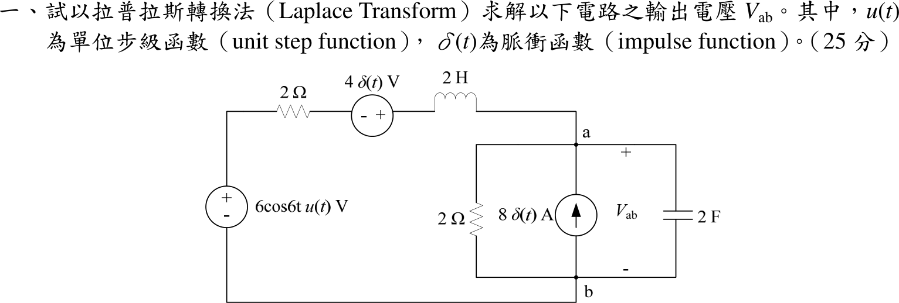
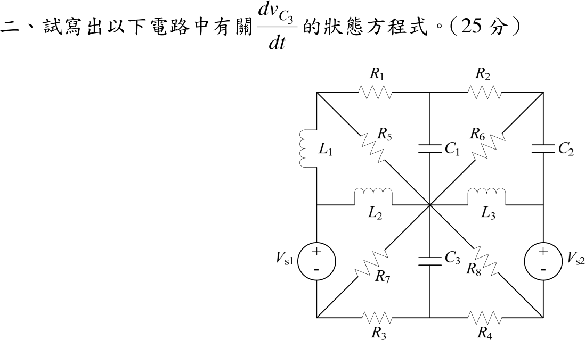
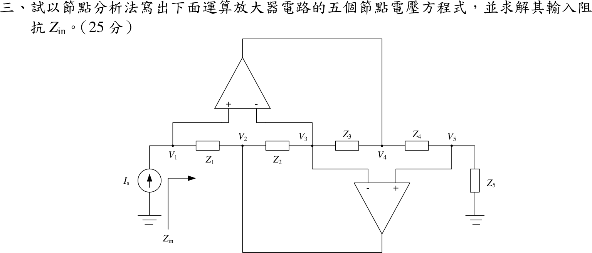
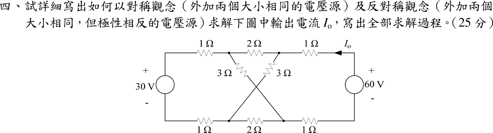

# 106 年電機工程技師｜電路學逐題詳解

> 本頁由題級 canonical 筆記組合；每題保留官方裁切圖、校驗狀態與可追溯的推導。

## 題目導覽
- [[#一、106 年電路學第 1 題|第 1 題：106 年電路學第 1 題]]
- [[#二、106 年電路學第 2 題｜\(dv_{C3}/dt\) 完整狀態方程式|第 2 題：\(dv_{C3}/dt\) 完整狀態方程式]]
- [[#三、106 年電路學第 3 題|第 3 題：106 年電路學第 3 題]]
- [[#四、106 年電路學第 4 題｜對稱與反對稱分析|第 4 題：對稱與反對稱分析]]

---

## 一、106 年電路學第 1 題

> 題級識別：EE-106-01-1
> canonical 來源：[[canonical/EE-106-01-1.md]]
> 題級校驗狀態：verified

### 已知與所求

由 \(b\) 沿左側串聯支路到 \(a\)：電壓源 \(6\cos6t\,u(t)\ \mathrm V\)（上正）、\(2\ \Omega\)、\(4\delta(t)\ \mathrm V\) 源（左負右正）、\(L=2\ \mathrm H\)；\(a\)–\(b\) 間並聯 \(2\ \Omega\)、向上注入 \(a\) 的 \(8\delta(t)\ \mathrm A\) 源與 \(C=2\ \mathrm F\)，\(V_{ab}\) 以 \(a\) 為正。以拉氏轉換求 \(V_{ab}\)（25 分）。

### 考場標準作答

**解題邏輯**：所有電源都帶 \(u(t)\) 或 \(\delta(t)\)，\(t<0\) 時電路無激勵，故取零初始狀態 \(i_L(0^-)=0\)、\(v_C(0^-)=0\)；\(s\) 域電壓、電流轉換式的單位（V·s、A·s）在式中省略，阻抗以 \(\Omega\)、導納以 S 標示。
1. 把電路轉成 \(s\) 域（脈衝源變常數、\(L\to sL\)、\(C\to 1/(sC)\)）。
2. 以 \(b\) 為參考對節點 \(a\) 列一條 KCL 解 \(V_{ab}(s)\)。
3. 做部分分式（強迫項分母 \(s^2+36\)、暫態項分母 \(4s^2+5s+2\)）。
4. 逐項反拉氏轉換得 \(v_{ab}(t)\)。

#### 步驟 1：\(s\) 域等效電路

畫法：

- 左側串聯支路（由 \(b\) 往 \(a\)）：\(6\cos6t\,u(t)\ \mathrm V\to\dfrac{6s}{s^2+36}\)（上正，往 \(a\) 升壓）、\(2\ \Omega\)、\(4\delta(t)\ \mathrm V\to4\)（左負右正，同樣往 \(a\) 升壓）、\(2\ \mathrm H\to2s\ \Omega\)。
- 右側 \(a\)–\(b\) 並聯：\(2\ \Omega\)、\(8\delta(t)\ \mathrm A\to8\)（向上流入 \(a\)）、\(2\ \mathrm F\to\dfrac{1}{2s}\ \Omega\)（導納 \(2s\ \mathrm S\)）。
- \(I_L(s)\) 取沿串聯支路流向 \(a\)。

串聯支路的等效電動勢與阻抗（兩電源皆往 \(a\) 升壓，相加）：
\[
V_s(s)=\frac{6s}{s^2+36}+4,\qquad Z_s=2+2s=2(1+s)\ \Omega
\]

#### 輸出電壓 \(V_{ab}\)（25 分）

**邏輯**：\(a\)–\(b\) 只有一個未知節點電壓，對 \(a\) 列 KCL 即得 \(V_{ab}(s)\)；有理式分母含共軛虛根 \(\pm j6\)（強迫響應）與複數極點（暫態），用部分分式拆開後查表反轉換。

**(a) 節點 \(a\) 的 KCL**

流入 \(a\)：\(I_L(s)=\dfrac{V_s-V_{ab}}{Z_s}\) 與脈衝電流 \(8\)；流出：經 \(2\ \Omega\) 的 \(\dfrac{V_{ab}}{2}\) 與經電容的 \(2sV_{ab}\)。
\[
\frac{V_s-V_{ab}}{2(1+s)}+8=\frac{V_{ab}}{2}+2sV_{ab}
\]
兩邊乘 \(2(1+s)\)：
\[
V_s-V_{ab}+16(1+s)=(1+s)V_{ab}+4s(1+s)V_{ab}
\]
\(V_{ab}\) 移到右邊合併：
\[
V_s+16+16s=V_{ab}\bigl[1+(1+s)+4s(1+s)\bigr]=V_{ab}(4s^2+5s+2)
\]
代入 \(V_s\)：
\[
V_s+16+16s=\frac{6s}{s^2+36}+16s+20
\]
\[
V_{ab}(s)=\frac{16s+20+\dfrac{6s}{s^2+36}}{4s^2+5s+2}
\]
分子通分：\((16s+20)(s^2+36)+6s=16s^3+20s^2+576s+720+6s=16s^3+20s^2+582s+720\)，
\[
V_{ab}(s)=\frac{16s^3+20s^2+582s+720}{(4s^2+5s+2)(s^2+36)}
\]

**(b) 部分分式**

令
\[
V_{ab}(s)=\frac{As+B}{s^2+36}+\frac{Cs+D}{4s^2+5s+2}
\]
在 \(s=j6\) 時 \(s^2+36=0\)，故 \(As+B\) 等於分子除以 \(4s^2+5s+2\) 在 \(s=j6\) 的值：
\[
16(j6)^3+20(j6)^2+582(j6)+720=-j3456-720+j3492+720=j36
\]
\[
4(j6)^2+5(j6)+2=-144+j30+2=-142+j30
\]
\[
j6A+B=\frac{j36}{-142+j30}=\frac{j36(-142-j30)}{142^2+30^2}=\frac{1080-j5112}{21064}
\]
實部、虛部分別比較：
\[
B=\frac{1080}{21064}=\frac{270}{5266},\qquad 6A=-\frac{5112}{21064}\ \Rightarrow\ A=-\frac{852}{21064}=-\frac{213}{5266}
\]
其餘兩係數由恆等式 \((As+B)(4s^2+5s+2)+(Cs+D)(s^2+36)=16s^3+20s^2+582s+720\) 比較：
\[
s^3:\ 4A+C=16\ \Rightarrow\ C=16+\frac{852}{5266}=\frac{85108}{5266}
\]
\[
s^0:\ 2B+36D=720\ \Rightarrow\ 36D=720-\frac{540}{5266}\ \Rightarrow\ D=20-\frac{15}{5266}=\frac{105305}{5266}
\]
（\(s^2\) 項核對：\(5A+4B+D=\dfrac{-1065+1080+105305}{5266}=\dfrac{105320}{5266}=20\)，成立。）
\[
V_{ab}(s)=\frac{-213s+270}{5266(s^2+36)}+\frac{85108s+105305}{5266(4s^2+5s+2)}
\]

**(c) 反拉氏轉換**

強迫項，用 \(\mathcal L^{-1}\{s/(s^2+36)\}=\cos6t\)、\(\mathcal L^{-1}\{1/(s^2+36)\}=\tfrac16\sin6t\)：
\[
\frac{-213s+270}{5266(s^2+36)}\ \to\ -\frac{213}{5266}\cos6t+\frac{270}{5266}\cdot\frac16\sin6t=-\frac{213}{5266}\cos6t+\frac{45}{5266}\sin6t
\]
暫態項，先配方：
\[
4s^2+5s+2=4\Bigl(s^2+\tfrac54s+\tfrac12\Bigr)=4\Bigl[\bigl(s+\tfrac58\bigr)^2+\tfrac{7}{64}\Bigr],\qquad \alpha=\tfrac58\ \mathrm{s^{-1}},\ \omega_d=\tfrac{\sqrt7}{8}=0.3307\ \mathrm{rad/s}
\]
分子改寫成 \((s+\alpha)\) 的形式：
\[
85108s+105305=85108\bigl(s+\tfrac58\bigr)+\bigl(105305-53192.5\bigr)=85108\bigl(s+\tfrac58\bigr)+52112.5
\]
\[
\frac{85108s+105305}{5266(4s^2+5s+2)}=\frac{85108}{21064}\cdot\frac{s+\frac58}{(s+\frac58)^2+\frac7{64}}+\frac{52112.5}{21064}\cdot\frac{1}{(s+\frac58)^2+\frac7{64}}
\]
用 \(\mathcal L^{-1}\Bigl\{\dfrac{s+\alpha}{(s+\alpha)^2+\omega_d^2}\Bigr\}=e^{-\alpha t}\cos\omega_dt\)、\(\mathcal L^{-1}\Bigl\{\dfrac{1}{(s+\alpha)^2+\omega_d^2}\Bigr\}=\dfrac{1}{\omega_d}e^{-\alpha t}\sin\omega_dt\)：
\[
\cos\text{ 係數}=\frac{85108}{21064}=\frac{21277}{5266}=4.040
\]
\[
\sin\text{ 係數}=\frac{52112.5}{21064}\cdot\frac{8}{\sqrt7}=\frac{104225}{5266\sqrt7}=\frac{104225\sqrt7}{36862}=7.481
\]
合併（精確係數）：
\[
v_{ab}(t)=\Bigl\{e^{-5t/8}\Bigl[\tfrac{21277}{5266}\cos\tfrac{\sqrt7}{8}t+\tfrac{104225\sqrt7}{36862}\sin\tfrac{\sqrt7}{8}t\Bigr]+\frac{45\sin6t-213\cos6t}{5266}\Bigr\}u(t)\ \mathrm V
\]
化為小數（強迫響應係數小於 0.1，保留 3 位有效數字：\(213/5266=0.0404\)、\(45/5266=0.00855\)）：
\[
\boxed{v_{ab}(t)=\Bigl\{e^{-5t/8}\Bigl[4.04\cos\tfrac{\sqrt7}{8}t+7.48\sin\tfrac{\sqrt7}{8}t\Bigr]-0.0404\cos6t+0.00855\sin6t\Bigr\}u(t)\ \mathrm V}
\]

### 驗算

- 初值：\(v_{ab}(0^+)=\tfrac{21277}{5266}-\tfrac{213}{5266}=\tfrac{21064}{5266}=4\ \mathrm V\)；物理上 \(8\delta\) 的電荷 \(8\ \mathrm C\) 全部注入 \(C=2\ \mathrm F\)，\(v_C(0^+)=8/2=4\ \mathrm V\)；初值定理 \(\lim_{s\to\infty}sV_{ab}(s)=16/4=4\ \mathrm V\)。三者一致。
- 強迫響應改用相量（\(\cos\) 基準，\(\omega=6\ \mathrm{rad/s}\)）：\(\mathbf V=\dfrac{6/(2+j12)}{1/(2+j12)+0.5+j12}=-0.0404-j0.00855\ \mathrm V\)，即 \(-0.0404\cos6t+0.00855\sin6t\)，與反轉換的穩態項相同。

### 失分點

- \(4\delta(t)\) 源左負右正，與 \(6\cos6t\,u(t)\) 同樣往 \(a\) 升壓，\(V_s\) 的 \(+4\) 不可寫成 \(-4\)。
- 分子的 \(16s+16\) 來自 \(8\delta\)（乘以 \(2(1+s)\)），\(+4\) 來自 \(4\delta\)；漏掉 \(16s\) 會使整個 \(V_{ab}(s)\) 錯誤。
- 結果要乘 \(u(t)\)，\(t<0\) 時 \(v_{ab}=0\)。

### 條件與疑義

題幹未給初始條件；因所有電源皆帶 \(u(t)\) 或 \(\delta(t)\)，取 \(i_L(0^-)=0\)、\(v_C(0^-)=0\)。若另有初值，需在 \(s\) 域加上 \(Li_L(0^-)\) 串聯電壓源與 \(Cv_C(0^-)\) 並聯電流源。

---

## 二、106 年電路學第 2 題｜\(dv_{C3}/dt\) 完整狀態方程式

> 題級識別：EE-106-01-2
> canonical 來源：[[canonical/EE-106-01-2.md]]
> 題級校驗狀態：verified

### 已知與所求

中央節點 \(O\) 是 \(R_5,R_6,R_7,R_8,L_2,L_3\) 與 \(C_1,C_3\) 的共同端。外圈：\(TL\)–\(R_1\)–\(TM\)–\(R_2\)–\(TR\)；\(TL\)–\(L_1\)–\(ML\)；\(TR\)–\(C_2\)–\(MR\)；\(ML\)–\(V_{s1}\)（上正）–\(BL\)；\(MR\)–\(V_{s2}\)（上正）–\(BR\)；\(BL\)–\(R_3\)–\(BM\)–\(R_4\)–\(BR\)。其餘：\(R_5\)：\(TL\)–\(O\)；\(C_1\)：\(TM\)–\(O\)；\(R_6\)：\(TR\)–\(O\)；\(L_2\)：\(ML\)–\(O\)；\(L_3\)：\(O\)–\(MR\)；\(R_7\)：\(BL\)–\(O\)；\(C_3\)：\(O\)–\(BM\)；\(R_8\)：\(O\)–\(BR\)。求 \(dv_{C3}/dt\) 的狀態方程式（25 分）。

### 考場標準作答

**解題邏輯**：狀態方程式的右邊只能有狀態量（各電容電壓 \(v_{C1},v_{C2},v_{C3}\)、各電感電流 \(i_{L1},i_{L2},i_{L3}\)）與電源。做法：電容視為已知電壓源、電感視為已知電流源（此瞬間值由狀態量給定），對 \(C_3\) 下端節點 \(BM\) 列 KCL 得 \(C_3\,dv_{C3}/dt\)；式中出現的非狀態節點電壓 \(V_{BL}\)（左側）與 \(V_{BR}\)（右側）分別用 \(BL\) 節點 KCL 與右側超節點 KCL 消去。題圖未標狀態量方向，以下自行定義（方向改變只影響正負號）。

#### 步驟 1：參考節點與狀態量方向

畫法：

- 以中心節點 \(O\) 為參考（\(V_O=0\)）；節點名稱：上排 \(TL,TM,TR\)、中排 \(ML,O,MR\)、下排 \(BL,BM,BR\)。
- 電容電壓：\(v_{C1}=V_{TM}\)（\(TM\) 正）、\(v_{C2}=V_{TR}-V_{MR}\)（\(TR\) 正）、\(v_{C3}=V_O-V_{BM}=-V_{BM}\)（\(O\) 正）。
- 電感電流：\(i_{L1}\) 由 \(TL\to ML\)、\(i_{L2}\) 由 \(ML\to O\)、\(i_{L3}\) 由 \(O\to MR\)。
- 電源：\(V_{ML}-V_{BL}=V_{s1}\)，\(V_{MR}-V_{BR}=V_{s2}\)。

#### 步驟 2：左側 \(BL\) 節點求 \(V_{BL}\)

節點 \(ML\) 只接 \(L_1\)、\(L_2\) 與 \(V_{s1}\)，故 \(V_{s1}\) 支路由 \(ML\) 向下流到 \(BL\) 的電流為 \(i_{L1}-i_{L2}\)。\(BL\) 的 KCL（流入 = 經 \(R_7\) 到 \(O\) + 經 \(R_3\) 到 \(BM\)），其中 \(V_{BL}-V_{BM}=V_{BL}+v_{C3}\)：
\[
i_{L1}-i_{L2}=\frac{V_{BL}}{R_7}+\frac{V_{BL}+v_{C3}}{R_3}
\]
兩邊乘 \(R_3R_7\)：
\[
R_3R_7(i_{L1}-i_{L2})=R_3V_{BL}+R_7V_{BL}+R_7v_{C3}
\]
\[
V_{BL}=\frac{R_3R_7(i_{L1}-i_{L2})-R_7v_{C3}}{R_3+R_7}
\]

#### 步驟 3：右側超節點求 \(V_{BR}\)

\(TR\)、\(MR\)、\(BR\) 由 \(C_2\)（電壓 \(v_{C2}\)）與 \(V_{s2}\) 相連，視為一個超節點：
\[
V_{TR}=v_{C2}+V_{MR}=v_{C2}+V_{s2}+V_{BR}
\]
令 \(u=v_{C2}+V_{s2}\)，則 \(V_{TR}=u+V_{BR}\)。超節點 KCL（流入：由 \(TM\) 經 \(R_2\)、由 \(O\) 經 \(L_3\)、由 \(BM\) 經 \(R_4\)；流出：經 \(R_6\)、\(R_8\) 到 \(O\)），其中 \(V_{BM}-V_{BR}=-v_{C3}-V_{BR}\)：
\[
\frac{v_{C1}-V_{TR}}{R_2}+i_{L3}+\frac{-v_{C3}-V_{BR}}{R_4}=\frac{V_{TR}}{R_6}+\frac{V_{BR}}{R_8}
\]
代入 \(V_{TR}=u+V_{BR}\)，把 \(V_{BR}\) 項移到右邊：
\[
\frac{v_{C1}}{R_2}-\frac{u}{R_2}-\frac{u}{R_6}+i_{L3}-\frac{v_{C3}}{R_4}=V_{BR}\Bigl(\frac1{R_2}+\frac1{R_4}+\frac1{R_6}+\frac1{R_8}\Bigr)
\]
兩邊乘 \(R_2R_4R_6R_8\)，令 \(D=R_2R_4R_6+R_2R_4R_8+R_2R_6R_8+R_4R_6R_8\)：
\[
R_4R_6R_8v_{C1}-R_4R_8(R_2+R_6)u+R_2R_4R_6R_8i_{L3}-R_2R_6R_8v_{C3}=D\,V_{BR}
\]
\[
V_{BR}=\frac{R_8\bigl[R_4R_6v_{C1}-R_4(R_2+R_6)(v_{C2}+V_{s2})+R_2R_4R_6i_{L3}-R_2R_6v_{C3}\bigr]}{D}
\]

#### \(dv_{C3}/dt\) 狀態方程式（25 分）

**邏輯**：\(C_3\) 的電流（由 \(O\) 經 \(C_3\) 流向 \(BM\)，與 \(v_{C3}\) 的 \(+\to-\) 同向）等於 \(C_3\,dv_{C3}/dt\)；它在 \(BM\) 只能經 \(R_3\)、\(R_4\) 流走，代入步驟 2、3 的 \(V_{BL}\)、\(V_{BR}\) 即只剩狀態量與電源。

\(BM\) 的 KCL（\(V_{BM}=-v_{C3}\)）：
\[
C_3\frac{dv_{C3}}{dt}=\frac{V_{BM}-V_{BL}}{R_3}+\frac{V_{BM}-V_{BR}}{R_4}=-\frac{v_{C3}+V_{BL}}{R_3}-\frac{v_{C3}+V_{BR}}{R_4}
\]
左項代入 \(V_{BL}\)：
\[
v_{C3}+V_{BL}=\frac{(R_3+R_7)v_{C3}-R_7v_{C3}+R_3R_7(i_{L1}-i_{L2})}{R_3+R_7}=\frac{R_3\bigl[v_{C3}+R_7(i_{L1}-i_{L2})\bigr]}{R_3+R_7}
\]
\[
-\frac{v_{C3}+V_{BL}}{R_3}=-\frac{v_{C3}}{R_3+R_7}-\frac{R_7}{R_3+R_7}(i_{L1}-i_{L2})
\]
右項代入 \(V_{BR}\)，\(v_{C3}\) 的係數為 \(D-R_2R_6R_8=R_4(R_2R_6+R_2R_8+R_6R_8)\)，令 \(E=R_2R_6+R_2R_8+R_6R_8\)：
\[
v_{C3}+V_{BR}=\frac{R_4\bigl[E\,v_{C3}+R_6R_8v_{C1}-R_8(R_2+R_6)(v_{C2}+V_{s2})+R_2R_6R_8i_{L3}\bigr]}{D}
\]
\[
-\frac{v_{C3}+V_{BR}}{R_4}=-\frac{E}{D}v_{C3}-\frac{R_6R_8}{D}v_{C1}+\frac{R_8(R_2+R_6)}{D}(v_{C2}+V_{s2})-\frac{R_2R_6R_8}{D}i_{L3}
\]
兩項相加，再除以 \(C_3\)：
\[
\boxed{\frac{dv_{C3}}{dt}=\frac{1}{C_3}\left[-\Bigl(\frac{1}{R_3+R_7}+\frac{E}{D}\Bigr)v_{C3}-\frac{R_7}{R_3+R_7}(i_{L1}-i_{L2})-\frac{R_6R_8}{D}v_{C1}+\frac{R_8(R_2+R_6)}{D}(v_{C2}+V_{s2})-\frac{R_2R_6R_8}{D}i_{L3}\right]}
\]
其中 \(D=R_2R_4R_6+R_2R_4R_8+R_2R_6R_8+R_4R_6R_8\)，\(E=R_2R_6+R_2R_8+R_6R_8\)。

\(R_1\)、\(R_5\)、\(L_1\) 的電壓與 \(V_{s1}\) 不出現：節點 \(TL\) 只接 \(R_1\)、\(R_5\)、\(L_1\)，而 \(L_1\) 的電流已由狀態量 \(i_{L1}\) 指定；\(V_{s1}\) 所在支路的電流固定為 \(i_{L1}-i_{L2}\)，其電壓只決定 \(V_{ML}\)，不影響 \(BL\) 以下的電流分配。

### 驗算

以不同方法逐項檢查各係數（令其餘狀態與電源為零；\(C_1,C_2,V_s\) 視為短路，電感視為開路）：

- 只留 \(v_{C3}\)：\(C_3\) 看到 \((R_3+R_7)\parallel\bigl(R_4+R_2\parallel R_6\parallel R_8\bigr)\)，其導納 \(\dfrac1{R_3+R_7}+\dfrac{E}{D}\)（因 \(R_4+R_2\parallel R_6\parallel R_8=D/E\)），與 \(v_{C3}\) 係數一致。
- 只留 \(i_{L3}\)：電流經 \(MR\) 流入 \(R_2,R_4,R_6,R_8\) 四條並聯路徑，\(R_4\) 分得 \(\dfrac{R_2R_6R_8}{D}\)，由 \(BM\) 向上穿過 \(C_3\)，故為負號。
- 只留 \(i_{L1}-i_{L2}\)：注入 \(BL\)，分給 \(R_3\)（到 \(BM\)）的比例 \(\dfrac{R_7}{R_3+R_7}\)，同樣由 \(BM\) 向上穿過 \(C_3\)，為負號。

另以隨機 \(R_1\sim R_8,C_3\) 與隨機狀態，把電容換成電壓源、電感換成電流源，對整個電路做節點法，所得 \(C_3\) 電流與上式相對誤差小於 \(10^{-9}\)。

### 失分點

- 狀態變數只有 \(v_C\) 與 \(i_L\)：\(V_{BL},V_{BR}\) 等代數節點電壓必須消去，答案中不可殘留。
- 右側 \(TR\)、\(MR\)、\(BR\) 要當成超節點（\(C_2\) 與 \(V_{s2}\) 都是電壓源型元件），不能對 \(TR\) 或 \(BR\) 單獨列 KCL 而漏掉 \(C_2\) 或 \(V_{s2}\) 支路的電流。
- \(v_{C3}\) 的極性是自訂的；若改為 \(V_{BM}-V_O\)，\(v_{C3}\) 自身項不變，其餘各項（\(v_{C1},v_{C2}\)、電感電流、\(V_{s2}\)）全部變號，不可只改一半。

---

## 三、106 年電路學第 3 題

> 題級識別：EE-106-01-3
> canonical 來源：[[canonical/EE-106-01-3.md]]
> 題級校驗狀態：verified

### 已知與所求

電流源 \(I_s\)（箭頭向上）注入節點 1；\(Z_1\) 接 \(V_1\)–\(V_2\)，\(Z_2\) 接 \(V_2\)–\(V_3\)，\(Z_3\) 接 \(V_3\)–\(V_4\)，\(Z_4\) 接 \(V_4\)–\(V_5\)，\(Z_5\) 接 \(V_5\) 與地。上方運放：\(+\) 端接 \(V_1\)、\(-\) 端接 \(V_3\)、輸出接 \(V_4\)；下方運放：\(-\) 端接 \(V_3\)、\(+\) 端接 \(V_5\)、輸出接 \(V_2\)。理想運放。以節點法寫出五個節點電壓方程式，並求 \(Z_{in}=V_1/I_s\)（25 分）。

### 考場標準作答

**解題邏輯**：兩顆運放都視為理想（輸入端不吸電流、有負回授所以 \(V_+=V_-\)）。節點 1、3、5 只接阻抗與運放輸入端，KCL 中沒有未知電流，可直接寫；節點 2、4 是運放輸出端，KCL 含未知的輸出電流，不構成約束，改用兩個虛短補足，共五個方程式。解法：由虛短令 \(V_1=V_3=V_5=V\) → 節點 5 求 \(V_4\) → 節點 3 求 \(V_2\) → 節點 1 求 \(I_s\) → \(Z_{in}=V_1/I_s\)。

#### 步驟 1：節點分類與參考方向

畫法：

- 地為參考點；\(I_s\) 箭頭向上，由地注入節點 1。
- 上方運放 A：\(+\) 端接 \(V_1\)、\(-\) 端接 \(V_3\)、輸出端為節點 4。下方運放 B：\(-\) 端接 \(V_3\)、\(+\) 端接 \(V_5\)、輸出端為節點 2。
- KCL 一律寫「流出節點的電流和 = 注入的電流」，阻抗電流以「本節點電壓 − 相鄰節點電壓」除以阻抗表示。

#### 五個節點電壓方程式與 \(Z_{in}\)（25 分）

**邏輯**：五個未知節點電壓需要五個獨立方程式——三個無運放輸出的節點 KCL 加兩個理想運放虛短；再由虛短把奇數節點都換成同一電壓 \(V\)，由右往左逐一消去。

**五個方程式**：
\[
\begin{aligned}
&\text{節點 1：}\ I_s=\frac{V_1-V_2}{Z_1}\\
&\text{節點 3：}\ \frac{V_3-V_2}{Z_2}+\frac{V_3-V_4}{Z_3}=0\\
&\text{節點 5：}\ \frac{V_5-V_4}{Z_4}+\frac{V_5}{Z_5}=0\\
&\text{運放 A 虛短：}\ V_1=V_3\\
&\text{運放 B 虛短：}\ V_3=V_5
\end{aligned}
\]

**求解**：令 \(V_1=V_3=V_5=V\)。

節點 5 求 \(V_4\)：
\[
\frac{V-V_4}{Z_4}=-\frac{V}{Z_5}
\]
\[
V-V_4=-\frac{VZ_4}{Z_5}
\]
\[
V_4=V+\frac{VZ_4}{Z_5}=V\left(1+\frac{Z_4}{Z_5}\right)
\]
節點 3 求 \(V_2\)：
\[
\frac{V-V_2}{Z_2}=\frac{V_4-V}{Z_3}
\]
代入 \(V_4-V=\dfrac{VZ_4}{Z_5}\)：
\[
\frac{V-V_2}{Z_2}=\frac{VZ_4}{Z_3Z_5}
\]
\[
V-V_2=\frac{VZ_2Z_4}{Z_3Z_5}
\]
\[
V_2=V\left(1-\frac{Z_2Z_4}{Z_3Z_5}\right)
\]
節點 1 求 \(I_s\)（代入 \(V-V_2\)）：
\[
I_s=\frac{V-V_2}{Z_1}=\frac{1}{Z_1}\cdot\frac{VZ_2Z_4}{Z_3Z_5}=\frac{VZ_2Z_4}{Z_1Z_3Z_5}
\]
輸入阻抗：
\[
Z_{in}=\frac{V_1}{I_s}=\frac{V}{VZ_2Z_4/(Z_1Z_3Z_5)}
\]
\[
\boxed{Z_{in}=\frac{V_1}{I_s}=\frac{Z_1Z_3Z_5}{Z_2Z_4}}
\]

### 驗算

代入數值檢查：取 \(Z_1=2,\ Z_2=4,\ Z_3=3,\ Z_4=6,\ Z_5=4\ \Omega\)，公式給 \(Z_{in}=\dfrac{2\times3\times4}{4\times6}=\dfrac{24}{24}=1\ \Omega\)。令 \(I_s=1\ \mathrm A\)，則 \(V_1=V_3=V_5=1\ \mathrm V\)，\(V_4=1\times(1+\tfrac64)=2.50\ \mathrm V\)，\(V_2=1\times(1-\tfrac{4\times6}{3\times4})=-1\ \mathrm V\)。回代五式：

- 節點 1：\((1-(-1))/2=1\ \mathrm A=I_s\)。
- 節點 3：\((1+1)/4+(1-2.50)/3=0.50-0.50=0\)。
- 節點 5：\((1-2.50)/6+1/4=-0.25+0.25=0\)。
- 兩個虛短自動成立。

### 失分點

- 運放輸出節點（2、4）的 KCL 含未知輸出電流，不能當作含 \(Z\) 的獨立約束；少寫虛短就湊不出五個方程式。
- 上方運放的 \(-\) 端接 \(V_3\)（不是 \(V_2\)）、下方運放的 \(+\) 端接 \(V_5\)；極性看錯會得到 \(V_1\neq V_3\) 的錯誤約束。
- \(Z_{in}\) 的分子是奇數編號 \(Z_1Z_3Z_5\)，分母是偶數編號 \(Z_2Z_4\)；顛倒會變成導納型式。

---

## 四、106 年電路學第 4 題｜對稱與反對稱分析

> 題級識別：EE-106-01-4
> canonical 來源：[[canonical/EE-106-01-4.md]]
> 題級校驗狀態：verified

### 已知與所求

左源 30 V、右源 60 V（皆上正）。上軌：\(1\ \Omega\)、節點 \(T_1\)、\(2\ \Omega\)、節點 \(T_2\)、\(1\ \Omega\)；下軌相同（節點 \(B_1,B_2\)）；交叉 \(3\ \Omega\) 接 \(T_1\)–\(B_2\) 與 \(T_2\)–\(B_1\)。\(I_o\) 為上軌由右源「+」端向左流出的電流。要求用對稱與反對稱激勵求 \(I_o\) 並寫出完整過程（25 分）。

### 考場標準作答

**解題邏輯**：電路對垂直中線左右鏡像對稱，只有兩源大小不同。把兩源拆成「大小相同、同極性」的對稱激勵（各 45 V）與「大小相同、極性相反」的反對稱激勵（各 15 V）：對稱激勵下鏡像節點等電位，兩個 \(2\ \Omega\) 無電流；反對稱激勵下鏡像節點電位等值反號，對稱軸電位為 0。兩種激勵各自用簡化後的電路求 \(I_o\)，最後疊加（線性電路）。\(I_o\) 的參考方向依題圖：上軌由右源「+」端向左流出。

#### 步驟 1：激勵分解

取兩源的平均與半差：
\[
\frac{30+60}{2}=45\ \mathrm V,\qquad \frac{60-30}{2}=15\ \mathrm V
\]
\[
\text{左源：}30=45-15\ \mathrm V,\qquad \text{右源：}60=45+15\ \mathrm V
\]

- 對稱激勵：左、右源皆 \(45\ \mathrm V\)（上正）。
- 反對稱激勵：右源 \(15\ \mathrm V\)（上正），左源 \(-15\ \mathrm V\)，即 \(15\ \mathrm V\) 下正上負。

由疊加定理：\(I_o=I_{o,s}+I_{o,a}\)，兩分量的參考方向都與 \(I_o\) 相同。

#### 步驟 2：對稱激勵求 \(I_{o,s}\)

左右鏡像後電路與激勵完全相同，故 \(V_{T1}=V_{T2}\)、\(V_{B1}=V_{B2}\)，上下兩個 \(2\ \Omega\) 兩端等電位、無電流，可拿掉。剩下的元件串成單一迴路：右源「+」\(\to\) 右上 \(1\ \Omega\to T_2\to\) 交叉 \(3\ \Omega\to B_1\to\) 左下 \(1\ \Omega\to\) 左源（\(-\to+\)）\(\to\) 左上 \(1\ \Omega\to T_1\to\) 交叉 \(3\ \Omega\to B_2\to\) 右下 \(1\ \Omega\to\) 右源「−」。

迴路中兩源同向串聯，KVL：
\[
\sum E=45+45=90\ \mathrm V,\qquad \sum R=1+3+1+1+3+1=10\ \Omega
\]
\[
I_{o,s}=\frac{\sum E}{\sum R}=\frac{90}{10}=9\ \mathrm A
\]

#### 步驟 3：反對稱激勵求 \(I_{o,a}\)

左右鏡像後激勵變號，故鏡像節點電位等值反號；以對稱軸（兩個 \(2\ \Omega\) 的中點）為 0 V，設 \(V_{T2}=x\)、\(V_{B2}=y\)，則 \(V_{T1}=-x\)、\(V_{B1}=-y\)。

交叉 \(3\ \Omega\)（\(T_2\to B_1\)）的電流：
\[
\frac{V_{T2}-V_{B1}}{3}=\frac{x-(-y)}{3}=\frac{x+y}{3}
\]
上軌 \(2\ \Omega\)（\(T_2\to T_1\)）的電流：\(\dfrac{x-(-x)}{2}=x\)；下軌 \(2\ \Omega\)（\(B_1\to B_2\)）的電流：\(\dfrac{-y-y}{2}=-y\)。

\(T_2\) 的 KCL（\(I_{o,a}\) 流入，經 \(2\ \Omega\)、\(3\ \Omega\) 流出）：
\[
I_{o,a}=x+\frac{x+y}{3}
\]
\(B_2\) 的 KCL（\(I_{o,a}\) 經右下 \(1\ \Omega\) 流回右源「−」；流入為下軌 \(2\ \Omega\) 的 \(-y\) 與交叉 \(3\ \Omega\)（\(T_1\to B_2\)）的 \(\frac{-x-y}{3}\)）：
\[
I_{o,a}=-y-\frac{x+y}{3}
\]
右源迴路 KVL（由 \(B_2\) 經右下 \(1\ \Omega\)、右源、右上 \(1\ \Omega\) 到 \(T_2\)）：
\[
x=y-1\cdot I_{o,a}+15-1\cdot I_{o,a}\ \Rightarrow\ x-y+2I_{o,a}=15
\]
\(T_2\) 式減 \(B_2\) 式：
\[
0=x+y+\frac{2(x+y)}{3}=\frac53(x+y)\ \Rightarrow\ y=-x
\]
所以交叉 \(3\ \Omega\) 電流 \(\frac{x+y}{3}=0\)。代回 \(T_2\) 式（\(I_{o,a}\) 全部流經上軌 \(2\ \Omega\)）：
\[
I_{o,a}=x+0=x
\]
代入 KVL：
\[
x-(-x)+2x=15\ \Rightarrow\ 4x=15\ \Rightarrow\ x=3.75\ \mathrm V
\]
\[
I_{o,a}=\frac{V_{T2}-V_{T1}}{2\ \Omega}=\frac{3.75-(-3.75)}{2}=3.75\ \mathrm A
\]
（即迴路只剩兩個 \(1\ \Omega\) 加兩個半條 \(2\ \Omega\)：\(15/(1+1+1+1)=3.75\ \mathrm A\)。）

#### 輸出電流 \(I_o\)（25 分）

**邏輯**：電路為線性，原激勵 = 對稱激勵 + 反對稱激勵，故 \(I_o\) 等於兩分量（同一參考方向）相加。

\[
I_o=I_{o,s}+I_{o,a}=9+3.75=12.75\ \mathrm A
\]
\[
\boxed{I_o=\frac{51}{4}=12.75\ \mathrm A}
\]

### 驗算

不分解，直接對原電路解節點電壓（以左源「−」端為 0 V）：\(T_1=24.75,\ T_2=32.25,\ B_1=5.25,\ B_2=-2.25\ \mathrm V\)，右源「−」端為 \(-15\ \mathrm V\)、「+」端為 \(45\ \mathrm V\)。故 \(I_o=(45-32.25)/1=12.75\ \mathrm A\)；左源電流 \(30-24.75=5.25\ \mathrm A\)（與 \(9-3.75\) 一致）。功率守恆：電源 \(60\times12.75+30\times5.25=922.50\ \mathrm W\)；4 個 \(1\ \Omega\) 吸收 \(2\times(5.25^2+12.75^2)=380.25\ \mathrm W\)、兩個 \(2\ \Omega\) 共 \(56.25\ \mathrm W\)、兩個 \(3\ \Omega\) 共 \(2\times9^2\times3=486\ \mathrm W\)，合計 \(922.50\ \mathrm W\)。

### 失分點

- 對稱激勵時兩個交叉 \(3\ \Omega\) 屬於同一個串聯迴路（\(T_2\to B_1\)、\(T_1\to B_2\)），總電阻 \(10\ \Omega\)、總電動勢 \(90\ \mathrm V\)；不要當成兩個獨立並聯支路。
- 反對稱時對稱軸電位為 0，但交叉 \(3\ \Omega\) 跨越對稱軸，不能直接視為斷路或短路；須由 KCL 證明 \(V_{T2}+V_{B2}=0\) 後才知無電流。
- 反對稱左源是 \(-15\ \mathrm V\)（極性反向），不是 \(+15\ \mathrm V\)；否則 \(I_o\) 的疊加方向會錯。

---
