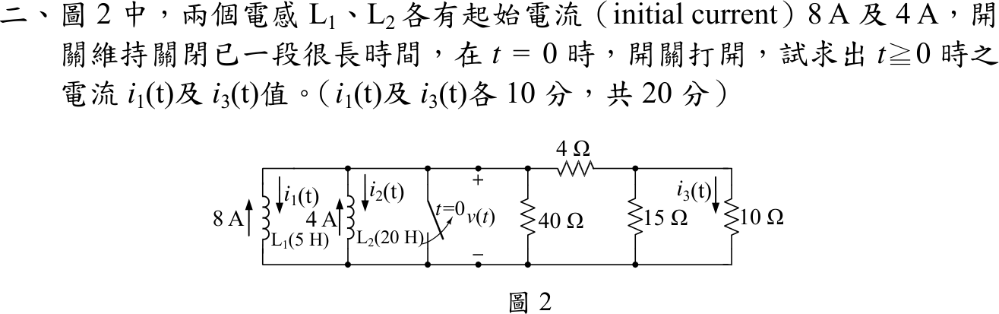
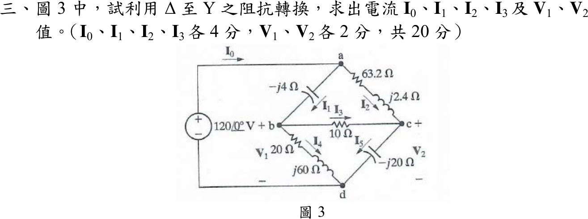
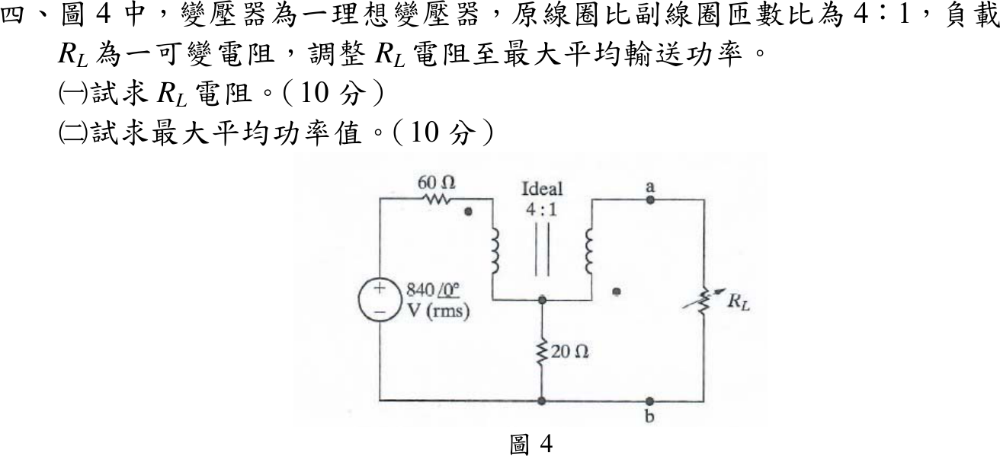
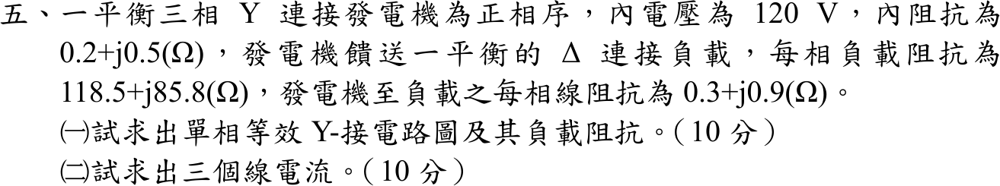

# 107 年電機工程技師｜電路學逐題詳解

> 本頁由題級 canonical 筆記組合；每題保留官方裁切圖、校驗狀態與可追溯的推導。

## 題目導覽
- [[#一、107 年電路學第 1 題｜4 Ω 電阻功率|第 1 題：4 Ω 電阻功率]]
- [[#二、107 年電路學第 2 題｜雙電感並聯暫態|第 2 題：雙電感並聯暫態]]
- [[#三、107 年電路學第 3 題|第 3 題：107 年電路學第 3 題]]
- [[#四、107 年電路學第 4 題｜理想變壓器最大平均功率|第 4 題：理想變壓器最大平均功率]]
- [[#五、107 年電路學第 5 題｜平衡三相 Δ 負載|第 5 題：平衡三相 Δ 負載]]

---

## 一、107 年電路學第 1 題｜4 Ω 電阻功率

> 題級識別：EE-107-01-1
> canonical 來源：[[canonical/EE-107-01-1.md]]
> 題級校驗狀態：verified

### 已知與所求

左側 50 V 獨立電壓源（上正）接左節點；左節點經 \(1\ \Omega\)（上方導線）通右節點，經 \(5\ \Omega\) 通中節點；中節點經 \(4\ \Omega\) 通右節點，經 \(20\ \Omega\) 接地，\(i_\phi\) 向下流過 \(20\ \Omega\)；右節點與地之間為 CCVS \(15i_\phi\)（上正）。求 \(4\ \Omega\) 消耗功率（20 分）。

### 考場標準作答

**解題邏輯**：電路含電流控制電壓源（CCVS），用節點分析。以下方導線為參考地：左節點被 50 V 源固定為 50 V，右節點被 CCVS 固定為 \(15i_\phi\)，而控制量 \(i_\phi\) 可用中節點電壓表示，所以只剩中節點 \(V_1\) 一個未知數 → 中節點 KCL 解 \(V_1\) → 由 CCVS 求 \(V_2\) → \(4\ \Omega\) 電流 \(I_4\) → \(P=I_4^2R\)。頂端 \(1\ \Omega\) 跨接在兩個定壓節點之間，其電流由兩個電源供給、不流經中節點，所以不進入中節點 KCL，也不影響所求。所有電源視為理想源。

#### 步驟 1：節點命名與參考方向

畫法：

- 下方導線為參考地；左節點 \(=50\ \mathrm V\)（50 V 源上正）；中節點電壓 \(V_1\)；右節點電壓 \(V_2\)（CCVS 上正）。
- 中節點的三條支路電流參考方向：\(I_5\) 由左節點經 \(5\ \Omega\) 流入中節點；\(i_\phi\) 依題圖向下流過 \(20\ \Omega\)；\(I_4\) 由中節點經 \(4\ \Omega\) 流向右節點。

#### 步驟 2：控制量與 CCVS 約束

\(i_\phi\) 向下流過 \(20\ \Omega\)，端電壓為 \(V_1-0\)：
\[
i_\phi=\frac{V_1}{20}
\]
CCVS 上正、下端接地，故右節點電壓：
\[
V_2=15i_\phi=15\times\frac{V_1}{20}=0.75V_1
\]

#### \(4\ \Omega\) 電阻的功率（20 分）

**邏輯**：中節點只有 \(V_1\) 一個未知數；列「流入 = 流出」KCL，代入步驟 2 的 \(V_2=0.75V_1\) 得一元一次方程，再由 \(I_4=(V_1-V_2)/4\) 求功率。

中節點 KCL（流入 \(I_5\) = 流出 \(i_\phi+I_4\)）：
\[
\frac{50-V_1}{5}=\frac{V_1}{20}+\frac{V_1-V_2}{4}
\]
代入 \(V_2=0.75V_1\)：
\[
\frac{50-V_1}{5}=\frac{V_1}{20}+\frac{V_1-0.75V_1}{4}
\]
\[
10-0.2V_1=0.05V_1+0.0625V_1
\]
\[
10=0.2V_1+0.05V_1+0.0625V_1=0.3125V_1
\]
\[
V_1=\frac{10}{0.3125}=32\ \mathrm V
\]
\[
V_2=0.75\times32=24\ \mathrm V
\]
\(4\ \Omega\) 的電流：
\[
I_4=\frac{V_1-V_2}{4}=\frac{32-24}{4}=\frac{8}{4}=2\ \mathrm A
\]
功率：
\[
\boxed{P_{4\Omega}=I_4^2(4)=2^2(4)=16\ \mathrm W}
\]

### 驗算

全電路功率守恆。頂端 \(1\ \Omega\) 電流（左 → 右）\(I_{1\Omega}=\dfrac{50-24}{1}=26\ \mathrm A\)，\(I_5=\dfrac{50-32}{5}=3.60\ \mathrm A\)，\(i_\phi=\dfrac{32}{20}=1.60\ \mathrm A\)：

- 50 V 源供給 \(50\times(26+3.60)=50\times29.60=1480\ \mathrm W\)；CCVS 由上端（正端）流入 \(26+2=28\ \mathrm A\)，吸收 \(24\times28=672\ \mathrm W\)。
- 電阻吸收：\(26^2(1)+3.60^2(5)+2^2(4)+1.60^2(20)=676+64.80+16+51.20=808\ \mathrm W\)；\(808+672=1480\ \mathrm W\)，與供給相等。

### 失分點

- CCVS 的電壓為 \(V_2=15i_\phi\)；把極性看反（\(V_2=-15i_\phi\)）會得 \(V_1=160/11\ \mathrm V\)、\(P_{4\Omega}=161.98\ \mathrm W\)。
- \(i_\phi\) 是 \(20\ \Omega\) 的電流 \(V_1/20\)，不是 \(4\ \Omega\) 的電流。
- 把頂端 \(1\ \Omega\) 的電流也算進中節點 KCL；它只連在兩個定壓節點之間，與中節點無關。

---

## 二、107 年電路學第 2 題｜雙電感並聯暫態

> 題級識別：EE-107-01-2
> canonical 來源：[[canonical/EE-107-01-2.md]]
> 題級校驗狀態：verified

### 已知與所求

\(L_1=5\ \mathrm H\)、\(L_2=20\ \mathrm H\) 並聯，初始電流 \(8\ \mathrm A\)（\(L_1\)）與 \(4\ \mathrm A\)（\(L_2\)），兩個箭頭都**向上**；\(i_1,i_2\) 定義為向下。開關在 \(t=0\) 打開，其右為 \(40\ \Omega\)，以及 \(4\ \Omega\) 串聯 \(15\ \Omega\parallel10\ \Omega\)；\(i_3\) 向下流過 \(10\ \Omega\)。求 \(t\ge0\) 的 \(i_1(t)\)、\(i_3(t)\)（各 10 分）。

### 考場標準作答

**解題邏輯**：開關閉合很久時兩電感被開關短路，題給的 8 A、4 A 即 \(t=0\) 的電感電流（電感電流不能突變）。\(t>0\) 開關打開，兩並聯電感接到純電阻網路，形成一階 RL 電路：先把兩電感併成 \(L_{eq}\)、電阻網路化成 \(R_{eq}\)，求總電感電流與端電壓 \(v(t)\) → 個別電感電流用 \(i_1=i_1(0)+\frac1{L_1}\int v\,dt\)（個別電流不按電感反比分配，因初值比例不同）→ \(i_3\) 由 \(v\) 經分壓、分流求得。電流參考方向：\(i_1,i_2\) 依題圖向下，\(v(t)\) 上正。

#### 步驟 1：初始值與 \(t\ge0\) 電路

畫法：

- \(i_1\)、\(i_2\) 參考方向向下（題圖），題給初始電流箭頭向上，故取負號。
- \(v(t)\) 上正下負，跨在兩電感與電阻網路兩端。
- 電阻網路：\(40\ \Omega\) 跨接上下軌；\(4\ \Omega\) 串接 \(15\ \Omega\parallel10\ \Omega\)，\(i_{4\Omega}\) 向右流過 \(4\ \Omega\)，\(i_3\) 向下流過 \(10\ \Omega\)。

\[
i_1(0)=-8\ \mathrm A,\qquad i_2(0)=-4\ \mathrm A
\]
實際初始電流方向向上，與參考方向相反，故為負值。

#### 步驟 2：等效電阻、等效電感與時間常數

\[
15\parallel10=\frac{15\times10}{15+10}=\frac{150}{25}=6\ \Omega
\]
\[
4+6=10\ \Omega
\]
\[
R_{eq}=40\parallel10=\frac{40\times10}{40+10}=\frac{400}{50}=8\ \Omega
\]
\[
L_{eq}=5\parallel20=\frac{5\times20}{5+20}=\frac{100}{25}=4\ \mathrm H
\]
\[
\tau=\frac{L_{eq}}{R_{eq}}=\frac{4}{8}=0.5\ \mathrm s,\qquad \frac1\tau=2\ \mathrm{s^{-1}}
\]

#### 步驟 3：總電感電流與端電壓 \(v(t)\)

總電感電流（向下）\(i_\Sigma=i_1+i_2\)：
\[
i_\Sigma(0)=-8+(-4)=-12\ \mathrm A
\]
無獨立源，\(i_\Sigma\) 自然衰減到 0：
\[
i_\Sigma(t)=i_\Sigma(0)e^{-t/\tau}=-12e^{-2t}\ \mathrm A
\]
流入電阻網路（自上軌向下）的電流為 \(-i_\Sigma=12e^{-2t}\ \mathrm A\)，故端電壓
\[
v(t)=R_{eq}\times(-i_\Sigma)=8\times12e^{-2t}=96e^{-2t}\ \mathrm V
\]

#### （一）\(i_1(t)\)（10 分）

**邏輯**：\(L_1\) 兩端電壓即 \(v(t)\)，且 \(i_1\) 由 \(v\) 的「+」端流入（被動符號），故 \(v=L_1\,di_1/dt\)，積分並加上初值即得 \(i_1\)。

\[
i_1(t)=i_1(0)+\frac{1}{L_1}\int_0^t v(\lambda)\,d\lambda=-8+\frac15\int_0^t96e^{-2\lambda}\,d\lambda
\]
\[
\int_0^t96e^{-2\lambda}\,d\lambda=\frac{96}{2}\bigl(1-e^{-2t}\bigr)=48\bigl(1-e^{-2t}\bigr)\ \mathrm{V\cdot s}
\]
\[
\frac15\times48\bigl(1-e^{-2t}\bigr)=9.6\bigl(1-e^{-2t}\bigr)\ \mathrm A
\]
\[
i_1(t)=-8+9.6-9.6e^{-2t}=1.6-9.6e^{-2t}\ \mathrm A
\]
\[
\boxed{i_1(t)=1.60-9.60e^{-2t}\ \mathrm A\quad(t\ge0)}
\]
\(t\) 很小時 \(i_1<0\)，實際電流向上（與參考方向相反）；\(t>\tfrac12\ln6=0.896\ \mathrm s\) 後轉為向下。同法 \(i_2(t)=-4+\tfrac1{20}\times48(1-e^{-2t})=-1.6-2.4e^{-2t}\ \mathrm A\)，終值 \(i_1(\infty)=-i_2(\infty)=1.6\ \mathrm A\)，為兩電感間的環流。

#### （二）\(i_3(t)\)（10 分）

**邏輯**：\(v(t)\) 直接跨在「\(4\ \Omega\) 串 \(15\parallel10\)」支路上，先求該支路電流 \(i_{4\Omega}\)，再依 \(15\ \Omega\)、\(10\ \Omega\) 分流取出 \(10\ \Omega\) 的電流。

\[
i_{4\Omega}=\frac{v}{4+6}=\frac{96e^{-2t}}{10}=9.6e^{-2t}\ \mathrm A
\]
並聯部分的電壓：
\[
v_{6\Omega}=6\times i_{4\Omega}=6\times9.6e^{-2t}=57.6e^{-2t}\ \mathrm V
\]
\[
i_3=\frac{v_{6\Omega}}{10}=\frac{57.6e^{-2t}}{10}=5.76e^{-2t}\ \mathrm A
\]
\[
\boxed{i_3(t)=5.76e^{-2t}\ \mathrm A\quad(t\ge0)}
\]

### 驗算

能量守恆：初始儲能 \(\tfrac12\times5\times8^2+\tfrac12\times20\times4^2=160+160=320\ \mathrm J\)；終值儲能 \(\tfrac12\times5\times1.6^2+\tfrac12\times20\times1.6^2=6.4+25.6=32\ \mathrm J\)；電阻消耗
\[
\int_0^\infty\frac{v^2}{R_{eq}}dt=\int_0^\infty\frac{(96e^{-2t})^2}{8}dt=\int_0^\infty1152e^{-4t}dt=\frac{1152}{4}=288\ \mathrm J
\]
\(320-32=288\ \mathrm J\)，成立。另以分流驗 \(i_3\)：\(i_3=i_{4\Omega}\times\dfrac{15}{15+10}=9.6e^{-2t}\times0.6=5.76e^{-2t}\ \mathrm A\)。

### 失分點

- 兩個初始電流箭頭都向上，應同號相加（\(i_\Sigma(0)=-12\ \mathrm A\)）；只把 4 A 當成向下（\(i_2(0)=+4\)）會得 \(i_3=1.92e^{-2t}\)；若再把 \(i_3\) 誤當 15 Ω 支路電流，則得 \(i_1=-4.80-3.20e^{-2t}\)、\(i_3=1.28e^{-2t}\)。
- \(i_1\) 終值不為 0：電流和衰減到 0，但兩電感個別電流停在環流 \(1.60\ \mathrm A\)。
- \(i_3\) 要經兩次分壓：先求 \(v\)，再經 \(4\ \Omega\) 串聯分壓到 \(15\parallel10\)，最後除以 \(10\ \Omega\)。

---

## 三、107 年電路學第 3 題

> 題級識別：EE-107-01-3
> canonical 來源：[[canonical/EE-107-01-3.md]]
> 題級校驗狀態：verified

### 已知與所求

電壓源 \(120\angle0^\circ\ \mathrm V\)（上端「+」接 \(a\)，下端「−」接 \(d\)）；\(\mathbf I_0\) 為進入 \(a\) 的電流。支路：\(a\)–\(b\) 為 \(-j4\ \Omega\)（\(\mathbf I_1\)，\(a\to b\)），\(a\)–\(c\) 為 \(63.2+j2.4\ \Omega\)（\(\mathbf I_2\)，\(a\to c\)），\(b\)–\(c\) 為 \(10\ \Omega\)（\(\mathbf I_3\)，\(b\to c\)），\(b\)–\(d\) 為 \(20+j60\ \Omega\)（\(\mathbf I_4\)，\(b\to d\)），\(c\)–\(d\) 為 \(-j20\ \Omega\)（\(\mathbf I_5\)，\(c\to d\)）。\(\mathbf V_1=\mathbf V_{bd}\)、\(\mathbf V_2=\mathbf V_{cd}\)。利用 Δ 至 Y 轉換求 \(\mathbf I_0\sim\mathbf I_3\)、\(\mathbf V_1\)、\(\mathbf V_2\)（\(\mathbf I_0\sim\mathbf I_3\) 各 4 分，\(\mathbf V_1,\mathbf V_2\) 各 2 分，共 20 分）。

### 考場標準作答

**解題邏輯**：橋式電路不能直接串並聯；題目指定把上方 Δ（\(a,b,c\) 三邊 \(-j4\)、\(63.2+j2.4\)、\(10\)）換成以 \(n\) 為中心的 Y，電路就變成「\(Z_{an}\) 串聯兩條並聯路徑 \(n\to b\to d\)、\(n\to c\to d\)」；以 \(d\) 為參考點，\(\mathbf V_a=120\angle0^\circ\ \mathrm V\)，電源為理想電壓源。
1. Δ→Y 求 \(Z_{an},Z_{bn},Z_{cn}\)，再串並聯得 \(Z_{in}\)。
2. 由 \(\mathbf I_0=120/Z_{in}\) 求 \(\mathbf V_n\)。
3. 兩路徑分流得 \(\mathbf I_4,\mathbf I_5\)，再求 \(\mathbf V_1,\mathbf V_2\)。
4. 回原電路以節點電壓差求原 Δ 支路電流 \(\mathbf I_1,\mathbf I_2,\mathbf I_3\)（Y 支路電流不是原 Δ 支路電流）。
5. 本題中間值保留 6 位有效數字（取 4 位會使 \(\mathbf V_2\) 末位差 0.01）。

#### 步驟 1：Δ→Y 轉換

Y 臂阻抗 = 相鄰兩邊乘積 ÷ 三邊和：
\[
Z_{an}=\frac{Z_{ab}Z_{ac}}{Z_\Sigma},\quad Z_{bn}=\frac{Z_{ab}Z_{bc}}{Z_\Sigma},\quad Z_{cn}=\frac{Z_{ac}Z_{bc}}{Z_\Sigma}
\]
三邊和：
\[
Z_\Sigma=-j4+(63.2+j2.4)+10=73.2-j1.6\ \Omega
\]
除以 \(Z_\Sigma\) 時分子分母同乘 \(Z_\Sigma^*=73.2+j1.6\)，分母：
\[
|Z_\Sigma|^2=73.2^2+1.6^2=5358.24+2.56=5360.8
\]
\(Z_{an}\)：
\[
Z_{ab}Z_{ac}=(-j4)(63.2+j2.4)=-j252.8+9.6=9.6-j252.8
\]
\[
(9.6-j252.8)(73.2+j1.6)=(702.72+404.48)+j(15.36-18504.96)=1107.2-j18489.6
\]
\[
Z_{an}=\frac{1107.2-j18489.6}{5360.8}=0.206536-j3.44904\ \Omega
\]
\(Z_{bn}\)：
\[
Z_{ab}Z_{bc}=(-j4)(10)=-j40,\qquad (-j40)(73.2+j1.6)=64-j2928
\]
\[
Z_{bn}=\frac{64-j2928}{5360.8}=0.0119385-j0.546187\ \Omega
\]
\(Z_{cn}\)：
\[
Z_{ac}Z_{bc}=(63.2+j2.4)(10)=632+j24
\]
\[
(632+j24)(73.2+j1.6)=(46262.4-38.4)+j(1011.2+1756.8)=46224+j2768
\]
\[
Z_{cn}=\frac{46224+j2768}{5360.8}=8.62259+j0.516341\ \Omega
\]

#### 步驟 2：串並聯求總阻抗 \(Z_{in}\)

兩條 \(n\to d\) 路徑：
\[
Z_{nbd}=Z_{bn}+(20+j60)=(0.0119385-j0.546187)+(20+j60)=20.0119+j59.4538\ \Omega
\]
\[
Z_{ncd}=Z_{cn}+(-j20)=(8.62259+j0.516341)+(-j20)=8.62259-j19.4837\ \Omega
\]
並聯 \(Z_p=\dfrac{Z_{nbd}Z_{ncd}}{Z_{nbd}+Z_{ncd}}\)。分母：
\[
Z_{nbd}+Z_{ncd}=28.6345+j39.9701\ \Omega
\]
分子：
\[
Z_{nbd}Z_{ncd}=(172.554+1158.38)+j(512.646-389.906)=1330.93+j122.740
\]
相除（同乘 \(28.6345-j39.9701\)）：
\[
28.6345^2+39.9701^2=819.935+1597.61=2417.54
\]
\[
(1330.93+j122.740)(28.6345-j39.9701)=43016.4-j49682.8
\]
\[
Z_p=\frac{43016.4-j49682.8}{2417.54}=17.7935-j20.5510\ \Omega
\]
總阻抗：
\[
Z_{in}=Z_{an}+Z_p=(0.206536+17.7935)-j(3.44904+20.5510)=18.0000-j24.0000\ \Omega
\]
\[
|Z_{in}|=\sqrt{18.00^2+24.00^2}=30.00\ \Omega,\qquad \angle Z_{in}=-\tan^{-1}\frac{24.00}{18.00}=-53.13^\circ
\]

#### 電流 \(\mathbf I_0\)（4 分）

**邏輯**：\(\mathbf I_0\) 是電源送入整個網路的電流，等於電源電壓除以由 \(a\)–\(d\) 看入的總阻抗。

\[
\mathbf I_0=\frac{\mathbf V_a}{Z_{in}}=\frac{120}{18.00-j24.00}=\frac{120(18.00+j24.00)}{18.00^2+24.00^2}=\frac{2160+j2880}{900}=2.400+j3.200\ \mathrm A
\]
\[
|\mathbf I_0|=\sqrt{2.400^2+3.200^2}=4.000\ \mathrm A,\qquad \angle\mathbf I_0=\tan^{-1}\frac{3.200}{2.400}=53.13^\circ
\]
\[
\boxed{\mathbf I_0=2.40+j3.20=4.00\angle53.13^\circ\ \mathrm A}
\]

#### 步驟 3：\(\mathbf V_n\) 與兩路徑電流 \(\mathbf I_4\)、\(\mathbf I_5\)

\(\mathbf I_0\) 全部流過 \(Z_{an}\)，\(n\) 點電壓（對 \(d\)）：
\[
\mathbf I_0Z_{an}=(2.400+j3.200)(0.206536-j3.44904)=(0.495686+11.0369)+j(0.660915-8.27770)=11.5326-j7.61678\ \mathrm V
\]
\[
\mathbf V_n=\mathbf V_a-\mathbf I_0Z_{an}=120-(11.5326-j7.61678)=108.467+j7.61678\ \mathrm V
\]
\(n\to b\to d\) 路徑電流就是 \(\mathbf I_4\)（\(b\to d\)），\(n\to c\to d\) 路徑電流就是 \(\mathbf I_5\)（\(c\to d\)）：
\[
\mathbf I_4=\frac{\mathbf V_n}{Z_{nbd}}=\frac{(108.467+j7.61678)(20.0119-j59.4538)}{20.0119^2+59.4538^2}=\frac{2623.48-j6296.35}{3935.23}=0.666665-j1.60000\ \mathrm A
\]
\[
\mathbf I_5=\frac{\mathbf V_n}{Z_{ncd}}=\frac{(108.467+j7.61678)(8.62259+j19.4837)}{8.62259^2+19.4837^2}=\frac{786.863+j2179.01}{453.964}=1.73332+j4.79996\ \mathrm A
\]

#### 電壓 \(\mathbf V_1\)（2 分）

**邏輯**：\(\mathbf V_1=\mathbf V_{bd}\) 就是 \(b\)–\(d\) 支路 \(20+j60\ \Omega\) 上的電壓，等於 \(\mathbf I_4\) 乘該支路阻抗（不是 \(Z_{bn}\) 上的壓降）。

\[
\mathbf V_1=\mathbf I_4(20+j60)=(0.666665-j1.60000)(20+j60)
\]
\[
=(13.3333+96.0000)+j(39.9999-32.0000)=109.333+j7.9999\ \mathrm V
\]
\[
|\mathbf V_1|=\sqrt{109.333^2+7.9999^2}=109.63\ \mathrm V,\qquad \angle\mathbf V_1=\tan^{-1}\frac{7.9999}{109.333}=4.18^\circ
\]
\[
\boxed{\mathbf V_1=109.33+j8.00=109.63\angle4.18^\circ\ \mathrm V}
\]

#### 電壓 \(\mathbf V_2\)（2 分）

**邏輯**：\(\mathbf V_2=\mathbf V_{cd}\) 是 \(c\)–\(d\) 支路 \(-j20\ \Omega\) 上的電壓，等於 \(\mathbf I_5\) 乘該支路阻抗。

\[
\mathbf V_2=\mathbf I_5(-j20)=(1.73332+j4.79996)(-j20)=95.9992-j34.6664\ \mathrm V
\]
\[
|\mathbf V_2|=\sqrt{95.9992^2+34.6664^2}=102.07\ \mathrm V,\qquad \angle\mathbf V_2=-\tan^{-1}\frac{34.6664}{95.9992}=-19.86^\circ
\]
\[
\boxed{\mathbf V_2=96.00-j34.67=102.07\angle-19.86^\circ\ \mathrm V}
\]

#### 電流 \(\mathbf I_1\)（4 分）

**邏輯**：\(\mathbf I_1\) 是原 Δ 的 \(a\to b\) 支路電流，Y 等效只保證端點 \(a,b,c\) 的電壓與流入端點的電流相同、內部支路電流不同，所以回原電路用 \(\mathbf V_a=120\)、\(\mathbf V_b=\mathbf V_1\) 的電壓差除以 \(-j4\)。

\[
\mathbf I_1=\frac{\mathbf V_a-\mathbf V_1}{-j4}=\frac{120-(109.333+j7.9999)}{-j4}=\frac{10.667-j7.9999}{-j4}
\]
除以 \(-j4\) 等於乘 \(\dfrac{j}{4}\)：
\[
\mathbf I_1=\frac{j10.667+7.9999}{4}=1.99998+j2.66675\ \mathrm A
\]
\[
|\mathbf I_1|=\sqrt{1.99998^2+2.66675^2}=3.33\ \mathrm A,\qquad \angle\mathbf I_1=\tan^{-1}\frac{2.66675}{1.99998}=53.13^\circ
\]
\[
\boxed{\mathbf I_1=2.00+j2.67=3.33\angle53.13^\circ\ \mathrm A}
\]

#### 電流 \(\mathbf I_2\)（4 分）

**邏輯**：同理，\(\mathbf I_2\) 為原 \(a\to c\) 支路電流，用 \(\mathbf V_a-\mathbf V_2\) 除以 \(63.2+j2.4\ \Omega\)。

\[
\mathbf I_2=\frac{\mathbf V_a-\mathbf V_2}{63.2+j2.4}=\frac{120-(95.9992-j34.6664)}{63.2+j2.4}=\frac{24.0008+j34.6664}{63.2+j2.4}
\]
分子分母同乘 \(63.2-j2.4\)，分母 \(63.2^2+2.4^2=3994.24+5.76=4000\)：
\[
(24.0008+j34.6664)(63.2-j2.4)=(1516.85+83.1994)+j(2190.92-57.6019)=1600.05+j2133.32
\]
\[
\mathbf I_2=\frac{1600.05+j2133.32}{4000}=0.400013+j0.533330\ \mathrm A
\]
\[
|\mathbf I_2|=\sqrt{0.400013^2+0.533330^2}=0.67\ \mathrm A,\qquad \angle\mathbf I_2=\tan^{-1}\frac{0.533330}{0.400013}=53.13^\circ
\]
\[
\boxed{\mathbf I_2=0.40+j0.53=0.67\angle53.13^\circ\ \mathrm A}
\]

#### 電流 \(\mathbf I_3\)（4 分）

**邏輯**：\(\mathbf I_3\) 為原 \(b\to c\) 支路（\(10\ \Omega\)）電流，用 \(\mathbf V_1-\mathbf V_2\) 除以 \(10\ \Omega\)。

\[
\mathbf I_3=\frac{\mathbf V_1-\mathbf V_2}{10}=\frac{(109.333-95.9992)+j(7.9999+34.6664)}{10}=\frac{13.3338+j42.6663}{10}=1.33338+j4.26663\ \mathrm A
\]
\[
|\mathbf I_3|=\sqrt{1.33338^2+4.26663^2}=4.47\ \mathrm A,\qquad \angle\mathbf I_3=\tan^{-1}\frac{4.26663}{1.33338}=72.65^\circ
\]
\[
\boxed{\mathbf I_3=1.33+j4.27=4.47\angle72.65^\circ\ \mathrm A}
\]

### 驗算

回原電路 KCL：節點 \(a\)：\(\mathbf I_1+\mathbf I_2=(2.00+0.40)+j(2.67+0.53)=2.40+j3.20=\mathbf I_0\)；節點 \(b\)：\(\mathbf I_1-\mathbf I_3-\mathbf I_4=(2.00-1.33-0.67)+j(2.67-4.27+1.60)=0\)；節點 \(c\)：\(\mathbf I_2+\mathbf I_3-\mathbf I_5=(0.40+1.33-1.73)+j(0.53+4.27-4.80)=0\)。三節點皆平衡，Δ→Y 結果與原電路一致（精確值 \(\mathbf I_1=2+j\tfrac83\)、\(\mathbf I_2=\tfrac25+j\tfrac{8}{15}\)、\(\mathbf I_3=\tfrac43+j\tfrac{64}{15}\ \mathrm A\)）。

### 失分點

- \(Z_{an}\) 取與 \(a\) 相連兩邊（\(-j4\)、\(63.2+j2.4\)）的乘積除以 \(Z_\Sigma\)；分子取錯，後面全部失準。
- \(\mathbf V_1,\mathbf V_2\) 是 \(b\)–\(d\)、\(c\)–\(d\) 原支路上的電壓，要用 \(\mathbf I_4(20+j60)\)、\(\mathbf I_5(-j20)\)，不是 \(Z_{bn}\)、\(Z_{cn}\) 上的壓降。
- \(\mathbf I_1,\mathbf I_2,\mathbf I_3\) 是原 Δ 的支路電流，必須回原電路用節點電壓差求，不能直接拿 Y 臂電流。

---

## 四、107 年電路學第 4 題｜理想變壓器最大平均功率

> 題級識別：EE-107-01-4
> canonical 來源：[[canonical/EE-107-01-4.md]]
> 題級校驗狀態：verified

### 已知與所求

理想變壓器匝比 4:1（一次：二次），\(840\angle0^\circ\ \mathrm V_{rms}\) 電源（上正）串 \(60\ \Omega\) 接一次側上端（點端）；一次側下端、二次側下端（點端）與 \(20\ \Omega\) 上端共接於節點 \(N\)，\(20\ \Omega\) 下端接地 \(b\)；二次側上端為 \(a\)，可變電阻 \(R_L\) 接於 \(a\)–\(b\)。求（一）\(R_L\)（10 分）；（二）最大平均功率（10 分）。

### 考場標準作答

**解題邏輯**：\(R_L\) 以外是含理想變壓器的純電阻網路，從 \(a\)–\(b\) 看入可化為戴維寧等效（\(V_{oc}\) 串 \(R_{th}\)），\(R_L\) 為純電阻時 \(R_L=R_{th}\) 得最大功率；前提為理想變壓器（無損、無激磁電流），\(840\ \mathrm V\) 為有效值，全為電阻、各量同相，以實數計算。
1. 依同名端寫出變壓器的電壓比與安匝平衡。
2. \(R_L\) 開路求 \(V_{oc}\)。
3. 電源短路、\(a\) 端注入測試電流求 \(R_{th}\)。
4. （一）\(R_L=R_{th}\)。
5. （二）\(P_{max}=|V_{oc}|^2/(4R_{th})\)。

#### 步驟 1：參考方向與變壓器關係

畫法：

- 以 \(b\) 為參考（\(0\ \mathrm V\)）；節點 1 為 \(60\ \Omega\) 與一次點端的接點（電壓 \(V_1\)），\(N\) 為一次下端、二次點端與 \(20\ \Omega\) 上端的共同節點（電壓 \(V_N\)）。
- 一次電壓 \(V_p=V_1-V_N\)（點端為正）；二次點端在下，二次電壓取 \(V_s=V_N-V_a\)（\(N\) 端為正）。
- \(I_p\)：經 \(60\ \Omega\) 流入一次點端；\(I_c\)：二次線圈內由 \(a\) 流向 \(N\)，即由二次點端流出；\(20\ \Omega\) 由 \(N\) 向下流 \(I_p+I_c\)。

電壓比（兩電壓都以點端為正）：
\[
\frac{V_p}{V_s}=\frac{N_1}{N_2}=4\ \Rightarrow\ V_s=\frac{V_p}{4}
\]
安匝平衡（電流流入一次點端、由二次點端流出）：
\[
N_1I_p=N_2I_c\ \Rightarrow\ 4I_p=1\times I_c\ \Rightarrow\ I_p=\frac{I_c}{4}
\]
其餘元件關係：
\[
V_1=840\ \mathrm V-(60\ \Omega)\,I_p,\qquad V_N=(20\ \Omega)\,(I_p+I_c),\qquad V_a=V_N-V_s
\]

#### 步驟 2：開路電壓 \(V_{oc}\)

\(R_L\) 移開，\(a\) 端無外接電流，二次線圈電流 \(I_c=0\)：
\[
I_p=\frac{I_c}{4}=\frac{0}{4}=0\ \mathrm A
\]
\[
V_N=20\times(0+0)=0\ \mathrm V
\]
\[
V_1=840-60\times0=840\ \mathrm V
\]
\[
V_p=V_1-V_N=840-0=840\ \mathrm V
\]
\[
V_s=\frac{V_p}{4}=\frac{840}{4}=210\ \mathrm V
\]
\[
V_{oc}=V_a=V_N-V_s=0-210=-210\ \mathrm V
\]
負號表示 \(a\) 端實際比 \(b\) 端低 \(210\ \mathrm V\)；功率只與 \(|V_{oc}|=210\ \mathrm V\) 有關。

#### 步驟 3：等效電阻 \(R_{th}\)

\(840\ \mathrm V\) 電源短路，在 \(a\) 端由外部注入測試電流 \(I_t=1\ \mathrm A\)（由 \(b\) 回流）：

- \(a\) 點 KCL：注入的電流全部進入二次線圈，\(I_c=I_t=1\ \mathrm A\)。

\[
I_p=\frac{I_c}{4}=\frac{1}{4}=0.25\ \mathrm A
\]
\[
V_N=20\times(0.25+1)=20\times1.25=25\ \mathrm V
\]
\[
V_1=0-60\times0.25=-15\ \mathrm V
\]
\[
V_p=V_1-V_N=-15-25=-40\ \mathrm V
\]
\[
V_s=\frac{V_p}{4}=\frac{-40}{4}=-10\ \mathrm V
\]
\[
V_a=V_N-V_s=25-(-10)=35\ \mathrm V
\]
\[
R_{th}=\frac{V_a}{I_t}=\frac{35\ \mathrm V}{1\ \mathrm A}=35\ \Omega
\]

#### （一）\(R_L\)（10 分）

**邏輯**：戴維寧等效為 \(V_{oc}\) 串 \(R_{th}\)，負載功率 \(P=|V_{oc}|^2R_L/(R_{th}+R_L)^2\)，對 \(R_L\) 微分為零即得 \(R_L=R_{th}\)。

\[
P(R_L)=\frac{|V_{oc}|^2R_L}{(R_{th}+R_L)^2}
\]
\[
\frac{dP}{dR_L}=|V_{oc}|^2\,\frac{(R_{th}+R_L)^2-2R_L(R_{th}+R_L)}{(R_{th}+R_L)^4}=|V_{oc}|^2\,\frac{R_{th}-R_L}{(R_{th}+R_L)^3}=0
\]
\[
R_L=R_{th}=35\ \Omega
\]
\[
\boxed{R_L = R_{th} = \mathbf{35}\ \Omega}
\]

#### （二）最大平均功率（10 分）

**邏輯**：\(R_L=R_{th}\) 時負載分得開路電壓的一半，\(P_{max}=|V_{oc}|^2/(4R_{th})\)；\(840\ \mathrm V\) 為有效值，所得即平均功率，不再除以 2。

\[
P_{max}=\frac{|V_{oc}|^2}{4R_{th}}
\]
\[
P_{max}=\frac{210^2}{4\times35}=\frac{44100}{140}=315\ \mathrm W
\]
\[
\boxed{P_{max}=315\text{ W}}
\]

### 驗算

直接令 \(R_L=35\ \Omega\) 解整個電路：\(V_a=-210\times\dfrac{35}{35+35}=-105\ \mathrm V\)；\(a\) 點 KCL \(I_c+V_a/R_L=0\Rightarrow I_c=105/35=3\ \mathrm A\)，\(I_p=3/4=0.75\ \mathrm A\)。回代：\(V_N=20\times3.75=75\ \mathrm V\)、\(V_1=840-45=795\ \mathrm V\)、\(V_p=795-75=720\ \mathrm V\)、\(V_s=180\ \mathrm V\)、\(V_a=75-180=-105\ \mathrm V\)，自洽。電源送出 \(840(0.75)=630\ \mathrm W\)；\(60\ \Omega\) 吸收 \(60(0.75)^2=33.75\ \mathrm W\)，\(20\ \Omega\) 吸收 \(20(3.75)^2=281.25\ \mathrm W\)，\(R_L\) 吸收 \(105^2/35=315\ \mathrm W\)；\(33.75+281.25+315=630\ \mathrm W\)。

### 失分點

- 點的位置：一次在上、二次在下，電壓關係含負號；視為同向會得 \(R_L=15\ \Omega\)、\(P=735\ \mathrm W\)。
- 二次電流也流過 \(20\ \Omega\)：該電阻電流是 \(I_p+I_c=5I_p\)，不是 \(I_p\)。
- 最大平均功率用有效值 \(V_{oc}^2/(4R_{th})\)；題給 840 V 為 RMS，不可再除以 2。

---

## 五、107 年電路學第 5 題｜平衡三相 Δ 負載

> 題級識別：EE-107-01-5
> canonical 來源：[[canonical/EE-107-01-5.md]]
> 題級校驗狀態：verified

### 已知與所求

平衡三相 Y 接發電機，正相序，內電壓 120 V（取為每相內電壓）、內阻抗 \(0.2+j0.5\ \Omega\)；每相線阻抗 \(0.3+j0.9\ \Omega\)；Δ 接負載每相 \(118.5+j85.8\ \Omega\)。求（一）單相等效 Y 接電路圖及其負載阻抗；（二）三個線電流（各 10 分）。

### 考場標準作答

**解題邏輯**：發電機 Y 接、負載 Δ 接，先把 Δ 負載換成等效 Y（每相 \(Z_\Delta/3\)），平衡系統中各中性點同電位，即可只畫 \(a\) 相單相電路；前提為題給「內電壓 120 V」視為每相內電動勢有效值，取 \(\mathbf E_{an}=120\angle0^\circ\ \mathrm V\) 為相角參考，發電機內阻抗記 \(Z_g\)、線路阻抗記 \(Z_\ell\)。
1. \(Z_Y=Z_\Delta/3\)。
2. 求單相串聯總阻抗 \(Z_\mathrm{tot}\)。
3. \(\mathbf I_a=\mathbf E_{an}/Z_\mathrm{tot}\)。
4. 依正相序移 \(\mp120^\circ\) 得 \(\mathbf I_b\)、\(\mathbf I_c\)。

#### 步驟 1：Δ 負載換成等效 Y

平衡 Δ 換成 Y，每相阻抗為 Δ 的三分之一：
\[
Z_Y=\frac{Z_\Delta}{3}=\frac{118.5+j85.8}{3}
\]
\[
Z_Y=\frac{118.5}{3}+j\frac{85.8}{3}=39.50 + j28.60\ \Omega
\]

#### （一）單相等效 Y 接電路圖及負載阻抗（10 分）

**邏輯**：Δ 換成 Y 後成為平衡 Y–Y 系統，電源中性點 \(n\) 與負載等效中性點 \(n'\) 同電位、中性線電流為零，所以 \(a\) 相可單獨畫成一條串聯迴路，負載就是步驟 1 的 \(Z_Y\)。

畫法：

- \(a\) 相內電動勢 \(\mathbf E_{an}\) 串發電機內阻抗 \(Z_g=0.2+j0.5\ \Omega\) 到發電機端點 \(a\)，再串線路阻抗 \(Z_\ell=0.3+j0.9\ \Omega\) 到負載端 \(a'\)。
- 等效 Y 每相阻抗 \(Z_Y\) 跨接在 \(a'\) 與 \(n'\) 之間；\(n\)、\(n'\) 以無阻抗導線相連（同電位）。
- 線電流 \(\mathbf I_a\) 的參考方向由發電機流向負載。

\[
\boxed{Z_Y=39.50 + j28.60\ \Omega}
\]

#### （二）三個線電流（10 分）

**邏輯**：單相電路是單一串聯迴路，\(\mathbf I_a=\mathbf E_{an}/Z_\mathrm{tot}\)；平衡正相序下 \(b\)、\(c\) 相電流大小相同，相角分別落後、超前 \(a\) 相 \(120^\circ\)。

串聯總阻抗：
\[
Z_\mathrm{tot}=Z_g+Z_\ell+Z_Y
\]
\[
Z_\mathrm{tot}=(0.2+0.3+39.50)+j(0.5+0.9+28.60)=40+j30\ \Omega
\]
化成極座標：
\[
|Z_\mathrm{tot}|=\sqrt{40^2+30^2}=\sqrt{2500}=50\ \Omega
\]
\[
\angle Z_\mathrm{tot}=\tan^{-1}\frac{30}{40}=\tan^{-1}0.75=36.87^\circ
\]

\(a\) 相線電流：
\[
\mathbf I_a=\frac{\mathbf E_{an}}{Z_\mathrm{tot}}=\frac{120\angle0^\circ}{50\angle36.87^\circ}
\]
\[
|\mathbf I_a|=\frac{120}{50}=2.40\ \mathrm A,\qquad \angle\mathbf I_a=0^\circ-36.87^\circ=-36.87^\circ
\]
\[
\boxed{\mathbf I_a=2.40\angle -36.87^\circ\ \mathrm A}
\]
正相序 \(b\) 相落後 \(120^\circ\)：
\[
\mathbf I_b=\mathbf I_a\angle-120^\circ=2.40\angle(-36.87^\circ-120^\circ)
\]
\[
\boxed{\mathbf I_b=2.40\angle-156.87^\circ\ \mathrm A}
\]
\(c\) 相超前 \(120^\circ\)：
\[
\mathbf I_c=\mathbf I_a\angle+120^\circ=2.40\angle(-36.87^\circ+120^\circ)
\]
\[
\boxed{\mathbf I_c=2.40\angle83.13^\circ\ \mathrm A}
\]

### 驗算

不經 Δ-Y 轉換，直接對 Δ 迴路做線電壓 KVL。發電機線電動勢 \(\mathbf E_{ab}=\sqrt3(120)\angle30^\circ=180+j103.92\ \mathrm V\)；每相串聯阻抗 \(Z_g+Z_\ell=(0.2+0.3)+j(0.5+0.9)=0.5+j1.4\ \Omega\)；線電流差 \(\mathbf I_a-\mathbf I_b=\sqrt3(2.40)\angle-6.87^\circ\ \mathrm A\)。負載端線電壓：
\[
\mathbf V_{a'b'}=\mathbf E_{ab}-(Z_g+Z_\ell)(\mathbf I_a-\mathbf I_b)=177.24+j98.39=202.72\angle29.04^\circ\ \mathrm V
\]
另一方面 Δ 支路電流 \(\mathbf I_{ab}=\mathbf I_a/(\sqrt3\angle-30^\circ)=\dfrac{2.40}{\sqrt3}\angle-6.87^\circ\approx1.39\angle-6.87^\circ\ \mathrm A\)，\(\mathbf I_{ab}Z_\Delta=\dfrac{2.40}{\sqrt3}\times146.30\angle35.91^\circ=202.72\angle29.04^\circ\ \mathrm V\)，兩者相同。

### 失分點

- 「內電壓 120 V」是每相電壓；當成線電壓（\(120/\sqrt3\) 每相）會得 \(|I|=1.39\ \mathrm A\)。
- Δ 負載必須除以 3 才是等效 Y 的每相阻抗；沿用 \(118.5+j85.8\) 會得 \(|I|\approx0.81\ \mathrm A\)。
- 正相序 b 相落後 \(120^\circ\)（\(-156.87^\circ\)），c 相超前（\(83.13^\circ\)），不可對調。

---
