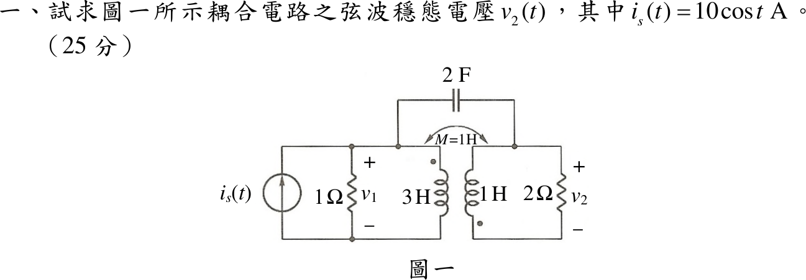
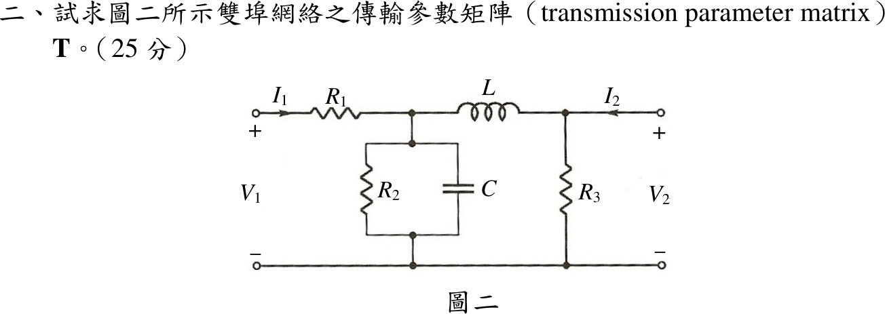
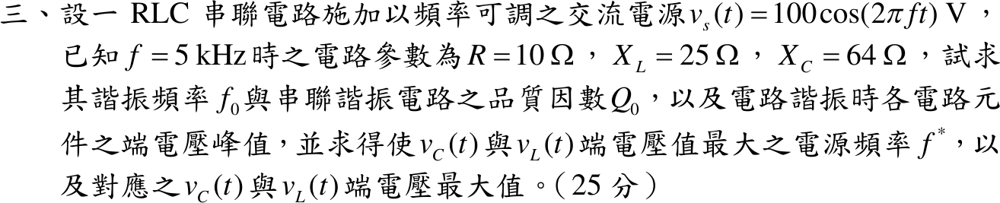
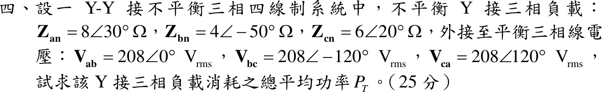

# 110 年電機工程技師｜電路學逐題詳解

> 本頁由題級 canonical 筆記組合；每題保留官方裁切圖、校驗狀態與可追溯的推導。

## 題目導覽
- [[#一、110 年第 1 題｜耦合電路弦波穩態|第 1 題：耦合電路弦波穩態]]
- [[#二、110 年電路學第 2 題：雙埠網路傳輸參數矩陣|第 2 題：110 年電路學第 2 題：雙埠網路傳輸參數矩陣]]
- [[#三、110 年電路學第 3 題：串聯 RLC 諧振與元件端電壓極值|第 3 題：110 年電路學第 3 題：串聯 RLC 諧振與元件端電壓極值]]
- [[#四、110 年電路學第 4 題：Y–Y 不平衡三相四線制總功率|第 4 題：110 年電路學第 4 題：Y–Y 不平衡三相四線制總功率]]

---

## 一、110 年第 1 題｜耦合電路弦波穩態

> 題級識別：EE-110-01-1
> canonical 來源：[[canonical/EE-110-01-1.md]]
> 題級校驗狀態：needs_manual_review
> [!WARNING] 本題仍有官方資料缺口或事件定義歧義；請以 canonical 條件式解答為準。

### 已知與所求

\(i_s=10\cos t\ \mathrm A\)（向上）注入左上節點；左側 \(1\ \Omega\)（電壓 \(v_1\)）與 \(L_1=3\ \mathrm H\)（同名端在上）並接於左上節點與左下導線之間。右側 \(L_2=1\ \mathrm H\)（同名端在下）與 \(2\ \Omega\)（電壓 \(v_2\)，上正）並接於右上節點與右下導線之間；\(M=1\ \mathrm H\)；\(2\ \mathrm F\) 跨接左右兩個上節點。圖中左下與右下導線分開，未相連。求 \(v_2(t)\)（25 分）。

### 考場標準作答

**解題邏輯**：全題為弦波穩態，用 \(\cos\) 基準的峰值相量，\(\omega=1\ \mathrm{rad/s}\)。
1. 先依官方圖確認拓樸：左下與右下導線斷開，右半電路（\(L_2\)、\(2\ \Omega\)）只靠 \(2\ \mathrm F\) 一條導線與左半相連，對右半整體取 KCL 得 \(I_C=0\)，兩側只靠互感耦合（本解採「依圖」讀法，共地讀法列於文末「條件與疑義」）。
2. 右迴路 KVL 把 \(\mathbf I_b\) 寫成 \(\mathbf I_a\) 的倍數。
3. 代入左線圈電壓得 \(\mathbf V_1\)（含反射阻抗）。
4. 左上節點 KCL 求 \(\mathbf I_a\)。
5. \(\mathbf V_2=2\mathbf I_b\)。

#### 步驟 1：電容電流 \(I_C=0\)

畫法：

- 右半電路（\(L_2\)、\(2\ \Omega\) 與兩者之間的導線）為一個「島」，與外界的連線只有電容一端。
- 對該島取 KCL：流入島的淨電流只能經電容，故 \(I_C=0\)；\(2\ \mathrm F\) 不影響任何電壓電流，下面不再列入。

#### 步驟 2：相量與參考方向

\[
\omega=1:\quad j\omega L_1=j(1)(3)=j3\ \Omega,\qquad j\omega L_2=j(1)(1)=j1\ \Omega,\qquad j\omega M=j(1)(1)=j1\ \Omega
\]
\[
\mathbf I_s=10\angle0^\circ\ \mathrm A
\]

- \(\mathbf I_a\)：由上而下流過 \(L_1\)，由 \(L_1\) 上端點端流入。
- \(\mathbf I_b\)：右迴路電流，由上而下流過 \(2\ \Omega\)，再由下而上進入 \(L_2\)，由 \(L_2\) 下端點端流入；故 \(\mathbf V_2=2\mathbf I_b\)（上正）。
- 兩電流都由點端流入，互感項與自感項同號（\(+j\omega M\)）。

#### 步驟 3：右迴路 KVL

\(L_2\) 點端（下）對非點端（上）的電壓為 \(j\omega L_2\mathbf I_b+j\omega M\mathbf I_a=j\mathbf I_b+j\mathbf I_a\)。沿 \(\mathbf I_b\) 方向繞一圈：經 \(2\ \Omega\) 由上而下壓降 \(2\mathbf I_b\)，經 \(L_2\) 由下而上壓降 \(j\mathbf I_b+j\mathbf I_a\)：
\[
2\mathbf I_b+j\mathbf I_b+j\mathbf I_a=0
\]
\[
(2+j)\mathbf I_b=-j\mathbf I_a\ \Rightarrow\ \mathbf I_b=\frac{-j\mathbf I_a}{2+j}
\]

#### 步驟 4：左線圈電壓（反射阻抗）

\[
\mathbf V_1=j\omega L_1\mathbf I_a+j\omega M\mathbf I_b=j3\mathbf I_a+j\mathbf I_b
\]
代入 \(\mathbf I_b\)：
\[
j\mathbf I_b=j\cdot\frac{-j\mathbf I_a}{2+j}=\frac{\mathbf I_a}{2+j}=\frac{(2-j)\mathbf I_a}{2^2+1^2}=(0.40-j0.20)\mathbf I_a
\]
\[
\mathbf V_1=(j3+0.40-j0.20)\mathbf I_a=(0.40+j2.80)\mathbf I_a
\]
其中 \(0.40-j0.20=\dfrac{(\omega M)^2}{2+j\omega L_2}\) 即右側反射到左側的阻抗。

#### 步驟 5：左上節點 KCL 求 \(\mathbf I_a\)

\(\mathbf I_s\) 流入左上節點，分流經 \(1\ \Omega\)（\(\mathbf V_1/1\)）與 \(L_1\)（\(\mathbf I_a\)），電容支路電流為 0：
\[
10=\frac{\mathbf V_1}{1}+\mathbf I_a=(0.40+j2.80)\mathbf I_a+\mathbf I_a=(1.40+j2.80)\mathbf I_a
\]
\[
\mathbf I_a=\frac{10}{1.40+j2.80}=\frac{10(1.40-j2.80)}{1.40^2+2.80^2}=\frac{14-j28}{9.80}=1.429-j2.857\ \mathrm A
\]

#### \(v_2(t)\)（25 分）

**邏輯**：\(\mathbf V_2=2\mathbf I_b\)，把步驟 3 的 \(\mathbf I_b\) 與步驟 5 的 \(\mathbf I_a\) 以分式代入，分母相乘恰為純虛數，可得精確值。

\[
\mathbf V_2=2\mathbf I_b=\frac{-j2\mathbf I_a}{2+j}=\frac{-j2}{2+j}\cdot\frac{10}{1.40+j2.80}=\frac{-j20}{(1.40+j2.80)(2+j)}
\]
分母展開：
\[
(1.40+j2.80)(2+j)=2.80+j1.40+j5.60+j^2\,2.80=j7
\]
\[
\mathbf V_2=\frac{-j20}{j7}=-\frac{20}{7}=-2.857\ \mathrm V
\]
極式：模 \(|\mathbf V_2|=\frac{20}{7}=2.857\ \mathrm V\)，角 \(180^\circ\)（負實數）。
\[
\boxed{v_2(t)=-\frac{20}{7}\cos t=2.86\cos(t+180^\circ)\ \mathrm V}
\]

### 驗算

功率守恆（理想耦合線圈不耗能）：
\[
|\mathbf I_a|^2=\frac{10^2}{|1.40+j2.80|^2}=\frac{100}{9.80}=10.204\ \mathrm{A^2}
\]
左側送入線圈的平均功率
\[
\frac12\mathrm{Re}\{\mathbf V_1\mathbf I_a^*\}=\frac12(0.40)|\mathbf I_a|^2=0.20\times10.204=2.041\ \mathrm W
\]
右側 \(2\ \Omega\) 吸收 \(\frac{|\mathbf V_2|^2}{2\cdot2}=\frac{(20/7)^2}{4}=\frac{100}{49}=2.041\ \mathrm W\)，兩者相等。

### 失分點

- 未檢查兩側接地是否相連，直接把 \(2\ \mathrm F\) 當成兩節點間的有效支路列 KCL。
- \(L_2\) 同名端在下方，互感電壓極性看錯會使 \(V_2\) 變號。
- \(V_2=-20/7\) 的負號表示與 \(i_s\) 反相，寫成 \(2.86\cos t\) 即漏掉 \(180^\circ\)。

### 條件與疑義

官方裁切圖的左下、右下導線在兩線圈之間斷開，上解依圖作答，電容不起作用。若出題意圖是兩側下導線共地（電容才構成迴路），則以共地為參考、兩上節點 \(\mathbf V_1,\mathbf V_2\) 列 KCL，線圈電流 \(\mathbf I_1=-\frac j2\mathbf V_1-\frac j2\mathbf V_2\)（流入 \(L_1\) 點端）、\(\mathbf I_2=\frac j2\mathbf V_1+\frac{3j}{2}\mathbf V_2\)（由下流入 \(L_2\) 點端）：
\[
\begin{bmatrix}1+j1.50&-j2.50\\-j2.50&0.50+j0.50\end{bmatrix}\begin{bmatrix}\mathbf V_1\\\mathbf V_2\end{bmatrix}=\begin{bmatrix}10\\0\end{bmatrix}
\]
\[
\Delta=(1+j1.50)(0.50+j0.50)-(-j2.50)^2=(-0.25+j1.25)+6.25=6+j1.25
\]
\[
\mathbf V_2=\frac{-(-j2.50)(10)}{\Delta}=\frac{j25}{6+j1.25}=\frac{j25(6-j1.25)}{6^2+1.25^2}=\frac{31.25+j150}{37.5625}=\frac{500+j2400}{601}
\]
\[
|\mathbf V_2|=\frac{\sqrt{500^2+2400^2}}{601}=\frac{2451.53}{601}=4.079\ \mathrm V,\qquad \angle \mathbf V_2=\tan^{-1}\frac{2400}{500}=78.23^\circ
\]
即 \(v_2(t)=4.08\cos(t+78.23^\circ)\ \mathrm V\)。兩種讀圖答案不同，作答時應先寫明採用哪一種接法。

---

## 二、110 年電路學第 2 題：雙埠網路傳輸參數矩陣

> 題級識別：EE-110-01-2
> canonical 來源：[[canonical/EE-110-01-2.md]]
> 題級校驗狀態：verified

### 已知與所求

由左至右：串聯 \(R_1\)、並聯支路 \(R_2\parallel C\)、串聯 \(L\)、並聯 \(R_3\)（跨在埠 2）。\(I_1\)、\(I_2\) 皆流入網路。求傳輸參數矩陣 \(\mathbf T\)（25 分），定義
\[
\begin{bmatrix}V_1\\I_1\end{bmatrix}=\begin{bmatrix}A&B\\C&D\end{bmatrix}\begin{bmatrix}V_2\\-I_2\end{bmatrix}
\]

### 考場標準作答

**解題邏輯**：此網路是梯形結構，可由埠 1 到埠 2 切成四個串接的二埠（串聯 \(R_1\)、並聯 \(R_2\parallel C\)、串聯 \(L\)、並聯 \(R_3\)），串接網路的傳輸參數等於各級 ABCD 矩陣依序相乘。先由定義推出「串聯阻抗」與「並聯導納」兩種基本矩陣 → 前兩級、後兩級各乘一次 → 兩者相乘得 \(\mathbf T\) → 代入 \(Y_2\) 展開成有理式。前提：以 s 域阻抗表示（\(Z_L=sL\)、\(Y_C=sC\)），\(I_2\) 依題圖流入網路，故右向量為 \(-I_2\)。

#### 步驟 1：切成四級並寫出基本 ABCD 矩陣

畫法：

- 由左至右切成 ① 串聯 \(Z=R_1\)、② 並聯 \(Y_2=\frac1{R_2}+sC\)、③ 串聯 \(Z=sL\)、④ 並聯 \(Y=\frac1{R_3}\)；前一級的輸出埠即後一級的輸入埠，級間電流方向一致（流向埠 2）。

串聯阻抗 \(Z\)（輸入電流全部流到輸出，\(I_1=-I_2\)；輸入電壓多一個壓降）：
\[
V_1=V_2+Z(-I_2),\quad I_1=0\cdot V_2+1\cdot(-I_2)\ \Rightarrow\ \begin{bmatrix}1&Z\\0&1\end{bmatrix}
\]
並聯導納 \(Y\)（兩埠電壓相同；輸入電流多一條分流 \(YV_2\)）：
\[
V_1=V_2+0\cdot(-I_2),\quad I_1=YV_2+(-I_2)\ \Rightarrow\ \begin{bmatrix}1&0\\Y&1\end{bmatrix}
\]
四級串接（次序由埠 1 到埠 2）：
\[
\mathbf T=\begin{bmatrix}1&R_1\\0&1\end{bmatrix}\begin{bmatrix}1&0\\Y_2&1\end{bmatrix}\begin{bmatrix}1&sL\\0&1\end{bmatrix}\begin{bmatrix}1&0\\\frac1{R_3}&1\end{bmatrix}
\]

#### 步驟 2：前兩級與後兩級

前兩級（列乘行，逐元素）：
\[
\begin{bmatrix}1&R_1\\0&1\end{bmatrix}\begin{bmatrix}1&0\\Y_2&1\end{bmatrix}
=\begin{bmatrix}1\cdot1+R_1Y_2&1\cdot0+R_1\cdot1\\0\cdot1+1\cdot Y_2&0\cdot0+1\cdot1\end{bmatrix}
=\begin{bmatrix}1+R_1Y_2&R_1\\Y_2&1\end{bmatrix}
\]
後兩級：
\[
\begin{bmatrix}1&sL\\0&1\end{bmatrix}\begin{bmatrix}1&0\\\frac1{R_3}&1\end{bmatrix}
=\begin{bmatrix}1+\frac{sL}{R_3}&sL\\\frac1{R_3}&1\end{bmatrix}
\]

#### 傳輸參數矩陣 \(\mathbf T\)（25 分）

**邏輯**：串接網路的 ABCD 矩陣為各級矩陣依序相乘，將步驟 2 的兩個 2×2 矩陣相乘即得；再以 \(Y_2=\frac{1+sCR_2}{R_2}\) 代入通分，得只含元件值的有理式。

\[
\mathbf T=\begin{bmatrix}1+R_1Y_2&R_1\\Y_2&1\end{bmatrix}\begin{bmatrix}1+\frac{sL}{R_3}&sL\\\frac1{R_3}&1\end{bmatrix}
\]
逐元素：
\[
A=(1+R_1Y_2)\left(1+\frac{sL}{R_3}\right)+R_1\cdot\frac1{R_3}
\]
\[
B=(1+R_1Y_2)\,sL+R_1\cdot1=R_1+sL(1+R_1Y_2)
\]
\[
C=Y_2\left(1+\frac{sL}{R_3}\right)+1\cdot\frac1{R_3}=Y_2+\frac{1+sLY_2}{R_3}
\]
\[
D=Y_2\cdot sL+1\cdot1=1+sLY_2
\]
\[
\boxed{\mathbf T=\begin{bmatrix}
(1+R_1Y_2)\left(1+\dfrac{sL}{R_3}\right)+\dfrac{R_1}{R_3} & R_1+sL(1+R_1Y_2)\\[8pt]
Y_2+\dfrac{1+sLY_2}{R_3} & 1+sLY_2
\end{bmatrix}}
\qquad Y_2=\frac1{R_2}+sC
\]

展開成有理式（先寫 \(1+R_1Y_2=\frac{R_2+R_1+sCR_1R_2}{R_2}\)、\(1+\frac{sL}{R_3}=\frac{R_3+sL}{R_3}\)）：
\[
A=\frac{(R_1+R_2+sCR_1R_2)(R_3+sL)+R_1R_2}{R_2R_3}=\frac{CLR_1R_2s^2+(CR_1R_2R_3+LR_1+LR_2)s+R_1R_2+R_1R_3+R_2R_3}{R_2R_3}
\]
\[
B=R_1+\frac{sL(R_1+R_2+sCR_1R_2)}{R_2}=\frac{CLR_1R_2s^2+(LR_1+LR_2)s+R_1R_2}{R_2}
\]
\[
C=\frac{R_3(1+sCR_2)+R_2+sL(1+sCR_2)}{R_2R_3}=\frac{CLR_2s^2+(CR_2R_3+L)s+R_2+R_3}{R_2R_3}
\]
\[
D=1+\frac{sL(1+sCR_2)}{R_2}=\frac{CLR_2s^2+Ls+R_2}{R_2}
\]
單位：\(A\)、\(D\) 無因次，\(B\) 為 \(\Omega\)，\(C\) 為 \(\mathrm S\)。

### 驗算

- 不用串接，直接列節點方程（中間節點電壓 \(V_a\)）：\(I_1=\frac{V_1-V_a}{R_1}\)、\(I_1=Y_2V_a+\frac{V_a-V_2}{sL}\)、\(I_2+\frac{V_a-V_2}{sL}=\frac{V_2}{R_3}\)；消去 \(V_a\) 後 \(V_1\)、\(I_1\) 對 \(V_2\)、\(-I_2\) 的係數與上列 \(A,B,C,D\) 完全相同。
- 開路特例 \(I_2=0\)、\(s\to0\)：\(A=\frac{R_1R_2+R_1R_3+R_2R_3}{R_2R_3}\)，即 \(V_1/V_2\) 等於 \(R_1\) 與 \(R_2\parallel R_3\) 分壓的倒數 \(1+\frac{R_1(R_2+R_3)}{R_2R_3}\)，相符。
- 被動互易網路：\(AD-BC=1\)（每級行列式為 1）。

### 失分點

- 圖示 \(I_2\) 流入網路，傳輸參數第二個自變數是 \(-I_2\)；若把 \(I_2\) 直接放進右向量，\(B\)、\(D\) 必須整欄變號。
- \(C\) 元素寫成 \(Y_2+\frac1{R_3}+\frac{sL}{R_3}\)，漏了 \(sL\) 項中的 \(Y_2\)；應為 \(Y_2+\frac{1+sLY_2}{R_3}\)。
- 串接矩陣相乘次序必須由埠 1 到埠 2，不能交換。

---

## 三、110 年電路學第 3 題：串聯 RLC 諧振與元件端電壓極值

> 題級識別：EE-110-01-3
> canonical 來源：[[canonical/EE-110-01-3.md]]
> 題級校驗狀態：verified

### 已知與所求

串聯 RLC，\(v_s=100\cos(2\pi ft)\ \mathrm V\)；\(f=5\ \mathrm{kHz}\) 時 \(R=10\ \Omega\)、\(X_L=25\ \Omega\)、\(X_C=64\ \Omega\)。求諧振頻率 \(f_0\)、品質因數 \(Q_0\)、諧振時各元件端電壓峰值；再求使 \(v_C\)、\(v_L\) 端電壓最大的電源頻率 \(f^*\) 與對應最大值（25 分）。

### 考場標準作答

**解題邏輯**：題給的 \(X_L\)、\(X_C\) 是 5 kHz 時的值，先用 \(X_L\propto f\)、\(X_C\propto1/f\) 換到任意頻率，令兩者相等求 \(f_0\)，再得 \(Q_0=X_{L0}/R\) 與諧振時各端電壓（此時 \(Z=R\)）。\(v_C\)、\(v_L\) 的最大值不在 \(f_0\)：把 \(|V_C|\)、\(|V_L|\) 寫成正規化頻率 \(u=f/f_0\) 的函數，對分母求極小。前提：\(R\) 不隨頻率變；電源振幅固定為峰值 \(V_m=100\ \mathrm V\)，所求「端電壓峰值」即振幅。

#### 步驟 1：電抗隨頻率換算

以 kHz 為頻率單位，5 kHz 時 \(X_L=25\ \Omega\)、\(X_C=64\ \Omega\)：
\[
X_L(f)=25\times\frac{f}{5},\qquad X_C(f)=64\times\frac{5}{f}
\]

#### 諧振頻率、品質因數與諧振時端電壓峰值

**邏輯**：串聯諧振條件為 \(X_L(f_0)=X_C(f_0)\)；諧振時電抗互消、\(Z=R\)，電流最大，\(Q_0=X_{L0}/R\)，電感與電容電壓為電阻電壓的 \(Q_0\) 倍。

\[
25\times\frac{f_0}{5}=64\times\frac{5}{f_0}
\]
\[
f_0^2=\frac{64\times5\times5}{25}=64
\]
\[
\boxed{f_0=8\ \mathrm{kHz}}
\]
諧振時電抗：
\[
X_{L0}=25\times\frac{8}{5}=40\ \Omega,\qquad X_{C0}=64\times\frac{5}{8}=40\ \Omega
\]
品質因數：
\[
Q_0=\frac{X_{L0}}{R}=\frac{40}{10}
\]
\[
\boxed{Q_0=4}
\]
諧振時 \(Z=R=10\ \Omega\)，電流峰值：
\[
I_m=\frac{V_m}{R}=\frac{100}{10}=10\ \mathrm A
\]
各元件端電壓峰值：
\[
V_{R,m}=I_mR=10\times10=100\ \mathrm V
\]
\[
V_{L,m}=I_mX_{L0}=10\times40=400\ \mathrm V,\qquad V_{C,m}=I_mX_{C0}=10\times40=400\ \mathrm V
\]
\[
\boxed{V_{R,m}=100\ \mathrm V},\qquad \boxed{V_{L,m}=V_{C,m}=400\ \mathrm V}
\]

#### 使 \(v_C\)、\(v_L\) 最大的頻率 \(f^*\) 與最大值

**邏輯**：\(|V_C|=V_mX_C/|Z|\)、\(|V_L|=V_mX_L/|Z|\) 都隨頻率變，分子分母一起變，所以極值不在 \(f_0\)。以 \(u=f/f_0\) 正規化後平方，把問題化成「分母二次式取極小」。

正規化：\(X_L=X_{L0}u=Q_0Ru\)、\(X_C=X_{C0}/u=Q_0R/u\)，\(|Z|=R\sqrt{1+Q_0^2(u-1/u)^2}\)。

電容電壓：
\[
|V_C|=\frac{V_mX_C}{|Z|}=\frac{V_mQ_0/u}{\sqrt{1+Q_0^2(u-1/u)^2}}=\frac{V_mQ_0}{\sqrt{u^2+Q_0^2(u^2-1)^2}}
\]
令 \(x=u^2\)，分母平方為
\[
g(x)=x+Q_0^2(x-1)^2=x+16(x-1)^2
\]
\[
\frac{dg}{dx}=1+32(x-1)=0\ \Rightarrow\ x=1-\frac1{32}=\frac{31}{32}
\]
\(\frac{d^2g}{dx^2}=32>0\)，\(g\) 為極小，即 \(|V_C|\) 為極大。
\[
f_C^*=f_0\sqrt{x}=8\sqrt{\tfrac{31}{32}}=8\times0.9843=7.874\ \mathrm{kHz}
\]
\[
\boxed{f_C^*=8\sqrt{\tfrac{31}{32}}=7.87\ \mathrm{kHz}}
\]
電感電壓（分子分母同除以 \(u\)）：
\[
|V_L|=\frac{V_mX_L}{|Z|}=\frac{V_mQ_0u}{\sqrt{1+Q_0^2(u-1/u)^2}}=\frac{V_mQ_0}{\sqrt{1/u^2+Q_0^2(1-1/u^2)^2}}
\]
令 \(w=1/u^2\)，分母平方為 \(w+16(1-w)^2=g(w)\)，與上式同形，極小在 \(w=\frac{31}{32}\)，即 \(u^2=\frac{32}{31}\)：
\[
f_L^*=f_0\sqrt{\tfrac{32}{31}}=8\times1.0160=8.128\ \mathrm{kHz}
\]
\[
\boxed{f_L^*=8\sqrt{\tfrac{32}{31}}=8.13\ \mathrm{kHz}}
\]
最大值：兩者分母的極小值相同，
\[
g_{\min}=\frac{31}{32}+16\left(\frac{31}{32}-1\right)^2=\frac{31}{32}+\frac{16}{1024}=\frac{62}{64}+\frac{1}{64}=\frac{63}{64}
\]
\[
V_{C,\max}=V_{L,\max}=\frac{V_mQ_0}{\sqrt{g_{\min}}}=\frac{100\times4}{\sqrt{63/64}}=\frac{3200}{\sqrt{63}}=\frac{3200}{7.9373}
\]
\[
\boxed{V_{C,\max}=V_{L,\max}=403.16\ \mathrm V}
\]

### 驗算

- 元件值：\(L=\frac{25}{2\pi(5000)}=795.77\ \mu\mathrm H\)、\(C=\frac{1}{2\pi(5000)(64)}=497.36\ \mathrm{nF}\)，\(f_0=\frac{1}{2\pi\sqrt{LC}}=8000\ \mathrm{Hz}\)。
- 直接代 \(f_C^*=7874.01\ \mathrm{Hz}\)：\(X_L=39.37\ \Omega\)、\(X_C=40.64\ \Omega\)，\(|Z|=\sqrt{10^2+1.27^2}=10.0803\ \Omega\)，\(|V_C|=\frac{100}{10.0803}(40.64)=403.16\ \mathrm V\)，大於諧振時的 400 V；以 7–9 kHz 細格數值掃描 \(|V_C|\)、\(|V_L|\) 的峰值亦落在 7.87 kHz、8.13 kHz。
- 兩極值頻率滿足 \(f_C^*f_L^*=f_0^2\)。

### 失分點

- 以為 \(v_C\)、\(v_L\) 在 \(f_0\) 達最大；有限 \(Q\) 時 \(v_C\) 的峰值出現在低於 \(f_0\) 的頻率、\(v_L\) 的峰值出現在高於 \(f_0\) 的頻率。
- 題給 \(X_L,X_C\) 是 5 kHz 的值，直接拿 \(25\)、\(64\) 算 \(Q_0=25/10\) 或 \(64/10\)。
- 電源 100 V 為峰值，題目問峰值即不需再乘 \(\sqrt2\)。

---

## 四、110 年電路學第 4 題：Y–Y 不平衡三相四線制總功率

> 題級識別：EE-110-01-4
> canonical 來源：[[canonical/EE-110-01-4.md]]
> 題級校驗狀態：verified

### 已知與所求

\(Z_{an}=8\angle30^\circ\)、\(Z_{bn}=4\angle-50^\circ\)、\(Z_{cn}=6\angle20^\circ\ \Omega\)；平衡正相序線電壓 \(V_{ab}=208\angle0^\circ\ \mathrm V_{rms}\)；Y–Y 四線制。求總平均功率 \(P_T\)（25 分）。

### 考場標準作答

**解題邏輯**：四線制的中性線把負載中性點 \(n\) 固定在電源中性點，所以負載雖不平衡，每相仍跨在平衡相電壓 \(V_L/\sqrt3\) 上，不必求中性點位移。主線：由線電壓求相電壓 → 每相各自以 \(P=\dfrac{V_\phi^2}{|Z|}\cos\theta_Z\) 求實功率 → 三相相加。前提：題給電壓為有效值；中性線阻抗為零；各相功率只與相電壓大小及該相阻抗角有關，相電壓的相角不影響 \(P\)。

#### 步驟 1：每相電壓

畫法：

- 電源中性點與負載中性點以中性線直接相連（同為 \(n\)），三個阻抗 \(\mathbf Z_{an}\)、\(\mathbf Z_{bn}\)、\(\mathbf Z_{cn}\) 各自跨在一個相電壓上。
- 相電流 \(\mathbf I_a,\mathbf I_b,\mathbf I_c\) 參考方向由線端流入負載、經中性點流回。

\[
V_\phi=\frac{V_L}{\sqrt3}=\frac{208}{\sqrt3}=120.09\ \mathrm V
\]
\[
V_\phi^2=\frac{208^2}{3}=\frac{43264}{3}\ \mathrm{V^2}
\]
正相序且 \(\mathbf V_{ab}=208\angle0^\circ\) 時，\(\mathbf V_{an}=V_\phi\angle-30^\circ\)、\(\mathbf V_{bn}=V_\phi\angle-150^\circ\)、\(\mathbf V_{cn}=V_\phi\angle90^\circ\)（大小相同，下面只用到 \(V_\phi\)）。

#### 步驟 2：每相實功率公式

\(\mathbf I=\mathbf V/\mathbf Z\)，所以 \(|\mathbf I|=V_\phi/|Z|\)，且電壓超前電流的角度等於阻抗角 \(\theta_Z\)：
\[
P=V_\phi|\mathbf I|\cos\theta_Z=\frac{V_\phi^2}{|Z|}\cos\theta_Z
\]

#### 總平均功率 \(P_T\)（25 分）

**邏輯**：中性線使三相彼此獨立，各相功率分別計算後直接相加；容性相（\(\theta_Z<0\)）的 \(\cos\theta_Z\) 仍為正，照樣吸收實功率。

\(a\) 相（\(|Z|=8\ \Omega\)、\(\theta_Z=30^\circ\)）：
\[
P_a=\frac{43264}{3\times8}\cos30^\circ=1802.6667\times0.8660254=1561.16\ \mathrm W
\]
\(b\) 相（\(|Z|=4\ \Omega\)、\(\theta_Z=-50^\circ\)，\(\cos(-50^\circ)=\cos50^\circ\)）：
\[
P_b=\frac{43264}{3\times4}\cos50^\circ=3605.3333\times0.6427876=2317.46\ \mathrm W
\]
\(c\) 相（\(|Z|=6\ \Omega\)、\(\theta_Z=20^\circ\)）：
\[
P_c=\frac{43264}{3\times6}\cos20^\circ=2403.5556\times0.9396926=2258.60\ \mathrm W
\]
三相相加：
\[
P_T=P_a+P_b+P_c=1561.16+2317.46+2258.60
\]
\[
\boxed{P_T=6137.22\ \mathrm W}
\]

### 驗算

改由 \(|\mathbf I|^2R\) 計算，\(|\mathbf I|^2=V_\phi^2/|Z|^2\)、\(R=|Z|\cos\theta_Z\)：

- \(a\) 相：\(|\mathbf I_a|^2=\frac{43264}{3\times64}=\frac{676}{3}\ \mathrm{A^2}\)，\(R_a=8\cos30^\circ=6.928203\ \Omega\)，\(\frac{676}{3}\times6.928203=1561.16\ \mathrm W\)。
- \(b\) 相：\(|\mathbf I_b|^2=\frac{43264}{3\times16}=\frac{2704}{3}\ \mathrm{A^2}\)，\(R_b=4\cos50^\circ=2.571150\ \Omega\)，\(\frac{2704}{3}\times2.571150=2317.46\ \mathrm W\)。
- \(c\) 相：\(|\mathbf I_c|^2=\frac{43264}{3\times36}=\frac{10816}{27}\ \mathrm{A^2}\)，\(R_c=6\cos20^\circ=5.638156\ \Omega\)，\(\frac{10816}{27}\times5.638156=2258.60\ \mathrm W\)。

合計 \(6137.22\ \mathrm W\)，與上式相同。另核相電壓：\(\mathbf V_{an}-\mathbf V_{bn}=V_\phi(\angle-30^\circ-\angle-150^\circ)=V_\phi\sqrt3\angle0^\circ=208\angle0^\circ\ \mathrm V\)，與題給 \(\mathbf V_{ab}\) 一致。

### 失分點

- 把 208 V 線電壓直接當相電壓，功率放大 3 倍。
- \(Z_{bn}\) 的 \(-50^\circ\) 是電容性，\(\cos(-50^\circ)=\cos50^\circ>0\)，仍吸收實功率，不可取負。

---
