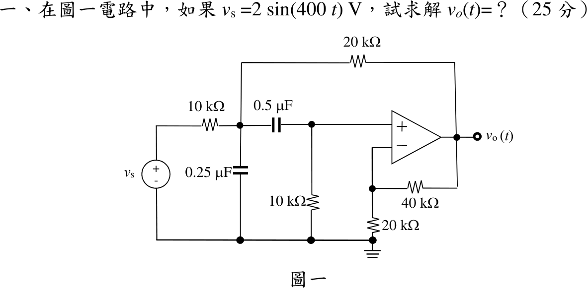
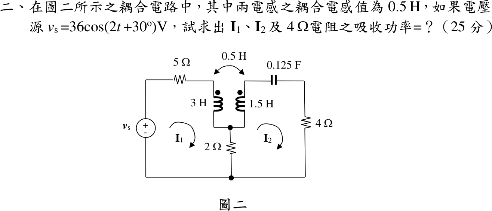
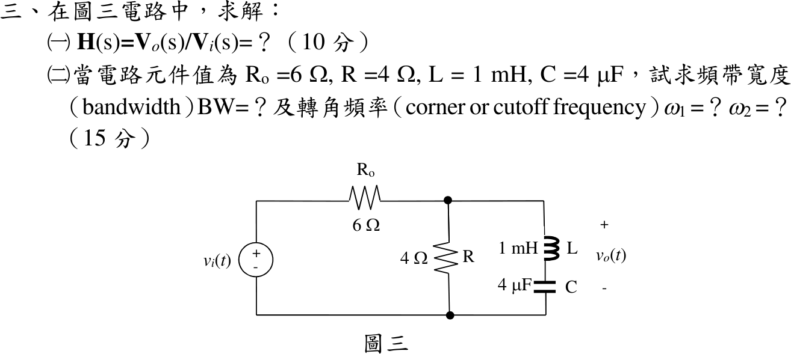
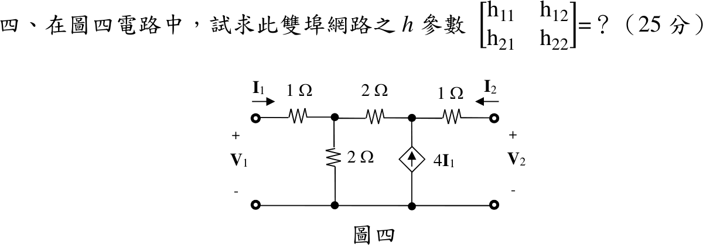

# 111 年電機工程技師｜電路學逐題詳解

> 本頁由題級 canonical 筆記組合；每題保留官方裁切圖、校驗狀態與可追溯的推導。

## 題目導覽
- [[#一、111 年電路學第 1 題｜含運算放大器交流穩態|第 1 題：含運算放大器交流穩態]]
- [[#二、111 年第 2 題｜互感耦合電路|第 2 題：互感耦合電路]]
- [[#三、111 年第 3 題｜RLC 轉移函數與截止頻率|第 3 題：RLC 轉移函數與截止頻率]]
- [[#四、111 年第 4 題｜受控電流源雙埠網路的 h 參數|第 4 題：受控電流源雙埠網路的 h 參數]]

---

## 一、111 年電路學第 1 題｜含運算放大器交流穩態

> 題級識別：EE-111-01-1
> canonical 來源：[[canonical/EE-111-01-1.md]]
> 題級校驗狀態：verified

### 已知與所求

\(v_s=2\sin(400t)\ \mathrm V\) 經 \(10\ \mathrm{k\Omega}\) 接節點 \(a\)；節點 \(a\) 另接 \(0.25\ \mu\mathrm F\) 對地、\(20\ \mathrm{k\Omega}\) 至 \(v_o\)、\(0.5\ \mu\mathrm F\) 至節點 \(b\)；節點 \(b\) 接 \(10\ \mathrm{k\Omega}\) 對地並接運算放大器同相端；反相端由 \(40\ \mathrm{k\Omega}\)（回授）與 \(20\ \mathrm{k\Omega}\)（接地）分壓。求 \(v_o(t)\)（25 分）。

### 考場標準作答

**解題邏輯**：理想運算放大器（虛短、虛斷）配上 \(40\ \mathrm{k\Omega}\)／\(20\ \mathrm{k\Omega}\) 構成增益 3 的非反相放大器，\(V_o=3V_b\)；但 \(20\ \mathrm{k\Omega}\) 把 \(V_o\) 回授到節點 \(a\)，前後級互相牽動，必須聯立節點方程。前提：弦波穩態；以 \(\sin\) 為基準的峰值相量 \(V_s=2\angle0^\circ\ \mathrm V\)；阻抗以 \(\mathrm{k\Omega}\)、電流以 mA 計。
1. 求增益，並換成相量阻抗。
2. 節點 \(b\) 方程得 \(V_a\) 與 \(V_b\) 的關係。
3. 節點 \(a\) 方程（代入 \(V_o=3V_b\)）。
4. 消去 \(V_a\) 解 \(V_b\)。
5. \(V_o\) 轉極式回時域。

#### 步驟 1：非反相放大器增益

虛短 \(V_-=V_+=V_b\)；虛斷使反相端兩電阻串聯分壓：
\[
V_b=\frac{20}{20+40}V_o\ \Rightarrow\ V_o=\left(1+\frac{40}{20}\right)V_b=3V_b
\]

#### 步驟 2：相量阻抗

\(\omega=400\ \mathrm{rad/s}\)：
\[
Z_{C1}=\frac{1}{j\omega C_1}=\frac{1}{j400\times0.25\times10^{-6}}=\frac{1}{j10^{-4}}=-j10\ \mathrm{k\Omega}
\]
\[
Z_{C2}=\frac{1}{j\omega C_2}=\frac{1}{j400\times0.5\times10^{-6}}=\frac{1}{j2\times10^{-4}}=-j5\ \mathrm{k\Omega}
\]
（\(C_1=0.25\ \mu\mathrm F\) 由 \(a\) 接地，\(C_2=0.5\ \mu\mathrm F\) 接 \(a\)、\(b\)。）

#### 步驟 3：節點 \(b\)

運放輸入電流為零，流經 \(C_2\) 的電流全進入 \(10\ \mathrm{k\Omega}\)：
\[
\frac{V_b-V_a}{-j5}+\frac{V_b}{10}=0
\]
全式乘 10（\(\frac{10}{-j5}=j2\)）：
\[
j2(V_b-V_a)+V_b=0\ \Rightarrow\ (1+j2)V_b=j2V_a
\]
\[
V_a=\frac{1+j2}{j2}V_b
\]

#### 步驟 4：節點 \(a\)

流出 \(a\) 的電流總和為零（經 \(10\ \mathrm{k\Omega}\) 往電源、經 \(C_1\) 往地、經 \(C_2\) 往 \(b\)、經 \(20\ \mathrm{k\Omega}\) 往 \(V_o=3V_b\)）：
\[
\frac{V_a-V_s}{10}+\frac{V_a}{-j10}+\frac{V_a-V_b}{-j5}+\frac{V_a-3V_b}{20}=0
\]
全式乘 20（\(\frac{20}{-j10}=j2\)、\(\frac{20}{-j5}=j4\)）：
\[
2(V_a-V_s)+j2V_a+j4(V_a-V_b)+(V_a-3V_b)=0
\]
\[
(2+j2+j4+1)V_a-(j4+3)V_b=2V_s
\]
\[
(3+j6)V_a-(3+j4)V_b=2V_s
\]

#### 輸出電壓 \(v_o(t)\)（25 分）

**邏輯**：把步驟 3 的 \(V_a\) 代入步驟 4，得只含 \(V_b\) 的一式，解出 \(V_b\) 後乘 3 即 \(V_o\)；以 \(\sin\) 基準的峰值相量直接寫回 \(\sin\)。

代入 \(V_a=\frac{1+j2}{j2}V_b\)：
\[
(3+j6)\frac{1+j2}{j2}V_b-(3+j4)V_b=2V_s
\]
\[
(3+j6)(1+j2)=3+j6+j6+j^2\times12=-9+j12
\]
\[
\frac{-9+j12}{j2}=\frac{(-9+j12)(-j)}{2}=\frac{12+j9}{2}=6+j4.5
\]
\[
(6+j4.5)-(3+j4)=3+j0.5
\]
\[
(3+j0.5)V_b=2V_s\ \Rightarrow\ V_b=\frac{2V_s}{3+j0.5}=\frac{4V_s}{6+j1}
\]
\[
V_o=3V_b=\frac{12V_s}{6+j1}=\frac{12(6-j1)}{6^2+1^2}V_s=\frac{72-j12}{37}V_s
\]
代入 \(V_s=2\)：
\[
V_o=\frac{144-j24}{37}\ \mathrm V
\]
化成極式：
\[
|V_o|=\frac{\sqrt{144^2+24^2}}{37}=\frac{24\sqrt{37}}{37}=\frac{24}{\sqrt{37}}=\frac{24}{6.0828}=3.9456\ \mathrm V
\]
\[
\angle V_o=\tan^{-1}\frac{-24}{144}=-\tan^{-1}\frac16=-9.46^\circ\quad(\text{第四象限})
\]
\[
\boxed{v_o(t)=\frac{24}{\sqrt{37}}\sin\left(400t-\tan^{-1}\frac16\right)=3.95\sin(400t-9.46^\circ)\ \mathrm V}
\]

### 驗算

改求轉移函數再代頻率。以 \(s\) 表示兩個節點方程並消去 \(V_a\)，得
\[
H(s)=\frac{V_o}{V_s}=\frac{1200s}{s^2+600s+120000}
\]
\(s=j400\)：\(H=\frac{j480000}{-40000+j240000}=\frac{j12}{-1+j6}=\frac{72-j12}{37}\)，\(|H|=\frac{12}{\sqrt{37}}=1.97\)，乘以 2 V 得 \(3.95\ \mathrm V\)，與節點相量解一致。

### 失分點

- 忽略 \(20\ \mathrm{k\Omega}\) 由 \(v_o\) 回授至節點 \(a\) 的支路，把電路拆成兩級獨立放大器，會得 \(5.66\sin(400t+45^\circ)\) 之類的錯解。
- 非反相增益寫成 \(40/20=2\)，漏了「\(1+\)」。
- 題目以 \(\sin\) 為基準，回時域時誤寫成 \(\cos\)。

---

## 二、111 年第 2 題｜互感耦合電路

> 題級識別：EE-111-01-2
> canonical 來源：[[canonical/EE-111-01-2.md]]
> 題級校驗狀態：verified

### 已知與所求

\(v_s=36\cos(2t+30^\circ)\ \mathrm V\) 串 \(5\ \Omega\) 接 \(L_1=3\ \mathrm H\) 上端（同名端在上）；\(L_2=1.5\ \mathrm H\)（同名端在上）上端串 \(0.125\ \mathrm F\) 與 \(4\ \Omega\)；兩線圈下端共接，經 \(2\ \Omega\) 接地；\(M=0.5\ \mathrm H\)。\(I_1,I_2\) 為順時針網目電流。求 \(I_1\)、\(I_2\) 及 \(4\ \Omega\) 吸收功率（25 分）。

### 考場標準作答

**解題邏輯**：題目指定順時針網目電流 \(\mathbf I_1\)、\(\mathbf I_2\)，故用網目分析；全題用 \(\cos\) 基準的峰值相量（\(\mathbf V_s=36\angle30^\circ\ \mathrm V\)），弦波穩態。
1. 把元件換成 \(\omega=2\) 的相量阻抗。
2. 依同名端判定互感項正負，列兩網目 KVL 成 \(2\times2\) 矩陣。
3. 以克拉瑪法則求 \(\mathbf I_1\)、\(\mathbf I_2\)（模與角分列）。
4. \(4\ \Omega\) 只流過 \(\mathbf I_2\)，平均功率 \(P=\frac12|\mathbf I_2|^2R\)。

#### 步驟 1：相量與阻抗

\(\omega=2\ \mathrm{rad/s}\)：
\[
j\omega L_1=j(2)(3)=j6\ \Omega,\qquad j\omega L_2=j(2)(1.5)=j3\ \Omega,\qquad j\omega M=j(2)(0.5)=j1\ \Omega
\]
\[
Z_C=\frac{1}{j\omega C}=\frac{1}{j(2)(0.125)}=\frac{1}{j0.25}=-j4\ \Omega
\]

#### 步驟 2：網目方向與互感符號

畫法：

- \(\mathbf I_1\)（左網目順時針）經 \(5\ \Omega\) 後由上而下流過 \(L_1\)，由 \(L_1\) 的點端流入。
- \(\mathbf I_2\)（右網目順時針）由下而上流過 \(2\ \Omega\) 與 \(L_2\)，由 \(L_2\) 的點端流出；換言之流入 \(L_2\) 點端的電流為 \(-\mathbf I_2\)，故互感項取負號。
- 共用的 \(2\ \Omega\) 由上而下的電流為 \(\mathbf I_1-\mathbf I_2\)。
- 線圈電壓（上端減下端）：\(L_1\) 為 \(j6\mathbf I_1+j1(-\mathbf I_2)=j6\mathbf I_1-j\mathbf I_2\)；\(L_2\) 為 \(j3(-\mathbf I_2)+j1\mathbf I_1=-j3\mathbf I_2+j\mathbf I_1\)。

左網目（順時針，各元件壓降和等於電源電壓）：
\[
5\mathbf I_1+(j6\mathbf I_1-j\mathbf I_2)+2(\mathbf I_1-\mathbf I_2)=36\angle30^\circ
\]
右網目（順時針經 \(L_2\) 時由下而上，壓降取線圈電壓的負值 \(j3\mathbf I_2-j\mathbf I_1\)）：
\[
2(\mathbf I_2-\mathbf I_1)+(j3\mathbf I_2-j\mathbf I_1)+(4-j4)\mathbf I_2=0
\]

#### 步驟 3：矩陣與行列式

合併同類項：左網目 \(\mathbf I_1\) 係數 \(5+j6+2=7+j6\)，\(\mathbf I_2\) 係數 \(-j-2\)；右網目 \(\mathbf I_1\) 係數 \(-2-j\)，\(\mathbf I_2\) 係數 \(2+j3+4-j4=6-j\)。
\[
\begin{bmatrix}7+j6&-2-j\\-2-j&6-j\end{bmatrix}
\begin{bmatrix}\mathbf I_1\\\mathbf I_2\end{bmatrix}=\begin{bmatrix}36\angle30^\circ\\0\end{bmatrix}
\]
\[
(7+j6)(6-j)=42-j7+j36-j^2\,6=48+j29
\]
\[
(-2-j)^2=4+j4+j^2=3+j4
\]
\[
\Delta=(48+j29)-(3+j4)=45+j25
\]
\[
|\Delta|=\sqrt{45^2+25^2}=\sqrt{2650}=51.48,\qquad \angle\Delta=\tan^{-1}\frac{25}{45}=29.055^\circ
\]

#### \(\mathbf I_1\)、\(\mathbf I_2\)

**邏輯**：克拉瑪法則——以右邊常數向量替換對應行；\(\mathbf I_1\) 的分子為 \((6-j)\times36\angle30^\circ\)，\(\mathbf I_2\) 的分子為 \(-(-2-j)\times36\angle30^\circ=(2+j)\times36\angle30^\circ\)。

\[
\mathbf I_1=\frac{(6-j)\,36\angle30^\circ}{45+j25},\qquad \mathbf I_2=\frac{(2+j)\,36\angle30^\circ}{45+j25}
\]
分子複數化為極式：
\[
|6-j|=\sqrt{6^2+1^2}=\sqrt{37}=6.083,\qquad \angle(6-j)=-\tan^{-1}\frac16=-9.462^\circ
\]
\[
|2+j|=\sqrt{2^2+1^2}=\sqrt5=2.236,\qquad \angle(2+j)=\tan^{-1}\frac12=26.565^\circ
\]
\(\mathbf I_1\) 的模與角：
\[
|\mathbf I_1|=\frac{6.083\times36}{51.48}=\frac{218.99}{51.48}=4.254\ \mathrm A
\]
\[
\angle\mathbf I_1=-9.462^\circ+30^\circ-29.055^\circ=-8.517^\circ
\]
直角座標：\(4.254\cos(-8.517^\circ)=4.207\)，\(4.254\sin(-8.517^\circ)=-0.6300\)：
\[
\boxed{\mathbf I_1=4.21-j0.63=4.25\angle-8.52^\circ\ \mathrm A}
\]
\(\mathbf I_2\) 的模與角：
\[
|\mathbf I_2|=\frac{2.236\times36}{51.48}=\frac{80.50}{51.48}=1.564\ \mathrm A
\]
\[
\angle\mathbf I_2=26.565^\circ+30^\circ-29.055^\circ=27.510^\circ
\]
直角座標：\(1.564\cos27.510^\circ=1.387\)，\(1.564\sin27.510^\circ=0.7224\)：
\[
\boxed{\mathbf I_2=1.39+j0.72=1.56\angle27.51^\circ\ \mathrm A}
\]

#### \(4\ \Omega\) 吸收功率

**邏輯**：\(4\ \Omega\) 位於右網目外側支路，只流過 \(\mathbf I_2\)；相量為峰值，平均功率要乘 \(\frac12\)。為避免四捨五入累積，\(|\mathbf I_2|^2\) 用精確式計算。

\[
|\mathbf I_2|^2=\frac{|2+j|^2\times36^2}{|\Delta|^2}=\frac{5\times1296}{2650}=\frac{6480}{2650}=2.445\ \mathrm{A^2}
\]
\[
P_4=\frac12|\mathbf I_2|^2R=\frac12\times2.445\times4
\]
\[
\boxed{P_4=4.89\ \mathrm W}
\]

### 驗算

改用節點法：令 \(L_1\) 上端電壓 \(V_x\)、線圈共接點 \(V_m\)、\(L_2\) 上端 \(V_y\)，以線圈電流為未知數：
\[
V_x-V_m=j6\mathbf I_1-j\mathbf I_2,\quad V_y-V_m=-j3\mathbf I_2+j\mathbf I_1,\quad \frac{V_m}{2}=\mathbf I_1-\mathbf I_2,\quad \mathbf I_2=\frac{V_y}{4-j4}
\]
連同 \(\mathbf I_1=(\mathbf V_s-V_x)/5\) 聯立，解得同一組 \(\mathbf I_1,\mathbf I_2\)。另以 \(V_4=4\mathbf I_2=4(1.387+j0.7224)=5.548+j2.890\ \mathrm V\)，\(\frac12\mathrm{Re}\{V_4\mathbf I_2^*\}=\frac12\times4|\mathbf I_2|^2=2\times2.445=4.890\ \mathrm W\)。

### 失分點

- 互感項只看電流箭頭不對同名端，非對角項寫成 \(-2+j\) 而解錯。
- 共用 \(2\ \Omega\) 只放進其中一個網目，或兩網目都寫成同號的 \(2(\mathbf I_1-\mathbf I_2)\)。
- 峰值相量直接用 \(P=RI^2\)，功率多一倍成 \(9.78\ \mathrm W\)。

---

## 三、111 年第 3 題｜RLC 轉移函數與截止頻率

> 題級識別：EE-111-01-3
> canonical 來源：[[canonical/EE-111-01-3.md]]
> 題級校驗狀態：verified

### 已知與所求

\(v_i\) 串 \(R_o\) 後接一節點；該節點對地並聯兩支路：\(R\)，以及串聯的 \(L\)、\(C\)；\(v_o\) 取該節點對地電壓。求（一）\(H(s)=V_o/V_i\)（10 分）；（二）\(R_o=6\ \Omega\)、\(R=4\ \Omega\)、\(L=1\ \mathrm{mH}\)、\(C=4\ \mu\mathrm F\) 時的 \(\mathrm{BW}\) 與 \(\omega_1,\omega_2\)（15 分）。

### 考場標準作答

**解題邏輯**：\(v_o\) 是 \(R\) 與串聯 \(LC\) 並聯後的節點電壓；電路為初始能量為零的線性非時變網路，\(H(s)\) 以零初值的 \(s\) 域阻抗求得。
1. 先在 \(s\) 域把 \(Z_{LC}=sL+\frac1{sC}\) 與 \(R\) 並聯成 \(Z_p\)。
2. 再由 \(R_o\) 與 \(Z_p\) 分壓得 \(H(s)\)，整理成標準二階帶拒形式並讀出 \(\omega_0^2\)、\(\alpha\)。
3. （二）代入元件值，以「\(|H(j\omega)|\) 降為通帶增益的 \(1/\sqrt2\)」為截止條件。
4. 解兩個二次式得 \(\omega_1,\omega_2\)，相減即頻寬。

#### 步驟 1：\(s\) 域阻抗

畫法：

- 電源 \(V_i(s)\) 串 \(R_o\) 到上方節點；節點對地兩支路為 \(R\) 與串聯的 \(sL\)、\(\frac1{sC}\)；\(V_o(s)\) 為該節點對地電壓。
- \(Z_{LC}\) 為 \(L\)、\(C\) 串聯支路，\(Z_p=R\parallel Z_{LC}\) 為節點對地的總阻抗。

\[
Z_{LC}=sL+\frac1{sC}=\frac{s^2LC+1}{sC}
\]
\[
Z_p=\frac{R\,Z_{LC}}{R+Z_{LC}}=\frac{R\,\dfrac{s^2LC+1}{sC}}{R+\dfrac{s^2LC+1}{sC}}=\frac{R(s^2LC+1)}{s^2LC+sRC+1}
\]

#### （一）轉移函數 \(H(s)\)（10 分）

**邏輯**：\(R_o\) 與 \(Z_p\) 串聯、\(V_o\) 取 \(Z_p\) 兩端，直接用分壓定則；再把分子分母同除 \((R_o+R)LC\)，使 \(s^2\) 係數為 1。

分壓：
\[
H(s)=\frac{V_o(s)}{V_i(s)}=\frac{Z_p}{R_o+Z_p}
\]
代入 \(Z_p\)，分子分母同乘 \(s^2LC+sRC+1\)：
\[
H(s)=\frac{R(s^2LC+1)}{R_o(s^2LC+sRC+1)+R(s^2LC+1)}
\]
分母按 \(s\) 的次方整理：
\[
H(s)=\frac{R(s^2LC+1)}{(R_o+R)(s^2LC+1)+R_oRCs}
\]
分子分母同除 \((R_o+R)LC\)：
\[
\frac{R_oRCs}{(R_o+R)LC}=\frac{R_oR}{(R_o+R)L}\,s,\qquad \frac{s^2LC+1}{LC}=s^2+\frac1{LC}
\]
\[
\boxed{H(s)=\frac{R}{R_o+R}\cdot\frac{s^2+\omega_0^2}{s^2+\alpha s+\omega_0^2},\quad \omega_0^2=\frac1{LC},\ \alpha=\frac{R_oR}{(R_o+R)L}}
\]
零點在 \(\pm j\omega_0\)，為帶拒（notch）響應，通帶增益 \(R/(R_o+R)\)。

#### （二）頻寬與截止頻率（15 分）

**邏輯**：本題通帶增益不是 1，半功率點應取 \(|H(j\omega)|=\frac{R}{R_o+R}\cdot\frac1{\sqrt2}\)；代入（一）的標準式可化成 \(|\omega_0^2-\omega^2|=\alpha\omega\)，分 \(\omega<\omega_0\)、\(\omega>\omega_0\) 兩個二次式各取正根。

**代入元件值**（\(L=1\ \mathrm{mH}=10^{-3}\ \mathrm H\)、\(C=4\ \mu\mathrm F=4\times10^{-6}\ \mathrm F\)）：
\[
\omega_0^2=\frac{1}{LC}=\frac{1}{(10^{-3})(4\times10^{-6})}=\frac{1}{4\times10^{-9}}=2.5\times10^8\ \mathrm{rad^2/s^2}
\]
\[
\omega_0=\sqrt{2.5\times10^8}=15811.39\ \mathrm{rad/s}
\]
\[
\alpha=\frac{R_oR}{(R_o+R)L}=\frac{6\times4}{(6+4)\times10^{-3}}=\frac{24}{0.01}=2400\ \mathrm{rad/s}
\]
\[
\frac{R}{R_o+R}=\frac{4}{6+4}=0.40
\]
\[
H(s)=0.40\,\frac{s^2+2.5\times10^8}{s^2+2400s+2.5\times10^8}
\]

**截止條件**：令 \(s=j\omega\)：
\[
|H(j\omega)|=0.40\,\frac{|\omega_0^2-\omega^2|}{\sqrt{(\omega_0^2-\omega^2)^2+\alpha^2\omega^2}}=\frac{0.40}{\sqrt2}=0.2828
\]
兩邊除以 \(0.40\)：
\[
\frac{|\omega_0^2-\omega^2|}{\sqrt{(\omega_0^2-\omega^2)^2+\alpha^2\omega^2}}=\frac{1}{\sqrt2}
\]
兩邊平方：
\[
\frac{(\omega_0^2-\omega^2)^2}{(\omega_0^2-\omega^2)^2+\alpha^2\omega^2}=\frac12
\]
交叉相乘：
\[
2(\omega_0^2-\omega^2)^2=(\omega_0^2-\omega^2)^2+\alpha^2\omega^2
\]
\[
(\omega_0^2-\omega^2)^2=\alpha^2\omega^2\ \Rightarrow\ |\omega_0^2-\omega^2|=\alpha\omega
\]

**解二次式**：

- \(\omega<\omega_0\)：\(\omega_0^2-\omega^2=\alpha\omega\)，即 \(\omega^2+\alpha\omega-\omega_0^2=0\)，正根 \(\omega_1=\dfrac{-\alpha+\sqrt{\alpha^2+4\omega_0^2}}{2}\)。
- \(\omega>\omega_0\)：\(\omega^2-\omega_0^2=\alpha\omega\)，即 \(\omega^2-\alpha\omega-\omega_0^2=0\)，正根 \(\omega_2=\dfrac{\alpha+\sqrt{\alpha^2+4\omega_0^2}}{2}\)。

共同的根號：
\[
\alpha^2+4\omega_0^2=2400^2+4\times2.5\times10^8=5.76\times10^6+1.0\times10^9=1.00576\times10^9
\]
\[
\sqrt{\alpha^2+4\omega_0^2}=\sqrt{1.00576\times10^9}=31713.72\ \mathrm{rad/s}
\]
\[
\omega_1=\frac{31713.72-2400}{2}=\frac{29313.72}{2}
\]
\[
\boxed{\omega_1=14656.86\ \mathrm{rad/s}}
\]
\[
\omega_2=\frac{31713.72+2400}{2}=\frac{34113.72}{2}
\]
\[
\boxed{\omega_2=17056.86\ \mathrm{rad/s}}
\]
頻寬：
\[
\mathrm{BW}=\omega_2-\omega_1=17056.86-14656.86=2400.00\ \mathrm{rad/s}
\]
\[
\boxed{\mathrm{BW}=2400\ \mathrm{rad/s}\ (=\alpha)}
\]
兩根滿足 \(\omega_1\omega_2=\omega_0^2=2.5\times10^8\)，\(\omega_0=15811.39\ \mathrm{rad/s}\) 為兩者幾何平均。

### 驗算

- 端點：\(\omega\to0\) 或 \(\infty\) 時 \(Z_{LC}\to\infty\)，\(H\to\frac{4}{10}=0.40\)；\(\omega=\omega_0\) 時 \(Z_{LC}=0\)，\(H=0\)，與帶拒形式一致。
- 直接代回 \(\omega_1=14656.86\)：\(\omega_1^2=2.1482\times10^8\)，\(\omega_0^2-\omega_1^2=2.5\times10^8-2.1482\times10^8=3.518\times10^7\)；\(\alpha\omega_1=2400\times14656.86=3.518\times10^7\)，兩者相等，故 \(|H(j\omega_1)|=0.40/\sqrt2=0.2828\)；以數值搜尋 \(|H(j\omega)|\) 的半功率點亦得同一組根。

### 失分點

- 把圖看成 \(R_o,R,L,C\) 全串聯並取 \(R\) 上電壓，寫成 \(H=\frac{R}{R_o+R+sL+1/(sC)}\)、\(\mathrm{BW}=(R_o+R)/L=10000\ \mathrm{rad/s}\)；官方圖中 \(R\) 與串聯 \(LC\) 並聯，應用上方的並聯負載分壓式。
- 以 \(|H|=1/\sqrt2\) 為截止條件；本題通帶增益是 \(0.40\)，應以 \(0.40/\sqrt2\) 為準。
- \(\alpha\) 誤用 \(R/L\) 或 \(R_o/L\)；有效電阻是 \(R_o\parallel R=2.40\ \Omega\)，\(\alpha=2.40/10^{-3}=2400\ \mathrm{rad/s}\)。

---

## 四、111 年第 4 題｜受控電流源雙埠網路的 h 參數

> 題級識別：EE-111-01-4
> canonical 來源：[[canonical/EE-111-01-4.md]]
> 題級校驗狀態：verified

### 已知與所求

埠 1（\(V_1\)，\(I_1\) 流入）串 \(1\ \Omega\) 至節點 \(a\)；\(a\) 經 \(2\ \Omega\) 接地、經 \(2\ \Omega\) 至節點 \(b\)；\(b\) 有由地指向 \(b\) 的受控電流源 \(4I_1\)，並串 \(1\ \Omega\) 至埠 2（\(V_2\)，\(I_2\) 流入）。求 \(h\) 參數（25 分）：
\[
\begin{bmatrix}V_1\\I_2\end{bmatrix}=\begin{bmatrix}h_{11}&h_{12}\\h_{21}&h_{22}\end{bmatrix}\begin{bmatrix}I_1\\V_2\end{bmatrix}
\]

### 考場標準作答

**解題邏輯**：\(h\) 參數以 \(I_1\)、\(V_2\) 為自變數，依定義分兩次求；前提為受控電流源 \(4I_1\) 由地指向 \(b\)（注入 \(b\)），\(I_1=0\) 時受控源電流為 0，相當於開路。
1. 埠 2 短路（\(V_2=0\)）得 \(h_{11}=V_1/I_1\)、\(h_{21}=I_2/I_1\)。
2. 埠 1 開路（\(I_1=0\)）得 \(h_{12}=V_1/V_2\)、\(h_{22}=I_2/V_2\)。
3. 兩種情況都以下方導線為參考，對節點 \(a\)、\(b\) 列 KCL。
4. 給自變數一個測試值（\(I_1=1\ \mathrm A\) 或 \(V_2=1\ \mathrm V\)），讓每一行都是有單位的數值。

#### 步驟 1：節點與通用方程式

畫法：

- 下方導線為參考（\(0\ \mathrm V\)）；左 \(1\ \Omega\) 與 \(2\ \Omega\)（接地）相接處為節點 \(a\)（電壓 \(V_a\)），\(2\ \Omega\)（串）、受控源與右 \(1\ \Omega\) 相接處為節點 \(b\)（電壓 \(V_b\)）。
- \(I_1\) 由埠 1 正端流入，\(I_2\) 由埠 2 正端流入（右 \(1\ \Omega\) 中由埠 2 流向 \(b\)）。

\[
V_1=V_a+(1\ \Omega)\,I_1,\qquad V_2=V_b+(1\ \Omega)\,I_2
\]
節點 \(a\) 的 KCL（\(I_1\) 流入，經兩個 \(2\ \Omega\) 流出）：
\[
I_1=\frac{V_a}{2\ \Omega}+\frac{V_a-V_b}{2\ \Omega}
\]
節點 \(b\) 的 KCL（流出 \(b\) 的電流和 = 受控源注入；流向埠 2 的電流為 \(-I_2\)）：
\[
\frac{V_b-V_a}{2\ \Omega}-I_2=4I_1
\]

#### 步驟 2：埠 2 短路（\(V_2=0\)），取 \(I_1=1\ \mathrm A\)

以下電壓以 V、電流以 A、電阻以 Ω 計。由 \(V_2=V_b+I_2\times1\ \Omega=0\)：
\[
I_2=-\frac{V_b}{1\ \Omega}
\]
節點 \(a\)（乘以 \(2\ \Omega\)）：
\[
2\times1=V_a+(V_a-V_b)\ \Rightarrow\ 2V_a=2+V_b\ \Rightarrow\ V_a=1+\frac{V_b}{2}\ \ (\mathrm V)
\]
節點 \(b\)：
\[
\frac{V_b-\left(1+\frac{V_b}{2}\right)}{2}+V_b=4\times1
\]
\[
\frac{V_b}{4}-\frac12+V_b=4
\]
\[
1.25\,V_b=4.5
\]
\[
V_b=\frac{4.5}{1.25}=3.6\ \mathrm V
\]
\[
V_a=1+\frac{3.6}{2}=2.8\ \mathrm V
\]
\[
V_1=V_a+1\times I_1=2.8+1=3.8\ \mathrm V
\]
\[
I_2=-\frac{3.6\ \mathrm V}{1\ \Omega}=-3.6\ \mathrm A
\]

#### 步驟 3：埠 1 開路（\(I_1=0\)），取 \(V_2=1\ \mathrm V\)

\(I_1=0\Rightarrow4I_1=0\)，受控源開路；左 \(1\ \Omega\) 無電流，\(V_1=V_a\)。

節點 \(a\)：
\[
0=\frac{V_a}{2}+\frac{V_a-V_b}{2}\ \Rightarrow\ 2V_a=V_b\ \Rightarrow\ V_a=\frac{V_b}{2}
\]
節點 \(b\)（\(I_2=\frac{V_2-V_b}{1\ \Omega}=1-V_b\)）：
\[
\frac{V_b-\frac{V_b}{2}}{2}-(1-V_b)=0
\]
\[
\frac{V_b}{4}+V_b=1
\]
\[
1.25\,V_b=1\ \Rightarrow\ V_b=\frac{1}{1.25}=0.8\ \mathrm V
\]
\[
V_1=V_a=\frac{0.8}{2}=0.4\ \mathrm V
\]
\[
I_2=1-0.8=0.2\ \mathrm A
\]

#### \(h\) 參數（25 分）

**邏輯**：依 \(h\) 參數定義，把步驟 2（\(V_2=0\)）與步驟 3（\(I_1=0\)）的結果除以各自的測試量。

\[
h_{11}=\left.\frac{V_1}{I_1}\right|_{V_2=0}=\frac{3.8\ \mathrm V}{1\ \mathrm A}=3.8\ \Omega,\qquad
h_{21}=\left.\frac{I_2}{I_1}\right|_{V_2=0}=\frac{-3.6\ \mathrm A}{1\ \mathrm A}=-3.6
\]
\[
h_{12}=\left.\frac{V_1}{V_2}\right|_{I_1=0}=\frac{0.4\ \mathrm V}{1\ \mathrm V}=0.4,\qquad
h_{22}=\left.\frac{I_2}{V_2}\right|_{I_1=0}=\frac{0.2\ \mathrm A}{1\ \mathrm V}=0.2\ \mathrm S
\]
\[
\boxed{\begin{bmatrix}h_{11}&h_{12}\\h_{21}&h_{22}\end{bmatrix}=\begin{bmatrix}3.80\ \Omega&0.40\\-3.60&0.20\ \mathrm S\end{bmatrix}}
\]
\(h_{21}\) 為負：埠 2 短路時實際電流由埠 2 流出（與 \(I_2\) 參考方向相反）。

### 驗算

任取 \(I_1=1\ \mathrm A\)、\(V_2=5\ \mathrm V\)，由矩陣得 \(V_1=3.80+2=5.80\ \mathrm V\)、\(I_2=-3.60+1=-2.60\ \mathrm A\)。回代電路：\(V_b=V_2-1\times I_2=5-(-2.60)=7.60\ \mathrm V\)、\(V_a=V_1-1\times I_1=4.80\ \mathrm V\)；\(a\) 點 \(\frac{4.80}{2}+\frac{4.80-7.60}{2}=2.40-1.40=1\ \mathrm A=I_1\)；\(b\) 點 \(\frac{7.60-4.80}{2}-(-2.60)=1.40+2.60=4\ \mathrm A=4I_1\)。兩點 KCL 同時成立。

### 失分點

- \(I_2\) 定義為流入埠 2，\(b\) 點流向右埠的電流是 \(-I_2\)；方向弄反會得 \(h_{21}=+3.60\)。
- 受控源方向為由地指向 \(b\)（注入 \(b\)），寫成流出會使 \(h_{11}\)、\(h_{21}\) 全錯。
- \(h_{11}\) 單位為 \(\Omega\)、\(h_{22}\) 為 S，\(h_{12},h_{21}\) 無因次，作答時單位不可混寫。

---
