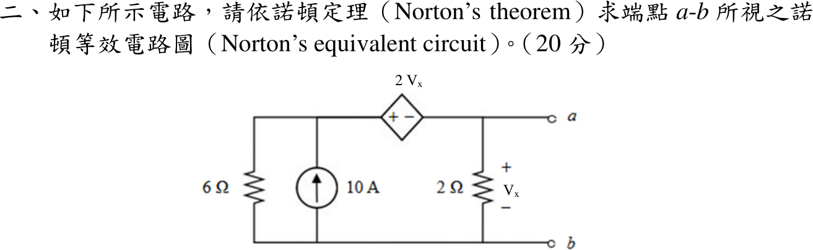
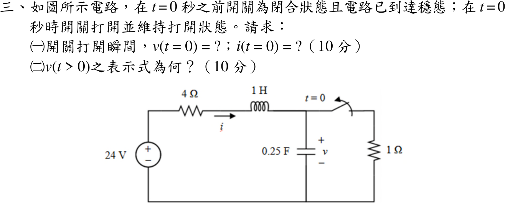
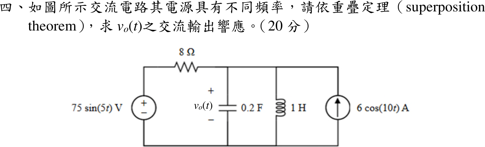
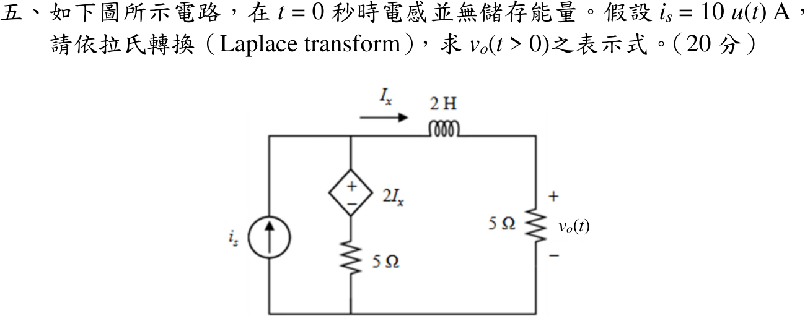

# 114 年電機工程技師｜電路學逐題詳解

> 本頁由題級 canonical 筆記組合；每題保留 QID、官方裁切、校驗狀態與完整得分型解答。

## 題目導覽
- [[#一、114 年電路學第 1 題｜節點電壓法與超節點|第 1 題：節點電壓法與超節點]]
- [[#二、114 年電路學第 2 題｜諾頓等效|第 2 題：諾頓等效]]
- [[#三、114 年電路學第 3 題｜二階 RLC 暫態|第 3 題：二階 RLC 暫態]]
- [[#四、114 年電路學第 4 題｜不同頻率的重疊定理|第 4 題：不同頻率的重疊定理]]
- [[#五、114 年電路學第 5 題｜拉氏轉換與含相依源電路|第 5 題：拉氏轉換與含相依源電路]]

---

## 一、114 年電路學第 1 題｜節點電壓法與超節點

> 題級識別：`EE-114-01-1`
> canonical 來源：`canonical/EE-114-01-1.md`
> 題級校驗狀態：`verified`

![[01_原始試題/依考科/01_電路學/images/questions/PE_114年_電路學_Q01.png]]

> 官方裁切來源：`01_原始試題/依考科/01_電路學/images/questions/PE_114年_電路學_Q01.png`

### 已知與所求

底線接地。25 V 電壓源正端接 \(v_1\)、負端接 \(v_2\)；相依電壓源 \(5I\) 負端接 \(v_2\)、正端接 \(v_3\)；6 Ω 跨接 \(v_1\)–\(v_3\)；2 Ω、4 Ω、3 Ω 分別由 \(v_1\)、\(v_2\)、\(v_3\) 接地，\(I\) 為 2 Ω 向下電流。求（一）\(I\)（5 分）；（二）\(v_1,v_2,v_3\)（15 分）。

### 考場標準作答

**解題邏輯**：題目指定節點電壓法。25 V 電壓源與相依電壓源 \(5I\) 把 \(v_1,v_2,v_3\) 連成同一個超節點，所以三個未知節點只能列一條超節點邊界 KCL；其餘兩條方程由兩個電壓源的電壓約束提供，控制量 \(I\) 再由 2 Ω 的歐姆定律補上。主線：把 \(v_2,v_3\) 都寫成 \(v_1\) 的函數 → 代入邊界 KCL 解 \(v_1\) → 得 \(I\) → 回推 \(v_2,v_3\)。

#### 步驟 1：超節點與約束方程

**畫法與方向**：以底線為參考節點；25 V 源正端在 \(v_1\)、負端在 \(v_2\)；相依源負端在 \(v_2\)、正端在 \(v_3\)；\(I\) 為 2 Ω 由 \(v_1\) 向下流到地的電流。6 Ω 連接 \(v_1\) 與 \(v_3\)，屬超節點內部支路，不列入邊界 KCL。

控制量與兩條電壓約束：
\[
I=\frac{v_1}{2},\qquad v_1-v_2=25,\qquad v_3-v_2=5I
\]
超節點邊界 KCL（流出超節點的只有三條接地電阻電流，和為零）：
\[
\frac{v_1}{2}+\frac{v_2}{4}+\frac{v_3}{3}=0
\]

#### 步驟 2：以 \(v_1\) 表示 \(v_2\)、\(v_3\)

由 25 V 源約束：
\[
v_2=v_1-25
\]
由相依源約束，再代入 \(v_2\) 與 \(I=v_1/2\)：
\[
v_3=v_2+5I=(v_1-25)+5\cdot\frac{v_1}{2}
\]
\[
v_3=v_1+\frac52v_1-25=\frac72v_1-25
\]

#### （一）電流 \(I\)（5 分）

**邏輯**：\(I=v_1/2\) 只由 \(v_1\) 決定；把步驟 2 的 \(v_2\)、\(v_3\) 代入邊界 KCL，得到只含 \(v_1\) 的一元方程。

代入邊界 KCL：
\[
\frac{v_1}{2}+\frac{v_1-25}{4}+\frac{\frac72v_1-25}{3}=0
\]
同乘 12 去分母：
\[
6v_1+3(v_1-25)+4\left(\tfrac72v_1-25\right)=0
\]
展開：
\[
6v_1+3v_1-75+14v_1-100=0
\]
合併同類項：
\[
23v_1-175=0\ \Rightarrow\ v_1=\frac{175}{23}\ \mathrm V
\]
\[
I=\frac{v_1}{2}=\frac{175}{23\times2}
\]
\[
\boxed{I=\frac{175}{46}=3.80\text{ A}}
\]

#### （二）節點電壓（15 分）

**邏輯**：\(v_1\) 已由（一）的 KCL 得到；\(v_2\)、\(v_3\) 直接用步驟 2 的兩條電壓約束回推，全程以精確分數代入。

\[
v_2=v_1-25=\frac{175}{23}-25=\frac{175-575}{23}=-\frac{400}{23}
\]
\[
v_3=\frac72v_1-25=\frac72\cdot\frac{175}{23}-25=\frac{1225}{46}-\frac{1150}{46}=\frac{75}{46}
\]
\[
\boxed{v_1=\frac{175}{23}=7.61\text{ V}},\qquad
\boxed{v_2=-\frac{400}{23}=-17.39\text{ V}},\qquad
\boxed{v_3=\frac{75}{46}=1.63\text{ V}}
\]

### 驗算

功率守恆（精確分數計算，顯示 4 位有效數字）：

- 6 Ω 電流 \((v_1-v_3)/6=\frac{275/46}{6}=\frac{275}{276}=0.9964\ \mathrm A\)（\(v_1\to v_3\)）。
- 25 V 源：節點 \(v_1\) 流出 \(I+\frac{275}{276}=\frac{1050+275}{276}=\frac{1325}{276}=4.801\ \mathrm A\)，全由 25 V 源正端供給，供給功率 \(25\times\frac{1325}{276}=120.0\ \mathrm W\)。
- 電阻吸收：2 Ω \(\frac{v_1^2}{2}=28.95\ \mathrm W\)、6 Ω \(6\left(\frac{275}{276}\right)^2=5.957\ \mathrm W\)、4 Ω \(\frac{v_2^2}{4}=75.61\ \mathrm W\)、3 Ω \(\frac{v_3^2}{3}=0.8861\ \mathrm W\)，合計 \(28.95+5.957+75.61+0.8861=111.4\ \mathrm W\)。
- 相依源：節點 \(v_3\) 由 6 Ω 流入 \(\frac{275}{276}\)、經 3 Ω 流出 \(\frac{v_3}{3}=\frac{150}{276}\)，其餘 \(\frac{125}{276}=0.4529\ \mathrm A\) 由相依源正端流入，吸收 \(5I\times\frac{125}{276}=\frac{875}{46}\times\frac{125}{276}=8.615\ \mathrm W\)。
- \(111.4+8.615=120.0\ \mathrm W\)，與 25 V 源供給相等。

### 失分點

- 把 6 Ω 寫成 \(\frac{v_1-v_3}{6}\) 列入超節點邊界 KCL，等於重複計算內部電流。
- 相依源極性看反寫成 \(v_2-v_3=5I\)，會得 \(3v_1=175\)、\(v_1=58.33\ \mathrm V\)；圖中相依源右端（\(v_3\)）為正。

---

## 二、114 年電路學第 2 題｜諾頓等效

> 題級識別：`EE-114-01-2`
> canonical 來源：`canonical/EE-114-01-2.md`
> 題級校驗狀態：`verified`

![[01_原始試題/依考科/01_電路學/images/questions/PE_114年_電路學_Q02.png]]

> 官方裁切來源：`01_原始試題/依考科/01_電路學/images/questions/PE_114年_電路學_Q02.png`

### 已知與所求

取 \(b\) 為參考點。左上節點 \(n\) 接 6 Ω 至 \(b\) 及 10 A 電流源（箭頭向上流入 \(n\)）；相依電壓源 \(2V_x\) 正端接 \(n\)、負端接 \(a\)；2 Ω 跨接 \(a\)–\(b\)，\(V_x=v_a\)（上正）。求 \(a\)–\(b\) 的諾頓等效電路。

### 考場標準作答

**解題邏輯**：諾頓等效要兩個量：\(I_N\)（= \(a\)–\(b\) 短路電流）與 \(R_N\)。電路含相依源，不能把源歸零後直接串並聯求 \(R_N\)，所以用 \(R_N=V_{oc}/I_{sc}\)：開路時以節點 \(n\) 的 KCL 求 \(V_{oc}\)，短路時由 \(V_x=0\) 使相依源電壓為零求 \(I_{sc}\)，最後畫成電流源並聯電阻。取 \(b\) 為參考點，\(V_x=v_a\)（上正下負）。

#### 步驟 1：相依源約束

相依源正端接 \(n\)、負端接 \(a\)，其電壓為 \(2V_x\)：
\[
v_n-v_a=2V_x,\qquad V_x=v_a
\]
\[
v_n=v_a+2v_a=3v_a
\]

#### 步驟 2：開路電壓 \(V_{oc}\)

\(a\)、\(b\) 開路時 \(a\) 端無外接電流，流過相依源（\(n\to a\)）的電流全部經 2 Ω 回到 \(b\)，即 \(v_a/2\)。節點 \(n\) 的 KCL（10 A 流入 = 6 Ω 與相依源支路流出）：
\[
10=\frac{v_n}{6}+\frac{v_a}{2}
\]
代入 \(v_n=3v_a\)：
\[
10=\frac{3v_a}{6}+\frac{v_a}{2}=\frac{v_a}{2}+\frac{v_a}{2}=v_a
\]
\[
V_{oc}=v_a=10\ \mathrm V
\]

#### 步驟 3：短路電流 \(I_{sc}\)

\(a\)–\(b\) 短路使 \(v_a=0\)，故 \(V_x=0\)、相依源電壓 \(2V_x=0\)：
\[
v_n=3v_a=3\times0=0
\]
6 Ω 與 2 Ω 兩端電壓皆為零，電流 \(v_n/6=0\)、\(v_a/2=0\)。節點 \(n\) 的 KCL：10 A 全部經相依源流向 \(a\)；節點 \(a\) 的 KCL：
\[
I_{sc}=10-\frac{v_a}{2}=10-0
\]
\(I_{sc}=10\ \mathrm A\)，在外部短路線中由 \(a\to b\)。

#### 諾頓等效電路（20 分）

**邏輯**：諾頓電流源等於端點短路電流，諾頓電阻由 \(V_{oc}/I_{sc}\) 求得（相依源保留在網路內，這個比值仍成立）。

\[
I_N=I_{sc}=10\ \mathrm A
\]
\[
R_N=\frac{V_{oc}}{I_{sc}}=\frac{10}{10}=1\ \Omega
\]
\[
\boxed{I_N=10\ \mathrm A},\qquad \boxed{R_N=1\ \Omega}
\]
畫法：\(a\)、\(b\) 兩端**並聯** 10 A 理想電流源與 1 Ω 電阻；電流源箭頭由 \(b\to a\)，使開路時電流全經 1 Ω 由上往下流，\(V_{ab}=I_NR_N=10\times1\)，即 \(V_{ab}=+10\,\mathrm V\)，與 \(V_{oc}\) 一致。

### 驗算

測試源法：關閉 10 A（開路）、保留相依源，在 \(a\) 加 \(V_t\)，則 \(v_n=3V_t\)，\(i_t=\frac{V_t}{2}+\frac{3V_t}{6}=V_t\Rightarrow R_N=1\ \Omega\)，與 \(V_{oc}/I_{sc}\) 一致。

### 失分點

- 求 \(R_N\) 時把相依源歸零會得 \(6\parallel2=1.5\ \Omega\)；相依源必須保留。
- \(V_x\) 極性看反（\(V_x=-v_a\)）會得 \(v_n=-v_a\)、\(V_{oc}=30\ \mathrm V\)。
- 把外部短路電流 \(a\to b\) 當成電流源本體箭頭；源內箭頭應為 \(b\to a\)。

---

## 三、114 年電路學第 3 題｜二階 RLC 暫態

> 題級識別：`EE-114-01-3`
> canonical 來源：`canonical/EE-114-01-3.md`
> 題級校驗狀態：`verified`

![[01_原始試題/依考科/01_電路學/images/questions/PE_114年_電路學_Q03.png]]

> 官方裁切來源：`01_原始試題/依考科/01_電路學/images/questions/PE_114年_電路學_Q03.png`

### 已知與所求

24 V 電源串 4 Ω、1 H（電流 \(i\) 向右）後接 0.25 F 電容（電壓 \(v\) 上正下負）；1 Ω 經開關與電容並聯。\(t<0\) 開關閉合且已穩態，\(t=0\) 打開。求（一）\(v(0)\)、\(i(0)\)（10 分）；（二）\(v(t>0)\)（10 分）。

### 考場標準作答

**解題邏輯**：電感電流與電容電壓不能瞬間改變，所以 \(t=0\) 的 \(i\)、\(v\) 就等於 \(t<0\) 直流穩態的值（電感短路、電容開路）。開關打開後 1 Ω 支路斷開、不再有電流，電路成為 24 V–4 Ω–1 H–0.25 F 串聯 RLC；以 \(v\) 為未知列二階微分方程 → 由特徵根判斷阻尼型態 → 全解 = 終值 + 自然響應 → 用 \(v(0)\) 與 \(\dot v(0)=i(0)/C\) 兩個初值定係數。開關視為理想開關。

#### （一）開關打開瞬間（10 分）

**邏輯**：\(t<0\) 已達直流穩態，電感短路、電容開路，24 V 只推動 4 Ω 與 1 Ω 串聯的電流；再由電感電流、電容電壓的連續性得到 \(t=0\) 的值。

電感短路、電容開路後，迴路只剩 24 V、4 Ω、1 Ω 串聯：
\[
i(0^-)=\frac{24}{4+1}
\]
\[
i(0^-)=\frac{24}{5}=4.80\ \mathrm A
\]
電容（開路）與 1 Ω 並聯，電容電壓等於 1 Ω 的電壓：
\[
v(0^-)=1\times i(0^-)
\]
\[
v(0^-)=1\times4.80=4.80\ \mathrm V
\]
電感電流、電容電壓連續：\(i(0)=i(0^-)\)、\(v(0)=v(0^-)\)。
\[
\boxed{v(0)=4.80\ \mathrm V},\qquad \boxed{i(0)=4.80\ \mathrm A}
\]

#### （二）\(v(t>0)\)（10 分）

**邏輯**：開關打開後為串聯 RLC，電容電流就是迴路電流 \(i=C\dot v\)；KVL 化成 \(v\) 的二階方程，特徵根決定響應形式，終值與兩個初值決定係數。

迴路 KVL（\(i\) 順時針，\(v\) 上正下負）：
\[
24=4i+L\frac{di}{dt}+v
\]
電容電流即迴路電流：
\[
i=C\frac{dv}{dt}=0.25\,\dot v,\qquad \frac{di}{dt}=0.25\,\ddot v
\]
代入 KVL（\(L=1\ \mathrm H\)）：
\[
24=4(0.25\,\dot v)+1\times(0.25\,\ddot v)+v=\dot v+0.25\,\ddot v+v
\]
兩邊乘 4：
\[
\ddot v+4\dot v+4v=96
\]
特徵方程：
\[
s^2+4s+4=0\ \Rightarrow\ (s+2)^2=0\ \Rightarrow\ s_1=s_2=-2\ \mathrm{s^{-1}}
\]
重根，臨界阻尼；亦即
\[
\alpha=\frac{R}{2L}=\frac{4}{2\times1}=2\ \mathrm{s^{-1}},\qquad \omega_0=\frac{1}{\sqrt{LC}}=\frac{1}{\sqrt{1\times0.25}}=2\ \mathrm{rad/s},\qquad \alpha=\omega_0
\]

終值：\(t\to\infty\) 電容開路、\(i=0\)，4 Ω 與 1 H 無壓降：
\[
v(\infty)=24\ \mathrm V\qquad(\text{亦即 }4v=96)
\]
全解形式：
\[
v(t)=24+(A+Bt)e^{-2t}
\]
初值一：\(v(0)=24+A=4.80\)
\[
A=4.80-24=-19.20\ \mathrm V
\]
初值二：微分得 \(\dot v(t)=\bigl[B-2(A+Bt)\bigr]e^{-2t}\)，故 \(\dot v(0)=B-2A\)；又電容電流 \(i(0)=C\dot v(0)\)：
\[
\dot v(0)=\frac{i(0)}{C}=\frac{4.80}{0.25}=19.20\ \mathrm{V/s}
\]
\[
B-2A=19.20\ \Rightarrow\ B=19.20+2A
\]
\[
B=19.20+2\times(-19.20)=19.20-38.40
\]
\[
B=-19.20\ \mathrm{V/s}
\]
\[
\boxed{v(t)=24-19.20(1+t)e^{-2t}\ \mathrm V,\quad t>0}
\]

### 驗算

由答案求 \(i=0.25\dot v=4.80(1+2t)e^{-2t}\)、\(\dfrac{di}{dt}=-19.20te^{-2t}\)，代回 KVL：
\[
4i+\frac{di}{dt}+v=19.20(1+2t)e^{-2t}-19.20te^{-2t}+24-19.20(1+t)e^{-2t}=24\ \mathrm V
\]
且 \(i(0)=4.80\ \mathrm A\)、\(i(\infty)=0\)，與初值及電容開路終值一致。

### 失分點

- 只用 \(v(0)=4.80\) 而漏用 \(\dot v(0)=i(0)/C=19.20\ \mathrm V/\mathrm s\)，重根解的 \(B\) 無法決定。
- 開關打開後仍把 1 Ω 留在電路，會誤得 \(s^2+8s+20=0\) 的欠阻尼解且 \(v(\infty)=4.80\ \mathrm V\)。
- 寫成 \(\dot v=iC\)（\(=1.20\)）而非 \(i/C\)。

---

## 四、114 年電路學第 4 題｜不同頻率的重疊定理

> 題級識別：`EE-114-01-4`
> canonical 來源：`canonical/EE-114-01-4.md`
> 題級校驗狀態：`verified`

![[01_原始試題/依考科/01_電路學/images/questions/PE_114年_電路學_Q04.png]]

> 官方裁切來源：`01_原始試題/依考科/01_電路學/images/questions/PE_114年_電路學_Q04.png`

### 已知與所求

\(75\sin(5t)\ \mathrm V\) 電壓源串 8 Ω 至輸出節點；輸出節點對地並接 0.2 F、1 H 與 \(6\cos(10t)\ \mathrm A\) 電流源（箭頭向上注入輸出節點）。以重疊定理求 \(v_o(t)\)（20 分）。

### 考場標準作答

**解題邏輯**：電路為線性，兩電源頻率不同（5 與 10 rad/s），用重疊定理：每次只留一個電源（關閉電壓源＝短路、關閉電流源＝開路），以該頻率的相量求 \(v_o\) 的穩態分量，最後回到時域相加——不同頻率的相量不可直接相加。電壓源 \(75\sin(5t)\) 取正弦基準峰值相量，電流源 \(6\cos(10t)\) 取餘弦基準峰值相量；兩分量各自回時域，基準不同不影響結果，最後統一寫成正弦。

#### 步驟 1：輸出節點的 \(L\)、\(C\) 並聯導納

\[
Y_C=j\omega C,\qquad Y_L=\frac{1}{j\omega L}=-\frac{j}{\omega L}
\]
\[
Y(j\omega)=Y_C+Y_L=j\left(0.2\omega-\frac1\omega\right)\ \mathrm S
\]

#### 步驟 2：5 rad/s 分量（電流源開路）

畫法：電流源開路；\(\mathbf V_s=75\angle0^\circ\ \mathrm V\)（正弦基準）經 8 Ω 接到輸出節點，節點對地為 \(Y_C\parallel Y_L\)。

\[
Y_C=j(5)(0.2)=j1\ \mathrm S,\qquad Y_L=\frac{1}{j(5)(1)}=-j0.2\ \mathrm S
\]
\[
Y_5=Y_C+Y_L=j1-j0.2=j0.8\ \mathrm S
\]

輸出節點 KCL（流出 8 Ω 支路與 \(Y_5\) 支路，和為零）：
\[
\frac{\mathbf V_{o,5}-\mathbf V_s}{8}+Y_5\mathbf V_{o,5}=0
\]
同乘 8 並移項：
\[
\mathbf V_{o,5}(1+8Y_5)=\mathbf V_s\ \Rightarrow\ \mathbf V_{o,5}=\frac{\mathbf V_s}{1+8Y_5}
\]
分母：
\[
1+8Y_5=1+8(j0.8)=1+j6.4
\]
\[
|1+j6.4|=\sqrt{1^2+6.4^2}=\sqrt{41.96}=6.478
\]
\[
\angle(1+j6.4)=\tan^{-1}\frac{6.4}{1}=81.12^\circ
\]
相除：
\[
\mathbf V_{o,5}=\frac{75\angle0^\circ}{6.478\angle81.12^\circ}\ \mathrm V
\]
\[
|\mathbf V_{o,5}|=\frac{75}{6.478}=11.58\ \mathrm V,\qquad \angle\mathbf V_{o,5}=0^\circ-81.12^\circ=-81.12^\circ
\]
正弦基準回時域：
\[
v_{o,5}(t)=11.58\sin(5t-81.12^\circ)\ \mathrm V
\]

#### 步驟 3：10 rad/s 分量（電壓源短路）

畫法：電壓源短路後，8 Ω 的左端接地，8 Ω 仍跨在輸出節點與地之間，與 \(Y_C\)、\(Y_L\) 三者並聯，由 \(\mathbf I_s=6\angle0^\circ\ \mathrm A\)（餘弦基準，箭頭向上注入輸出節點）驅動。

\[
Y_C=j(10)(0.2)=j2\ \mathrm S,\qquad Y_L=\frac{1}{j(10)(1)}=-j0.1\ \mathrm S
\]
\[
Y_{10}=Y_C+Y_L=j2-j0.1=j1.9\ \mathrm S
\]

加上 8 Ω 的電導 \(1/8=0.125\ \mathrm S\)：
\[
Y_{\mathrm{total}}=\frac18+j1.9\ \mathrm S
\]
\[
|Y_{\mathrm{total}}|=\sqrt{0.125^2+1.9^2}=\sqrt{0.015625+3.61}=\sqrt{3.625625}=1.904\ \mathrm S
\]
\[
\angle Y_{\mathrm{total}}=\tan^{-1}\frac{1.9}{0.125}=\tan^{-1}15.2=86.24^\circ
\]
輸出節點 KCL（注入 \(\mathbf I_s\)＝流出 \(Y_{\mathrm{total}}\mathbf V_{o,10}\)）：
\[
\mathbf V_{o,10}=\frac{\mathbf I_s}{Y_{\mathrm{total}}}=\frac6{1/8+j1.9}=\frac{6\angle0^\circ}{1.904\angle86.24^\circ}\ \mathrm V
\]
\[
|\mathbf V_{o,10}|=\frac{6}{1.904}=3.151\ \mathrm V,\qquad \angle\mathbf V_{o,10}=0^\circ-86.24^\circ=-86.24^\circ
\]
餘弦基準回時域：
\[
v_{o,10}(t)=3.151\cos(10t-86.24^\circ)\ \mathrm V
\]
改寫成正弦（\(\cos\theta=\sin(\theta+90^\circ)\)）：
\[
v_{o,10}(t)=3.151\sin(10t-86.24^\circ+90^\circ)=3.151\sin(10t+3.76^\circ)\ \mathrm V
\]

#### 輸出響應 \(v_o(t)\)（20 分）

**邏輯**：重疊定理：總響應＝各電源單獨作用的響應之和；兩分量頻率不同，只能在時域相加。

\[
v_o(t)=v_{o,5}(t)+v_{o,10}(t)
\]
\[
\boxed{v_o(t)=11.58\sin(5t-81.12^\circ)+3.15\sin(10t+3.76^\circ)\ \mathrm V}
\]

### 驗算

改用阻抗分壓／分流。5 rad/s：\(Z_C=-j1\ \Omega\)、\(Z_L=j5\ \Omega\)，\(Z_p=\dfrac{(-j1)(j5)}{-j1+j5}=\dfrac{5}{j4}=-j1.25\ \Omega\)；\(|\mathbf V_{o,5}|=\dfrac{75\times1.25}{\sqrt{8^2+1.25^2}}=\dfrac{93.75}{8.097}=11.58\ \mathrm V\)，相角 \(-90^\circ+\tan^{-1}\frac{1.25}{8}=-90^\circ+8.88^\circ=-81.12^\circ\)。
10 rad/s：\(Z_C=-j0.5\ \Omega\)、\(Z_L=j10\ \Omega\)，\(Z_p=\dfrac{(-j0.5)(j10)}{j9.5}=-j0.5263\ \Omega\)，再並 8 Ω：\(|Z|=\dfrac{8\times0.5263}{\sqrt{64+0.2770}}=\dfrac{4.210}{8.017}=0.5252\ \Omega\)，\(6\times0.5252=3.151\ \mathrm V\)，相角 \(-90^\circ+\tan^{-1}\frac{0.5263}{8}=-90^\circ+3.76^\circ=-86.24^\circ\)。直角座標 \(\mathbf V_{o,10}=0.2069-j3.144\ \mathrm V\)，模 \(3.151\ \mathrm V\)，一致。

### 失分點

- 短路電壓源時連 8 Ω 一起刪除，誤得 \(6/(j1.9)=3.16\angle-90^\circ\ \mathrm V\)。
- 把 5 rad/s 與 10 rad/s 的相量直接相加。
- 10 rad/s 分量用餘弦求得後，改寫成正弦時漏加 \(90^\circ\)。

---

## 五、114 年電路學第 5 題｜拉氏轉換與含相依源電路

> 題級識別：`EE-114-01-5`
> canonical 來源：`canonical/EE-114-01-5.md`
> 題級校驗狀態：`verified`

![[01_原始試題/依考科/01_電路學/images/questions/PE_114年_電路學_Q05.png]]

> 官方裁切來源：`01_原始試題/依考科/01_電路學/images/questions/PE_114年_電路學_Q05.png`

### 已知與所求

\(i_s=10u(t)\ \mathrm A\) 向上注入上方節點 \(a\)；中間支路為相依電壓源 \(2I_x\)（上正）串 5 Ω 接地，兩者之間節點記為 \(c\)；2 H 電感（\(I_x\) 向右，初始無儲能）串右側 5 Ω 接地，\(v_o\) 為右側 5 Ω 電壓。以拉氏轉換求 \(v_o(t>0)\)（20 分）。

### 考場標準作答

**解題邏輯**：電感零初值，\(s\) 域電路不必加初值源。取電感電流 \(I_x\) 為唯一未知量：右支路把 \(V_a\)、\(V_o\) 寫成 \(I_x\) 的倍數，中間支路由相依源極性得 \(V_c\)，再在節點 \(a\) 寫 KCL 解出 \(I_x(s)\)；\(V_o=5I_x\) 經部分分式後反拉氏轉換。下導線為參考節點。

#### 步驟 1：\(s\) 域電路

畫法：

- \(i_s=10u(t)\ \mathrm A\Rightarrow I_s(s)=\dfrac{10}{s}\)，向上注入節點 \(a\)。
- 電感 \(L=2\ \mathrm H\)：\(sL=2s\ \Omega\)；初始電流為零，不加初值源。
- \(I_x\)：由節點 \(a\) 經電感流向右側 5 Ω（題給方向）；\(I_m\)：中間支路由節點 \(a\) 向下流經相依源與 5 Ω 的電流（參考方向向下）。
- 相依源 \(2I_x\) 上正下負，其下端節點記為 \(c\)；\(V_o\) 為右側 5 Ω 上正下負的電壓。

#### 步驟 2：右支路與中間支路以 \(I_x\) 表示

右側 5 Ω（歐姆定律）：
\[
V_o=5I_x
\]
右支路 KVL（電感與 5 Ω 串聯）：
\[
V_a=(sL+5)I_x=(2s+5)I_x
\]
相依源上正下負，節點 \(c\) 比節點 \(a\) 低 \(2I_x\)：
\[
V_c=V_a-2I_x=(2s+5)I_x-2I_x=(2s+3)I_x
\]
中間支路 5 Ω（向下）：
\[
I_m=\frac{V_c}{5}=\frac{(2s+3)I_x}{5}
\]

#### 步驟 3：節點 \(a\) 的 KCL 求 \(I_x(s)\)

注入的 \(I_s\) 等於流出的 \(I_x\) 與 \(I_m\)：
\[
I_s=I_x+I_m
\]
代入：
\[
\frac{10}{s}=I_x+\frac{(2s+3)I_x}{5}
\]
右邊通分：
\[
I_x+\frac{(2s+3)I_x}{5}=\frac{5+2s+3}{5}I_x=\frac{2s+8}{5}I_x
\]
解 \(I_x\)：
\[
I_x=\frac{10}{s}\cdot\frac{5}{2s+8}=\frac{50}{s(2s+8)}
\]
分母提出 2：
\[
I_x=\frac{50}{2s(s+4)}=\frac{25}{s(s+4)}
\]

#### 輸出電壓 \(v_o(t>0)\)（20 分）

**邏輯**：\(V_o=5I_x\) 為兩相異實極點 \(s=0\)、\(s=-4\) 的有理式，以部分分式拆開後逐項反拉氏轉換（\(\frac1s\leftrightarrow u(t)\)，\(\frac1{s+a}\leftrightarrow e^{-at}\)）。

\[
V_o(s)=5I_x=5\times\frac{25}{s(s+4)}=\frac{125}{s(s+4)}
\]
部分分式設 \(V_o(s)=\dfrac{A}{s}+\dfrac{B}{s+4}\)：
\[
A=\left.sV_o(s)\right|_{s=0}=\left.\frac{125}{s+4}\right|_{s=0}=\frac{125}{4}=31.25\ \mathrm V
\]
\[
B=\left.(s+4)V_o(s)\right|_{s=-4}=\left.\frac{125}{s}\right|_{s=-4}=\frac{125}{-4}=-31.25\ \mathrm V
\]
\[
V_o(s)=\frac{31.25}{s}-\frac{31.25}{s+4}
\]
逐項反拉氏轉換：
\[
v_o(t)=31.25-31.25e^{-4t}\ \mathrm V
\]
\[
\boxed{v_o(t)=31.25(1-e^{-4t})\ \mathrm V,\quad t>0}
\]

### 驗算

時域直接列式。\(i_x=v_o/5\)，電感 \(v_a=v_o+2\dot i_x=v_o+\frac25\dot v_o\)，故 \(v_c=v_a-2i_x=\frac35v_o+\frac25\dot v_o\)。節點 \(a\)：\(i_x+v_c/5=10\)，即
\[
\frac{v_o}{5}+\frac{3v_o}{25}+\frac{2\dot v_o}{25}=10\;\Longleftrightarrow\;\dot v_o+4v_o=125
\]
答案代入：\(125e^{-4t}+125(1-e^{-4t})=125\)，且 \(v_o(0^+)=0\ \mathrm V\)（電感電流為零）、\(v_o(\infty)=31.25\ \mathrm V\)。

### 失分點

- 相依源極性寫反（\(V_c=V_a+2I_x\)）會得 \(I_x=25/[s(s+6)]\)、終值 \(20.83\ \mathrm V\)。
- 把零初始電感當直流短路只求終值，漏掉 \(e^{-4t}\) 暫態項。
- 部分分式係數 \(B\) 的符號（\(125/(-4)\)）算錯，會得 \(31.25(1+e^{-4t})\)，與 \(v_o(0^+)=0\) 矛盾。
