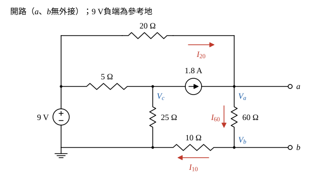
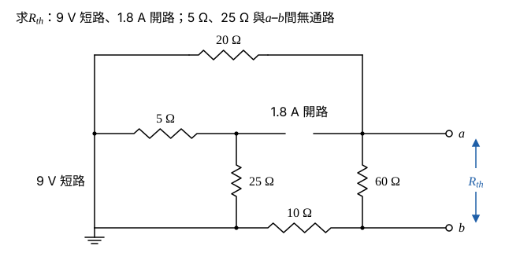
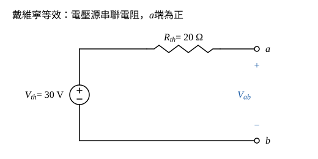

# 104 年電路學第 1 題｜橋接電路戴維寧等效

## 已知與所求

\(9\ \mathrm V\) 源（上正下負）在左側；上方 \(20\ \Omega\) 由 \(9\ \mathrm V\) 正端接到 \(a\) 節點；\(5\ \Omega\) 由 \(9\ \mathrm V\) 正端接到中節點 \(c\)，\(c\) 經 \(25\ \Omega\) 接 \(9\ \mathrm V\) 負端，並經 \(1.8\ \mathrm A\) 電流源（箭頭向右）接到 \(a\)；\(60\ \Omega\) 接 \(a\) 與 \(b\)；\(10\ \Omega\) 接 \(9\ \mathrm V\) 負端與 \(b\)。求 \(a\)–\(b\) 兩點間的戴維寧等效電路（20 分）。

## 考場標準作答

**解題邏輯**：戴維寧等效要兩個量：\(V_{th}\)（\(a\)–\(b\) 開路電壓）與 \(R_{th}\)（獨立源歸零後由 \(a\)–\(b\) 看入的電阻）。電路只有獨立源，所以 \(V_{th}\) 用節點分析（\(a\)、\(b\) 兩節點 KCL）求 \(V_a-V_b\)，\(R_{th}\) 用「電壓源短路、電流源開路」後串並聯化簡，最後畫成電壓源串聯電阻。以 \(9\ \mathrm V\) 負端為參考地，電源皆為理想源。

### 步驟 1：節點命名與參考方向

畫法：

- \(9\ \mathrm V\) 負端為地，正端節點電壓固定為 \(9\ \mathrm V\)；中節點電壓 \(V_c\)，兩端點電壓 \(V_a\)、\(V_b\)。
- 支路電流參考方向：\(I_{20}\) 由 \(9\ \mathrm V\) 正端經 \(20\ \Omega\) 流向 \(a\)；\(I_{60}\) 由 \(a\) 向下流到 \(b\)；\(I_{10}\) 由 \(b\) 經 \(10\ \Omega\) 流回地。開路時 \(a\)、\(b\) 端無外接電流。
- \(1.8\ \mathrm A\) 電流源由 \(c\) 流向 \(a\)，不論 \(V_c\) 為何，流入 \(a\) 的電流都固定為 \(1.8\ \mathrm A\)；所以 \(5\ \Omega\)、\(25\ \Omega\) 只決定 \(V_c\)（電流源端電壓），不影響 \(V_a\)、\(V_b\)，求 \(V_{th}\) 時不必解 \(V_c\)。

### 步驟 2：開路電壓 \(V_{th}\)

\(b\) 節點只接 \(60\ \Omega\) 與 \(10\ \Omega\)，KCL（流入 = 流出）：
\[
I_{60}=I_{10}\ \Rightarrow\ \frac{V_a-V_b}{60}=\frac{V_b}{10}
\]
兩邊乘 60：
\[
V_a-V_b=6V_b\ \Rightarrow\ V_b=\frac{V_a}{7}
\]
所以
\[
I_{60}=\frac{V_a-V_a/7}{60}=\frac{6V_a/7}{60}=\frac{V_a}{70}
\]
\(a\) 節點 KCL（流入 \(1.8\ \mathrm A\) 與 \(I_{20}\)，流出 \(I_{60}\)）：
\[
1.8 + \frac{9-V_a}{20}=\frac{V_a}{70}
\]
兩邊乘 140：
\[
252+7(9-V_a)=2V_a
\]
\[
252+63=7V_a+2V_a\ \Rightarrow\ 315=9V_a
\]
\[
V_a=\frac{315}{9}=35\ \mathrm V,\qquad V_b=\frac{35}{7}=5\ \mathrm V
\]
回代 \(I_{20}\)：
\[
I_{20}=\frac{9-V_a}{20}=\frac{9-35}{20}=-1.30\ \mathrm A
\]
負號表示實際電流由 \(a\) 經 \(20\ \Omega\) 流回 \(9\ \mathrm V\) 正端，與圖 1 的參考箭頭相反；核 \(a\) 節點：\(1.8+(-1.30)=0.50\ \mathrm A=I_{60}=\frac{35}{70}\ \mathrm A\)。
\[
V_{th}=V_a-V_b=35-5=30\ \mathrm V\quad(a\text{ 端為正})
\]

### 步驟 3：等效電阻 \(R_{th}\)

\(9\ \mathrm V\) 短路使其正端節點與地同電位；\(1.8\ \mathrm A\) 開路後，節點 \(c\) 只經 \(5\ \Omega\)、\(25\ \Omega\) 接回地，與 \(a\)、\(b\) 之間沒有通路，這兩個電阻不計入。由 \(a\) 到 \(b\) 有兩條路徑：

- 直接經 \(60\ \Omega\)；
- \(a\to20\ \Omega\to\) 地 \(\to10\ \Omega\to b\)，串聯 \(20+10=30\ \Omega\)。

\[
R_{th}=60\parallel30=\frac{60\times30}{60+30}=\frac{1800}{90}=20\ \Omega
\]

### 戴維寧等效電路（20 分）

**邏輯**：戴維寧等效電路由開路電壓 \(V_{th}\) 串聯等效電阻 \(R_{th}\) 構成，極性依 \(V_a-V_b>0\) 定為 \(a\) 端為正。

\[
\boxed{V_{th}=30\ \mathrm V\ (a\text{ 端為正})},\qquad \boxed{R_{th}=20\ \Omega}
\]
畫法：\(30\ \mathrm V\) 理想電壓源正端經 \(20\ \Omega\) 接 \(a\)，負端接 \(b\)；開路時 \(R_{th}\) 無電流，\(V_{ab}=30\ \mathrm V\)，與步驟 2 一致。

## 驗算

重疊定理。僅 \(9\ \mathrm V\) 作用（電流源開路）：外迴路 \(20+60+10=90\ \Omega\)，電流 \(9/90=0.10\ \mathrm A\)，\(60\ \Omega\) 端電壓 \(0.10\times60=6\ \mathrm V\)。僅 \(1.8\ \mathrm A\) 作用（\(9\ \mathrm V\) 短路）：電流進入 \(a\) 後分兩路回地，經 \(20\ \Omega\) 或經 \(60+10=70\ \Omega\)，流過 \(60\ \Omega\) 的分流 \(1.8\times\dfrac{20}{20+70}=0.40\ \mathrm A\)，端電壓 \(0.40\times60=24\ \mathrm V\)。相加 \(6+24=30\ \mathrm V\)，與 \(V_{th}\) 相同。另：\(c\) 節點 KCL \(\frac{9-V_c}{5}=\frac{V_c}{25}+1.8\) 得 \(V_c=0\)，只是電流源端電壓，確實不影響 \(V_{th}\)。

## 失分點

- \(V_{th}\) 取 \(V_a-V_b\)（\(35-5\)），不是 \(V_a=35\ \mathrm V\)；\(10\ \Omega\) 在 \(b\) 與地之間，\(b\) 不是地。
- 求 \(R_{th}\) 時漏掉 \(10\ \Omega\) 會得 \(60\parallel20=15\ \Omega\)；把 \(5\ \Omega\)、\(25\ \Omega\) 併入（電流源未開路）也會算錯。
- 電流源支路串了 \(5\ \Omega\)、\(25\ \Omega\) 仍是固定 \(1.8\ \mathrm A\) 流入 \(a\)，不要把它們併進 \(a\) 節點的 KCL。
