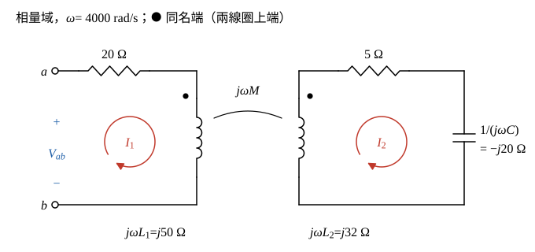

# 104 年電路學第 2 題｜互感耦合輸入阻抗為實數

## 已知與所求

\(\omega=4000\ \mathrm{rad/s}\)。一次側：\(a\) 端串 \(20\ \Omega\) 接 \(L_1=12.5\ \mathrm{mH}\)，再回到 \(b\)；二次側：\(L_2=8\ \mathrm{mH}\) 串 \(5\ \Omega\) 與 \(C=12.5\ \mu\mathrm F\) 成閉迴路；兩線圈同名端都在上端，耦合係數 \(k\)。求使 \(Z_{ab}\) 為實數的 \(k\)（20 分）。

## 考場標準作答

### 步驟 1：電抗

以弦波穩態相量分析，設線圈、電容皆為理想元件。

\[
\omega L_1=4000\times12.5\times10^{-3}=50\ \Omega
\]
\[
\omega L_2=4000\times8\times10^{-3}=32\ \Omega
\]
\[
\frac{1}{\omega C}=\frac{1}{4000\times12.5\times10^{-6}}=\frac{1}{0.05}=20\ \Omega
\]

### 步驟 2：網目 KVL 與 \(Z_{ab}\)

畫法：

- 在 \(a\)、\(b\) 外加電壓 \(\mathbf V_{ab}\)（\(a\) 正），一次側網目電流 \(\mathbf I_1\) 順時針：由 \(a\) 流入，經 \(20\ \Omega\) 後向下流過 \(L_1\)，即由 \(L_1\) 的點端流入。
- 二次側網目電流 \(\mathbf I_2\) 也取順時針：向上流過 \(L_2\)，即由 \(L_2\) 的點端流出。
- 一個電流由點端流入、另一個由點端流出，互感電壓與自感電壓反號，互阻抗取 \(-j\omega M\)。

二次側迴路阻抗：
\[
Z_{22}=5+j\omega L_2-j\frac{1}{\omega C}=5+j32-j20=5+j12\ \Omega
\]
兩網目 KVL：
\[
\begin{aligned}
\mathbf V_{ab}&=(20+j50)\mathbf I_1-j\omega M\,\mathbf I_2\\
0&=-j\omega M\,\mathbf I_1+(5+j12)\mathbf I_2
\end{aligned}
\]
由第二式：
\[
\mathbf I_2=\frac{j\omega M}{5+j12}\mathbf I_1
\]
代入第一式：
\[
\mathbf V_{ab}=(20+j50)\mathbf I_1-j\omega M\cdot\frac{j\omega M}{5+j12}\mathbf I_1=\left[20+j50+\frac{(\omega M)^2}{5+j12}\right]\mathbf I_1
\]
（\(-j\omega M\cdot j\omega M=-j^2(\omega M)^2=(\omega M)^2\)；若互感改取 \(+j\omega M\)，兩式的互感項同時變號，乘積不變，所以答案與同名端極性無關。）
\[
Z_{ab}=\frac{\mathbf V_{ab}}{\mathbf I_1}=20+j50+\frac{(\omega M)^2}{5+j12}
\]

### 耦合係數 \(k\)（20 分）

有理化：
\[
\frac{1}{5+j12}=\frac{5-j12}{(5+j12)(5-j12)}=\frac{5-j12}{25+144}=\frac{5-j12}{169}
\]
反射阻抗乘開：
\[
\frac{(\omega M)^2}{5+j12}=\frac{(\omega M)^2(5-j12)}{169}=\frac{5(\omega M)^2}{169}-j\frac{12(\omega M)^2}{169}
\]
加上 \(20+j50\)，實部、虛部分別合併：
\[
Z_{ab}=20+\frac{5(\omega M)^2}{169}+j\left[50-\frac{12(\omega M)^2}{169}\right]
\]
令虛部為零：
\[
50-\frac{12(\omega M)^2}{169}=0
\]
\[
(\omega M)^2=\frac{50\times169}{12}=\frac{8450}{12}=\frac{4225}{6}\ \Omega^2
\]
由 \(M=k\sqrt{L_1L_2}\)：
\[
(\omega M)^2=k^2(\omega L_1)(\omega L_2)=k^2\times50\times32=1600k^2
\]
\[
1600k^2=\frac{4225}{6}
\]
\[
k^2=\frac{4225}{6\times1600}=\frac{4225}{9600}=\frac{169}{384}
\]
\[
k=\sqrt{\frac{169}{384}}=\frac{13}{\sqrt{384}}=\frac{13}{8\sqrt6}=\frac{13}{19.596}=0.6634
\]
\[
\boxed{k=\frac{13}{8\sqrt6}\approx0.66}
\]

\(0<k\le1\)，合理。

## 驗算

代回 \(k^2=169/384\)：\((\omega M)^2=\tfrac{169}{384}\times1600=\tfrac{4225}{6}\)，而 \(\tfrac{4225}{6}\div169=\tfrac{25}{6}\)，故
\(\mathrm{Im}\,Z_{ab}=50-12\times\tfrac{25}{6}=50-50=0\)，\(Z_{ab}=20+5\times\tfrac{25}{6}=20+20.83=40.83\ \Omega\)（純電阻）。互感量 \(M=k\sqrt{L_1L_2}=0.6634\times\sqrt{12.5\times8}\ \mathrm{mH}=0.6634\times10=6.634\ \mathrm{mH}\)。

## 失分點

- 二次側含電容，\(Z_{22}=5+j(32-20)\)，不是 \(5+j32\)；漏掉 \(-j20\) 會得 \((\omega M)^2=1639.06\ \Omega^2\)、\(k=1.01>1\)，不合理。
- 反射阻抗為 \((\omega M)^2/Z_{22}\)，要有理化後才能分出實、虛部，且 \(M=k\sqrt{L_1L_2}\) 要換算回 \(k\)。
- 反射阻抗是 \(+(\omega M)^2/Z_{22}\)，不是 \(-(\omega M)^2/Z_{22}\)；\((j\omega M)^2=-(\omega M)^2\) 的負號與 KVL 中互感項的減號相乘後為正。
