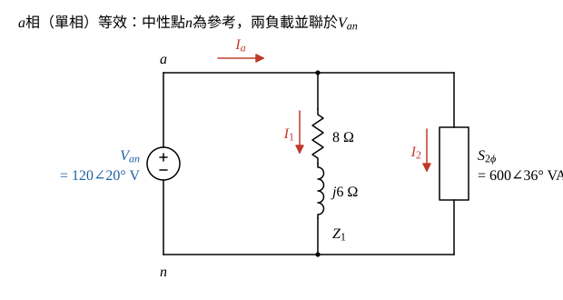

# 104 年電路學第 3 題｜三相 Y 接並聯負載複數功率

## 已知與所求

平衡三相，Y 接電源，\(abc\) 相序，\(V_{an}=120\angle20^\circ\ \mathrm{V_{rms}}\)（裁切圖印作 \(Y_{an}\)，依文意為相電壓 \(V_{an}\)）。兩個並聯 Y 型負載：負載 1 每相 \(Z_1=(8+j6)\ \Omega\)；負載 2 的 \(a\) 相複數功率為 \(600\angle36^\circ\ \mathrm{VA}\)。求電源提供的總複數功率（20 分）。

## 考場標準作答

**解題邏輯**：系統平衡，三相各相功率相同，只要算 \(a\) 相再乘 3。主線：取 \(a\) 相單相等效（中性點為參考，兩負載都接在 \(V_{an}\) 上）→ 負載 1 用 \(S=|V|^2/Z^*\) 求每相複數功率 → 負載 2 每相功率題目已給，換成直角座標 → 兩者相加得每相總功率 → 乘 3 得電源總複數功率。電壓為有效值，故 \(S=VI^*\) 不必再除 2。

### 步驟 1：\(a\) 相單相等效

畫法：

- Y–Y 平衡系統中，電源中性點與兩負載中性點同電位，\(a\) 相可單獨畫成 \(V_{an}\) 跨接兩並聯負載。
- 負載 1 每相 \(Z_1=8+j6\ \Omega\)；負載 2 以每相複數功率 \(S_{2\phi}=600\angle36^\circ\ \mathrm{VA}\) 表示。

### 步驟 2：負載 1 每相複數功率 \(S_{1\phi}\)

\[
S_{1\phi}=V_{an}I_1^*=V_{an}\left(\frac{V_{an}}{Z_1}\right)^*=\frac{|V_{an}|^2}{Z_1^*}
\]
\[
S_{1\phi}=\frac{120^2}{8-j6}=\frac{14400}{8-j6}
\]
分子分母同乘 \(8+j6\)，分母 \(8^2+6^2=100\)：
\[
S_{1\phi}=\frac{14400(8+j6)}{100}=144(8+j6)=1152+j864\ \mathrm{VA}
\]

### 步驟 3：負載 2 每相複數功率 \(S_{2\phi}\)

\[
S_{2\phi}=600\angle36^\circ=600\cos36^\circ+j600\sin36^\circ
\]
\[
600\cos36^\circ=600\times0.80902=485.41\ \mathrm W
\]
\[
600\sin36^\circ=600\times0.58779=352.67\ \mathrm{var}
\]
\[
S_{2\phi}=485.41+j352.67\ \mathrm{VA}
\]

### 電源總複數功率（20 分）

**邏輯**：並聯負載的複數功率可直接相加（功率守恆），平衡三相總功率等於每相功率的 3 倍；電源供出的功率等於兩負載吸收的總和。

每相總功率：
\[
S_\phi=S_{1\phi}+S_{2\phi}=(1152+485.41)+j(864+352.67)=1637.41+j1216.67\ \mathrm{VA}
\]
三相總功率：
\[
S_T=3S_\phi=3\times1637.41+j3\times1216.67=4912.23+j3650.01\ \mathrm{VA}
\]
化成極座標：
\[
|S_T|=\sqrt{4912.23^2+3650.01^2}=6119.85\ \mathrm{VA}
\]
\[
\theta=\tan^{-1}\frac{3650.01}{4912.23}=\tan^{-1}0.7430=36.61^\circ
\]
\[
\boxed{S_T=4912.23+j3650.01\ \mathrm{VA}=6.12\angle36.61^\circ\ \mathrm{kVA}}
\]
即 \(P_T=4.91\ \mathrm{kW}\)、\(Q_T=3.65\ \mathrm{kvar}\)（感性）。

## 驗算

改用線電流：負載 1 電流 \(I_1=\dfrac{120\angle20^\circ}{10\angle36.87^\circ}=12\angle-16.87^\circ\ \mathrm A\)；負載 2 電流 \(I_2=\left(\dfrac{S_{2\phi}}{V_{an}}\right)^*=\left(5\angle16^\circ\right)^*=5\angle-16^\circ\ \mathrm A\)。\(I_a=I_1+I_2=12\angle-16.87^\circ+5\angle-16^\circ=17.00\angle-16.61^\circ\ \mathrm A\)，\(S_T=3V_{an}I_a^*=3(120)(17.00)\angle(20^\circ+16.61^\circ)=6.12\angle36.61^\circ\ \mathrm{kVA}\)，與上式相同。

## 失分點

- 題目所給是「\(a\) 相」複數功率，電源總功率必須乘 3，不能只加單相。
- 複數功率用 \(S=|V|^2/Z^*\)（共軛），不是 \(|V|^2/Z\)；後者會得 \(1152-j864\)，\(Q\) 變負。
- 角度 \(36^\circ\) 換直角座標時計算機須在 DEG 模式，否則 \(\cos36\) 會以弧度計算。
