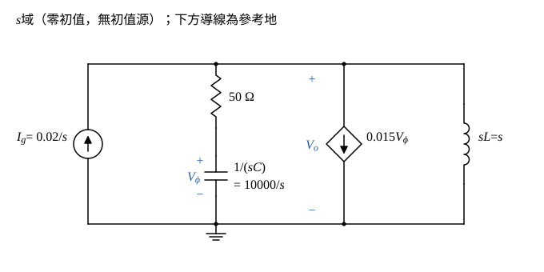

# 104 年電路學第 4 題｜相依源 RLC 二階暫態

## 已知與所求

\(t=0\) 時無儲能，\(i_g=20u(t)\ \mathrm{mA}\)（向上注入頂節點）。頂節點對地並聯四支路：\(i_g\)；\(50\ \Omega\) 串 \(100\ \mu\mathrm F\)（電容電壓 \(v_\phi\)，上正）；相依電流源 \(15\times10^{-3}v_\phi\)（向下）；\(1\ \mathrm H\) 電感。\(v_o\) 為頂節點對地電壓（上正）。求 \(v_o(t)\)（20 分）。

## 考場標準作答

### 步驟 1：\(s\) 域電路

只有一個非參考節點（頂節點），用 \(s\) 域節點分析；電流以 A、電壓以 V 計。

畫法：

- \(i_g=0.02u(t)\ \mathrm A\Rightarrow I_g(s)=\dfrac{0.02}{s}\)，向上注入頂節點。
- \(C=100\ \mu\mathrm F=10^{-4}\ \mathrm F\)：\(\dfrac1{sC}=\dfrac{1}{10^{-4}s}=\dfrac{10000}{s}\ \Omega\)；\(L=1\ \mathrm H\)：\(sL=s\ \Omega\)。
- 無儲能，故電容、電感都不加初值源；\(V_\phi\) 為電容上的電壓（上正），\(V_o\) 為頂節點對地電壓。

### 步驟 2：各支路以 \(V_o\) 表示

\(RC\) 支路阻抗：
\[
Z_{RC}=50+\frac{10000}{s}=\frac{50s+10000}{s}=\frac{50(s+200)}{s}
\]
\(RC\) 支路電流（向下）：
\[
\frac{V_o}{Z_{RC}}=\frac{s}{50(s+200)}V_o=\frac{0.02s}{s+200}V_o
\]
控制量 \(V_\phi\) 由分壓：
\[
V_\phi=V_o\frac{10000/s}{50(s+200)/s}=V_o\frac{10000}{50(s+200)}=\frac{200}{s+200}V_o
\]
相依源電流（向下）：
\[
15\times10^{-3}V_\phi=0.015\times\frac{200}{s+200}V_o=\frac{3}{s+200}V_o
\]
電感電流（向下）：
\[
\frac{V_o}{sL}=\frac{V_o}{s}
\]

### 輸出電壓 \(v_o(t)\)（20 分）

頂節點 KCL：
\[
\frac{0.02}{s}=V_o\left[\frac{0.02s}{s+200}+\frac{3}{s+200}+\frac1s\right]
\]
前兩項同分母相加：
\[
\frac{0.02s}{s+200}+\frac{3}{s+200}=\frac{0.02s+3}{s+200}
\]
再與 \(\dfrac1s\) 通分：
\[
\frac{0.02s+3}{s+200}+\frac1s=\frac{s(0.02s+3)+(s+200)}{s(s+200)}=\frac{0.02s^2+4s+200}{s(s+200)}
\]
分子提出 0.02：
\[
0.02s^2+4s+200=0.02(s^2+200s+10000)=0.02(s+100)^2
\]
所以
\[
\frac{0.02}{s}=V_o\,\frac{0.02(s+100)^2}{s(s+200)}
\]
\[
V_o(s)=\frac{0.02}{s}\times\frac{s(s+200)}{0.02(s+100)^2}=\frac{s+200}{(s+100)^2}
\]
部分分式：分子 \(s+200=(s+100)+100\)，
\[
V_o(s)=\frac{s+100}{(s+100)^2}+\frac{100}{(s+100)^2}=\frac{1}{s+100}+\frac{100}{(s+100)^2}
\]
反拉氏轉換（\(\frac1{s+a}\leftrightarrow e^{-at}\)，\(\frac1{(s+a)^2}\leftrightarrow te^{-at}\)）：
\[
v_o(t)=e^{-100t}+100te^{-100t}
\]
\[
\boxed{v_o(t)=(1+100t)e^{-100t}\,u(t)\ \mathrm V}
\]
特徵式 \((s+100)^2=0\) 為重根 \(s=-100\)，屬臨界阻尼。

## 驗算

初值：\(t=0^+\) 電容電壓連續為 0（相當短路），\(v_\phi=0\)，相依源為 0；電感電流連續為 0（相當開路），\(20\ \mathrm{mA}\) 全經 \(50\ \Omega\)，\(v_o(0^+)=0.02\times50=1\ \mathrm V\)，與 \((1+0)e^0=1\) 一致。終值：\(t\to\infty\) 電感短路，\(v_o\to0\)，與 \(e^{-100t}\) 衰減一致；終值定理 \(\lim_{s\to0}sV_o(s)=0\) 亦同。

## 失分點

- 相依源電流 \(15\times10^{-3}v_\phi\) 受電容電壓 \(v_\phi\) 控制，而非 \(v_o\)；須先以分壓 \(V_\phi=\dfrac{200}{s+200}V_o\) 換成 \(V_o\)。
- 分母整理後為 \(0.02(s+100)^2\)（\(s^2+200s+10000\)），重根；若誤得兩相異根會寫成雙指數。
- 重根部分分式漏掉 \(\dfrac{100}{(s+100)^2}\) 項，會少掉 \(100te^{-100t}\)。
