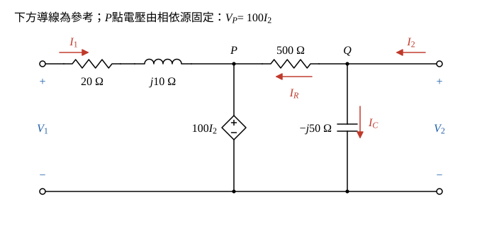

# 104 年電路學第 5 題｜雙埠網路 g 參數

## 已知與所求

埠 1：\(V_1\)、\(I_1\)（向右流入），串聯 \(20\ \Omega\) 與 \(j10\ \Omega\) 到中間節點 \(P\)；\(P\) 對地為相依電壓源 \(100I_2\)（上正）；\(P\) 與輸出節點 \(Q\) 間 \(500\ \Omega\)；\(Q\) 對地並聯 \(-j50\ \Omega\)；埠 2：\(V_2\) 在 \(Q\)、\(I_2\) 向左流入 \(Q\)。求 \(I_1=g_{11}V_1+g_{12}I_2\)、\(V_2=g_{21}V_1+g_{22}I_2\) 的 \(g\) 參數（20 分）。

## 考場標準作答

**解題邏輯**：\(g\) 參數以 \(V_1\)、\(I_2\) 為自變數，求 \(I_1\) 與 \(V_2\)。關鍵是中間節點 \(P\) 的電壓被相依源固定為 \(V_P=100I_2\)，與 \(V_1\) 無關：輸入側只要一條迴路 KVL 就得 \(I_1\)（→ \(g_{11},g_{12}\)）；輸出側對節點 \(Q\) 列 KCL，式中只有 \(V_2\) 與 \(I_2\)（→ \(g_{21}=0\)、\(g_{22}\)）。全題為相量，阻抗以 \(\Omega\)、導納以 S 表示。

### 步驟 1：節點與參考方向

畫法：

- 下方導線為參考；\(P\) 為 \(j10\ \Omega\) 右端節點，\(Q\) 為輸出端上方節點（\(V_2\) 即 \(Q\) 的電壓）。
- \(I_1\) 由埠 1 正端流入，\(I_2\) 由埠 2 正端流入 \(Q\)（依題圖）。
- \(I_C\)：自 \(Q\) 向下流過 \(-j50\ \Omega\)；\(I_R\)：自 \(Q\) 經 \(500\ \Omega\) 流向 \(P\)。
- 相依源上正下負接在 \(P\) 與參考之間，故 \(V_P=100I_2\)（係數 100 的單位為 \(\Omega\)）。

### g 參數（20 分）

**邏輯**：\(g\) 參數的兩條定義式各對應一條方程式——輸入迴路 KVL 直接寫成 \(I_1\) 對 \(V_1\)、\(I_2\) 的線性式；節點 \(Q\) 的 KCL 寫成 \(V_2\) 對 \(I_2\) 的式子，比對係數即得四個參數。

**(a) 輸入迴路求 \(g_{11}\)、\(g_{12}\)**

由埠 1 經 \(20\ \Omega\)、\(j10\ \Omega\) 到 \(P\)，再經相依源回參考：
\[
V_1=(20+j10)I_1+V_P=(20+j10)I_1+100I_2
\]
移項解 \(I_1\)：
\[
I_1=\frac{1}{20+j10}V_1-\frac{100}{20+j10}I_2
\]
有理化（\(|20+j10|^2=20^2+10^2=500\)）：
\[
\frac{1}{20+j10}=\frac{20-j10}{500}=0.04 - j0.02\ \mathrm S
\]
\[
\boxed{g_{11}=\frac{1}{20+j10}=0.04 - j0.02\ \mathrm S}
\]
\[
-\frac{100}{20+j10}=-100\times(0.04-j0.02)=-4+j2
\]
\[
\boxed{g_{12}=-\frac{100}{20+j10}=-4+j2\ \text{（無因次）}}
\]

**(b) 節點 \(Q\) 求 \(g_{21}\)、\(g_{22}\)**

\(Q\) 的 KCL（流入 \(I_2\) = 流出 \(I_C+I_R\)）：
\[
I_2=I_C+I_R=\frac{V_2}{-j50}+\frac{V_2-V_P}{500}
\]
代入 \(V_P=100I_2\)，並逐項化簡：
\[
\frac{1}{-j50}=\frac{j}{50}=j0.02\ \mathrm S,\qquad \frac{1}{500}=0.002\ \mathrm S,\qquad \frac{100I_2}{500}=0.2I_2
\]
\[
I_2=j0.02V_2+0.002V_2-0.2I_2
\]
\[
1.2I_2=(0.002+j0.02)V_2
\]
\[
V_2=\frac{1.2}{0.002+j0.02}I_2=\frac{600}{1+j10}I_2
\]
此式不含 \(V_1\)：\(P\) 點電壓由 \(I_2\) 決定，\(V_1\) 只改變 \(I_1\)，影響不到 \(Q\)。
\[
\boxed{g_{21}=0}
\]
有理化（\(|1+j10|^2=1+100=101\)）：
\[
\frac{600}{1+j10}=\frac{600(1-j10)}{101}=\frac{600}{101}-j\frac{6000}{101}
\]
\[
\boxed{g_{22}=\frac{600}{1+j10}=\frac{600}{101}-j\frac{6000}{101}\approx5.94-j59.41\ \Omega}
\]

## 驗算

依定義測試：\(I_2=0\)（埠 2 開路）時 \(V_P=0\)，\(I_1=V_1/(20+j10)\)，\(g_{11}\) 成立；\(Q\) 無激勵，\(V_2=0\)，\(g_{21}=0\)。\(V_1=0\)、注入 \(I_2=1\ \mathrm A\) 時 \(V_P=100\ \mathrm V\)，\(I_1=-100/(20+j10)=-4+j2\ \mathrm A\) 即 \(g_{12}\)；\(V_2=600/(1+j10)=5.94-j59.41\ \mathrm V\)，代回 KCL：\(V_2(0.002+j0.02)=(5.94-j59.41)(0.002+j0.02)=0.0119+1.1882+j(0.1188-0.1188)\approx1.20\ \mathrm A=1.2I_2\)，成立。

## 失分點

- 混合單位：\(g_{11}\) 單位 S、\(g_{22}\) 單位 \(\Omega\)，\(g_{12}\)、\(g_{21}\) 無因次，作答要逐一標註。
- 相依源 \(100I_2\) 使 \(V_P\) 與 \(V_1\) 無關，\(g_{21}=0\)；不要以為 \(V_1\) 會經 \(500\ \Omega\) 影響埠 2。
- \(Q\) 的 KCL 要包含相依源造成的 \(-0.2I_2\) 項，漏掉會得 \(1/(0.002+j0.02)\) 而非乘以 \(1.2\)。
