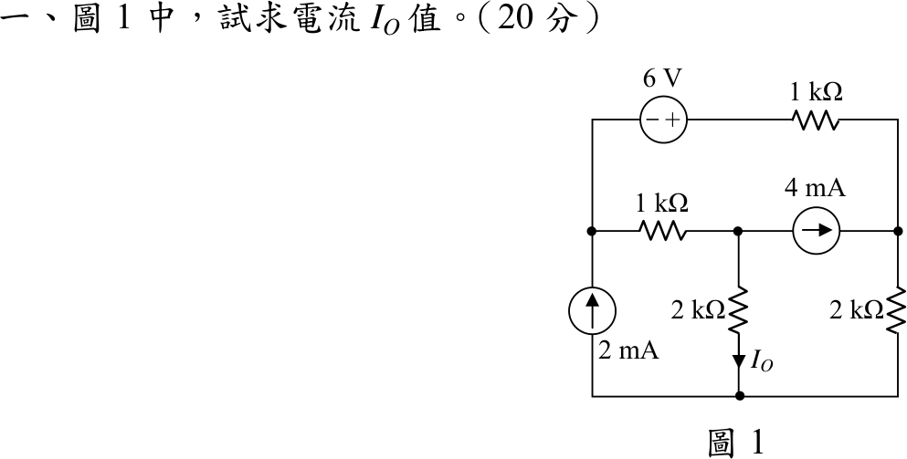
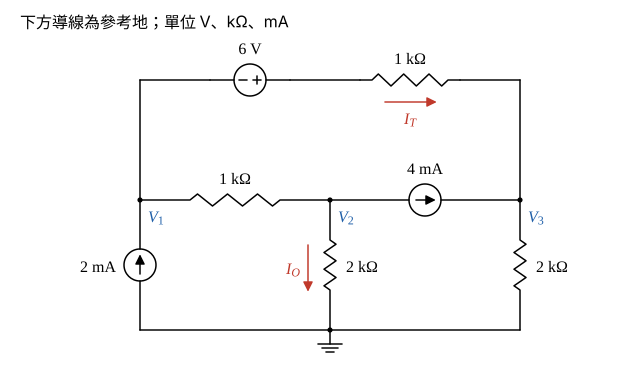

# 105 年電路學第 1 題｜多網目直流電路節點分析

## 已知與所求

下方水平導線為參考節點。\(2\ \mathrm{mA}\) 電流源由下往上注入左節點 \(V_1\)；\(V_1\) 與中節點 \(V_2\) 間為 \(1\ \mathrm{k\Omega}\)；\(V_2\) 經 \(2\ \mathrm{k\Omega}\) 接地（\(I_O\) 向下）；\(4\ \mathrm{mA}\) 電流源由 \(V_2\) 指向右節點 \(V_3\)，\(V_3\) 經 \(2\ \mathrm{k\Omega}\) 接地；上方支路由 \(V_1\) 經 \(6\ \mathrm V\)（左負右正）與 \(1\ \mathrm{k\Omega}\) 接到 \(V_3\)。求 \(I_O\)（20 分）。

## 考場標準作答

### 步驟 1：節點命名與參考方向

以節點分析求解；電壓以 V、電阻以 \(\mathrm{k\Omega}\)、電流以 mA 計（\(\mathrm V/\mathrm{k\Omega}=\mathrm{mA}\)），電源皆為理想源。

畫法：

- 下方導線為參考地；左、中、右節點電壓分別為 \(V_1\)、\(V_2\)、\(V_3\)。
- 上方支路電流 \(I_T\) 參考方向取由 \(V_1\) 向右流到 \(V_3\)；\(I_O\) 依題圖向下流過中間 \(2\ \mathrm{k\Omega}\)。
- KCL 一律寫「流入 = 流出」。

### 步驟 2：上方支路電流 \(I_T\)

由 \(V_1\) 向右經過 6 V 源（左負右正），電位升高 6 V，到達 \(1\ \mathrm{k\Omega}\) 左端時為 \(V_1+6\)；再經 \(1\ \mathrm{k\Omega}\) 到 \(V_3\)：
\[
I_T=\frac{(V_1+6)-V_3}{1}=V_1+6-V_3\ \ (\mathrm{mA})
\]

### 電流 \(I_O\)（20 分）

三個節點 KCL（流入 = 流出）：
\[
\begin{aligned}
V_1\text{ 節點：}&\ 2=\frac{V_1-V_2}{1}+I_T\\
V_2\text{ 節點：}&\ \frac{V_1-V_2}{1}=\frac{V_2}{2}+4\\
V_3\text{ 節點：}&\ 4+I_T=\frac{V_3}{2}
\end{aligned}
\]
代入 \(I_T=V_1+6-V_3\) 並整理：

- \(V_1\) 節點：\(2=V_1-V_2+V_1+6-V_3\Rightarrow 2V_1-V_2-V_3=-4\) …(1)
- \(V_2\) 節點：兩邊乘 2，\(2V_1-2V_2=V_2+8\Rightarrow 2V_1-3V_2=8\) …(2)
- \(V_3\) 節點：兩邊乘 2，\(8+2V_1+12-2V_3=V_3\Rightarrow 2V_1-3V_3=-20\) …(3)

(2) − (3) 消去 \(V_1\)：
\[
-3V_2+3V_3=8-(-20)=28
\]
\[
V_3=V_2+\frac{28}{3}
\]
由 (2)：
\[
V_1=\frac{8+3V_2}{2}=4+1.5V_2
\]
代入 (1)：
\[
2(4+1.5V_2)-V_2-\left(V_2+\frac{28}{3}\right)=-4
\]
\[
8+3V_2-2V_2-\frac{28}{3}=-4
\]
\[
V_2=-4-8+\frac{28}{3}=-12+\frac{28}{3}=-\frac{8}{3}\ \mathrm V
\]
回代：
\[
V_1=4+1.5\times\left(-\frac83\right)=4-4=0\ \mathrm V,\qquad V_3=-\frac83+\frac{28}{3}=\frac{20}{3}\ \mathrm V
\]
\(I_O\) 向下流過 \(2\ \mathrm{k\Omega}\)：
\[
I_O=\frac{V_2-0}{2}=\frac{-8/3}{2}
\]
\[
\boxed{I_O=-\frac{4}{3}\ \mathrm{mA}\approx-1.33\ \mathrm{mA}}
\]

負號表示實際電流由地向上流過該 \(2\ \mathrm{k\Omega}\)。同理上方支路 \(I_T=-\tfrac23\ \mathrm{mA}\) 也為負，實際方向與圖 1 的參考方向相反（見驗算）。

## 驗算

支路電流：\(I_T=V_1+6-V_3=0+6-\tfrac{20}{3}=-\tfrac23\ \mathrm{mA}\)（實際由右向左 \(0.67\ \mathrm{mA}\)，由正端流入 6 V 源）；中間 \(1\ \mathrm{k\Omega}\) 向右 \(\tfrac{0-(-8/3)}{1}=\tfrac83\ \mathrm{mA}\)；右側 \(2\ \mathrm{k\Omega}\) 向下 \(\tfrac{20/3}{2}=\tfrac{10}{3}\ \mathrm{mA}\)。

- KCL：\(V_2\) 節點 \(\tfrac83=-\tfrac43+4\)；\(V_3\) 節點 \(4+(-\tfrac23)=\tfrac{10}{3}\)。
- 功率：電阻吸收 \(\tfrac49+\tfrac{64}{9}+\tfrac{32}{9}+\tfrac{200}{9}=\tfrac{300}{9}=33.33\ \mathrm{mW}\)，加 6 V 源吸收 \(6\times\tfrac23=4\ \mathrm{mW}\)，共 \(37.33\ \mathrm{mW}\)；\(4\ \mathrm{mA}\) 源供出 \(4(V_3-V_2)=4\times\tfrac{28}{3}=37.33\ \mathrm{mW}\)，\(2\ \mathrm{mA}\) 源端電壓 \(V_1=0\) 故供出 \(0\)，兩側相等。

## 失分點

- 6 V 左負右正，上方支路電流是 \(V_1+6-V_3\)；寫成 \(V_1-6-V_3\) 會使 \(V_2\) 錯誤。
- \(I_O\) 箭頭向下，\(V_2<0\) 故答案為負，不要為了「好看」取絕對值。
- \(4\ \mathrm{mA}\) 源在 \(V_2\) 節點是流出、在 \(V_3\) 節點是流入，兩處符號相反。
