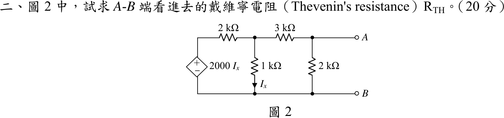
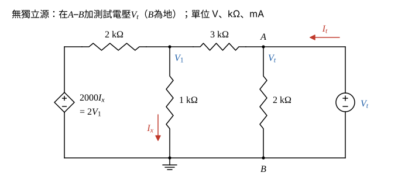

# 105 年電路學第 2 題｜相依源戴維寧等效電阻

## 已知與所求

左側為相依電壓源 \(2000I_x\)（上正下負），\(I_x\) 為流經 \(1\ \mathrm{k\Omega}\) 向下的電流；\(2\ \mathrm{k\Omega}\) 接於相依源正端與中節點 \(V_1\) 之間，\(1\ \mathrm{k\Omega}\) 自 \(V_1\) 接到下方導線，\(3\ \mathrm{k\Omega}\) 接 \(V_1\) 與 \(A\)，\(2\ \mathrm{k\Omega}\) 接 \(A\) 與 \(B\)（下方導線）。電路無獨立源，求 \(A\)–\(B\) 端看進去的戴維寧電阻 \(R_{TH}\)（20 分）。

## 考場標準作答

### 步驟 1：測試源與控制量

電路只有相依源，開路電壓與短路電流皆為 0，不能用 \(V_{oc}/I_{sc}\)，也不能把相依源歸零，故保留相依源、加測試電壓 \(V_t\)，以 \(R_{TH}=V_t/I_t\) 求解。單位用 V、\(\mathrm{k\Omega}\)、mA。

畫法：

- \(B\)（下方導線）為參考地；在 \(A\)–\(B\) 加測試電壓 \(V_t\)（\(A\) 正），測試電流 \(I_t\) 由測試源流入 \(A\)。
- \(I_x\) 依題圖向下流過 \(1\ \mathrm{k\Omega}\)。

\(1\ \mathrm{k\Omega}\) 兩端電壓為 \(V_1\)：
\[
I_x=\frac{V_1}{1\ \mathrm{k\Omega}}=V_1\ \ (\mathrm{mA})
\]
相依源係數 2000 的單位是 \(\Omega\)（即 \(2\ \mathrm{k\Omega}\)），與 mA 相乘得 V：
\[
2000I_x=2\ \mathrm{k\Omega}\times(V_1\ \mathrm{mA})=2V_1\ \ (\mathrm V)
\]

### 步驟 2：\(V_1\) 節點 KCL

相依源正端電壓為 \(2V_1\)，經 \(2\ \mathrm{k\Omega}\) 流入 \(V_1\) 的電流為 \(\dfrac{2V_1-V_1}{2}\)；流出為向下的 \(I_x\) 與經 \(3\ \mathrm{k\Omega}\) 流向 \(A\) 的電流：
\[
\frac{2V_1-V_1}{2}=\frac{V_1}{1}+\frac{V_1-V_t}{3}
\]
兩邊乘 6：
\[
3V_1=6V_1+2(V_1-V_t)
\]
\[
3V_1=8V_1-2V_t\ \Rightarrow\ 5V_1=2V_t
\]
\[
V_1=\frac25V_t=0.4V_t
\]

### 戴維寧電阻 \(R_{TH}\)（20 分）

\(A\) 節點 KCL：
\[
I_t=\frac{V_t}{2}+\frac{V_t-V_1}{3}
\]
代入 \(V_1=0.4V_t\)：
\[
I_t=0.5V_t+\frac{V_t-0.4V_t}{3}=0.5V_t+\frac{0.6V_t}{3}=0.5V_t+0.2V_t=0.7V_t\ \ (\mathrm{mA})
\]
\[
R_{TH}=\frac{V_t}{I_t}=\frac{V_t}{0.7V_t}=\frac{1}{0.7}\ \mathrm{k\Omega}=\frac{10}{7}\ \mathrm{k\Omega}
\]
\[
\boxed{R_{TH}=\frac{10000}{7}\ \Omega\approx1.43\ \mathrm{k\Omega}}
\]

## 驗算

改用測試電流源：自 \(A\) 灌入 \(I_t=1\ \mathrm{mA}\)，令 \(V_B=0\)。\(V_1\) 節點方程式不變，仍得 \(V_1=0.4V_A\)；\(A\) 節點 \(1=\dfrac{V_A}{2}+\dfrac{V_A-0.4V_A}{3}=0.7V_A\)，得 \(V_A=\dfrac{1}{0.7}=1.429\ \mathrm V\)，故 \(R_{TH}=\dfrac{1.429\ \mathrm V}{1\ \mathrm{mA}}=1.43\ \mathrm{k\Omega}\)，與上式相同。

## 失分點

- 相依源不可像獨立電壓源那樣短路；短路後會得 \(2\parallel(3+2\parallel1)=1.29\ \mathrm{k\Omega}\)，必須保留並用測試源求解。
- \(2000I_x\) 的 \(I_x\) 以 A 計；以 mA 代入時應換算成 \(2V_1\)（V），直接寫 \(2000V_1\) 會差 1000 倍。
- 無獨立源時 \(V_{oc}=0\)、\(I_{sc}=0\)，不能用 \(V_{oc}/I_{sc}\)。
