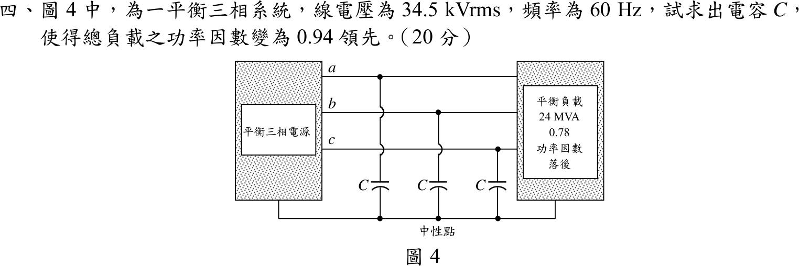
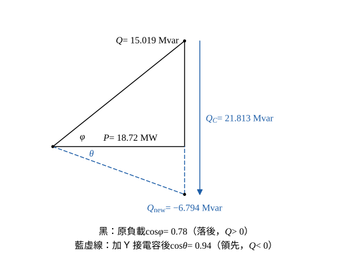

# 105 年電路學第 4 題｜三相功率因數改善與 Y 接電容

## 已知與所求

平衡三相，線電壓 \(V_L=34.5\ \mathrm{kV_{rms}}\)、\(f=60\ \mathrm{Hz}\)；平衡負載 \(S=24\ \mathrm{MVA}\)、功率因數 \(0.78\) 落後。三個電容 \(C\) 分別由 \(a,b,c\) 線接到中性點（Y 接）。求 \(C\)，使總負載（原負載加電容組）的功率因數成為 \(0.94\) 領先（20 分）。

## 考場標準作答

**解題邏輯**：功率因數改善用無效功率補償：理想電容只供應無效功率、不改變有效功率 \(P\)。主線為：求原負載 \(P\)、\(Q\) → 由目標功因 \(0.94\) 領先求新的無效功率 \(Q_{\text{new}}\)（領先所以為負）→ 電容組須供應 \(Q_C=Q-Q_{\text{new}}\) → 電容接中性點為 Y 接，每個電容承受相電壓 \(V_L/\sqrt3\)，由 \(Q_C=3\omega CV_{ph}^2\) 解 \(C\)。前提：電源理想、線電壓維持 \(34.5\ \mathrm{kV}\)，落後（感性）\(Q>0\)、領先（容性）\(Q<0\)。

### 步驟 1：原負載的 \(P\)、\(Q\)

\[
P=S\cos\varphi=24\times0.78=18.72\ \mathrm{MW}
\]
\[
\sin\varphi=\sqrt{1-0.78^2}=\sqrt{1-0.6084}=\sqrt{0.3916}=0.62578
\]
\[
Q=S\sin\varphi=24\times0.62578=15.019\ \mathrm{Mvar}
\]
（這條鏈保留 5 位有效數字：若取 4 位，\(Q_C\) 會變成 \(21.82\) 而使 \(C\) 的末位差 \(0.02\ \mu\mathrm F\)。）

### 步驟 2：目標無效功率 \(Q_{\text{new}}\)

\[
\cos\theta=0.94,\qquad \sin\theta=\sqrt{1-0.94^2}=\sqrt{1-0.8836}=\sqrt{0.1164}=0.34117
\]
\[
\tan\theta=\frac{\sin\theta}{\cos\theta}=\frac{0.34117}{0.94}=0.36295
\]
領先，故 \(Q_{\text{new}}<0\)：
\[
Q_{\text{new}}=-P\tan\theta=-18.72\times0.36295=-6.794\ \mathrm{Mvar}
\]

### 步驟 3：電容組須供應的 \(Q_C\)

\[
Q_C=Q-Q_{\text{new}}=15.019-(-6.794)=21.813\ \mathrm{Mvar}
\]

### 電容 \(C\)（20 分）

**邏輯**：電容接中性點為 Y 接，每個電容的端電壓是相電壓 \(V_{ph}=V_L/\sqrt3\)；三相共供 \(Q_C=3\omega CV_{ph}^2=\omega CV_L^2\)，移項得 \(C=Q_C/(\omega V_L^2)\)。

\[
Q_C=3\omega CV_{ph}^2=3\omega C\left(\frac{V_L}{\sqrt3}\right)^2=\omega CV_L^2
\quad\Rightarrow\quad C=\frac{Q_C}{\omega V_L^2}
\]
\[
\omega=2\pi f=2\pi\times60=376.99\ \mathrm{rad/s}
\]
\[
V_L^2=(34.5\times10^3)^2=1.19025\times10^{9}\ \mathrm V^2
\]
\[
\omega V_L^2=376.99\times1.19025\times10^{9}=4.4871\times10^{11}\ \mathrm{V^2/s}
\]
\[
C=\frac{21.813\times10^6}{4.4871\times10^{11}}=4.8613\times10^{-5}\ \mathrm F
\]
\[
\boxed{C=48.61\ \mu\mathrm F}
\]

## 驗算

回代：每相電壓 \(V_{ph}=34.5/\sqrt3=19.919\ \mathrm{kV}\)，三相電容供 \(3\omega CV_{ph}^2=\omega CV_L^2=4.4871\times10^{11}\times4.8613\times10^{-5}=21.813\ \mathrm{Mvar}\)。淨 \(Q=15.019-21.813=-6.794\ \mathrm{Mvar}\)，\(\mathrm{pf}=\dfrac{18.72}{\sqrt{18.72^2+6.794^2}}=\dfrac{18.72}{19.915}=0.94\)，且 \(Q<0\) 為領先。

## 失分點

- 電容接中性點是 Y 接，\(C=Q_C/(\omega V_L^2)\)；誤當 \(\Delta\) 接（每個電容承受 \(V_L\)）而用 \(C=Q_C/(3\omega V_L^2)\)，會得 \(16.20\ \mu\mathrm F\)。
- 「領先 \(0.94\)」代表 \(Q_{\text{new}}\) 為負；只補到 \(Q=0\)，或補到 \(0.94\) 落後，所需 \(Q_C\) 都不同。
- 電容不改變 \(P\)：目標無效功率要用原負載的 \(P=18.72\ \mathrm{MW}\) 乘 \(\tan\theta\)，不能用 \(S=24\ \mathrm{MVA}\)。
