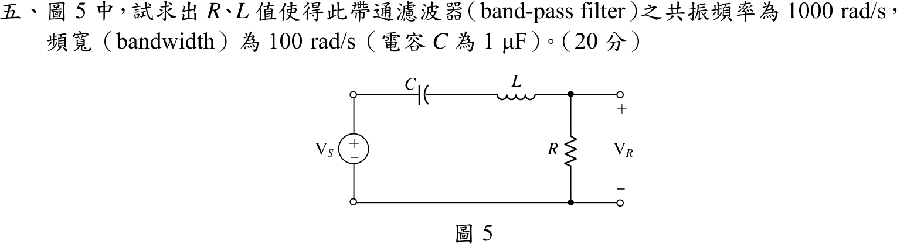
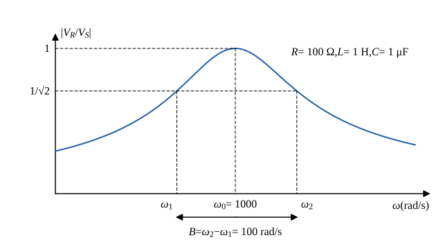

# 105 年電路學第 5 題｜串聯 RLC 帶通濾波器設計

## 已知與所求

\(V_S\) 串聯 \(C\)、\(L\)，輸出 \(V_R\) 取自 \(R\) 兩端；\(C=1\ \mu\mathrm F\)，要求共振頻率 \(\omega_0=1000\ \mathrm{rad/s}\)、頻寬 \(B=100\ \mathrm{rad/s}\)。求 \(R\)、\(L\)（20 分）。

## 考場標準作答

**解題邏輯**：\(C\)、\(L\)、\(R\) 串聯且輸出取自 \(R\)，是串聯 RLC 帶通濾波器。共振時 \(\omega_0L=\dfrac1{\omega_0C}\)，電抗抵消、阻抗只剩 \(R\)，輸出最大；頻寬是半功率點（增益降為 \(1/\sqrt2\)）\(\omega_1\)、\(\omega_2\) 之間的寬度，串聯 RLC 為 \(B=R/L\)。先由共振條件求 \(L\)，再由頻寬求 \(R\)。電源視為理想電壓源，輸出端開路（不接負載）。

### 步驟 1：轉移函數與兩條設計式

分壓：
\[
\frac{V_R}{V_S}=\frac{R}{R+j\left(\omega L-\dfrac{1}{\omega C}\right)},\qquad
\left|\frac{V_R}{V_S}\right|=\frac{R}{\sqrt{R^2+\left(\omega L-\dfrac1{\omega C}\right)^2}}
\]

- 共振（增益最大 = 1）：\(\omega_0L-\dfrac{1}{\omega_0C}=0\Rightarrow\omega_0=\dfrac{1}{\sqrt{LC}}\)。
- 半功率點（增益 \(=1/\sqrt2\)）：\(\left|\omega L-\dfrac1{\omega C}\right|=R\)，兩邊乘 \(\omega/L\)：
\[
\omega^2\mp\frac RL\omega-\frac1{LC}=0
\]
取正根：
\[
\omega_{2,1}=\pm\frac{R}{2L}+\sqrt{\left(\frac{R}{2L}\right)^2+\frac1{LC}}
\]
兩根相減：
\[
B=\omega_2-\omega_1=\frac{R}{2L}-\left(-\frac{R}{2L}\right)=\frac RL
\]

### 電感 \(L\)

**邏輯**：共振頻率只由 \(L\)、\(C\) 決定，\(C\) 已知，由 \(\omega_0=1/\sqrt{LC}\) 直接解出 \(L\)。

先把 \(C=1\ \mu\mathrm F=10^{-6}\ \mathrm F\)：
\[
\omega_0=\frac{1}{\sqrt{LC}}\ \Rightarrow\ L=\frac{1}{\omega_0^2C}
\]
\[
L=\frac{1}{(10^3)^2\times10^{-6}}=\frac{1}{10^6\times10^{-6}}=\frac11
\]
\[
\boxed{L=1\text{ H}}
\]

### 電阻 \(R\)

**邏輯**：頻寬 \(B=R/L\)，\(L\) 已由上式求得，代入即得 \(R\)。

\[
B=\frac RL\ \Rightarrow\ R=BL
\]
\[
R=100\ \mathrm{rad/s}\times1\ \mathrm H
\]
\[
\boxed{R=100\ \Omega}
\]

## 驗算

代回半功率點方程式 \(\omega^2\mp100\omega-10^6=0\)：
\[
\omega_2=\frac{100+\sqrt{100^2+4\times10^6}}{2}=50+1001.25=1051.25\ \mathrm{rad/s}
\]
\[
\omega_1=\frac{-100+\sqrt{100^2+4\times10^6}}{2}=-50+1001.25=951.25\ \mathrm{rad/s}
\]
\[
\omega_2-\omega_1=1051.25-951.25=100\ \mathrm{rad/s}=B
\]
且 \(\omega=1000\) 時電抗 \(1000\times1-\dfrac{1}{1000\times10^{-6}}=1000-1000=0\)，增益 1，確為共振。

## 失分點

- 頻寬是 \(R/L\)（rad/s），不是 \(R/(2L)\)（那是暫態衰減係數 \(\alpha\)）。
- \(C=1\ \mu\mathrm F\) 須換成 \(10^{-6}\ \mathrm F\)；漏掉會讓 \(L\) 差 \(10^6\) 倍。
- 頻寬若以 Hz 表示須除以 \(2\pi\)；本題 \(\omega_0\)、\(B\) 都是 rad/s，直接代入。
