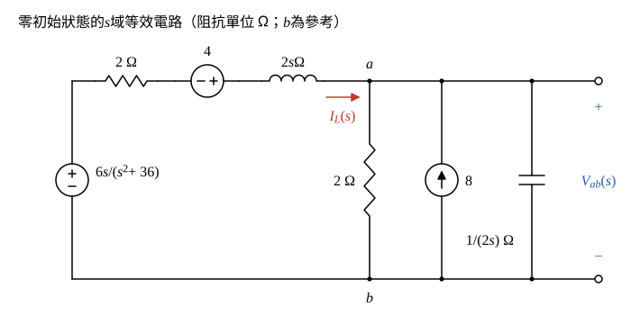

# 106 年電路學第 1 題｜拉氏轉換求 \(V_{ab}\)

## 已知與所求

由 \(b\) 沿左側串聯支路到 \(a\)：電壓源 \(6\cos6t\,u(t)\ \mathrm V\)（上正）、\(2\ \Omega\)、\(4\delta(t)\ \mathrm V\) 源（左負右正）、\(L=2\ \mathrm H\)；\(a\)–\(b\) 間並聯 \(2\ \Omega\)、向上注入 \(a\) 的 \(8\delta(t)\ \mathrm A\) 源與 \(C=2\ \mathrm F\)，\(V_{ab}\) 以 \(a\) 為正。以拉氏轉換求 \(V_{ab}\)（25 分）。

## 考場標準作答

### 步驟 1：\(s\) 域等效電路

所有電源皆帶 \(u(t)\) 或 \(\delta(t)\)，\(t<0\) 無激勵，故取零初始狀態 \(i_L(0^-)=0\)、\(v_C(0^-)=0\)；\(s\) 域電壓、電流轉換式的單位（V·s、A·s）省略，阻抗以 \(\Omega\)、導納以 S 標示。

畫法：

- 左側串聯支路（由 \(b\) 往 \(a\)）：\(6\cos6t\,u(t)\ \mathrm V\to\dfrac{6s}{s^2+36}\)（上正，往 \(a\) 升壓）、\(2\ \Omega\)、\(4\delta(t)\ \mathrm V\to4\)（左負右正，同樣往 \(a\) 升壓）、\(2\ \mathrm H\to2s\ \Omega\)。
- 右側 \(a\)–\(b\) 並聯：\(2\ \Omega\)、\(8\delta(t)\ \mathrm A\to8\)（向上流入 \(a\)）、\(2\ \mathrm F\to\dfrac{1}{2s}\ \Omega\)（導納 \(2s\ \mathrm S\)）。
- \(I_L(s)\) 取沿串聯支路流向 \(a\)。

串聯支路的等效電動勢與阻抗（兩電源皆往 \(a\) 升壓，相加）：
\[
V_s(s)=\frac{6s}{s^2+36}+4,\qquad Z_s=2+2s=2(1+s)\ \Omega
\]

### 輸出電壓 \(V_{ab}\)（25 分）

**(a) 節點 \(a\) 的 KCL**

流入 \(a\)：\(I_L(s)=\dfrac{V_s-V_{ab}}{Z_s}\) 與脈衝電流 \(8\)；流出：經 \(2\ \Omega\) 的 \(\dfrac{V_{ab}}{2}\) 與經電容的 \(2sV_{ab}\)。
\[
\frac{V_s-V_{ab}}{2(1+s)}+8=\frac{V_{ab}}{2}+2sV_{ab}
\]
兩邊乘 \(2(1+s)\)：
\[
V_s-V_{ab}+16(1+s)=(1+s)V_{ab}+4s(1+s)V_{ab}
\]
\(V_{ab}\) 移到右邊合併：
\[
V_s+16+16s=V_{ab}\bigl[1+(1+s)+4s(1+s)\bigr]=V_{ab}(4s^2+5s+2)
\]
代入 \(V_s\)：
\[
V_s+16+16s=\frac{6s}{s^2+36}+16s+20
\]
\[
V_{ab}(s)=\frac{16s+20+\dfrac{6s}{s^2+36}}{4s^2+5s+2}
\]
分子通分：\((16s+20)(s^2+36)+6s=16s^3+20s^2+576s+720+6s=16s^3+20s^2+582s+720\)，
\[
V_{ab}(s)=\frac{16s^3+20s^2+582s+720}{(4s^2+5s+2)(s^2+36)}
\]

**(b) 部分分式**

令
\[
V_{ab}(s)=\frac{As+B}{s^2+36}+\frac{Cs+D}{4s^2+5s+2}
\]
在 \(s=j6\) 時 \(s^2+36=0\)，故 \(As+B\) 等於分子除以 \(4s^2+5s+2\) 在 \(s=j6\) 的值：
\[
16(j6)^3+20(j6)^2+582(j6)+720=-j3456-720+j3492+720=j36
\]
\[
4(j6)^2+5(j6)+2=-144+j30+2=-142+j30
\]
\[
j6A+B=\frac{j36}{-142+j30}=\frac{j36(-142-j30)}{142^2+30^2}=\frac{1080-j5112}{21064}
\]
實部、虛部分別比較：
\[
B=\frac{1080}{21064}=\frac{270}{5266},\qquad 6A=-\frac{5112}{21064}\ \Rightarrow\ A=-\frac{852}{21064}=-\frac{213}{5266}
\]
其餘兩係數由恆等式 \((As+B)(4s^2+5s+2)+(Cs+D)(s^2+36)=16s^3+20s^2+582s+720\) 比較：
\[
s^3:\ 4A+C=16\ \Rightarrow\ C=16+\frac{852}{5266}=\frac{85108}{5266}
\]
\[
s^0:\ 2B+36D=720\ \Rightarrow\ 36D=720-\frac{540}{5266}\ \Rightarrow\ D=20-\frac{15}{5266}=\frac{105305}{5266}
\]
（\(s^2\) 項核對：\(5A+4B+D=\dfrac{-1065+1080+105305}{5266}=\dfrac{105320}{5266}=20\)，成立。）
\[
V_{ab}(s)=\frac{-213s+270}{5266(s^2+36)}+\frac{85108s+105305}{5266(4s^2+5s+2)}
\]

**(c) 反拉氏轉換**

強迫項，用 \(\mathcal L^{-1}\{s/(s^2+36)\}=\cos6t\)、\(\mathcal L^{-1}\{1/(s^2+36)\}=\tfrac16\sin6t\)：
\[
\frac{-213s+270}{5266(s^2+36)}\ \to\ -\frac{213}{5266}\cos6t+\frac{270}{5266}\cdot\frac16\sin6t=-\frac{213}{5266}\cos6t+\frac{45}{5266}\sin6t
\]
暫態項，先配方：
\[
4s^2+5s+2=4\Bigl(s^2+\tfrac54s+\tfrac12\Bigr)=4\Bigl[\bigl(s+\tfrac58\bigr)^2+\tfrac{7}{64}\Bigr],\qquad \alpha=\tfrac58\ \mathrm{s^{-1}},\ \omega_d=\tfrac{\sqrt7}{8}=0.3307\ \mathrm{rad/s}
\]
分子改寫成 \((s+\alpha)\) 的形式：
\[
85108s+105305=85108\bigl(s+\tfrac58\bigr)+\bigl(105305-53192.5\bigr)=85108\bigl(s+\tfrac58\bigr)+52112.5
\]
\[
\frac{85108s+105305}{5266(4s^2+5s+2)}=\frac{85108}{21064}\cdot\frac{s+\frac58}{(s+\frac58)^2+\frac7{64}}+\frac{52112.5}{21064}\cdot\frac{1}{(s+\frac58)^2+\frac7{64}}
\]
用 \(\mathcal L^{-1}\Bigl\{\dfrac{s+\alpha}{(s+\alpha)^2+\omega_d^2}\Bigr\}=e^{-\alpha t}\cos\omega_dt\)、\(\mathcal L^{-1}\Bigl\{\dfrac{1}{(s+\alpha)^2+\omega_d^2}\Bigr\}=\dfrac{1}{\omega_d}e^{-\alpha t}\sin\omega_dt\)：
\[
\cos\text{ 係數}=\frac{85108}{21064}=\frac{21277}{5266}=4.040
\]
\[
\sin\text{ 係數}=\frac{52112.5}{21064}\cdot\frac{8}{\sqrt7}=\frac{104225}{5266\sqrt7}=\frac{104225\sqrt7}{36862}=7.481
\]
合併（精確係數）：
\[
v_{ab}(t)=\Bigl\{e^{-5t/8}\Bigl[\tfrac{21277}{5266}\cos\tfrac{\sqrt7}{8}t+\tfrac{104225\sqrt7}{36862}\sin\tfrac{\sqrt7}{8}t\Bigr]+\frac{45\sin6t-213\cos6t}{5266}\Bigr\}u(t)\ \mathrm V
\]
化為小數（強迫響應係數小於 0.1，保留 3 位有效數字：\(213/5266=0.0404\)、\(45/5266=0.00855\)）：
\[
\boxed{v_{ab}(t)=\Bigl\{e^{-5t/8}\Bigl[4.04\cos\tfrac{\sqrt7}{8}t+7.48\sin\tfrac{\sqrt7}{8}t\Bigr]-0.0404\cos6t+0.00855\sin6t\Bigr\}u(t)\ \mathrm V}
\]

## 驗算

- 初值：\(v_{ab}(0^+)=\tfrac{21277}{5266}-\tfrac{213}{5266}=\tfrac{21064}{5266}=4\ \mathrm V\)；物理上 \(8\delta\) 的電荷 \(8\ \mathrm C\) 全部注入 \(C=2\ \mathrm F\)，\(v_C(0^+)=8/2=4\ \mathrm V\)；初值定理 \(\lim_{s\to\infty}sV_{ab}(s)=16/4=4\ \mathrm V\)。三者一致。
- 強迫響應改用相量（\(\cos\) 基準，\(\omega=6\ \mathrm{rad/s}\)）：\(\mathbf V=\dfrac{6/(2+j12)}{1/(2+j12)+0.5+j12}=-0.0404-j0.00855\ \mathrm V\)，即 \(-0.0404\cos6t+0.00855\sin6t\)，與反轉換的穩態項相同。

## 失分點

- \(4\delta(t)\) 源左負右正，與 \(6\cos6t\,u(t)\) 同樣往 \(a\) 升壓，\(V_s\) 的 \(+4\) 不可寫成 \(-4\)。
- 分子的 \(16s+16\) 來自 \(8\delta\)（乘以 \(2(1+s)\)），\(+4\) 來自 \(4\delta\)；漏掉 \(16s\) 會使整個 \(V_{ab}(s)\) 錯誤。
- 結果要乘 \(u(t)\)，\(t<0\) 時 \(v_{ab}=0\)。

## 條件與疑義

題幹未給初始條件；因所有電源皆帶 \(u(t)\) 或 \(\delta(t)\)，取 \(i_L(0^-)=0\)、\(v_C(0^-)=0\)。若另有初值，需在 \(s\) 域加上 \(Li_L(0^-)\) 串聯電壓源與 \(Cv_C(0^-)\) 並聯電流源。
