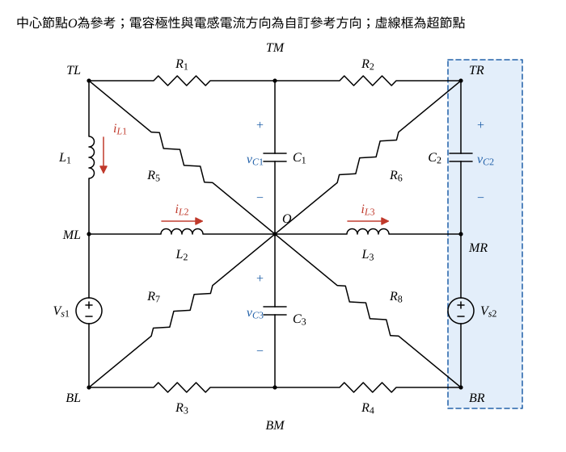

# 106 年電路學第 2 題｜\(dv_{C3}/dt\) 狀態方程式

## 已知與所求

中央節點 \(O\) 是 \(R_5,R_6,R_7,R_8,L_2,L_3\) 與 \(C_1,C_3\) 的共同端。外圈：\(TL\)–\(R_1\)–\(TM\)–\(R_2\)–\(TR\)；\(TL\)–\(L_1\)–\(ML\)；\(TR\)–\(C_2\)–\(MR\)；\(ML\)–\(V_{s1}\)（上正）–\(BL\)；\(MR\)–\(V_{s2}\)（上正）–\(BR\)；\(BL\)–\(R_3\)–\(BM\)–\(R_4\)–\(BR\)。其餘：\(R_5\)：\(TL\)–\(O\)；\(C_1\)：\(TM\)–\(O\)；\(R_6\)：\(TR\)–\(O\)；\(L_2\)：\(ML\)–\(O\)；\(L_3\)：\(O\)–\(MR\)；\(R_7\)：\(BL\)–\(O\)；\(C_3\)：\(O\)–\(BM\)；\(R_8\)：\(O\)–\(BR\)。求 \(dv_{C3}/dt\) 的狀態方程式（25 分）。

## 考場標準作答

**解題邏輯**：狀態方程式的右邊只能有狀態量（各電容電壓 \(v_{C1},v_{C2},v_{C3}\)、各電感電流 \(i_{L1},i_{L2},i_{L3}\)）與電源。做法：電容視為已知電壓源、電感視為已知電流源（此瞬間值由狀態量給定），對 \(C_3\) 下端節點 \(BM\) 列 KCL 得 \(C_3\,dv_{C3}/dt\)；式中出現的非狀態節點電壓 \(V_{BL}\)（左側）與 \(V_{BR}\)（右側）分別用 \(BL\) 節點 KCL 與右側超節點 KCL 消去。題圖未標狀態量方向，以下自行定義（方向改變只影響正負號）。

### 步驟 1：參考節點與狀態量方向

畫法：

- 以中心節點 \(O\) 為參考（\(V_O=0\)）；節點名稱：上排 \(TL,TM,TR\)、中排 \(ML,O,MR\)、下排 \(BL,BM,BR\)。
- 電容電壓：\(v_{C1}=V_{TM}\)（\(TM\) 正）、\(v_{C2}=V_{TR}-V_{MR}\)（\(TR\) 正）、\(v_{C3}=V_O-V_{BM}=-V_{BM}\)（\(O\) 正）。
- 電感電流：\(i_{L1}\) 由 \(TL\to ML\)、\(i_{L2}\) 由 \(ML\to O\)、\(i_{L3}\) 由 \(O\to MR\)。
- 電源：\(V_{ML}-V_{BL}=V_{s1}\)，\(V_{MR}-V_{BR}=V_{s2}\)。

### 步驟 2：左側 \(BL\) 節點求 \(V_{BL}\)

節點 \(ML\) 只接 \(L_1\)、\(L_2\) 與 \(V_{s1}\)，故 \(V_{s1}\) 支路由 \(ML\) 向下流到 \(BL\) 的電流為 \(i_{L1}-i_{L2}\)。\(BL\) 的 KCL（流入 = 經 \(R_7\) 到 \(O\) + 經 \(R_3\) 到 \(BM\)），其中 \(V_{BL}-V_{BM}=V_{BL}+v_{C3}\)：
\[
i_{L1}-i_{L2}=\frac{V_{BL}}{R_7}+\frac{V_{BL}+v_{C3}}{R_3}
\]
兩邊乘 \(R_3R_7\)：
\[
R_3R_7(i_{L1}-i_{L2})=R_3V_{BL}+R_7V_{BL}+R_7v_{C3}
\]
\[
V_{BL}=\frac{R_3R_7(i_{L1}-i_{L2})-R_7v_{C3}}{R_3+R_7}
\]

### 步驟 3：右側超節點求 \(V_{BR}\)

\(TR\)、\(MR\)、\(BR\) 由 \(C_2\)（電壓 \(v_{C2}\)）與 \(V_{s2}\) 相連，視為一個超節點：
\[
V_{TR}=v_{C2}+V_{MR}=v_{C2}+V_{s2}+V_{BR}
\]
令 \(u=v_{C2}+V_{s2}\)，則 \(V_{TR}=u+V_{BR}\)。超節點 KCL（流入：由 \(TM\) 經 \(R_2\)、由 \(O\) 經 \(L_3\)、由 \(BM\) 經 \(R_4\)；流出：經 \(R_6\)、\(R_8\) 到 \(O\)），其中 \(V_{BM}-V_{BR}=-v_{C3}-V_{BR}\)：
\[
\frac{v_{C1}-V_{TR}}{R_2}+i_{L3}+\frac{-v_{C3}-V_{BR}}{R_4}=\frac{V_{TR}}{R_6}+\frac{V_{BR}}{R_8}
\]
代入 \(V_{TR}=u+V_{BR}\)，把 \(V_{BR}\) 項移到右邊：
\[
\frac{v_{C1}}{R_2}-\frac{u}{R_2}-\frac{u}{R_6}+i_{L3}-\frac{v_{C3}}{R_4}=V_{BR}\Bigl(\frac1{R_2}+\frac1{R_4}+\frac1{R_6}+\frac1{R_8}\Bigr)
\]
兩邊乘 \(R_2R_4R_6R_8\)，令 \(D=R_2R_4R_6+R_2R_4R_8+R_2R_6R_8+R_4R_6R_8\)：
\[
R_4R_6R_8v_{C1}-R_4R_8(R_2+R_6)u+R_2R_4R_6R_8i_{L3}-R_2R_6R_8v_{C3}=D\,V_{BR}
\]
\[
V_{BR}=\frac{R_8\bigl[R_4R_6v_{C1}-R_4(R_2+R_6)(v_{C2}+V_{s2})+R_2R_4R_6i_{L3}-R_2R_6v_{C3}\bigr]}{D}
\]

### \(dv_{C3}/dt\) 狀態方程式（25 分）

**邏輯**：\(C_3\) 的電流（由 \(O\) 經 \(C_3\) 流向 \(BM\)，與 \(v_{C3}\) 的 \(+\to-\) 同向）等於 \(C_3\,dv_{C3}/dt\)；它在 \(BM\) 只能經 \(R_3\)、\(R_4\) 流走，代入步驟 2、3 的 \(V_{BL}\)、\(V_{BR}\) 即只剩狀態量與電源。

\(BM\) 的 KCL（\(V_{BM}=-v_{C3}\)）：
\[
C_3\frac{dv_{C3}}{dt}=\frac{V_{BM}-V_{BL}}{R_3}+\frac{V_{BM}-V_{BR}}{R_4}=-\frac{v_{C3}+V_{BL}}{R_3}-\frac{v_{C3}+V_{BR}}{R_4}
\]
左項代入 \(V_{BL}\)：
\[
v_{C3}+V_{BL}=\frac{(R_3+R_7)v_{C3}-R_7v_{C3}+R_3R_7(i_{L1}-i_{L2})}{R_3+R_7}=\frac{R_3\bigl[v_{C3}+R_7(i_{L1}-i_{L2})\bigr]}{R_3+R_7}
\]
\[
-\frac{v_{C3}+V_{BL}}{R_3}=-\frac{v_{C3}}{R_3+R_7}-\frac{R_7}{R_3+R_7}(i_{L1}-i_{L2})
\]
右項代入 \(V_{BR}\)，\(v_{C3}\) 的係數為 \(D-R_2R_6R_8=R_4(R_2R_6+R_2R_8+R_6R_8)\)，令 \(E=R_2R_6+R_2R_8+R_6R_8\)：
\[
v_{C3}+V_{BR}=\frac{R_4\bigl[E\,v_{C3}+R_6R_8v_{C1}-R_8(R_2+R_6)(v_{C2}+V_{s2})+R_2R_6R_8i_{L3}\bigr]}{D}
\]
\[
-\frac{v_{C3}+V_{BR}}{R_4}=-\frac{E}{D}v_{C3}-\frac{R_6R_8}{D}v_{C1}+\frac{R_8(R_2+R_6)}{D}(v_{C2}+V_{s2})-\frac{R_2R_6R_8}{D}i_{L3}
\]
兩項相加，再除以 \(C_3\)：
\[
\boxed{\frac{dv_{C3}}{dt}=\frac{1}{C_3}\left[-\Bigl(\frac{1}{R_3+R_7}+\frac{E}{D}\Bigr)v_{C3}-\frac{R_7}{R_3+R_7}(i_{L1}-i_{L2})-\frac{R_6R_8}{D}v_{C1}+\frac{R_8(R_2+R_6)}{D}(v_{C2}+V_{s2})-\frac{R_2R_6R_8}{D}i_{L3}\right]}
\]
其中 \(D=R_2R_4R_6+R_2R_4R_8+R_2R_6R_8+R_4R_6R_8\)，\(E=R_2R_6+R_2R_8+R_6R_8\)。

\(R_1\)、\(R_5\)、\(L_1\) 的電壓與 \(V_{s1}\) 不出現：節點 \(TL\) 只接 \(R_1\)、\(R_5\)、\(L_1\)，而 \(L_1\) 的電流已由狀態量 \(i_{L1}\) 指定；\(V_{s1}\) 所在支路的電流固定為 \(i_{L1}-i_{L2}\)，其電壓只決定 \(V_{ML}\)，不影響 \(BL\) 以下的電流分配。

## 驗算

以不同方法逐項檢查各係數（令其餘狀態與電源為零；\(C_1,C_2,V_s\) 視為短路，電感視為開路）：

- 只留 \(v_{C3}\)：\(C_3\) 看到 \((R_3+R_7)\parallel\bigl(R_4+R_2\parallel R_6\parallel R_8\bigr)\)，其導納 \(\dfrac1{R_3+R_7}+\dfrac{E}{D}\)（因 \(R_4+R_2\parallel R_6\parallel R_8=D/E\)），與 \(v_{C3}\) 係數一致。
- 只留 \(i_{L3}\)：電流經 \(MR\) 流入 \(R_2,R_4,R_6,R_8\) 四條並聯路徑，\(R_4\) 分得 \(\dfrac{R_2R_6R_8}{D}\)，由 \(BM\) 向上穿過 \(C_3\)，故為負號。
- 只留 \(i_{L1}-i_{L2}\)：注入 \(BL\)，分給 \(R_3\)（到 \(BM\)）的比例 \(\dfrac{R_7}{R_3+R_7}\)，同樣由 \(BM\) 向上穿過 \(C_3\)，為負號。

另以隨機 \(R_1\sim R_8,C_3\) 與隨機狀態，把電容換成電壓源、電感換成電流源，對整個電路做節點法，所得 \(C_3\) 電流與上式相對誤差小於 \(10^{-9}\)。

## 失分點

- 狀態變數只有 \(v_C\) 與 \(i_L\)：\(V_{BL},V_{BR}\) 等代數節點電壓必須消去，答案中不可殘留。
- 右側 \(TR\)、\(MR\)、\(BR\) 要當成超節點（\(C_2\) 與 \(V_{s2}\) 都是電壓源型元件），不能對 \(TR\) 或 \(BR\) 單獨列 KCL 而漏掉 \(C_2\) 或 \(V_{s2}\) 支路的電流。
- \(v_{C3}\) 的極性是自訂的；若改為 \(V_{BM}-V_O\)，\(v_{C3}\) 自身項不變，其餘各項（\(v_{C1},v_{C2}\)、電感電流、\(V_{s2}\)）全部變號，不可只改一半。
