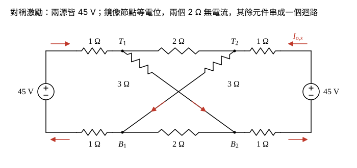
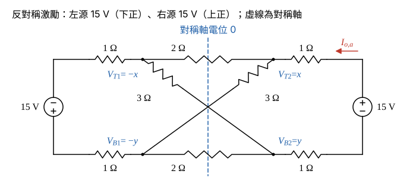

# 106 年電路學第 4 題｜對稱與反對稱分析

## 已知與所求

左源 30 V、右源 60 V（皆上正）。上軌：\(1\ \Omega\)、節點 \(T_1\)、\(2\ \Omega\)、節點 \(T_2\)、\(1\ \Omega\)；下軌相同（節點 \(B_1,B_2\)）；交叉 \(3\ \Omega\) 接 \(T_1\)–\(B_2\) 與 \(T_2\)–\(B_1\)。\(I_o\) 為上軌由右源「+」端向左流出的電流。要求用對稱與反對稱激勵求 \(I_o\) 並寫出完整過程（25 分）。

## 考場標準作答

**解題邏輯**：電路對垂直中線左右鏡像對稱，只有兩源大小不同。把兩源拆成「大小相同、同極性」的對稱激勵（各 45 V）與「大小相同、極性相反」的反對稱激勵（各 15 V）：對稱激勵下鏡像節點等電位，兩個 \(2\ \Omega\) 無電流；反對稱激勵下鏡像節點電位等值反號，對稱軸電位為 0。兩種激勵各自用簡化後的電路求 \(I_o\)，最後疊加（線性電路）。\(I_o\) 的參考方向依題圖：上軌由右源「+」端向左流出。

### 步驟 1：激勵分解

取兩源的平均與半差：
\[
\frac{30+60}{2}=45\ \mathrm V,\qquad \frac{60-30}{2}=15\ \mathrm V
\]
\[
\text{左源：}30=45-15\ \mathrm V,\qquad \text{右源：}60=45+15\ \mathrm V
\]

- 對稱激勵：左、右源皆 \(45\ \mathrm V\)（上正）。
- 反對稱激勵：右源 \(15\ \mathrm V\)（上正），左源 \(-15\ \mathrm V\)，即 \(15\ \mathrm V\) 下正上負。

由疊加定理：\(I_o=I_{o,s}+I_{o,a}\)，兩分量的參考方向都與 \(I_o\) 相同。

### 步驟 2：對稱激勵求 \(I_{o,s}\)

左右鏡像後電路與激勵完全相同，故 \(V_{T1}=V_{T2}\)、\(V_{B1}=V_{B2}\)，上下兩個 \(2\ \Omega\) 兩端等電位、無電流，可拿掉。剩下的元件串成單一迴路：右源「+」\(\to\) 右上 \(1\ \Omega\to T_2\to\) 交叉 \(3\ \Omega\to B_1\to\) 左下 \(1\ \Omega\to\) 左源（\(-\to+\)）\(\to\) 左上 \(1\ \Omega\to T_1\to\) 交叉 \(3\ \Omega\to B_2\to\) 右下 \(1\ \Omega\to\) 右源「−」。

迴路中兩源同向串聯，KVL：
\[
\sum E=45+45=90\ \mathrm V,\qquad \sum R=1+3+1+1+3+1=10\ \Omega
\]
\[
I_{o,s}=\frac{\sum E}{\sum R}=\frac{90}{10}=9\ \mathrm A
\]

### 步驟 3：反對稱激勵求 \(I_{o,a}\)

左右鏡像後激勵變號，故鏡像節點電位等值反號；以對稱軸（兩個 \(2\ \Omega\) 的中點）為 0 V，設 \(V_{T2}=x\)、\(V_{B2}=y\)，則 \(V_{T1}=-x\)、\(V_{B1}=-y\)。

交叉 \(3\ \Omega\)（\(T_2\to B_1\)）的電流：
\[
\frac{V_{T2}-V_{B1}}{3}=\frac{x-(-y)}{3}=\frac{x+y}{3}
\]
上軌 \(2\ \Omega\)（\(T_2\to T_1\)）的電流：\(\dfrac{x-(-x)}{2}=x\)；下軌 \(2\ \Omega\)（\(B_1\to B_2\)）的電流：\(\dfrac{-y-y}{2}=-y\)。

\(T_2\) 的 KCL（\(I_{o,a}\) 流入，經 \(2\ \Omega\)、\(3\ \Omega\) 流出）：
\[
I_{o,a}=x+\frac{x+y}{3}
\]
\(B_2\) 的 KCL（\(I_{o,a}\) 經右下 \(1\ \Omega\) 流回右源「−」；流入為下軌 \(2\ \Omega\) 的 \(-y\) 與交叉 \(3\ \Omega\)（\(T_1\to B_2\)）的 \(\frac{-x-y}{3}\)）：
\[
I_{o,a}=-y-\frac{x+y}{3}
\]
右源迴路 KVL（由 \(B_2\) 經右下 \(1\ \Omega\)、右源、右上 \(1\ \Omega\) 到 \(T_2\)）：
\[
x=y-1\cdot I_{o,a}+15-1\cdot I_{o,a}\ \Rightarrow\ x-y+2I_{o,a}=15
\]
\(T_2\) 式減 \(B_2\) 式：
\[
0=x+y+\frac{2(x+y)}{3}=\frac53(x+y)\ \Rightarrow\ y=-x
\]
所以交叉 \(3\ \Omega\) 電流 \(\frac{x+y}{3}=0\)。代回 \(T_2\) 式（\(I_{o,a}\) 全部流經上軌 \(2\ \Omega\)）：
\[
I_{o,a}=x+0=x
\]
代入 KVL：
\[
x-(-x)+2x=15\ \Rightarrow\ 4x=15\ \Rightarrow\ x=3.75\ \mathrm V
\]
\[
I_{o,a}=\frac{V_{T2}-V_{T1}}{2\ \Omega}=\frac{3.75-(-3.75)}{2}=3.75\ \mathrm A
\]
（即迴路只剩兩個 \(1\ \Omega\) 加兩個半條 \(2\ \Omega\)：\(15/(1+1+1+1)=3.75\ \mathrm A\)。）

### 輸出電流 \(I_o\)（25 分）

**邏輯**：電路為線性，原激勵 = 對稱激勵 + 反對稱激勵，故 \(I_o\) 等於兩分量（同一參考方向）相加。

\[
I_o=I_{o,s}+I_{o,a}=9+3.75=12.75\ \mathrm A
\]
\[
\boxed{I_o=\frac{51}{4}=12.75\ \mathrm A}
\]

## 驗算

不分解，直接對原電路解節點電壓（以左源「−」端為 0 V）：\(T_1=24.75,\ T_2=32.25,\ B_1=5.25,\ B_2=-2.25\ \mathrm V\)，右源「−」端為 \(-15\ \mathrm V\)、「+」端為 \(45\ \mathrm V\)。故 \(I_o=(45-32.25)/1=12.75\ \mathrm A\)；左源電流 \(30-24.75=5.25\ \mathrm A\)（與 \(9-3.75\) 一致）。功率守恆：電源 \(60\times12.75+30\times5.25=922.50\ \mathrm W\)；4 個 \(1\ \Omega\) 吸收 \(2\times(5.25^2+12.75^2)=380.25\ \mathrm W\)、兩個 \(2\ \Omega\) 共 \(56.25\ \mathrm W\)、兩個 \(3\ \Omega\) 共 \(2\times9^2\times3=486\ \mathrm W\)，合計 \(922.50\ \mathrm W\)。

## 失分點

- 對稱激勵時兩個交叉 \(3\ \Omega\) 屬於同一個串聯迴路（\(T_2\to B_1\)、\(T_1\to B_2\)），總電阻 \(10\ \Omega\)、總電動勢 \(90\ \mathrm V\)；不要當成兩個獨立並聯支路。
- 反對稱時對稱軸電位為 0，但交叉 \(3\ \Omega\) 跨越對稱軸，不能直接視為斷路或短路；須由 KCL 證明 \(V_{T2}+V_{B2}=0\) 後才知無電流。
- 反對稱左源是 \(-15\ \mathrm V\)（極性反向），不是 \(+15\ \mathrm V\)；否則 \(I_o\) 的疊加方向會錯。
