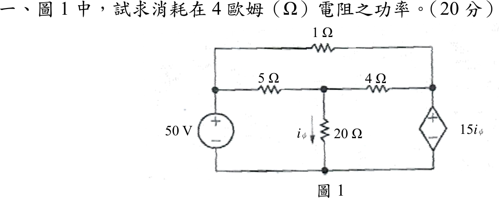
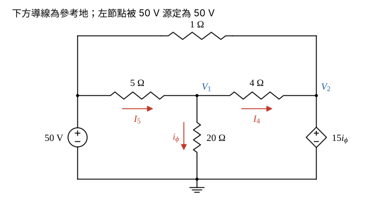

# 107 年電路學第 1 題｜4 Ω 電阻功率

## 已知與所求

左側 50 V 獨立電壓源（上正）接左節點；左節點經 \(1\ \Omega\)（上方導線）通右節點，經 \(5\ \Omega\) 通中節點；中節點經 \(4\ \Omega\) 通右節點，經 \(20\ \Omega\) 接地，\(i_\phi\) 向下流過 \(20\ \Omega\)；右節點與地之間為 CCVS \(15i_\phi\)（上正）。求 \(4\ \Omega\) 消耗功率（20 分）。

## 考場標準作答

**解題邏輯**：電路含電流控制電壓源（CCVS），用節點分析。以下方導線為參考地：左節點被 50 V 源固定為 50 V，右節點被 CCVS 固定為 \(15i_\phi\)，而控制量 \(i_\phi\) 可用中節點電壓表示，所以只剩中節點 \(V_1\) 一個未知數 → 中節點 KCL 解 \(V_1\) → 由 CCVS 求 \(V_2\) → \(4\ \Omega\) 電流 \(I_4\) → \(P=I_4^2R\)。頂端 \(1\ \Omega\) 跨接在兩個定壓節點之間，其電流由兩個電源供給、不流經中節點，所以不進入中節點 KCL，也不影響所求。所有電源視為理想源。

### 步驟 1：節點命名與參考方向

畫法：

- 下方導線為參考地；左節點 \(=50\ \mathrm V\)（50 V 源上正）；中節點電壓 \(V_1\)；右節點電壓 \(V_2\)（CCVS 上正）。
- 中節點的三條支路電流參考方向：\(I_5\) 由左節點經 \(5\ \Omega\) 流入中節點；\(i_\phi\) 依題圖向下流過 \(20\ \Omega\)；\(I_4\) 由中節點經 \(4\ \Omega\) 流向右節點。

### 步驟 2：控制量與 CCVS 約束

\(i_\phi\) 向下流過 \(20\ \Omega\)，端電壓為 \(V_1-0\)：
\[
i_\phi=\frac{V_1}{20}
\]
CCVS 上正、下端接地，故右節點電壓：
\[
V_2=15i_\phi=15\times\frac{V_1}{20}=0.75V_1
\]

### \(4\ \Omega\) 電阻的功率（20 分）

**邏輯**：中節點只有 \(V_1\) 一個未知數；列「流入 = 流出」KCL，代入步驟 2 的 \(V_2=0.75V_1\) 得一元一次方程，再由 \(I_4=(V_1-V_2)/4\) 求功率。

中節點 KCL（流入 \(I_5\) = 流出 \(i_\phi+I_4\)）：
\[
\frac{50-V_1}{5}=\frac{V_1}{20}+\frac{V_1-V_2}{4}
\]
代入 \(V_2=0.75V_1\)：
\[
\frac{50-V_1}{5}=\frac{V_1}{20}+\frac{V_1-0.75V_1}{4}
\]
\[
10-0.2V_1=0.05V_1+0.0625V_1
\]
\[
10=0.2V_1+0.05V_1+0.0625V_1=0.3125V_1
\]
\[
V_1=\frac{10}{0.3125}=32\ \mathrm V
\]
\[
V_2=0.75\times32=24\ \mathrm V
\]
\(4\ \Omega\) 的電流：
\[
I_4=\frac{V_1-V_2}{4}=\frac{32-24}{4}=\frac{8}{4}=2\ \mathrm A
\]
功率：
\[
\boxed{P_{4\Omega}=I_4^2(4)=2^2(4)=16\ \mathrm W}
\]

## 驗算

全電路功率守恆。頂端 \(1\ \Omega\) 電流（左 → 右）\(I_{1\Omega}=\dfrac{50-24}{1}=26\ \mathrm A\)，\(I_5=\dfrac{50-32}{5}=3.60\ \mathrm A\)，\(i_\phi=\dfrac{32}{20}=1.60\ \mathrm A\)：

- 50 V 源供給 \(50\times(26+3.60)=50\times29.60=1480\ \mathrm W\)；CCVS 由上端（正端）流入 \(26+2=28\ \mathrm A\)，吸收 \(24\times28=672\ \mathrm W\)。
- 電阻吸收：\(26^2(1)+3.60^2(5)+2^2(4)+1.60^2(20)=676+64.80+16+51.20=808\ \mathrm W\)；\(808+672=1480\ \mathrm W\)，與供給相等。

## 失分點

- CCVS 的電壓為 \(V_2=15i_\phi\)；把極性看反（\(V_2=-15i_\phi\)）會得 \(V_1=160/11\ \mathrm V\)、\(P_{4\Omega}=161.98\ \mathrm W\)。
- \(i_\phi\) 是 \(20\ \Omega\) 的電流 \(V_1/20\)，不是 \(4\ \Omega\) 的電流。
- 把頂端 \(1\ \Omega\) 的電流也算進中節點 KCL；它只連在兩個定壓節點之間，與中節點無關。
