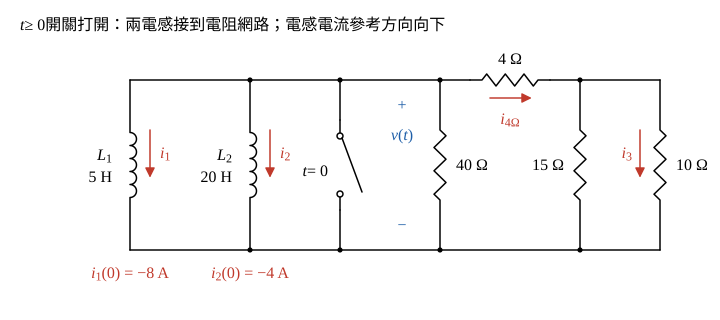

# 107 年電路學第 2 題｜雙電感並聯暫態

## 已知與所求

\(L_1=5\ \mathrm H\)、\(L_2=20\ \mathrm H\) 並聯，初始電流 \(8\ \mathrm A\)（\(L_1\)）與 \(4\ \mathrm A\)（\(L_2\)），兩個箭頭都**向上**；\(i_1,i_2\) 定義為向下。開關在 \(t=0\) 打開，其右為 \(40\ \Omega\)，以及 \(4\ \Omega\) 串聯 \(15\ \Omega\parallel10\ \Omega\)；\(i_3\) 向下流過 \(10\ \Omega\)。求 \(t\ge0\) 的 \(i_1(t)\)、\(i_3(t)\)（各 10 分）。

## 考場標準作答

### 步驟 1：初始值與 \(t\ge0\) 電路

開關閉合很久時兩電感被短路，題給 8 A、4 A 即 \(t=0\) 的電感電流（電感電流不能突變）；\(t>0\) 開關打開，兩並聯電感接純電阻網路，為一階 RL 電路。

畫法：

- \(i_1\)、\(i_2\) 參考方向向下（題圖），題給初始電流箭頭向上，故取負號。
- \(v(t)\) 上正下負，跨在兩電感與電阻網路兩端。
- 電阻網路：\(40\ \Omega\) 跨接上下軌；\(4\ \Omega\) 串接 \(15\ \Omega\parallel10\ \Omega\)，\(i_{4\Omega}\) 向右流過 \(4\ \Omega\)，\(i_3\) 向下流過 \(10\ \Omega\)。

\[
i_1(0)=-8\ \mathrm A,\qquad i_2(0)=-4\ \mathrm A
\]
實際初始電流方向向上，與參考方向相反，故為負值。

### 步驟 2：等效電阻、等效電感與時間常數

\[
15\parallel10=\frac{15\times10}{15+10}=\frac{150}{25}=6\ \Omega
\]
\[
4+6=10\ \Omega
\]
\[
R_{eq}=40\parallel10=\frac{40\times10}{40+10}=\frac{400}{50}=8\ \Omega
\]
\[
L_{eq}=5\parallel20=\frac{5\times20}{5+20}=\frac{100}{25}=4\ \mathrm H
\]
\[
\tau=\frac{L_{eq}}{R_{eq}}=\frac{4}{8}=0.5\ \mathrm s,\qquad \frac1\tau=2\ \mathrm{s^{-1}}
\]

### 步驟 3：總電感電流與端電壓 \(v(t)\)

總電感電流（向下）\(i_\Sigma=i_1+i_2\)：
\[
i_\Sigma(0)=-8+(-4)=-12\ \mathrm A
\]
無獨立源，\(i_\Sigma\) 自然衰減到 0：
\[
i_\Sigma(t)=i_\Sigma(0)e^{-t/\tau}=-12e^{-2t}\ \mathrm A
\]
流入電阻網路（自上軌向下）的電流為 \(-i_\Sigma=12e^{-2t}\ \mathrm A\)，故端電壓
\[
v(t)=R_{eq}\times(-i_\Sigma)=8\times12e^{-2t}=96e^{-2t}\ \mathrm V
\]

### （一）\(i_1(t)\)（10 分）

\(L_1\) 兩端電壓即 \(v(t)\)，\(i_1\) 由「+」端流入，故 \(v=L_1\,di_1/dt\)；個別電流不按電感反比分配（初值比例不同），須積分加初值：

\[
i_1(t)=i_1(0)+\frac{1}{L_1}\int_0^t v(\lambda)\,d\lambda=-8+\frac15\int_0^t96e^{-2\lambda}\,d\lambda
\]
\[
\int_0^t96e^{-2\lambda}\,d\lambda=\frac{96}{2}\bigl(1-e^{-2t}\bigr)=48\bigl(1-e^{-2t}\bigr)\ \mathrm{V\cdot s}
\]
\[
\frac15\times48\bigl(1-e^{-2t}\bigr)=9.6\bigl(1-e^{-2t}\bigr)\ \mathrm A
\]
\[
i_1(t)=-8+9.6-9.6e^{-2t}=1.6-9.6e^{-2t}\ \mathrm A
\]
\[
\boxed{i_1(t)=1.60-9.60e^{-2t}\ \mathrm A\quad(t\ge0)}
\]
\(t\) 很小時 \(i_1<0\)，實際電流向上（與參考方向相反）；\(t>\tfrac12\ln6=0.896\ \mathrm s\) 後轉為向下。同法 \(i_2(t)=-4+\tfrac1{20}\times48(1-e^{-2t})=-1.6-2.4e^{-2t}\ \mathrm A\)，終值 \(i_1(\infty)=-i_2(\infty)=1.6\ \mathrm A\)，為兩電感間的環流。

### （二）\(i_3(t)\)（10 分）

\[
i_{4\Omega}=\frac{v}{4+6}=\frac{96e^{-2t}}{10}=9.6e^{-2t}\ \mathrm A
\]
並聯部分的電壓：
\[
v_{6\Omega}=6\times i_{4\Omega}=6\times9.6e^{-2t}=57.6e^{-2t}\ \mathrm V
\]
\[
i_3=\frac{v_{6\Omega}}{10}=\frac{57.6e^{-2t}}{10}=5.76e^{-2t}\ \mathrm A
\]
\[
\boxed{i_3(t)=5.76e^{-2t}\ \mathrm A\quad(t\ge0)}
\]

## 驗算

能量守恆：初始儲能 \(\tfrac12\times5\times8^2+\tfrac12\times20\times4^2=160+160=320\ \mathrm J\)；終值儲能 \(\tfrac12\times5\times1.6^2+\tfrac12\times20\times1.6^2=6.4+25.6=32\ \mathrm J\)；電阻消耗
\[
\int_0^\infty\frac{v^2}{R_{eq}}dt=\int_0^\infty\frac{(96e^{-2t})^2}{8}dt=\int_0^\infty1152e^{-4t}dt=\frac{1152}{4}=288\ \mathrm J
\]
\(320-32=288\ \mathrm J\)，成立。另以分流驗 \(i_3\)：\(i_3=i_{4\Omega}\times\dfrac{15}{15+10}=9.6e^{-2t}\times0.6=5.76e^{-2t}\ \mathrm A\)。

## 失分點

- 兩個初始電流箭頭都向上，應同號相加（\(i_\Sigma(0)=-12\ \mathrm A\)）；只把 4 A 當成向下（\(i_2(0)=+4\)）會得 \(i_3=1.92e^{-2t}\)；若再把 \(i_3\) 誤當 15 Ω 支路電流，則得 \(i_1=-4.80-3.20e^{-2t}\)、\(i_3=1.28e^{-2t}\)。
- \(i_1\) 終值不為 0：電流和衰減到 0，但兩電感個別電流停在環流 \(1.60\ \mathrm A\)。
- \(i_3\) 要經兩次分壓：先求 \(v\)，再經 \(4\ \Omega\) 串聯分壓到 \(15\parallel10\)，最後除以 \(10\ \Omega\)。
