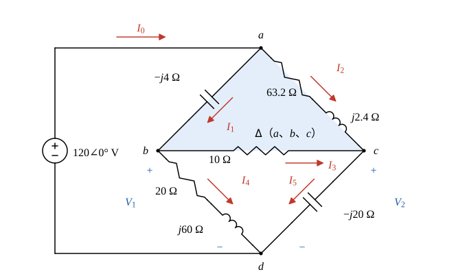
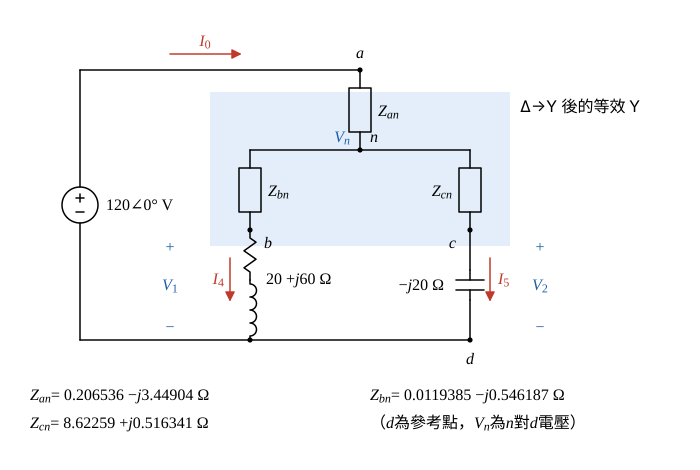

# 107 年電路學第 3 題｜Δ-Y 轉換與相量電流

## 已知與所求

電壓源 \(120\angle0^\circ\ \mathrm V\)（上端「+」接 \(a\)，下端「−」接 \(d\)）；\(\mathbf I_0\) 為進入 \(a\) 的電流。支路：\(a\)–\(b\) 為 \(-j4\ \Omega\)（\(\mathbf I_1\)，\(a\to b\)），\(a\)–\(c\) 為 \(63.2+j2.4\ \Omega\)（\(\mathbf I_2\)，\(a\to c\)），\(b\)–\(c\) 為 \(10\ \Omega\)（\(\mathbf I_3\)，\(b\to c\)），\(b\)–\(d\) 為 \(20+j60\ \Omega\)（\(\mathbf I_4\)，\(b\to d\)），\(c\)–\(d\) 為 \(-j20\ \Omega\)（\(\mathbf I_5\)，\(c\to d\)）。\(\mathbf V_1=\mathbf V_{bd}\)、\(\mathbf V_2=\mathbf V_{cd}\)。利用 Δ 至 Y 轉換求 \(\mathbf I_0\sim\mathbf I_3\)、\(\mathbf V_1\)、\(\mathbf V_2\)（\(\mathbf I_0\sim\mathbf I_3\) 各 4 分，\(\mathbf V_1,\mathbf V_2\) 各 2 分，共 20 分）。

## 考場標準作答

### 步驟 1：Δ→Y 轉換

橋式電路不能直接串並聯，依題意將上方 Δ（\(a,b,c\)）換成以 \(n\) 為中心的 Y。以 \(d\) 為參考點，\(\mathbf V_a=120\angle0^\circ\ \mathrm V\)，電源為理想電壓源；中間值保留 6 位有效數字（取 4 位會使 \(\mathbf V_2\) 末位差 0.01）。

Y 臂阻抗 = 相鄰兩邊乘積 ÷ 三邊和：
\[
Z_{an}=\frac{Z_{ab}Z_{ac}}{Z_\Sigma},\quad Z_{bn}=\frac{Z_{ab}Z_{bc}}{Z_\Sigma},\quad Z_{cn}=\frac{Z_{ac}Z_{bc}}{Z_\Sigma}
\]
三邊和：
\[
Z_\Sigma=-j4+(63.2+j2.4)+10=73.2-j1.6\ \Omega
\]
除以 \(Z_\Sigma\) 時分子分母同乘 \(Z_\Sigma^*=73.2+j1.6\)，分母：
\[
|Z_\Sigma|^2=73.2^2+1.6^2=5358.24+2.56=5360.8
\]
\(Z_{an}\)：
\[
Z_{ab}Z_{ac}=(-j4)(63.2+j2.4)=-j252.8+9.6=9.6-j252.8
\]
\[
(9.6-j252.8)(73.2+j1.6)=(702.72+404.48)+j(15.36-18504.96)=1107.2-j18489.6
\]
\[
Z_{an}=\frac{1107.2-j18489.6}{5360.8}=0.206536-j3.44904\ \Omega
\]
\(Z_{bn}\)：
\[
Z_{ab}Z_{bc}=(-j4)(10)=-j40,\qquad (-j40)(73.2+j1.6)=64-j2928
\]
\[
Z_{bn}=\frac{64-j2928}{5360.8}=0.0119385-j0.546187\ \Omega
\]
\(Z_{cn}\)：
\[
Z_{ac}Z_{bc}=(63.2+j2.4)(10)=632+j24
\]
\[
(632+j24)(73.2+j1.6)=(46262.4-38.4)+j(1011.2+1756.8)=46224+j2768
\]
\[
Z_{cn}=\frac{46224+j2768}{5360.8}=8.62259+j0.516341\ \Omega
\]

### 步驟 2：串並聯求總阻抗 \(Z_{in}\)

兩條 \(n\to d\) 路徑：
\[
Z_{nbd}=Z_{bn}+(20+j60)=(0.0119385-j0.546187)+(20+j60)=20.0119+j59.4538\ \Omega
\]
\[
Z_{ncd}=Z_{cn}+(-j20)=(8.62259+j0.516341)+(-j20)=8.62259-j19.4837\ \Omega
\]
並聯 \(Z_p=\dfrac{Z_{nbd}Z_{ncd}}{Z_{nbd}+Z_{ncd}}\)。分母：
\[
Z_{nbd}+Z_{ncd}=28.6345+j39.9701\ \Omega
\]
分子：
\[
Z_{nbd}Z_{ncd}=(172.554+1158.38)+j(512.646-389.906)=1330.93+j122.740
\]
相除（同乘 \(28.6345-j39.9701\)）：
\[
28.6345^2+39.9701^2=819.935+1597.61=2417.54
\]
\[
(1330.93+j122.740)(28.6345-j39.9701)=43016.4-j49682.8
\]
\[
Z_p=\frac{43016.4-j49682.8}{2417.54}=17.7935-j20.5510\ \Omega
\]
總阻抗：
\[
Z_{in}=Z_{an}+Z_p=(0.206536+17.7935)-j(3.44904+20.5510)=18.0000-j24.0000\ \Omega
\]
\[
|Z_{in}|=\sqrt{18.00^2+24.00^2}=30.00\ \Omega,\qquad \angle Z_{in}=-\tan^{-1}\frac{24.00}{18.00}=-53.13^\circ
\]

### 電流 \(\mathbf I_0\)（4 分）

\[
\mathbf I_0=\frac{\mathbf V_a}{Z_{in}}=\frac{120}{18.00-j24.00}=\frac{120(18.00+j24.00)}{18.00^2+24.00^2}=\frac{2160+j2880}{900}=2.400+j3.200\ \mathrm A
\]
\[
|\mathbf I_0|=\sqrt{2.400^2+3.200^2}=4.000\ \mathrm A,\qquad \angle\mathbf I_0=\tan^{-1}\frac{3.200}{2.400}=53.13^\circ
\]
\[
\boxed{\mathbf I_0=2.40+j3.20=4.00\angle53.13^\circ\ \mathrm A}
\]

### 步驟 3：\(\mathbf V_n\) 與兩路徑電流 \(\mathbf I_4\)、\(\mathbf I_5\)

\(\mathbf I_0\) 全部流過 \(Z_{an}\)，\(n\) 點電壓（對 \(d\)）：
\[
\mathbf I_0Z_{an}=(2.400+j3.200)(0.206536-j3.44904)=(0.495686+11.0369)+j(0.660915-8.27770)=11.5326-j7.61678\ \mathrm V
\]
\[
\mathbf V_n=\mathbf V_a-\mathbf I_0Z_{an}=120-(11.5326-j7.61678)=108.467+j7.61678\ \mathrm V
\]
\(n\to b\to d\) 路徑電流就是 \(\mathbf I_4\)（\(b\to d\)），\(n\to c\to d\) 路徑電流就是 \(\mathbf I_5\)（\(c\to d\)）：
\[
\mathbf I_4=\frac{\mathbf V_n}{Z_{nbd}}=\frac{(108.467+j7.61678)(20.0119-j59.4538)}{20.0119^2+59.4538^2}=\frac{2623.48-j6296.35}{3935.23}=0.666665-j1.60000\ \mathrm A
\]
\[
\mathbf I_5=\frac{\mathbf V_n}{Z_{ncd}}=\frac{(108.467+j7.61678)(8.62259+j19.4837)}{8.62259^2+19.4837^2}=\frac{786.863+j2179.01}{453.964}=1.73332+j4.79996\ \mathrm A
\]

### 電壓 \(\mathbf V_1\)（2 分）

\(\mathbf V_1=\mathbf V_{bd}\) 為 \(b\)–\(d\) 支路 \(20+j60\ \Omega\) 上的電壓（不是 \(Z_{bn}\) 上的壓降）：

\[
\mathbf V_1=\mathbf I_4(20+j60)=(0.666665-j1.60000)(20+j60)
\]
\[
=(13.3333+96.0000)+j(39.9999-32.0000)=109.333+j7.9999\ \mathrm V
\]
\[
|\mathbf V_1|=\sqrt{109.333^2+7.9999^2}=109.63\ \mathrm V,\qquad \angle\mathbf V_1=\tan^{-1}\frac{7.9999}{109.333}=4.18^\circ
\]
\[
\boxed{\mathbf V_1=109.33+j8.00=109.63\angle4.18^\circ\ \mathrm V}
\]

### 電壓 \(\mathbf V_2\)（2 分）

\[
\mathbf V_2=\mathbf I_5(-j20)=(1.73332+j4.79996)(-j20)=95.9992-j34.6664\ \mathrm V
\]
\[
|\mathbf V_2|=\sqrt{95.9992^2+34.6664^2}=102.07\ \mathrm V,\qquad \angle\mathbf V_2=-\tan^{-1}\frac{34.6664}{95.9992}=-19.86^\circ
\]
\[
\boxed{\mathbf V_2=96.00-j34.67=102.07\angle-19.86^\circ\ \mathrm V}
\]

### 電流 \(\mathbf I_1\)（4 分）

Y 等效只保證端點 \(a,b,c\) 的電壓與端點電流相同，內部支路電流不同，故回原電路以節點電壓差求原 Δ 的 \(a\to b\) 支路電流：

\[
\mathbf I_1=\frac{\mathbf V_a-\mathbf V_1}{-j4}=\frac{120-(109.333+j7.9999)}{-j4}=\frac{10.667-j7.9999}{-j4}
\]
除以 \(-j4\) 等於乘 \(\dfrac{j}{4}\)：
\[
\mathbf I_1=\frac{j10.667+7.9999}{4}=1.99998+j2.66675\ \mathrm A
\]
\[
|\mathbf I_1|=\sqrt{1.99998^2+2.66675^2}=3.33\ \mathrm A,\qquad \angle\mathbf I_1=\tan^{-1}\frac{2.66675}{1.99998}=53.13^\circ
\]
\[
\boxed{\mathbf I_1=2.00+j2.67=3.33\angle53.13^\circ\ \mathrm A}
\]

### 電流 \(\mathbf I_2\)（4 分）

\[
\mathbf I_2=\frac{\mathbf V_a-\mathbf V_2}{63.2+j2.4}=\frac{120-(95.9992-j34.6664)}{63.2+j2.4}=\frac{24.0008+j34.6664}{63.2+j2.4}
\]
分子分母同乘 \(63.2-j2.4\)，分母 \(63.2^2+2.4^2=3994.24+5.76=4000\)：
\[
(24.0008+j34.6664)(63.2-j2.4)=(1516.85+83.1994)+j(2190.92-57.6019)=1600.05+j2133.32
\]
\[
\mathbf I_2=\frac{1600.05+j2133.32}{4000}=0.400013+j0.533330\ \mathrm A
\]
\[
|\mathbf I_2|=\sqrt{0.400013^2+0.533330^2}=0.67\ \mathrm A,\qquad \angle\mathbf I_2=\tan^{-1}\frac{0.533330}{0.400013}=53.13^\circ
\]
\[
\boxed{\mathbf I_2=0.40+j0.53=0.67\angle53.13^\circ\ \mathrm A}
\]

### 電流 \(\mathbf I_3\)（4 分）

\[
\mathbf I_3=\frac{\mathbf V_1-\mathbf V_2}{10}=\frac{(109.333-95.9992)+j(7.9999+34.6664)}{10}=\frac{13.3338+j42.6663}{10}=1.33338+j4.26663\ \mathrm A
\]
\[
|\mathbf I_3|=\sqrt{1.33338^2+4.26663^2}=4.47\ \mathrm A,\qquad \angle\mathbf I_3=\tan^{-1}\frac{4.26663}{1.33338}=72.65^\circ
\]
\[
\boxed{\mathbf I_3=1.33+j4.27=4.47\angle72.65^\circ\ \mathrm A}
\]

## 驗算

回原電路 KCL：節點 \(a\)：\(\mathbf I_1+\mathbf I_2=(2.00+0.40)+j(2.67+0.53)=2.40+j3.20=\mathbf I_0\)；節點 \(b\)：\(\mathbf I_1-\mathbf I_3-\mathbf I_4=(2.00-1.33-0.67)+j(2.67-4.27+1.60)=0\)；節點 \(c\)：\(\mathbf I_2+\mathbf I_3-\mathbf I_5=(0.40+1.33-1.73)+j(0.53+4.27-4.80)=0\)。三節點皆平衡，Δ→Y 結果與原電路一致（精確值 \(\mathbf I_1=2+j\tfrac83\)、\(\mathbf I_2=\tfrac25+j\tfrac{8}{15}\)、\(\mathbf I_3=\tfrac43+j\tfrac{64}{15}\ \mathrm A\)）。

## 失分點

- \(Z_{an}\) 取與 \(a\) 相連兩邊（\(-j4\)、\(63.2+j2.4\)）的乘積除以 \(Z_\Sigma\)；分子取錯，後面全部失準。
- \(\mathbf V_1,\mathbf V_2\) 是 \(b\)–\(d\)、\(c\)–\(d\) 原支路上的電壓，要用 \(\mathbf I_4(20+j60)\)、\(\mathbf I_5(-j20)\)，不是 \(Z_{bn}\)、\(Z_{cn}\) 上的壓降。
- \(\mathbf I_1,\mathbf I_2,\mathbf I_3\) 是原 Δ 的支路電流，必須回原電路用節點電壓差求，不能直接拿 Y 臂電流。
