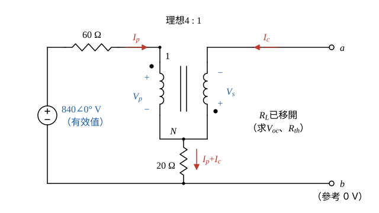
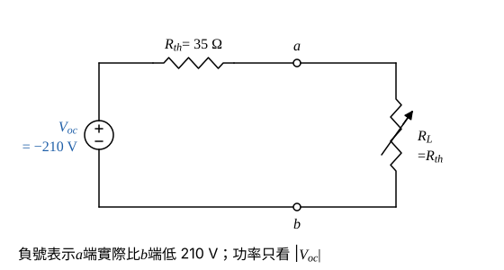

# 107 年電路學第 4 題｜理想變壓器最大平均功率

## 已知與所求

理想變壓器匝比 4:1（一次：二次），\(840\angle0^\circ\ \mathrm V_{rms}\) 電源（上正）串 \(60\ \Omega\) 接一次側上端（點端）；一次側下端、二次側下端（點端）與 \(20\ \Omega\) 上端共接於節點 \(N\)，\(20\ \Omega\) 下端接地 \(b\)；二次側上端為 \(a\)，可變電阻 \(R_L\) 接於 \(a\)–\(b\)。求（一）\(R_L\)（10 分）；（二）最大平均功率（10 分）。

## 考場標準作答

**解題邏輯**：\(R_L\) 以外是含理想變壓器的純電阻網路，從 \(a\)–\(b\) 看入可化為戴維寧等效（\(V_{oc}\) 串 \(R_{th}\)），\(R_L\) 為純電阻時 \(R_L=R_{th}\) 得最大功率。依序：依同名端寫出變壓器的電壓比與安匝平衡 → \(R_L\) 開路求 \(V_{oc}\) → 電源短路、\(a\) 端注入測試電流求 \(R_{th}\) → （一）\(R_L=R_{th}\)、（二）\(P_{max}=|V_{oc}|^2/(4R_{th})\)。前提：理想變壓器（無損、無激磁電流）；\(840\ \mathrm V\) 為有效值；全為電阻、各量同相，以實數計算。

### 步驟 1：參考方向與變壓器關係

畫法：

- 以 \(b\) 為參考（\(0\ \mathrm V\)）；節點 1 為 \(60\ \Omega\) 與一次點端的接點（電壓 \(V_1\)），\(N\) 為一次下端、二次點端與 \(20\ \Omega\) 上端的共同節點（電壓 \(V_N\)）。
- 一次電壓 \(V_p=V_1-V_N\)（點端為正）；二次點端在下，二次電壓取 \(V_s=V_N-V_a\)（\(N\) 端為正）。
- \(I_p\)：經 \(60\ \Omega\) 流入一次點端；\(I_c\)：二次線圈內由 \(a\) 流向 \(N\)，即由二次點端流出；\(20\ \Omega\) 由 \(N\) 向下流 \(I_p+I_c\)。

電壓比（兩電壓都以點端為正）：
\[
\frac{V_p}{V_s}=\frac{N_1}{N_2}=4\ \Rightarrow\ V_s=\frac{V_p}{4}
\]
安匝平衡（電流流入一次點端、由二次點端流出）：
\[
N_1I_p=N_2I_c\ \Rightarrow\ 4I_p=1\times I_c\ \Rightarrow\ I_p=\frac{I_c}{4}
\]
其餘元件關係：
\[
V_1=840\ \mathrm V-(60\ \Omega)\,I_p,\qquad V_N=(20\ \Omega)\,(I_p+I_c),\qquad V_a=V_N-V_s
\]

### 步驟 2：開路電壓 \(V_{oc}\)

\(R_L\) 移開，\(a\) 端無外接電流，二次線圈電流 \(I_c=0\)：
\[
I_p=\frac{I_c}{4}=\frac{0}{4}=0\ \mathrm A
\]
\[
V_N=20\times(0+0)=0\ \mathrm V
\]
\[
V_1=840-60\times0=840\ \mathrm V
\]
\[
V_p=V_1-V_N=840-0=840\ \mathrm V
\]
\[
V_s=\frac{V_p}{4}=\frac{840}{4}=210\ \mathrm V
\]
\[
V_{oc}=V_a=V_N-V_s=0-210=-210\ \mathrm V
\]
負號表示 \(a\) 端實際比 \(b\) 端低 \(210\ \mathrm V\)；功率只與 \(|V_{oc}|=210\ \mathrm V\) 有關。

### 步驟 3：等效電阻 \(R_{th}\)

\(840\ \mathrm V\) 電源短路，在 \(a\) 端由外部注入測試電流 \(I_t=1\ \mathrm A\)（由 \(b\) 回流）：

- \(a\) 點 KCL：注入的電流全部進入二次線圈，\(I_c=I_t=1\ \mathrm A\)。

\[
I_p=\frac{I_c}{4}=\frac{1}{4}=0.25\ \mathrm A
\]
\[
V_N=20\times(0.25+1)=20\times1.25=25\ \mathrm V
\]
\[
V_1=0-60\times0.25=-15\ \mathrm V
\]
\[
V_p=V_1-V_N=-15-25=-40\ \mathrm V
\]
\[
V_s=\frac{V_p}{4}=\frac{-40}{4}=-10\ \mathrm V
\]
\[
V_a=V_N-V_s=25-(-10)=35\ \mathrm V
\]
\[
R_{th}=\frac{V_a}{I_t}=\frac{35\ \mathrm V}{1\ \mathrm A}=35\ \Omega
\]

### （一）\(R_L\)（10 分）

**邏輯**：戴維寧等效為 \(V_{oc}\) 串 \(R_{th}\)，負載功率 \(P=|V_{oc}|^2R_L/(R_{th}+R_L)^2\)，對 \(R_L\) 微分為零即得 \(R_L=R_{th}\)。

\[
P(R_L)=\frac{|V_{oc}|^2R_L}{(R_{th}+R_L)^2}
\]
\[
\frac{dP}{dR_L}=|V_{oc}|^2\,\frac{(R_{th}+R_L)^2-2R_L(R_{th}+R_L)}{(R_{th}+R_L)^4}=|V_{oc}|^2\,\frac{R_{th}-R_L}{(R_{th}+R_L)^3}=0
\]
\[
R_L=R_{th}=35\ \Omega
\]
\[
\boxed{R_L = R_{th} = \mathbf{35}\ \Omega}
\]

### （二）最大平均功率（10 分）

**邏輯**：\(R_L=R_{th}\) 時負載分得開路電壓的一半，\(P_{max}=|V_{oc}|^2/(4R_{th})\)；\(840\ \mathrm V\) 為有效值，所得即平均功率，不再除以 2。

\[
P_{max}=\frac{|V_{oc}|^2}{4R_{th}}
\]
\[
P_{max}=\frac{210^2}{4\times35}=\frac{44100}{140}=315\ \mathrm W
\]
\[
\boxed{P_{max}=315\text{ W}}
\]

## 驗算

直接令 \(R_L=35\ \Omega\) 解整個電路：\(V_a=-210\times\dfrac{35}{35+35}=-105\ \mathrm V\)；\(a\) 點 KCL \(I_c+V_a/R_L=0\Rightarrow I_c=105/35=3\ \mathrm A\)，\(I_p=3/4=0.75\ \mathrm A\)。回代：\(V_N=20\times3.75=75\ \mathrm V\)、\(V_1=840-45=795\ \mathrm V\)、\(V_p=795-75=720\ \mathrm V\)、\(V_s=180\ \mathrm V\)、\(V_a=75-180=-105\ \mathrm V\)，自洽。電源送出 \(840(0.75)=630\ \mathrm W\)；\(60\ \Omega\) 吸收 \(60(0.75)^2=33.75\ \mathrm W\)，\(20\ \Omega\) 吸收 \(20(3.75)^2=281.25\ \mathrm W\)，\(R_L\) 吸收 \(105^2/35=315\ \mathrm W\)；\(33.75+281.25+315=630\ \mathrm W\)。

## 失分點

- 點的位置：一次在上、二次在下，電壓關係含負號；視為同向會得 \(R_L=15\ \Omega\)、\(P=735\ \mathrm W\)。
- 二次電流也流過 \(20\ \Omega\)：該電阻電流是 \(I_p+I_c=5I_p\)，不是 \(I_p\)。
- 最大平均功率用有效值 \(V_{oc}^2/(4R_{th})\)；題給 840 V 為 RMS，不可再除以 2。
