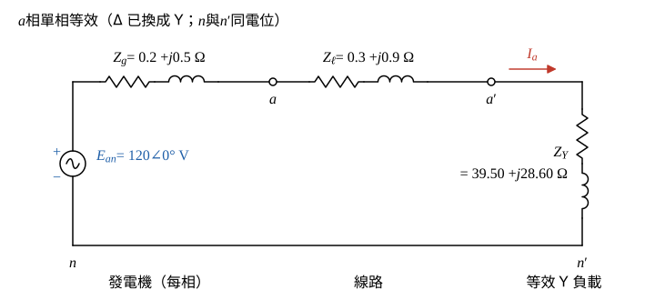

# 107 年電路學第 5 題｜平衡三相 Y-Δ 單相等效與線電流

## 已知與所求

平衡三相 Y 接發電機，正相序，內電壓 120 V（取為每相內電壓）、內阻抗 \(0.2+j0.5\ \Omega\)；每相線阻抗 \(0.3+j0.9\ \Omega\)；Δ 接負載每相 \(118.5+j85.8\ \Omega\)。求（一）單相等效 Y 接電路圖及其負載阻抗；（二）三個線電流（各 10 分）。

## 考場標準作答

### 步驟 1：Δ 負載換成等效 Y

設題給「內電壓 120 V」為每相內電動勢有效值，取 \(\mathbf E_{an}=120\angle0^\circ\ \mathrm V\) 為相角參考；發電機內阻抗記 \(Z_g\)、線路阻抗記 \(Z_\ell\)。

平衡 Δ 換成 Y，每相阻抗為 Δ 的三分之一：
\[
Z_Y=\frac{Z_\Delta}{3}=\frac{118.5+j85.8}{3}
\]
\[
Z_Y=\frac{118.5}{3}+j\frac{85.8}{3}=39.50 + j28.60\ \Omega
\]

### （一）單相等效 Y 接電路圖及負載阻抗（10 分）

Δ 換成 Y 後為平衡 Y–Y 系統，\(n\)、\(n'\) 同電位、中性線電流為零，故 \(a\) 相可單獨畫成一條串聯迴路。

畫法：

- \(a\) 相內電動勢 \(\mathbf E_{an}\) 串發電機內阻抗 \(Z_g=0.2+j0.5\ \Omega\) 到發電機端點 \(a\)，再串線路阻抗 \(Z_\ell=0.3+j0.9\ \Omega\) 到負載端 \(a'\)。
- 等效 Y 每相阻抗 \(Z_Y\) 跨接在 \(a'\) 與 \(n'\) 之間；\(n\)、\(n'\) 以無阻抗導線相連（同電位）。
- 線電流 \(\mathbf I_a\) 的參考方向由發電機流向負載。

\[
\boxed{Z_Y=39.50 + j28.60\ \Omega}
\]

### （二）三個線電流（10 分）

串聯總阻抗：
\[
Z_\mathrm{tot}=Z_g+Z_\ell+Z_Y
\]
\[
Z_\mathrm{tot}=(0.2+0.3+39.50)+j(0.5+0.9+28.60)=40+j30\ \Omega
\]
化成極座標：
\[
|Z_\mathrm{tot}|=\sqrt{40^2+30^2}=\sqrt{2500}=50\ \Omega
\]
\[
\angle Z_\mathrm{tot}=\tan^{-1}\frac{30}{40}=\tan^{-1}0.75=36.87^\circ
\]

\(a\) 相線電流：
\[
\mathbf I_a=\frac{\mathbf E_{an}}{Z_\mathrm{tot}}=\frac{120\angle0^\circ}{50\angle36.87^\circ}
\]
\[
|\mathbf I_a|=\frac{120}{50}=2.40\ \mathrm A,\qquad \angle\mathbf I_a=0^\circ-36.87^\circ=-36.87^\circ
\]
\[
\boxed{\mathbf I_a=2.40\angle -36.87^\circ\ \mathrm A}
\]
正相序 \(b\) 相落後 \(120^\circ\)：
\[
\mathbf I_b=\mathbf I_a\angle-120^\circ=2.40\angle(-36.87^\circ-120^\circ)
\]
\[
\boxed{\mathbf I_b=2.40\angle-156.87^\circ\ \mathrm A}
\]
\(c\) 相超前 \(120^\circ\)：
\[
\mathbf I_c=\mathbf I_a\angle+120^\circ=2.40\angle(-36.87^\circ+120^\circ)
\]
\[
\boxed{\mathbf I_c=2.40\angle83.13^\circ\ \mathrm A}
\]

## 驗算

不經 Δ-Y 轉換，直接對 Δ 迴路做線電壓 KVL。發電機線電動勢 \(\mathbf E_{ab}=\sqrt3(120)\angle30^\circ=180+j103.92\ \mathrm V\)；每相串聯阻抗 \(Z_g+Z_\ell=(0.2+0.3)+j(0.5+0.9)=0.5+j1.4\ \Omega\)；線電流差 \(\mathbf I_a-\mathbf I_b=\sqrt3(2.40)\angle-6.87^\circ\ \mathrm A\)。負載端線電壓：
\[
\mathbf V_{a'b'}=\mathbf E_{ab}-(Z_g+Z_\ell)(\mathbf I_a-\mathbf I_b)=177.24+j98.39=202.72\angle29.04^\circ\ \mathrm V
\]
另一方面 Δ 支路電流 \(\mathbf I_{ab}=\mathbf I_a/(\sqrt3\angle-30^\circ)=\dfrac{2.40}{\sqrt3}\angle-6.87^\circ\approx1.39\angle-6.87^\circ\ \mathrm A\)，\(\mathbf I_{ab}Z_\Delta=\dfrac{2.40}{\sqrt3}\times146.30\angle35.91^\circ=202.72\angle29.04^\circ\ \mathrm V\)，兩者相同。

## 失分點

- 「內電壓 120 V」是每相電壓；當成線電壓（\(120/\sqrt3\) 每相）會得 \(|I|=1.39\ \mathrm A\)。
- Δ 負載必須除以 3 才是等效 Y 的每相阻抗；沿用 \(118.5+j85.8\) 會得 \(|I|\approx0.81\ \mathrm A\)。
- 正相序 b 相落後 \(120^\circ\)（\(-156.87^\circ\)），c 相超前（\(83.13^\circ\)），不可對調。
