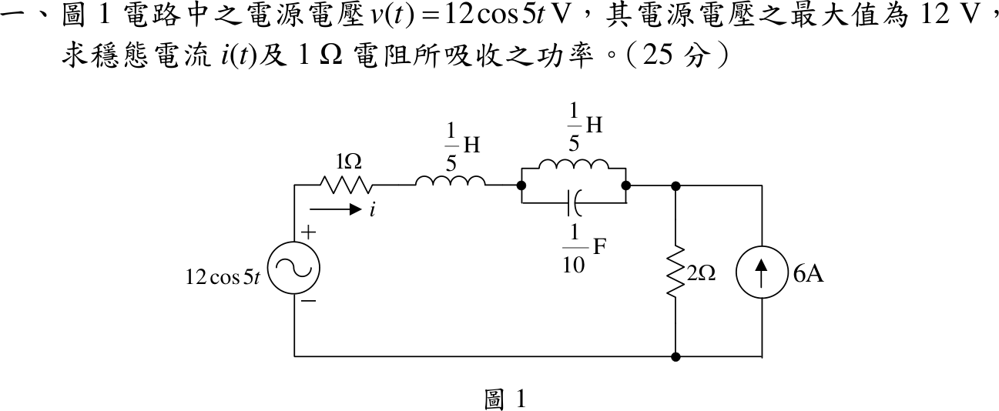
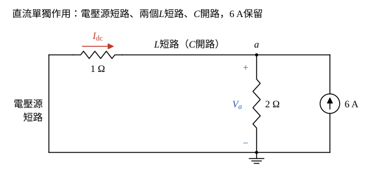
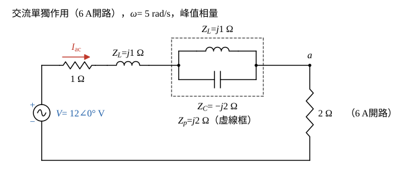

# 108 年電路學第 1 題｜正弦穩態電流與 1 Ω 電阻功率

## 已知與所求

\(v(t)=12\cos5t\ \mathrm V\)（峰值 12 V）串 \(1\ \Omega\)、\(\tfrac15\ \mathrm H\)，再接 \(\tfrac15\ \mathrm H\) 並聯 \(\tfrac1{10}\ \mathrm F\)；右節點 \(a\) 對地接 \(2\ \Omega\) 與向上（注入 \(a\)）的 \(6\ \mathrm A\) 電流源。\(i\) 為 \(1\ \Omega\) 上由左向右的電流。求穩態 \(i(t)\) 與 \(1\ \Omega\) 吸收功率（25 分）。

## 考場標準作答

### 步驟 1：直流分量 \(I_\mathrm{dc}\)（只留 6 A）

直流 6 A 與 \(\omega=5\ \mathrm{rad/s}\) 交流源頻率不同，不能放進同一相量方程，故用疊加。設為穩態；直流時電感短路、電容開路；交流取 \(\cos\) 基準的峰值相量 \(\mathbf V=12\angle0^\circ\ \mathrm V\)。

畫法：

- \(12\cos5t\) 的直流成分為 0，電壓源以短路取代；兩個 \(\tfrac15\ \mathrm H\) 電感短路、\(\tfrac1{10}\ \mathrm F\) 電容開路。
- 於是 \(1\ \Omega\) 直接接在節點 \(a\) 與地之間，與 \(2\ \Omega\)、6 A 電流源並聯。
- \(I_\mathrm{dc}\) 沿用題圖 \(i\) 的參考方向（\(1\ \Omega\) 上由左向右），\(V_a\) 為節點 \(a\) 對地電壓。

節點 \(a\) 的 KCL（注入 = 流出）：
\[
6=\frac{V_a}{2}+\frac{V_a}{1}
\]
\[
6=1.5V_a\ \Rightarrow\ V_a=\frac{6}{1.5}=4\ \mathrm V
\]
\(1\ \Omega\) 左端接地（電壓源已短路），由左向右的電流：
\[
I_\mathrm{dc}=\frac{0-V_a}{1}=\frac{0-4}{1}=-4\ \mathrm A
\]
負號表示直流實際由右向左流過 \(1\ \Omega\)，與圖中參考箭頭相反。

### 步驟 2：交流分量 \(\mathbf I_\mathrm{ac}\)（只留 \(12\cos5t\)）

畫法：6 A 電流源開路後，\(2\ \Omega\) 是節點 \(a\) 到地的唯一路徑，整個電路成為單一串聯迴路；\(\mathbf I_\mathrm{ac}\) 參考方向同 \(i\)（由左向右）。

各元件阻抗（\(\omega=5\ \mathrm{rad/s}\)；兩個 \(\tfrac15\ \mathrm H\) 電感的 \(\omega L\) 相同，皆記為 \(Z_L\)）：
\[
Z_L=j\omega L=j5\times\tfrac15=j1\ \Omega
\]
\[
Z_C=\frac{1}{j\omega C}=\frac{1}{j5\times\tfrac1{10}}=\frac{1}{j0.5}=-j2\ \Omega
\]
\(L\) 與 \(C\) 並聯：
\[
Z_p=\frac{Z_LZ_C}{Z_L+Z_C}=\frac{(j1)(-j2)}{j1-j2}=\frac{2}{-j1}=j2\ \Omega
\]

串聯總阻抗：
\[
Z=1+Z_L+Z_p+2=1+j1+j2+2=3+j3\ \Omega
\]
\[
|Z|=\sqrt{3^2+3^2}=3\sqrt2\ \Omega,\qquad \angle Z=\tan^{-1}\frac33=45^\circ
\]
\[
\mathbf I_\mathrm{ac}=\frac{\mathbf V}{Z}=\frac{12\angle0^\circ}{3\sqrt2\angle45^\circ}
\]
\[
|\mathbf I_\mathrm{ac}|=\frac{12}{3\sqrt2}=\frac{4}{\sqrt2}=2\sqrt2\ \mathrm A,\qquad \angle\mathbf I_\mathrm{ac}=0^\circ-45^\circ=-45^\circ
\]

### 穩態電流 \(i(t)\)

\[
i(t)=I_\mathrm{dc}+i_\mathrm{ac}(t),\qquad i_\mathrm{ac}(t)=|\mathbf I_\mathrm{ac}|\cos(5t+\angle\mathbf I_\mathrm{ac})=2\sqrt2\cos(5t-45^\circ)\ \mathrm A
\]
\[
i(t)=-4+2\sqrt2\cos(5t-45^\circ)\ \mathrm A,\qquad 2\sqrt2=2.828
\]
\[
\boxed{i(t)=-4+2.83\cos(5t-45^\circ)\ \mathrm A}
\]

### \(1\ \Omega\) 電阻吸收功率

\[
P_{1\Omega}=\overline{\left(I_\mathrm{dc}+i_\mathrm{ac}\right)^2}\,R=I_\mathrm{dc}^2R+2I_\mathrm{dc}\overline{i_\mathrm{ac}}\,R+\overline{i_\mathrm{ac}^2}\,R,\qquad \overline{i_\mathrm{ac}}=0
\]
直流部分：
\[
P_\mathrm{dc}=I_\mathrm{dc}^2R=(-4)^2\times1=16\ \mathrm W
\]
交流部分（峰值 \(2\sqrt2\ \mathrm A\)）：
\[
P_\mathrm{ac}=\tfrac12|\mathbf I_\mathrm{ac}|^2R=\tfrac12(2\sqrt2)^2\times1=\tfrac12\times8=4\ \mathrm W
\]
相加：
\[
P_{1\Omega}=P_\mathrm{dc}+P_\mathrm{ac}=16+4
\]
\[
\boxed{P_{1\Omega}=20\ \mathrm W}
\]

## 驗算

全電路平均功率守恆：\(a\) 點電壓 \(v_a=4+4\sqrt2\cos(5t-45^\circ)\ \mathrm V\)（交流 \(=\mathbf I_\mathrm{ac}\cdot2\)）。

- 供給：電壓源 \(\tfrac12(12)(2\sqrt2)\cos45^\circ=12\ \mathrm W\)；6 A 源 \(6\times\overline{v_a}=24\ \mathrm W\)，合計 36 W。
- 吸收：\(1\ \Omega\) 為 20 W；\(2\ \Omega\) 為 \(\dfrac{4^2}{2}+\dfrac{(4\sqrt2)^2}{2\cdot2}=8+8=16\ \mathrm W\)；LC 並聯為純電抗，合計 36 W。

## 失分點

- 把 6 A 當成 5 rad/s 的相量一起相加；漏掉直流分量會得 \(i=2\sqrt2\cos(5t-45^\circ)\)、\(P=4\ \mathrm W\)。
- 直流 \(i\) 的方向：\(i\) 箭頭向右而 \(1\ \Omega\) 實際電流向左，應為 \(-4\ \mathrm A\)，不是 \(+4\ \mathrm A\)。
- 交流部分以峰值相量直接用 \(|I|^2R\)，會使 \(P_\mathrm{ac}\) 多一倍成 8 W。
