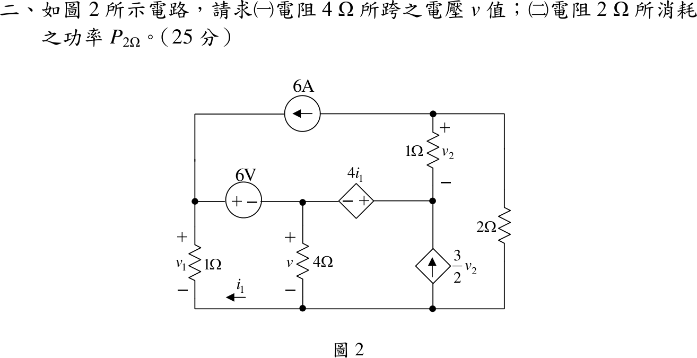
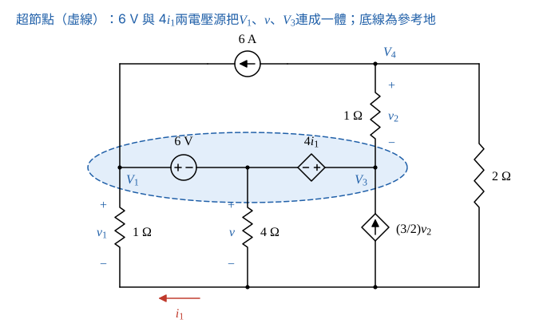

# 108 年電路學第 2 題｜含相依源直流電路

## 已知與所求

左上節點接 6 A 電流源（箭頭向左，電流由最上節點流入左節點）、6 V 電壓源「+」端與 \(1\ \Omega\)（\(v_1\) 上正）；6 V 源「−」端為 4 Ω（\(v\) 上正）頂端；相依電壓源 \(4i_1\)（左負右正）接 4 Ω 頂端與相依電流源 \(\tfrac32v_2\)（向上注入）頂端；最上節點接 \(1\ \Omega\)（\(v_2\) 上正，下端即相依源右端）與 \(2\ \Omega\)。\(i_1\) 箭頭沿底線向左，故電流由地向上穿過左側 \(1\ \Omega\)。求（一）\(4\ \Omega\) 電壓 \(v\)；（二）\(2\ \Omega\) 功率 \(P_{2\Omega}\)（共 25 分）。

## 考場標準作答

**解題邏輯**：電路有兩個電壓源（6 V 獨立源、\(4i_1\) 相依源）串在左節點、\(4\ \Omega\) 頂端與相依源右端之間，三點合成一個超節點，所以用節點分析：以底線為參考地、取 \(v\)（\(4\ \Omega\) 頂端電壓）為主未知數 → 用電壓源與控制量把其餘節點電壓都寫成 \(v\) 的式子 → 最上節點 KCL 求 \(V_4\) → 超節點 KCL 解出 \(v\) → 由 \(V_4\) 求 \(2\ \Omega\) 功率。所有電源視為理想源。

### 步驟 1：節點命名與參考方向

畫法：

- 底線為參考地；\(V_1\)：左節點（6 V 源「+」端、左側 \(1\ \Omega\) 頂端）；\(v\)：6 V 源「−」端，即 \(4\ \Omega\) 頂端；\(V_3\)：相依電壓源右端（「+」端）；\(V_4\)：最上節點。
- \(v_2\) 為右側 \(1\ \Omega\) 的電壓（上正），\(v_2=V_4-V_3\)；\(v_1=V_1\)。
- \(i_1\) 依題圖沿底線向左，即由地向上流過左側 \(1\ \Omega\) 進入 \(V_1\)，與 \(v_1\) 的被動方向相反。
- 6 A 源箭頭向左：電流由最上節點流出、流入左節點。
- 超節點 \(\{V_1,v,V_3\}\) 由兩個電壓源連成，邊界外的支路為：6 A 源、左側 \(1\ \Omega\)、\(4\ \Omega\)、右側 \(1\ \Omega\)、相依電流源。

### 步驟 2：電壓約束——各節點以 \(v\) 表示

6 V 源（「+」在左節點）：
\[
V_1=v+6
\]
控制電流 \(i_1\)（由地向上流過 \(1\ \Omega\)，與 \(V_1\) 的被動方向相反）：
\[
i_1=\frac{0-V_1}{1}=-(v+6)
\]
相依電壓源（「+」在右端）：
\[
V_3=v+4i_1=v-4(v+6)=-3v-24
\]

### 步驟 3：最上節點 KCL——\(V_4\) 與 \(v_2\)

流出最上節點的電流和為 0：經 6 A 源流出 6 A、經右側 \(1\ \Omega\) 向下流出 \(v_2/1\)、經 \(2\ \Omega\) 流出 \(V_4/2\)：
\[
6+\frac{V_4-V_3}{1}+\frac{V_4}{2}=0
\]
代入 \(V_3=-3v-24\)：
\[
6+V_4+3v+24+0.5V_4=0\ \Rightarrow\ 1.5V_4=-3v-30
\]
\[
V_4=-2v-20
\]
\[
v_2=V_4-V_3=(-2v-20)-(-3v-24)=v+4
\]

### （一）\(4\ \Omega\) 的電壓 \(v\)

**邏輯**：超節點內部（6 V 源、\(4i_1\) 源）的電流不必求，只對超節點邊界列 KCL；所有邊界電流都已在步驟 2、3 寫成 \(v\) 的式子，得一條一元一次方程。

超節點 KCL（流出 = 流入）：
- 流出：經左側 \(1\ \Omega\) 向下 \(V_1/1\)、經 \(4\ \Omega\) 向下 \(v/4\)。
- 流入：6 A 源流入 \(V_1\) 的 6 A、右側 \(1\ \Omega\) 向下流入 \(V_3\) 的 \(v_2\)、相依電流源向上注入 \(V_3\) 的 \(\tfrac32v_2\)。

\[
\frac{V_1}{1}+\frac v4=6+v_2+\frac32v_2
\]
代入 \(V_1=v+6\)、\(v_2=v+4\)：
\[
(v+6)+0.25v=6+2.5(v+4)
\]
\[
1.25v+6=2.5v+16
\]
\[
1.25v-2.5v=16-6\ \Rightarrow\ -1.25v=10
\]
\[
\boxed{v=-8\ \mathrm V}
\]

### （二）\(2\ \Omega\) 的功率 \(P_{2\Omega}\)

**邏輯**：\(2\ \Omega\) 跨在最上節點與地之間，端電壓即 \(V_4\)；代入步驟 3 的 \(V_4=-2v-20\) 後用 \(P=V^2/R\)。

\[
V_4=-2v-20=-2(-8)-20=16-20=-4\ \mathrm V
\]
\[
P_{2\Omega}=\frac{V_4^2}{2}=\frac{(-4)^2}{2}=\frac{16}{2}
\]
\[
\boxed{P_{2\Omega}=8\ \mathrm W}
\]

## 驗算

節點電壓：\(V_1=-2,\ v=-8,\ V_3=0,\ V_4=-4,\ v_2=-4\ \mathrm V,\quad i_1=2\ \mathrm A\)；以功率守恆檢查（與 KCL 解法不同）：

- 電阻吸收：\(1\ \Omega(V_1)\) 4 W、\(4\ \Omega\) 16 W、\(1\ \Omega(v_2)\) 16 W、\(2\ \Omega\) 8 W，共 44 W。
- 電源供給：6 A 源兩端升壓 \(V_1-V_4=2\ \mathrm V\)，供 12 W；6 V 源通過 \(6-V_1/1=8\ \mathrm A\) 由「+」端流入，吸 48 W；\(4i_1=8\ \mathrm V\) 源通過 \(8-v/4=10\ \mathrm A\) 由「+」端流出，供 80 W；相依電流源端電壓 \(V_3=0\)，0 W。\(12-48+80=44\ \mathrm W\)。

## 失分點

- \(i_1\) 箭頭向左（由地向上）：誤寫 \(i_1=+V_1\)（或把 \(4i_1\) 的極性看反）會得 \(v=-72/13\ \mathrm V\)、\(P_{2\Omega}\approx20.9\ \mathrm W\)。
- 相依電流源 \(\tfrac32v_2\) 向上注入相依源右端，超節點 KCL 要放在「流入」側。
- 題目要求兩個量，求出 \(v\) 後還需用 \(V_4\)（非 \(v\)）算 \(2\ \Omega\) 功率。
