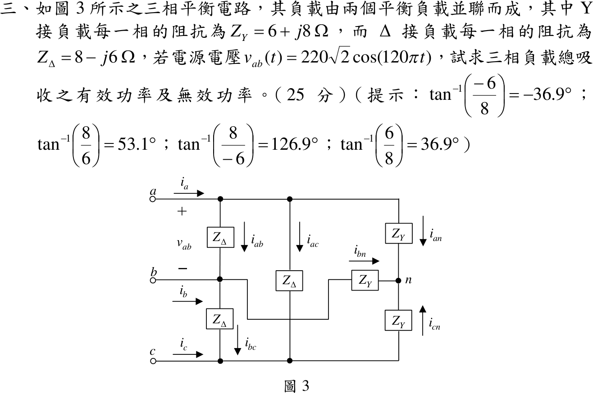
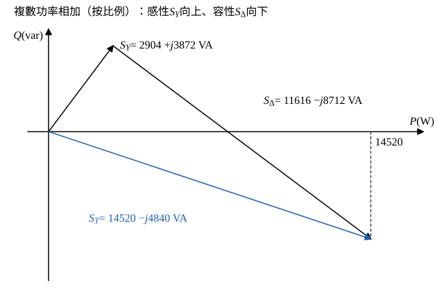

# 108 年電路學第 3 題｜三相平衡 Y／Δ 負載功率

## 已知與所求

平衡三相電路，Y 接負載每相 \(Z_Y=6+j8\ \Omega\)，Δ 接負載每相 \(Z_\Delta=8-j6\ \Omega\)，兩負載並聯；\(v_{ab}(t)=220\sqrt2\cos(120\pi t)\)（題幹未標單位，視為伏特）。求三相負載總吸收的有效功率與無效功率（25 分）。

## 考場標準作答

**解題邏輯**：兩個平衡負載並聯在同一組線電壓上，總複數功率等於兩負載複數功率相加（功率守恆）。關鍵是每相電壓：Y 接負載每相跨相電壓 \(V_L/\sqrt3\)，Δ 接負載每相直接跨線電壓 \(V_L\)。主線：由 \(v_{ab}\) 峰值求線電壓有效值 → 各負載以 \(S=3|V_\phi|^2/Z^*\) 求三相複數功率 → 相加取實部、虛部。前提：\(v_{ab}\) 單位為 V；平衡負載的功率與相序無關；分母用有理化直接得直角式，不必經題目提示的角度近似。

### 步驟 1：每相電壓有效值

線電壓峰值 \(220\sqrt2\ \mathrm V\)，有效值：
\[
V_L=\frac{220\sqrt2}{\sqrt2}=220\ \mathrm V
\]
Y 接負載每相電壓與其平方：
\[
V_{\phi Y}=\frac{V_L}{\sqrt3}=\frac{220}{\sqrt3}\ \mathrm V,\qquad V_{\phi Y}^2=\frac{220^2}{3}=\frac{48400}{3}\ \mathrm{V^2}
\]
Δ 接負載每相電壓：
\[
V_{\phi\Delta}=V_L=220\ \mathrm V
\]

### 步驟 2：Y 接負載三相複數功率 \(S_Y\)

\[
S_Y=3\frac{V_{\phi Y}^2}{Z_Y^*}=3\times\frac{48400/3}{6-j8}=\frac{48400}{6-j8}
\]
分子分母同乘 \(6+j8\)，分母 \(6^2+8^2=100\)：
\[
S_Y=\frac{48400(6+j8)}{100}=484(6+j8)=2904+j3872\ \mathrm{VA}
\]

### 步驟 3：Δ 接負載三相複數功率 \(S_\Delta\)

\[
S_\Delta=3\frac{V_{\phi\Delta}^2}{Z_\Delta^*}=3\times\frac{220^2}{8+j6}=\frac{145200}{8+j6}
\]
分子分母同乘 \(8-j6\)，分母 \(8^2+6^2=100\)：
\[
S_\Delta=\frac{145200(8-j6)}{100}=1452(8-j6)=11616-j8712\ \mathrm{VA}
\]

### 三相負載總有效功率與無效功率（25 分）

**邏輯**：並聯負載的複數功率可直接相加；總複數功率的實部為有效功率 \(P\)、虛部為無效功率 \(Q\)。

\[
S_T=S_Y+S_\Delta
\]
\[
S_T=(2904+11616)+j(3872-8712)=14520-j4840\ \mathrm{VA}
\]

取實部與虛部：
\[
P=\mathrm{Re}\,S_T=14520\ \mathrm W,\qquad Q=\mathrm{Im}\,S_T=-4840\ \mathrm{var}
\]
\[
\boxed{P=14.52\ \mathrm{kW}},\qquad \boxed{Q=-4.84\ \mathrm{kvar}}
\]
\(Q<0\) 表示整體呈容性：Δ 負載的容性無效功率 \(8712\ \mathrm{var}\) 大於 Y 負載的感性無效功率 \(3872\ \mathrm{var}\)。

## 驗算

Δ 折成 Y：\(Z_\Delta/3=\tfrac83-j2\ \Omega\)，與 \(6+j8\) 並聯：
\[
Z_{eq}=\frac{(6+j8)(\tfrac83-j2)}{(6+j8)+(\tfrac83-j2)}=3-j1\ \Omega
\]
\[
S_T=3\cdot\frac{(220/\sqrt3)^2}{Z_{eq}^*}=\frac{48400}{3+j1}=14520-j4840\ \mathrm{VA}
\]
與兩負載功率相加一致。

## 失分點

- Y 負載相電壓是 \(220/\sqrt3\) V，Δ 負載相電壓是 220 V，不可都用 220 V。
- \(220\sqrt2\) 是峰值；把 \(220\sqrt2\) 當有效值會使 \(P,Q\) 變 2 倍。
- 複數功率要用 \(Z^*\)（或 \(V I^*\)）；漏掉共軛會使 \(Q\) 符號顛倒，得 \(Q=+4.84\ \mathrm{kvar}\)。
