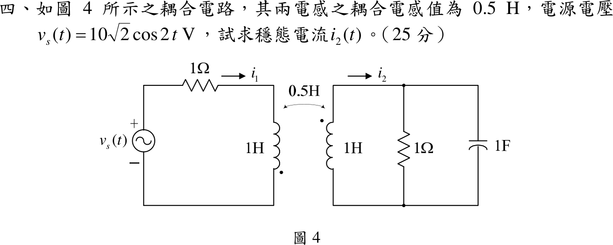
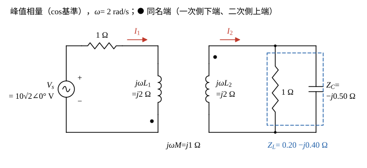

# 108 年電路學第 4 題｜互感耦合電路

## 已知與所求

\(v_s(t)=10\sqrt2\cos2t\ \mathrm V\) 串 \(1\ \Omega\) 接一次側 \(L_1=1\ \mathrm H\)；二次側 \(L_2=1\ \mathrm H\) 接 \(1\ \Omega\) 並聯 \(1\ \mathrm F\)；互感 \(M=0.5\ \mathrm H\)。一次側點在下端、二次側點在上端；\(i_1\) 由上端（非點端）流入一次側，\(i_2\) 由二次側上端（點端）流出，等於由下端（非點端）流入。求穩態 \(i_2(t)\)（25 分）。

## 考場標準作答

**解題邏輯**：一次側與二次側是兩個只靠互感相連的迴路，以題給 \(i_1\)、\(i_2\) 為兩個迴路電流列 KVL。先把元件換成 \(\omega=2\) 的相量阻抗（二次側 \(1\ \Omega\parallel1\ \mathrm F\) 先併成 \(Z_L\)），再依同名端定互感項符號，聯立兩式以克拉瑪法則求 \(\mathbf I_2\)，最後把極式（模與角分列）寫回時域。全題為弦波穩態，用 \(\cos\) 基準的峰值相量 \(\mathbf V_s=10\sqrt2\angle0^\circ\ \mathrm V\)。

### 步驟 1：相量阻抗

\(\omega=2\ \mathrm{rad/s}\)：
\[
j\omega L_1=j(2)(1)=j2\ \Omega,\qquad j\omega L_2=j(2)(1)=j2\ \Omega,\qquad j\omega M=j(2)(0.5)=j1\ \Omega
\]
\[
Z_C=\frac{1}{j\omega C}=\frac{1}{j(2)(1)}=-j0.50\ \Omega
\]
二次側負載 \(1\ \Omega\) 與 \(1\ \mathrm F\) 並聯：
\[
Z_L=\frac{1\times(-j0.50)}{1-j0.50}=\frac{-j0.50}{1-j0.50}
\]
分子分母同乘 \(j2\)（\((-j0.50)(j2)=1\)，\((1-j0.50)(j2)=j2+1\)）：
\[
Z_L=\frac{(-j0.50)(j2)}{(1-j0.50)(j2)}=\frac{1}{1+j2}
\]
有理化：
\[
Z_L=\frac{1-j2}{(1+j2)(1-j2)}=\frac{1-j2}{1^2+2^2}=\frac{1-j2}{5}=0.20-j0.40\ \Omega
\]

### 步驟 2：同名端與兩迴路 KVL

畫法：

- \(\mathbf I_1\) 依題圖由一次側線圈上端流入；一次側的點在下端，故 \(\mathbf I_1\) 由非點端流入。
- \(\mathbf I_2\) 依題圖沿二次側上方導線向右，從二次側線圈上端（點端）流出，等於由下端（非點端）流入線圈。
- 兩參考電流都由非點端流入（與都由點端流入等效），互感電壓與自感電壓同號，取 \(+j\omega M\)。

一次側（沿 \(\mathbf I_1\) 方向，電源電壓等於各壓降和）：
\[
\mathbf V_s=1\cdot\mathbf I_1+j2\mathbf I_1+j1\mathbf I_2\ \Rightarrow\ (1+j2)\mathbf I_1+j\mathbf I_2=10\sqrt2
\]
二次側（沿 \(\mathbf I_2\) 方向：線圈由下而上壓降 \(j2\mathbf I_2+j1\mathbf I_1\)，再經 \(Z_L\) 由上而下壓降 \(Z_L\mathbf I_2\)）：
\[
j2\mathbf I_2+j\mathbf I_1+(0.20-j0.40)\mathbf I_2=0\ \Rightarrow\ j\mathbf I_1+(0.20+j1.60)\mathbf I_2=0
\]

### 穩態電流 \(i_2(t)\)（25 分）

**邏輯**：兩式為 \(2\times2\) 線性方程，克拉瑪法則直接給 \(\mathbf I_2=\dfrac{-j\times10\sqrt2}{\Delta}\)；化成極式後依 \(\cos\) 基準寫回時域。

行列式：
\[
(1+j2)(0.20+j1.60)=0.20+j1.60+j0.40+j^2\,3.20=(0.20-3.20)+j(1.60+0.40)=-3+j2
\]
\[
\Delta=(1+j2)(0.20+j1.60)-(j)(j)=(-3+j2)-(-1)=-2+j2
\]
克拉瑪法則：
\[
\mathbf I_2=\frac{(1+j2)\times0-j\times10\sqrt2}{\Delta}=\frac{-j\,10\sqrt2}{-2+j2}
\]
分母有理化：
\[
\frac{-j}{-2+j2}=\frac{-j(-2-j2)}{(-2)^2+2^2}=\frac{j2+j^2\,2}{8}=\frac{-2+j2}{8}=\frac{-1+j}{4}
\]
\[
\mathbf I_2=\frac{10\sqrt2\,(-1+j)}{4}
\]
化為極式：
\[
|-1+j|=\sqrt{(-1)^2+1^2}=\sqrt2,\qquad \angle(-1+j)=180^\circ-\tan^{-1}\frac11=135^\circ\ (\text{第二象限})
\]
\[
|\mathbf I_2|=\frac{10\sqrt2\times\sqrt2}{4}=\frac{20}{4}=5\ \mathrm A,\qquad \angle\mathbf I_2=135^\circ
\]
\[
\mathbf I_2=5\angle135^\circ\ \mathrm A
\]
\(\cos\) 基準峰值相量寫回時域：
\[
\boxed{i_2(t)=5\cos(2t+135^\circ)\ \mathrm A}
\]

## 驗算

以有效值相量（\(\mathbf V_s=10\angle0^\circ\)）做功率守恆：\(\mathbf I_2=\frac{5}{\sqrt2}\angle135^\circ=\frac{5}{\sqrt2}\cdot\frac{-1+j}{\sqrt2}=-2.50+j2.50\ \mathrm A\)，由二次側方程 \(\mathbf I_1=\frac{-(0.20+j1.60)\mathbf I_2}{j}=(-1.60+j0.20)\mathbf I_2=3.50-j4.50\ \mathrm A\)。

- 電源送出 \(\mathrm{Re}(\mathbf V_s\mathbf I_1^*)=10\times3.50=35\ \mathrm W\)。
- 串聯 \(1\ \Omega\) 吸收 \(|\mathbf I_1|^2\times1=(3.50^2+4.50^2)=32.50\ \mathrm W\)。
- 負載吸收 \(\mathrm{Re}(Z_L)|\mathbf I_2|^2=0.20\times(2.50^2+2.50^2)=0.20\times12.50=2.50\ \mathrm W\)；\(32.50+2.50=35\ \mathrm W\)，與電源送出相等。

## 失分點

- 同名端：兩電流皆由非點端流入故 \(+j\omega M\)；誤用 \(-j\omega M\) 會得 \(5\cos(2t-45^\circ)\ \mathrm A\)，整個反相。
- 右側 \(1\ \Omega\) 與 \(1\ \mathrm F\) 為並聯，\(Z_L=0.20-j0.40\ \Omega\)，不是 \(1-j0.50\ \Omega\) 的串聯。
- 峰值相量源取 \(10\sqrt2\)；若取 10 當峰值，最後振幅只剩 \(5/\sqrt2\approx3.54\ \mathrm A\)。
