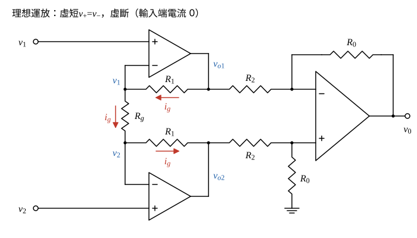

# 109 年電路學第 1 題｜三運算放大器儀表放大器

## 已知與所求

輸入級：上運放 \(+\) 端接 \(v_1\)、下運放 \(+\) 端接 \(v_2\)；兩個 \(-\) 端之間接 \(R_g\)，各自經 \(R_1\) 回授至本身輸出 \(v_{o1}\)（上）、\(v_{o2}\)（下）。差動級：\(v_{o1}\) 經 \(R_2\) 接 \(-\) 端（回授 \(R_0\)），\(v_{o2}\) 經 \(R_2\) 接 \(+\) 端（\(R_0\) 接地）。求 \(v_0\) 與 \(v_1,v_2\) 的關係（25 分）。

## 考場標準作答

**解題邏輯**：電路是三運放儀表放大器，分兩級處理。前提：三個運放皆為理想且有負回授，故可用「虛短」（\(v_+=v_-\)）與「虛斷」（輸入端電流為 0）。輸入級：虛短定出兩個 \(-\) 端電位 → 求 \(R_g\) 電流 \(i_g\) → 虛斷使 \(i_g\) 全數流過兩個 \(R_1\) → 得 \(v_{o1}\)、\(v_{o2}\) 及其差。差動級：\(+\) 端分壓 → \(-\) 端 KCL → 得 \(v_0\) 與 \(v_{o2}-v_{o1}\) 的關係。最後兩級相乘。

### 步驟 1：輸入級——\(v_{o1}\)、\(v_{o2}\)

畫法：

- 虛短：上運放 \(-\) 端電位 \(=v_1\)，下運放 \(-\) 端電位 \(=v_2\)，兩者分別為 \(R_g\) 的上、下端。
- \(i_g\) 取由上而下流過 \(R_g\)；虛斷使 \(i_g\) 由 \(v_{o1}\) 經上方 \(R_1\) 流入、再經下方 \(R_1\) 流向 \(v_{o2}\)，三個電阻串聯同一電流。

\(R_g\) 電流（歐姆定律）：
\[
i_g=\frac{v_1-v_2}{R_g}
\]
上方 \(-\) 端 KCL（由 \(v_{o1}\) 經 \(R_1\) 流入的電流全數流入 \(R_g\)）：
\[
\frac{v_{o1}-v_1}{R_1}=i_g\ \Rightarrow\ v_{o1}=v_1+R_1i_g
\]
下方 \(-\) 端 KCL（由 \(R_g\) 流入的電流全數經 \(R_1\) 流向 \(v_{o2}\)）：
\[
i_g=\frac{v_2-v_{o2}}{R_1}\ \Rightarrow\ v_{o2}=v_2-R_1i_g
\]
兩式相減：
\[
v_{o2}-v_{o1}=(v_2-v_1)-2R_1i_g
\]
代入 \(i_g\)：
\[
v_{o2}-v_{o1}=(v_2-v_1)-\frac{2R_1}{R_g}(v_1-v_2)=(v_2-v_1)+\frac{2R_1}{R_g}(v_2-v_1)
\]
\[
v_{o2}-v_{o1}=\left(1+\frac{2R_1}{R_g}\right)(v_2-v_1)
\]

### 步驟 2：差動級——\(v_0\) 與 \(v_{o1}\)、\(v_{o2}\)

\(+\) 端：\(v_{o2}\) 經 \(R_2\)、\(R_0\) 對地分壓（虛斷，\(+\) 端無電流）：
\[
v_+=\frac{R_0}{R_2+R_0}\,v_{o2}
\]
虛短 \(v_-=v_+\)；\(-\) 端 KCL（由 \(v_{o1}\) 經 \(R_2\) 流入的電流全數經 \(R_0\) 流向 \(v_0\)）：
\[
\frac{v_{o1}-v_-}{R_2}=\frac{v_--v_0}{R_0}
\]
解出 \(v_0\)：
\[
v_0=v_--\frac{R_0}{R_2}(v_{o1}-v_-)=\left(1+\frac{R_0}{R_2}\right)v_--\frac{R_0}{R_2}v_{o1}
\]
代入 \(v_-=v_+\)：
\[
\left(1+\frac{R_0}{R_2}\right)v_+=\frac{R_2+R_0}{R_2}\cdot\frac{R_0}{R_2+R_0}\,v_{o2}=\frac{R_0}{R_2}\,v_{o2}
\]
\[
v_0=\frac{R_0}{R_2}\,v_{o2}-\frac{R_0}{R_2}\,v_{o1}=\frac{R_0}{R_2}(v_{o2}-v_{o1})
\]

### 輸出與輸入的關係（25 分）

**邏輯**：差動級只放大 \(v_{o2}-v_{o1}\)（步驟 2），而輸入級已把它寫成 \(v_2-v_1\) 的倍數（步驟 1），兩式串接即得總關係。

\[
v_0=\frac{R_0}{R_2}(v_{o2}-v_{o1})=\frac{R_0}{R_2}\cdot\left(1+\frac{2R_1}{R_g}\right)(v_2-v_1)
\]
\[
\boxed{v_0=\frac{R_0}{R_2}\left(1+\frac{2R_1}{R_g}\right)(v_2-v_1)}
\]
差模增益 \(A_d=\dfrac{R_0}{R_2}\left(1+\dfrac{2R_1}{R_g}\right)\)，共模輸入不被放大。

## 驗算

- 共模檢查：\(v_1=v_2=v_{cm}\) 時 \(i_g=0\)，\(v_{o1}=v_{o2}=v_{cm}\)，差動級輸出 \(0\)，與公式一致。
- 特例：\(R_g\to\infty\)（輸入級成為兩個電壓隨耦器），公式退化為標準差動放大器 \(v_0=\frac{R_0}{R_2}(v_2-v_1)\)。
- 將七個節點的虛短與 KCL 方程一次聯立求解，得到相同結果。

## 失分點

- 本圖 \(v_1\) 經上方路徑進差動級的反相端，輸出正比於 \(v_2-v_1\)；寫成 \(v_1-v_2\) 會整體差一個負號。
- 增益寫成 \(1+\frac{R_1}{R_g}\)，漏了兩個 \(R_1\) 都由 \(i_g\) 流過。
