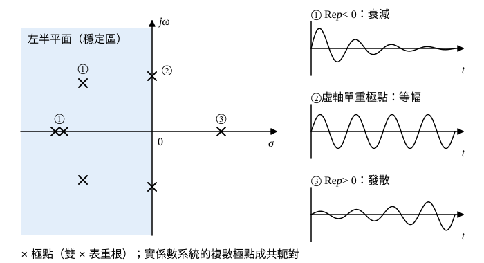

# 109 年電路學第 2 題｜轉移函數極點與系統穩定度

## 已知與所求

論述題：說明轉移函數極點與系統穩定度的關係（25 分）。對象取因果、連續時間、集總參數 LTI 系統，\(H(s)=N(s)/D(s)\) 已約分。

## 考場標準作答

### 步驟 1：極點決定自然模態

設為因果、連續時間、集總參數 LTI 系統，\(H(s)=N(s)/D(s)\) 已約分；若 \(\deg N=\deg D\)，先長除出常數項（對應 \(\delta(t)\)，不影響穩定度）。

極點為 \(D(s)=0\) 的根 \(p_k=\sigma_k+j\omega_k\)。各極點皆單重時，部分分式為
\[
H(s)=\sum_k\frac{A_k}{s-p_k},\qquad A_k=(s-p_k)H(s)\big|_{s=p_k}
\]
逐項反拉氏轉換：
\[
h(t)=\sum_kA_k\,e^{p_kt}\,u(t)
\]
每個模態拆成實部與虛部：
\[
e^{p_kt}=e^{\sigma_kt}e^{j\omega_kt}=e^{\sigma_kt}(\cos\omega_kt+j\sin\omega_kt)
\]
\[
|e^{p_kt}|=e^{\sigma_kt}\,|e^{j\omega_kt}|=e^{\sigma_kt}
\]
- 實部 \(\sigma_k\) 決定模態增減，虛部 \(\omega_k\) 決定振盪角頻率。
- 實係數系統的複數極點成共軛對，兩項合併為實數模態 \(2|A_k|e^{\sigma_kt}\cos(\omega_kt+\angle A_k)\)。
- 重數 \(r\) 的極點另含 \(\dfrac{A}{(s-p)^r}\leftrightarrow\dfrac{A\,t^{r-1}}{(r-1)!}e^{pt}\)，即模態多乘 \(t^{r-1}\)。

### 步驟 2：各模態的絕對可積性（BIBO 判準）

BIBO 穩定的定義：任何有界輸入 \(|x(t)|\le M\) 都產生有界輸出。由卷積：
\[
|y(t)|=\left|\int_0^\infty h(\tau)\,x(t-\tau)\,d\tau\right|\le\int_0^\infty|h(\tau)|\,|x(t-\tau)|\,d\tau\le M\int_0^\infty|h(\tau)|\,d\tau
\]
- 充分：\(\int_0^\infty|h|\,dt<\infty\) 則 \(y\) 有界。
- 必要：取有界輸入 \(x(t-\tau)=\operatorname{sgn}h(\tau)\)，得 \(y(t)=\int_0^t|h(\tau)|\,d\tau\)；若積分發散，輸出無界。

所以 BIBO 穩定 \(\iff\int_0^\infty|h(t)|\,dt<\infty\)，再逐模態檢查：
\[
\sigma<0:\quad\int_0^\infty e^{\sigma t}\,dt=\left[\frac{e^{\sigma t}}{\sigma}\right]_0^\infty=0-\frac1\sigma=\frac{1}{-\sigma}<\infty
\]
\[
\sigma<0,\ \text{重數 }r:\quad\int_0^\infty t^{r-1}e^{\sigma t}\,dt=\frac{(r-1)!}{(-\sigma)^r}<\infty
\]
\[
\sigma\ge0:\quad e^{\sigma t}\ge1\ \Rightarrow\ \int_0^\infty e^{\sigma t}\,dt\ge\int_0^\infty1\,dt=\infty
\]
\(\sigma=0\) 的共軛對雖然 \(|\cos\omega t|\) 有界，積分仍發散（步驟 3 計算）。

### 步驟 3：臨界穩定不是 BIBO 穩定（反例）

取虛軸單重共軛極點 \(p=\pm j\omega\)：
\[
H(s)=\frac{1}{s^2+\omega^2}\ \Rightarrow\ h(t)=\frac{\sin\omega t}{\omega}\,u(t)
\]
\(h(t)\) 有界不衰減；每半週期 \(\pi/\omega\) 的面積：
\[
\int_0^{\pi/\omega}\frac{\sin\omega t}{\omega}\,dt=\frac{1}{\omega}\left[-\frac{\cos\omega t}{\omega}\right]_0^{\pi/\omega}=\frac{1-(-1)}{\omega^2}=\frac{2}{\omega^2}
\]
無限多個半週期相加 \(\int_0^\infty|h|\,dt=\infty\)，故非 BIBO 穩定。具體的有界輸入 \(x(t)=\sin\omega t\)：
\[
X(s)=\frac{\omega}{s^2+\omega^2},\qquad Y(s)=H(s)X(s)=\frac{\omega}{(s^2+\omega^2)^2}
\]
利用 \(\mathcal L\{\sin\omega t-\omega t\cos\omega t\}=\dfrac{2\omega^3}{(s^2+\omega^2)^2}\)：
\[
Y(s)=\frac{1}{2\omega^2}\cdot\frac{2\omega^3}{(s^2+\omega^2)^2}\ \Rightarrow\ y(t)=\frac{\sin\omega t-\omega t\cos\omega t}{2\omega^2}=\frac{\sin\omega t}{2\omega^2}-\frac{t\cos\omega t}{2\omega}
\]
第二項振幅 \(t/(2\omega)\) 隨時間線性成長（共振），有界輸入得無界輸出。

### 步驟 4：二階系統的對應

\[
H(s)=\frac{K\omega_n^2}{s^2+2\zeta\omega_ns+\omega_n^2},\qquad s^2+2\zeta\omega_ns+\omega_n^2=0
\]
\[
s=\frac{-2\zeta\omega_n\pm\sqrt{4\zeta^2\omega_n^2-4\omega_n^2}}{2}=-\zeta\omega_n\pm\omega_n\sqrt{\zeta^2-1}
\]
- \(0<\zeta<1\)：\(s=-\zeta\omega_n\pm j\omega_n\sqrt{1-\zeta^2}\)，實部 \(-\zeta\omega_n<0\)，衰減振盪。
- \(\zeta\ge1\)：兩實根，\(\sqrt{\zeta^2-1}<\zeta\)，兩根皆負，無振盪衰減。
- \(\zeta=0\)：\(s=\pm j\omega_n\)，等幅振盪（臨界穩定）。
- \(\zeta<0\)：實部 \(-\zeta\omega_n>0\)，發散。

極點越接近虛軸（\(\zeta\omega_n\) 越小），包絡 \(e^{-\zeta\omega_nt}\) 的時間常數 \(1/(\zeta\omega_n)\) 越長，衰減越慢、頻率響應的共振峰越尖。

### 步驟 5：零極點對消與內部穩定

\[
H(s)=\frac{s-a}{(s-a)(s+b)}=\frac{1}{s+b}\qquad(a,b>0)
\]
約分後只剩極點 \(-b\)，輸入輸出為 BIBO 穩定；但被消去的 \(+a\) 模態 \(e^{at}\) 若存在於系統內部（不可控或不可觀），內部狀態仍會發散。故穩定度須區分外部（轉移函數）與內部（狀態實現）。

### 極點與系統穩定度的關係（25 分）

由步驟 1–2，穩定度由每個極點模態 \(t^{r-1}e^{\sigma t}\) 是否絕對可積決定，只看極點實部與虛軸上的重數：

| 極點位置 | 模態 | 結論 |
|---|---|---|
| ① 全部在左半平面 \(\mathrm{Re}\,p<0\)（含重根） | \(t^{r-1}e^{\sigma t}\to0\) | 漸近穩定、BIBO 穩定 |
| ② 虛軸上單重極點，其餘在左半平面 | 等幅正弦或常數 | 臨界（邊界）穩定，非 BIBO 穩定 |
| 虛軸上重極點 | \(t\cos\omega t\) 等多項式成長 | 不穩定 |
| ③ 任一右半平面極點 | \(e^{\sigma t}\)，\(\sigma>0\) | 不穩定 |

\[
\boxed{\text{BIBO 穩定}\iff\text{所有極點 }\mathrm{Re}\,p_k<0\iff\int_0^\infty|h(t)|\,dt<\infty}
\]

## 驗算

以反拉氏轉換逐例核對上表：
- \(\frac{1}{(s+1)(s+3)}\)、\(\frac{1}{(s+2)^2}\Rightarrow te^{-2t}\)、\(\frac{5}{s^2+2s+5}\)：\(h(t)\to0\) 且絕對可積，左半平面重根仍穩定。
- \(\frac{1}{s^2+4}\Rightarrow\frac12\sin2t\)：有界不衰減；乘上 \(\frac{2}{s^2+4}\)（輸入 \(\sin2t\)）得 \(\frac{\sin2t-2t\cos2t}{8}\)，線性發散。
- \(\frac1{s^2}\Rightarrow t\)、\(\frac1{s-1}\Rightarrow e^{t}\)：皆無界。

## 失分點

- 把虛軸單重極點（臨界穩定）寫成 BIBO 穩定。
- 誤稱「重根即不穩定」；只有虛軸或右半平面的重根才不穩定，左半平面重根仍漸近穩定。
- 未先約分就判斷，或忽略對消模態對內部穩定的影響。
