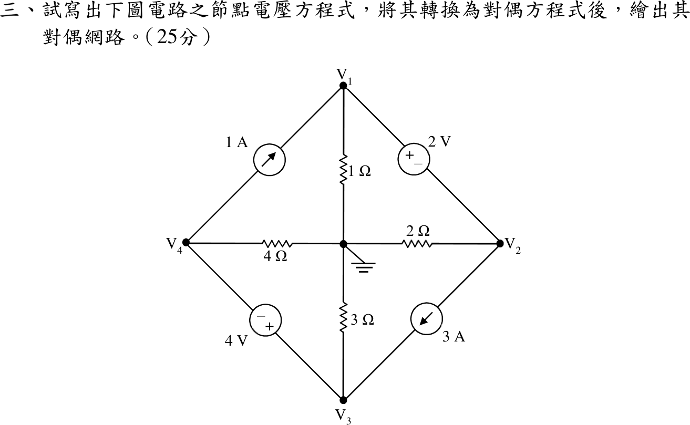
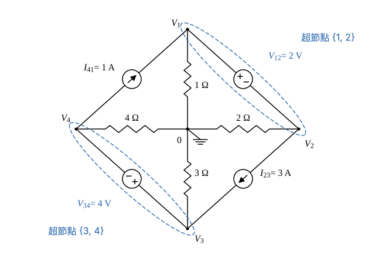
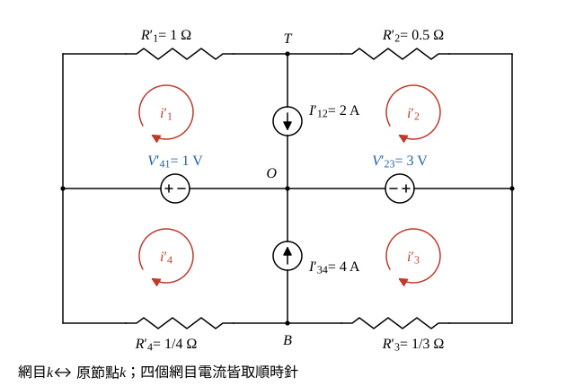

# 109 年電路學第 3 題｜節點電壓方程式與對偶網路

## 已知與所求

中心節點接地；\(V_1,V_2,V_3,V_4\) 分別經 \(1,2,3,4\ \Omega\) 接地。外框支路：\(1\ \mathrm A\) 電流源由 \(V_4\) 流向 \(V_1\)；\(2\ \mathrm V\) 電壓源 \(V_1\) 端為正、\(V_2\) 端為負；\(3\ \mathrm A\) 電流源由 \(V_2\) 流向 \(V_3\)；\(4\ \mathrm V\) 電壓源 \(V_3\) 端為正、\(V_4\) 端為負。寫出節點電壓方程式，轉為對偶方程式並繪出對偶網路（25 分）。

## 考場標準作答

### 步驟 1：命名與超節點

畫法：

- 中心節點為參考（\(0\ \mathrm V\)）；\(V_k\) 經 \(R_k=k\ \Omega\) 接地，電導 \(G_1=1\ \mathrm S\)、\(G_2=0.5\ \mathrm S\)、\(G_3=\tfrac13\ \mathrm S\)、\(G_4=\tfrac14\ \mathrm S\)。
- 外框電源依題圖命名：\(I_{41}=1\ \mathrm A\)（節點 4 流向節點 1）、\(V_{12}=2\ \mathrm V\)（正端在節點 1）、\(I_{23}=3\ \mathrm A\)（節點 2 流向節點 3）、\(V_{34}=4\ \mathrm V\)（正端在節點 3）。
- 電壓源兩端節點各圈成超節點 \(\{1,2\}\)、\(\{3,4\}\)；超節點 KCL 只計電阻電流與電流源電流，電壓源電流在超節點內部抵消。

### 節點電壓方程式

電壓約束：
\[
V_1-V_2=V_{12}=2\ \mathrm V,\qquad V_3-V_4=V_{34}=4\ \mathrm V
\]
超節點 \(\{1,2\}\)：\(I_{41}\) 流入節點 1、\(I_{23}\) 由節點 2 流出：
\[
G_1V_1+G_2V_2=I_{41}-I_{23}
\]
\[
(1\ \mathrm S)\,V_1+(0.5\ \mathrm S)\,V_2=1-3=-2\ \mathrm A
\]
超節點 \(\{3,4\}\)：\(I_{23}\) 流入節點 3、\(I_{41}\) 由節點 4 流出：
\[
G_3V_3+G_4V_4=I_{23}-I_{41}
\]
\[
\left(\tfrac13\ \mathrm S\right)V_3+\left(\tfrac14\ \mathrm S\right)V_4=3-1=2\ \mathrm A
\]
題目只要求寫出方程式；以下解值供驗算與對偶網路核對，非得分必要步驟。

解超節點 \(\{1,2\}\)（電壓以 V、電導以 S 計，各項為電流 A）：代入 \(V_1=V_2+2\)
\[
1\times(V_2+2)+0.5\,V_2=-2
\]
\[
1.5\,V_2+2=-2
\]
\[
1.5\,V_2=-4
\]
\[
V_2=\frac{-4}{1.5}=-\frac83\ \mathrm V
\]
\[
V_1=V_2+2=-\frac83+2=-\frac23\ \mathrm V
\]
解超節點 \(\{3,4\}\)（同上單位）：代入 \(V_3=V_4+4\)
\[
\tfrac13(V_4+4)+\tfrac14V_4=2
\]
\[
\tfrac13V_4+\tfrac43+\tfrac14V_4=2
\]
\[
\tfrac7{12}V_4=2-\tfrac43=\tfrac23
\]
\[
V_4=\frac23\times\frac{12}{7}=\frac87\ \mathrm V
\]
\[
V_3=V_4+4=\frac87+4=\frac{36}{7}\ \mathrm V
\]
\[
\boxed{V_1=-\tfrac23=-0.67\ \mathrm V},\quad \boxed{V_2=-\tfrac83=-2.67\ \mathrm V},\quad \boxed{V_3=\tfrac{36}{7}=5.14\ \mathrm V},\quad \boxed{V_4=\tfrac87=1.14\ \mathrm V}
\]

### 對偶方程式

平面電路的對偶把節點 KCL 換成網目 KVL：節點電壓 \(\leftrightarrow\) 網目電流、電導 \(G\ (\mathrm S)\leftrightarrow\) 電阻 \(R'=G\ (\Omega)\)、電壓源 \(\leftrightarrow\) 電流源、電流源 \(\leftrightarrow\) 電壓源、接地節點 \(\leftrightarrow\) 外圍網目；係數與常數不變，故解的數值相同、單位改為 A。

對偶元件值：
\[
R'_1=G_1=1\ \Omega,\quad R'_2=G_2=0.5\ \Omega,\quad R'_3=G_3=\tfrac13\ \Omega,\quad R'_4=G_4=\tfrac14\ \Omega
\]
\[
I'_{12}=2\ \mathrm A,\quad I'_{34}=4\ \mathrm A,\quad V'_{41}=1\ \mathrm V,\quad V'_{23}=3\ \mathrm V
\]
電流約束（對偶於電壓約束）：
\[
i'_1-i'_2=I'_{12}=2\ \mathrm A,\qquad i'_3-i'_4=I'_{34}=4\ \mathrm A
\]
超網目 KVL（對偶於超節點 KCL）：
\[
R'_1i'_1+R'_2i'_2=V'_{41}-V'_{23}\ \Rightarrow\ (1\ \Omega)\,i'_1+(0.5\ \Omega)\,i'_2=1-3=-2\ \mathrm V
\]
\[
R'_3i'_3+R'_4i'_4=V'_{23}-V'_{41}\ \Rightarrow\ \left(\tfrac13\ \Omega\right)i'_3+\left(\tfrac14\ \Omega\right)i'_4=3-1=2\ \mathrm V
\]
四式與節點方程逐項同形，消去過程相同（題目未要求求解，以下解值供核對）：
\[
\boxed{i'_1=-\tfrac23=-0.67\ \mathrm A},\ \boxed{i'_2=-\tfrac83=-2.67\ \mathrm A},\ \boxed{i'_3=\tfrac{36}{7}=5.14\ \mathrm A},\ \boxed{i'_4=\tfrac87=1.14\ \mathrm A}
\]

### 對偶網路

原電路四個節點兩兩相鄰成環且都經電阻接地，對偶後成為「田」字形：每個原節點對應一個網目，接地節點對應外圍，原外框支路對應相鄰兩網目的共用支路，原接地電阻對應只屬單一網目的外框支路。

畫法：

- 先畫中心節點 \(O\) 與四個網目：網目 1 左上、2 右上、3 右下、4 左下，網目電流皆順時針。
- 原接地電阻 \(1,2,3,4\ \Omega\) → 外框電阻 \(R'_1\sim R'_4=1,\ 0.5,\ \tfrac13,\ \tfrac14\ \Omega\)，各只屬網目 1、2、3、4。
- 原 \(V_{12}\)（節點 1–2）→ 網目 1–2 共用的上豎支路放 \(I'_{12}=2\ \mathrm A\)，向下流向 \(O\)：順時針的 \(i'_1\) 在此向下、\(i'_2\) 向上，滿足 \(i'_1-i'_2=2\)。
- 原 \(V_{34}\)（節點 3–4）→ 下豎支路放 \(I'_{34}=4\ \mathrm A\)，向上流向 \(O\)：\(i'_3\) 在此向上、\(i'_4\) 向下，滿足 \(i'_3-i'_4=4\)。
- 原 \(I_{41}\)（節點 4–1）→ 左橫支路放 \(V'_{41}=1\ \mathrm V\)，外端為正；原 \(I_{23}\)（節點 2–3）→ 右橫支路放 \(V'_{23}=3\ \mathrm V\)，外端為正。沿超網目 \(\{1,2\}\) 順時針一圈，\(V'_{41}\) 為升壓、\(V'_{23}\) 為降壓，正好給出 \(1-3=-2\ \mathrm V\)。

## 驗算

- 原電路以 MNA（兩電壓源電流為未知數）完整求解，得同一組 \(V_1\sim V_4\)；回代 \(-\frac23+\frac12\times(-\frac83)=-\frac23-\frac43=-2\ \mathrm A\)、\(\frac13\times\frac{36}{7}+\frac14\times\frac87=\frac{12}{7}+\frac27=2\ \mathrm A\)。
- 對偶網路改以節點法求解（圖 2，\(O\) 接地；左、右節點電壓分別為 \(V'_{41}=1\ \mathrm V\)、\(V'_{23}=3\ \mathrm V\)）：上節點 \(T\) 的 KCL \((1-T)-2(T-3)-2=0\Rightarrow T=\frac53\ \mathrm V\)；下節點 \(B\) 的 KCL \(3(3-B)-4(B-1)-4=0\Rightarrow B=\frac97\ \mathrm V\)。網目電流 \(i'_1=(1-\frac53)/1=-\frac23\ \mathrm A\)、\(i'_2=(\frac53-3)/0.5=-\frac83\ \mathrm A\)、\(i'_3=(3-\frac97)/\frac13=\frac{36}{7}\ \mathrm A\)、\(i'_4=(\frac97-1)/\frac14=\frac87\ \mathrm A\)，與 \(V_1\sim V_4\) 數值逐一相等，證實圖中元件值與極性正確。

## 失分點

- 對偶時把電阻值直接照抄（\(2\ \Omega\to2\ \Omega\)）；應取電導值 \(0.5\ \Omega\)。
- \(4\ \mathrm V\) 源的正端在 \(V_3\)，寫成 \(V_4-V_3=4\) 會使超節點 \(\{3,4\}\) 的解全錯。
- 對偶電源方向未與順時針網目約定配合，造成網目方程常數項變號。
