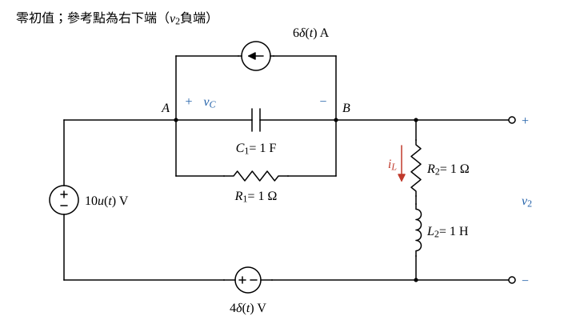

# 109 年電路學第 4 題｜脈衝與步階激勵的二階暫態

## 已知與所求

左側 \(10u(t)\ \mathrm V\)（上正）；底線 \(4\delta(t)\ \mathrm V\)（左正右負，右端為 \(v_2\) 負端）；上方 \(C_1=1\ \mathrm F\)、\(R_1=1\ \Omega\) 與 \(6\delta(t)\ \mathrm A\) 電流源（箭頭向左）三者並聯於左上節點 \(A\) 與右上節點 \(B\) 之間；右側 \(R_2=1\ \Omega\) 串 \(L_2=1\ \mathrm H\)。\(v_2=v_B\)（以右下端為參考），零初始狀態。以時域法求 \(v_2(t)\)（25 分）。

## 考場標準作答

**解題邏輯**：以電容電壓 \(v_C\) 與電感電流 \(i_L\) 為狀態變數做時域分析。兩個脈衝只在 \(t=0\) 作用：\(6\delta(t)\) 電流源把電荷瞬間灌進 \(C_1\)，使 \(v_C\) 跳變；\(4\delta(t)\) 電壓源落在 \(R_2\)–\(L_2\) 支路，使 \(i_L\) 跳變。主線：列 KCL／支路方程 → 由 \(0^-\to0^+\) 積分求兩個跳變初值 → 解 \(t>0\) 的二階狀態方程（穩態＋自然響應）→ \(v_2=10-v_C\) 再補上 \(t=0\) 的脈衝 \(4\delta(t)\)。前提：零初始狀態（\(v_C(0^-)=0\)、\(i_L(0^-)=0\)），電源理想；\(v_C\)、\(i_L\) 本身不含脈衝（只能跳變）。

### 步驟 1：參考方向與基本方程

畫法：

- 右下端（\(v_2\) 負端）為參考點；左上節點記 \(A\)、右上節點記 \(B\)。
- \(v_C=v_A-v_B\)（\(A\) 正）；\(i_L\) 由 \(B\) 向下流經 \(R_2\)、\(L_2\)。
- \(6\delta(t)\) 電流源箭頭向左，即由 \(B\) 經電流源流向 \(A\)。

由參考點經 \(4\delta(t)\) 電壓源（右負左正）升 \(4\delta(t)\)，再經 \(10u(t)\) 電壓源（下負上正）升 \(10u(t)\)：
\[
v_A=4\delta(t)+10u(t)
\]
\(v_2\) 即節點 \(B\) 電壓：
\[
v_2=v_A-v_C=10u(t)+4\delta(t)-v_C
\]
節點 \(B\) 的 KCL（由 \(A\) 經 \(C_1\)、\(R_1\) 流入 = 經電流源流出 + 經 \(R_2,L_2\) 流出）：
\[
C_1\frac{dv_C}{dt}+\frac{v_C}{R_1}=6\delta(t)+i_L
\]
\(R_2\)–\(L_2\) 支路：
\[
v_2=R_2i_L+L_2\frac{di_L}{dt}
\]

### 步驟 2：脈衝造成的跳變初值

KCL 由 \(0^-\) 積分到 \(0^+\)：\(v_C\)、\(i_L\) 有界，\(\int_{0^-}^{0^+}\frac{v_C}{R_1}dt\) 與 \(\int_{0^-}^{0^+}i_L\,dt\) 皆為 0，只剩
\[
C_1\left[v_C(0^+)-v_C(0^-)\right]=\int_{0^-}^{0^+}6\delta(t)\,dt=6
\]
\[
v_C(0^+)=\frac{6}{C_1}+0=\frac{6}{1}=6\ \mathrm V
\]
\(v_C\) 只有跳變、不含脈衝，所以 \(v_2\) 中的 \(4\delta(t)\) 全落在 \(L_2\) 上。支路方程積分：
\[
L_2\left[i_L(0^+)-i_L(0^-)\right]=\int_{0^-}^{0^+}\left(v_2-R_2i_L\right)dt=4
\]
\[
i_L(0^+)=\frac{4}{L_2}+0=\frac{4}{1}=4\ \mathrm A
\]

### 步驟 3：\(t>0\) 的狀態方程與穩態

\(t>0\) 時 \(\delta(t)=0\)、\(u(t)=1\)，代入 \(C_1=1\ \mathrm F\)、\(R_1=R_2=1\ \Omega\)、\(L_2=1\ \mathrm H\)：
\[
\frac{dv_C}{dt}=i_L-v_C,\qquad \frac{di_L}{dt}=v_2-i_L=10-v_C-i_L
\]
穩態（導數為 0）：第一式得 \(i_L(\infty)=v_C(\infty)\)，代入第二式 \(10-2v_C(\infty)=0\)：
\[
v_C(\infty)=i_L(\infty)=\frac{10}{2}=5
\]
（\(v_C\) 單位 V、\(i_L\) 單位 A。）

### 步驟 4：自然響應與 \(v_C(t)\)

令偏差量 \(x=v_C-5\)、\(y=i_L-5\)：
\[
\dot x=y-x,\qquad \dot y=-x-y
\]
由第一式 \(y=\dot x+x\)，對第一式再微分並代入第二式：
\[
\ddot x=\dot y-\dot x=(-x-y)-\dot x=-x-(\dot x+x)-\dot x=-2x-2\dot x
\]
\[
\ddot x+2\dot x+2x=0\ \Rightarrow\ s^2+2s+2=0\ \Rightarrow\ s=\frac{-2\pm\sqrt{4-8}}{2}=-1\pm j1
\]
欠阻尼解：
\[
x(t)=e^{-t}(A\cos t+B\sin t)
\]
初值：
\[
x(0^+)=v_C(0^+)-5=6-5=1\ \mathrm V\ \Rightarrow\ A=1\ \mathrm V
\]
\[
\dot x(0^+)=y(0^+)-x(0^+)=(4-5)-1=-2\ \mathrm{V/s}
\]
\(\dot x=e^{-t}\left[(B-A)\cos t-(A+B)\sin t\right]\)，在 \(t=0^+\)：
\[
B-A=-2\ \Rightarrow\ B=-2+1=-1\ \mathrm V
\]
\[
v_C(t)=5+e^{-t}(\cos t-\sin t)\ \mathrm V\quad(t>0)
\]

### 輸出電壓 \(v_2(t)\)（25 分）

**邏輯**：\(t>0\) 時 \(v_2=10-v_C\)；在 \(t=0\) 的脈衝 \(4\delta(t)\) 直接出現在 \(v_2\)（\(v_C\) 不含脈衝），必須一起寫出。

\(t>0\)：
\[
v_2=10-v_C=10-\left[5+e^{-t}(\cos t-\sin t)\right]=5-e^{-t}(\cos t-\sin t)\ \mathrm V
\]
加上 \(t=0\) 的脈衝分量：
\[
\boxed{v_2(t)=4\delta(t)+\left[5-e^{-t}(\cos t-\sin t)\right]u(t)\ \mathrm V}
\]

## 驗算

- 拉氏轉換（零初值）：\(V_A=\frac{10}{s}+4\)，節點 \(B\)：\((V_B-V_A)(1+s)+6+\frac{V_B}{1+s}=0\)，
\[
V_2(s)=\frac{(4s^2+8s+10)(s+1)}{s(s^2+2s+2)}=4+\frac5s-\frac{s}{(s+1)^2+1}
\]
反轉換為 \(4\delta(t)+[5-e^{-t}\cos t+e^{-t}\sin t]u(t)\)，與時域解相同。
- 支路回代：由 \(y=\dot x+x=-e^{-t}(\cos t+\sin t)\) 得 \(i_L(t)=5-e^{-t}(\cos t+\sin t)\ \mathrm A\)（\(i_L(0^+)=4\) 相符），\(\frac{di_L}{dt}=2e^{-t}\sin t\)，\(R_2i_L+L_2\frac{di_L}{dt}=5-e^{-t}(\cos t-\sin t)=v_2\)（\(t>0\)）；\(v_2(0^+)=4\)、\(v_2(\infty)=5\ \mathrm V\)（直流時 \(R_1\)、\(R_2\) 平分 10 V）。

## 失分點

- \(v_2\) 是 \(R_2\)–\(L_2\) 支路電壓，\(4\delta(t)\) 直接出現在其中；只寫 \(t>0\) 的部分會漏掉 \(4\delta(t)\)。
- \(6\delta(t)\) 電流源使 \(v_C\) 跳到 \(6\ \mathrm V\)、\(4\delta(t)\) 電壓源使 \(i_L\) 跳到 \(4\ \mathrm A\)；把脈衝當成 \(4\ \mathrm V\)、\(6\ \mathrm A\) 階躍會得錯誤初值。
- 直流穩態誤判為 \(0\)；\(10u(t)\) 經 \(R_1\)、\(R_2\) 有直流路徑，\(v_2(\infty)=5\ \mathrm V\)。
