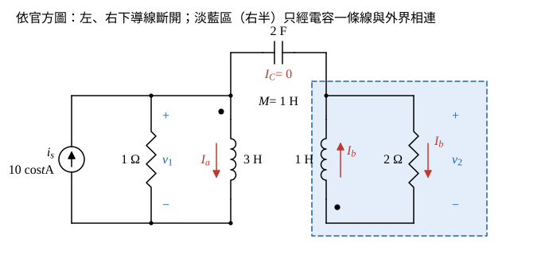

# 110 年電路學第 1 題｜耦合電路弦波穩態

## 已知與所求

\(i_s=10\cos t\ \mathrm A\)（向上）注入左上節點；左側 \(1\ \Omega\)（電壓 \(v_1\)）與 \(L_1=3\ \mathrm H\)（同名端在上）並接於左上節點與左下導線之間。右側 \(L_2=1\ \mathrm H\)（同名端在下）與 \(2\ \Omega\)（電壓 \(v_2\)，上正）並接於右上節點與右下導線之間；\(M=1\ \mathrm H\)；\(2\ \mathrm F\) 跨接左右兩個上節點。圖中左下與右下導線分開，未相連。求 \(v_2(t)\)（25 分）。

## 考場標準作答

**解題邏輯**：全題為弦波穩態，用 \(\cos\) 基準的峰值相量，\(\omega=1\ \mathrm{rad/s}\)。
1. 先依官方圖確認拓樸：左下與右下導線斷開，右半電路（\(L_2\)、\(2\ \Omega\)）只靠 \(2\ \mathrm F\) 一條導線與左半相連，對右半整體取 KCL 得 \(I_C=0\)，兩側只靠互感耦合（本解採「依圖」讀法，共地讀法列於文末「條件與疑義」）。
2. 右迴路 KVL 把 \(\mathbf I_b\) 寫成 \(\mathbf I_a\) 的倍數。
3. 代入左線圈電壓得 \(\mathbf V_1\)（含反射阻抗）。
4. 左上節點 KCL 求 \(\mathbf I_a\)。
5. \(\mathbf V_2=2\mathbf I_b\)。

### 步驟 1：電容電流 \(I_C=0\)

畫法：

- 右半電路（\(L_2\)、\(2\ \Omega\) 與兩者之間的導線）為一個「島」，與外界的連線只有電容一端。
- 對該島取 KCL：流入島的淨電流只能經電容，故 \(I_C=0\)；\(2\ \mathrm F\) 不影響任何電壓電流，下面不再列入。

### 步驟 2：相量與參考方向

\[
\omega=1:\quad j\omega L_1=j(1)(3)=j3\ \Omega,\qquad j\omega L_2=j(1)(1)=j1\ \Omega,\qquad j\omega M=j(1)(1)=j1\ \Omega
\]
\[
\mathbf I_s=10\angle0^\circ\ \mathrm A
\]

- \(\mathbf I_a\)：由上而下流過 \(L_1\)，由 \(L_1\) 上端點端流入。
- \(\mathbf I_b\)：右迴路電流，由上而下流過 \(2\ \Omega\)，再由下而上進入 \(L_2\)，由 \(L_2\) 下端點端流入；故 \(\mathbf V_2=2\mathbf I_b\)（上正）。
- 兩電流都由點端流入，互感項與自感項同號（\(+j\omega M\)）。

### 步驟 3：右迴路 KVL

\(L_2\) 點端（下）對非點端（上）的電壓為 \(j\omega L_2\mathbf I_b+j\omega M\mathbf I_a=j\mathbf I_b+j\mathbf I_a\)。沿 \(\mathbf I_b\) 方向繞一圈：經 \(2\ \Omega\) 由上而下壓降 \(2\mathbf I_b\)，經 \(L_2\) 由下而上壓降 \(j\mathbf I_b+j\mathbf I_a\)：
\[
2\mathbf I_b+j\mathbf I_b+j\mathbf I_a=0
\]
\[
(2+j)\mathbf I_b=-j\mathbf I_a\ \Rightarrow\ \mathbf I_b=\frac{-j\mathbf I_a}{2+j}
\]

### 步驟 4：左線圈電壓（反射阻抗）

\[
\mathbf V_1=j\omega L_1\mathbf I_a+j\omega M\mathbf I_b=j3\mathbf I_a+j\mathbf I_b
\]
代入 \(\mathbf I_b\)：
\[
j\mathbf I_b=j\cdot\frac{-j\mathbf I_a}{2+j}=\frac{\mathbf I_a}{2+j}=\frac{(2-j)\mathbf I_a}{2^2+1^2}=(0.40-j0.20)\mathbf I_a
\]
\[
\mathbf V_1=(j3+0.40-j0.20)\mathbf I_a=(0.40+j2.80)\mathbf I_a
\]
其中 \(0.40-j0.20=\dfrac{(\omega M)^2}{2+j\omega L_2}\) 即右側反射到左側的阻抗。

### 步驟 5：左上節點 KCL 求 \(\mathbf I_a\)

\(\mathbf I_s\) 流入左上節點，分流經 \(1\ \Omega\)（\(\mathbf V_1/1\)）與 \(L_1\)（\(\mathbf I_a\)），電容支路電流為 0：
\[
10=\frac{\mathbf V_1}{1}+\mathbf I_a=(0.40+j2.80)\mathbf I_a+\mathbf I_a=(1.40+j2.80)\mathbf I_a
\]
\[
\mathbf I_a=\frac{10}{1.40+j2.80}=\frac{10(1.40-j2.80)}{1.40^2+2.80^2}=\frac{14-j28}{9.80}=1.429-j2.857\ \mathrm A
\]

### \(v_2(t)\)（25 分）

**邏輯**：\(\mathbf V_2=2\mathbf I_b\)，把步驟 3 的 \(\mathbf I_b\) 與步驟 5 的 \(\mathbf I_a\) 以分式代入，分母相乘恰為純虛數，可得精確值。

\[
\mathbf V_2=2\mathbf I_b=\frac{-j2\mathbf I_a}{2+j}=\frac{-j2}{2+j}\cdot\frac{10}{1.40+j2.80}=\frac{-j20}{(1.40+j2.80)(2+j)}
\]
分母展開：
\[
(1.40+j2.80)(2+j)=2.80+j1.40+j5.60+j^2\,2.80=j7
\]
\[
\mathbf V_2=\frac{-j20}{j7}=-\frac{20}{7}=-2.857\ \mathrm V
\]
極式：模 \(|\mathbf V_2|=\frac{20}{7}=2.857\ \mathrm V\)，角 \(180^\circ\)（負實數）。
\[
\boxed{v_2(t)=-\frac{20}{7}\cos t=2.86\cos(t+180^\circ)\ \mathrm V}
\]

## 驗算

功率守恆（理想耦合線圈不耗能）：
\[
|\mathbf I_a|^2=\frac{10^2}{|1.40+j2.80|^2}=\frac{100}{9.80}=10.204\ \mathrm{A^2}
\]
左側送入線圈的平均功率
\[
\frac12\mathrm{Re}\{\mathbf V_1\mathbf I_a^*\}=\frac12(0.40)|\mathbf I_a|^2=0.20\times10.204=2.041\ \mathrm W
\]
右側 \(2\ \Omega\) 吸收 \(\frac{|\mathbf V_2|^2}{2\cdot2}=\frac{(20/7)^2}{4}=\frac{100}{49}=2.041\ \mathrm W\)，兩者相等。

## 失分點

- 未檢查兩側接地是否相連，直接把 \(2\ \mathrm F\) 當成兩節點間的有效支路列 KCL。
- \(L_2\) 同名端在下方，互感電壓極性看錯會使 \(V_2\) 變號。
- \(V_2=-20/7\) 的負號表示與 \(i_s\) 反相，寫成 \(2.86\cos t\) 即漏掉 \(180^\circ\)。

## 條件與疑義

官方裁切圖的左下、右下導線在兩線圈之間斷開，上解依圖作答，電容不起作用。若出題意圖是兩側下導線共地（電容才構成迴路），則以共地為參考、兩上節點 \(\mathbf V_1,\mathbf V_2\) 列 KCL，線圈電流 \(\mathbf I_1=-\frac j2\mathbf V_1-\frac j2\mathbf V_2\)（流入 \(L_1\) 點端）、\(\mathbf I_2=\frac j2\mathbf V_1+\frac{3j}{2}\mathbf V_2\)（由下流入 \(L_2\) 點端）：
\[
\begin{bmatrix}1+j1.50&-j2.50\\-j2.50&0.50+j0.50\end{bmatrix}\begin{bmatrix}\mathbf V_1\\\mathbf V_2\end{bmatrix}=\begin{bmatrix}10\\0\end{bmatrix}
\]
\[
\Delta=(1+j1.50)(0.50+j0.50)-(-j2.50)^2=(-0.25+j1.25)+6.25=6+j1.25
\]
\[
\mathbf V_2=\frac{-(-j2.50)(10)}{\Delta}=\frac{j25}{6+j1.25}=\frac{j25(6-j1.25)}{6^2+1.25^2}=\frac{31.25+j150}{37.5625}=\frac{500+j2400}{601}
\]
\[
|\mathbf V_2|=\frac{\sqrt{500^2+2400^2}}{601}=\frac{2451.53}{601}=4.079\ \mathrm V,\qquad \angle \mathbf V_2=\tan^{-1}\frac{2400}{500}=78.23^\circ
\]
即 \(v_2(t)=4.08\cos(t+78.23^\circ)\ \mathrm V\)。兩種讀圖答案不同，作答時應先寫明採用哪一種接法。
