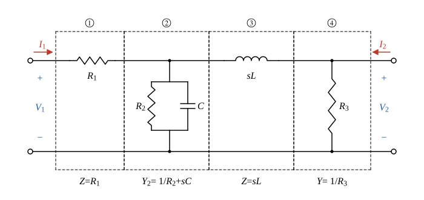

# 110 年電路學第 2 題｜雙埠網路傳輸參數矩陣

## 已知與所求

由左至右：串聯 \(R_1\)、並聯支路 \(R_2\parallel C\)、串聯 \(L\)、並聯 \(R_3\)（跨在埠 2）。\(I_1\)、\(I_2\) 皆流入網路。求傳輸參數矩陣 \(\mathbf T\)（25 分），定義
\[
\begin{bmatrix}V_1\\I_1\end{bmatrix}=\begin{bmatrix}A&B\\C&D\end{bmatrix}\begin{bmatrix}V_2\\-I_2\end{bmatrix}
\]

## 考場標準作答

### 步驟 1：切成四級並寫出基本 ABCD 矩陣

梯形網路由埠 1 到埠 2 切成四個串接二埠，串接網路的傳輸參數等於各級 ABCD 矩陣依序相乘。以 s 域阻抗表示（\(Z_L=sL\)、\(Y_C=sC\)）；\(I_2\) 依題圖流入網路，故右向量為 \(-I_2\)。

畫法：

- 由左至右切成 ① 串聯 \(Z=R_1\)、② 並聯 \(Y_2=\frac1{R_2}+sC\)、③ 串聯 \(Z=sL\)、④ 並聯 \(Y=\frac1{R_3}\)；前一級的輸出埠即後一級的輸入埠，級間電流方向一致（流向埠 2）。

串聯阻抗 \(Z\)（輸入電流全部流到輸出，\(I_1=-I_2\)；輸入電壓多一個壓降）：
\[
V_1=V_2+Z(-I_2),\quad I_1=0\cdot V_2+1\cdot(-I_2)\ \Rightarrow\ \begin{bmatrix}1&Z\\0&1\end{bmatrix}
\]
並聯導納 \(Y\)（兩埠電壓相同；輸入電流多一條分流 \(YV_2\)）：
\[
V_1=V_2+0\cdot(-I_2),\quad I_1=YV_2+(-I_2)\ \Rightarrow\ \begin{bmatrix}1&0\\Y&1\end{bmatrix}
\]
四級串接（次序由埠 1 到埠 2）：
\[
\mathbf T=\begin{bmatrix}1&R_1\\0&1\end{bmatrix}\begin{bmatrix}1&0\\Y_2&1\end{bmatrix}\begin{bmatrix}1&sL\\0&1\end{bmatrix}\begin{bmatrix}1&0\\\frac1{R_3}&1\end{bmatrix}
\]

### 步驟 2：前兩級與後兩級

前兩級（列乘行，逐元素）：
\[
\begin{bmatrix}1&R_1\\0&1\end{bmatrix}\begin{bmatrix}1&0\\Y_2&1\end{bmatrix}
=\begin{bmatrix}1\cdot1+R_1Y_2&1\cdot0+R_1\cdot1\\0\cdot1+1\cdot Y_2&0\cdot0+1\cdot1\end{bmatrix}
=\begin{bmatrix}1+R_1Y_2&R_1\\Y_2&1\end{bmatrix}
\]
後兩級：
\[
\begin{bmatrix}1&sL\\0&1\end{bmatrix}\begin{bmatrix}1&0\\\frac1{R_3}&1\end{bmatrix}
=\begin{bmatrix}1+\frac{sL}{R_3}&sL\\\frac1{R_3}&1\end{bmatrix}
\]

### 傳輸參數矩陣 \(\mathbf T\)（25 分）

\[
\mathbf T=\begin{bmatrix}1+R_1Y_2&R_1\\Y_2&1\end{bmatrix}\begin{bmatrix}1+\frac{sL}{R_3}&sL\\\frac1{R_3}&1\end{bmatrix}
\]
逐元素：
\[
A=(1+R_1Y_2)\left(1+\frac{sL}{R_3}\right)+R_1\cdot\frac1{R_3}
\]
\[
B=(1+R_1Y_2)\,sL+R_1\cdot1=R_1+sL(1+R_1Y_2)
\]
\[
C=Y_2\left(1+\frac{sL}{R_3}\right)+1\cdot\frac1{R_3}=Y_2+\frac{1+sLY_2}{R_3}
\]
\[
D=Y_2\cdot sL+1\cdot1=1+sLY_2
\]
\[
\boxed{\mathbf T=\begin{bmatrix}
(1+R_1Y_2)\left(1+\dfrac{sL}{R_3}\right)+\dfrac{R_1}{R_3} & R_1+sL(1+R_1Y_2)\\[8pt]
Y_2+\dfrac{1+sLY_2}{R_3} & 1+sLY_2
\end{bmatrix}}
\qquad Y_2=\frac1{R_2}+sC
\]

展開成有理式（先寫 \(1+R_1Y_2=\frac{R_2+R_1+sCR_1R_2}{R_2}\)、\(1+\frac{sL}{R_3}=\frac{R_3+sL}{R_3}\)）：
\[
A=\frac{(R_1+R_2+sCR_1R_2)(R_3+sL)+R_1R_2}{R_2R_3}=\frac{CLR_1R_2s^2+(CR_1R_2R_3+LR_1+LR_2)s+R_1R_2+R_1R_3+R_2R_3}{R_2R_3}
\]
\[
B=R_1+\frac{sL(R_1+R_2+sCR_1R_2)}{R_2}=\frac{CLR_1R_2s^2+(LR_1+LR_2)s+R_1R_2}{R_2}
\]
\[
C=\frac{R_3(1+sCR_2)+R_2+sL(1+sCR_2)}{R_2R_3}=\frac{CLR_2s^2+(CR_2R_3+L)s+R_2+R_3}{R_2R_3}
\]
\[
D=1+\frac{sL(1+sCR_2)}{R_2}=\frac{CLR_2s^2+Ls+R_2}{R_2}
\]
單位：\(A\)、\(D\) 無因次，\(B\) 為 \(\Omega\)，\(C\) 為 \(\mathrm S\)。

## 驗算

- 不用串接，直接列節點方程（中間節點電壓 \(V_a\)）：\(I_1=\frac{V_1-V_a}{R_1}\)、\(I_1=Y_2V_a+\frac{V_a-V_2}{sL}\)、\(I_2+\frac{V_a-V_2}{sL}=\frac{V_2}{R_3}\)；消去 \(V_a\) 後 \(V_1\)、\(I_1\) 對 \(V_2\)、\(-I_2\) 的係數與上列 \(A,B,C,D\) 完全相同。
- 開路特例 \(I_2=0\)、\(s\to0\)：\(A=\frac{R_1R_2+R_1R_3+R_2R_3}{R_2R_3}\)，即 \(V_1/V_2\) 等於 \(R_1\) 與 \(R_2\parallel R_3\) 分壓的倒數 \(1+\frac{R_1(R_2+R_3)}{R_2R_3}\)，相符。
- 被動互易網路：\(AD-BC=1\)（每級行列式為 1）。

## 失分點

- 圖示 \(I_2\) 流入網路，傳輸參數第二個自變數是 \(-I_2\)；若把 \(I_2\) 直接放進右向量，\(B\)、\(D\) 必須整欄變號。
- \(C\) 元素寫成 \(Y_2+\frac1{R_3}+\frac{sL}{R_3}\)，漏了 \(sL\) 項中的 \(Y_2\)；應為 \(Y_2+\frac{1+sLY_2}{R_3}\)。
- 串接矩陣相乘次序必須由埠 1 到埠 2，不能交換。
