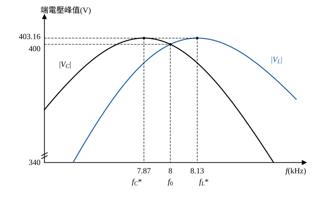

# 110 年電路學第 3 題｜串聯 RLC 諧振與元件端電壓極值

## 已知與所求

串聯 RLC，\(v_s=100\cos(2\pi ft)\ \mathrm V\)；\(f=5\ \mathrm{kHz}\) 時 \(R=10\ \Omega\)、\(X_L=25\ \Omega\)、\(X_C=64\ \Omega\)。求諧振頻率 \(f_0\)、品質因數 \(Q_0\)、諧振時各元件端電壓峰值；再求使 \(v_C\)、\(v_L\) 端電壓最大的電源頻率 \(f^*\) 與對應最大值（25 分）。

## 考場標準作答

**解題邏輯**：題給的 \(X_L\)、\(X_C\) 是 5 kHz 時的值，先用 \(X_L\propto f\)、\(X_C\propto1/f\) 換到任意頻率，令兩者相等求 \(f_0\)，再得 \(Q_0=X_{L0}/R\) 與諧振時各端電壓（此時 \(Z=R\)）。\(v_C\)、\(v_L\) 的最大值不在 \(f_0\)：把 \(|V_C|\)、\(|V_L|\) 寫成正規化頻率 \(u=f/f_0\) 的函數，對分母求極小。前提：\(R\) 不隨頻率變；電源振幅固定為峰值 \(V_m=100\ \mathrm V\)，所求「端電壓峰值」即振幅。

### 步驟 1：電抗隨頻率換算

以 kHz 為頻率單位，5 kHz 時 \(X_L=25\ \Omega\)、\(X_C=64\ \Omega\)：
\[
X_L(f)=25\times\frac{f}{5},\qquad X_C(f)=64\times\frac{5}{f}
\]

### 諧振頻率、品質因數與諧振時端電壓峰值

**邏輯**：串聯諧振條件為 \(X_L(f_0)=X_C(f_0)\)；諧振時電抗互消、\(Z=R\)，電流最大，\(Q_0=X_{L0}/R\)，電感與電容電壓為電阻電壓的 \(Q_0\) 倍。

\[
25\times\frac{f_0}{5}=64\times\frac{5}{f_0}
\]
\[
f_0^2=\frac{64\times5\times5}{25}=64
\]
\[
\boxed{f_0=8\ \mathrm{kHz}}
\]
諧振時電抗：
\[
X_{L0}=25\times\frac{8}{5}=40\ \Omega,\qquad X_{C0}=64\times\frac{5}{8}=40\ \Omega
\]
品質因數：
\[
Q_0=\frac{X_{L0}}{R}=\frac{40}{10}
\]
\[
\boxed{Q_0=4}
\]
諧振時 \(Z=R=10\ \Omega\)，電流峰值：
\[
I_m=\frac{V_m}{R}=\frac{100}{10}=10\ \mathrm A
\]
各元件端電壓峰值：
\[
V_{R,m}=I_mR=10\times10=100\ \mathrm V
\]
\[
V_{L,m}=I_mX_{L0}=10\times40=400\ \mathrm V,\qquad V_{C,m}=I_mX_{C0}=10\times40=400\ \mathrm V
\]
\[
\boxed{V_{R,m}=100\ \mathrm V},\qquad \boxed{V_{L,m}=V_{C,m}=400\ \mathrm V}
\]

### 使 \(v_C\)、\(v_L\) 最大的頻率 \(f^*\) 與最大值

**邏輯**：\(|V_C|=V_mX_C/|Z|\)、\(|V_L|=V_mX_L/|Z|\) 都隨頻率變，分子分母一起變，所以極值不在 \(f_0\)。以 \(u=f/f_0\) 正規化後平方，把問題化成「分母二次式取極小」。

正規化：\(X_L=X_{L0}u=Q_0Ru\)、\(X_C=X_{C0}/u=Q_0R/u\)，\(|Z|=R\sqrt{1+Q_0^2(u-1/u)^2}\)。

電容電壓：
\[
|V_C|=\frac{V_mX_C}{|Z|}=\frac{V_mQ_0/u}{\sqrt{1+Q_0^2(u-1/u)^2}}=\frac{V_mQ_0}{\sqrt{u^2+Q_0^2(u^2-1)^2}}
\]
令 \(x=u^2\)，分母平方為
\[
g(x)=x+Q_0^2(x-1)^2=x+16(x-1)^2
\]
\[
\frac{dg}{dx}=1+32(x-1)=0\ \Rightarrow\ x=1-\frac1{32}=\frac{31}{32}
\]
\(\frac{d^2g}{dx^2}=32>0\)，\(g\) 為極小，即 \(|V_C|\) 為極大。
\[
f_C^*=f_0\sqrt{x}=8\sqrt{\tfrac{31}{32}}=8\times0.9843=7.874\ \mathrm{kHz}
\]
\[
\boxed{f_C^*=8\sqrt{\tfrac{31}{32}}=7.87\ \mathrm{kHz}}
\]
電感電壓（分子分母同除以 \(u\)）：
\[
|V_L|=\frac{V_mX_L}{|Z|}=\frac{V_mQ_0u}{\sqrt{1+Q_0^2(u-1/u)^2}}=\frac{V_mQ_0}{\sqrt{1/u^2+Q_0^2(1-1/u^2)^2}}
\]
令 \(w=1/u^2\)，分母平方為 \(w+16(1-w)^2=g(w)\)，與上式同形，極小在 \(w=\frac{31}{32}\)，即 \(u^2=\frac{32}{31}\)：
\[
f_L^*=f_0\sqrt{\tfrac{32}{31}}=8\times1.0160=8.128\ \mathrm{kHz}
\]
\[
\boxed{f_L^*=8\sqrt{\tfrac{32}{31}}=8.13\ \mathrm{kHz}}
\]
最大值：兩者分母的極小值相同，
\[
g_{\min}=\frac{31}{32}+16\left(\frac{31}{32}-1\right)^2=\frac{31}{32}+\frac{16}{1024}=\frac{62}{64}+\frac{1}{64}=\frac{63}{64}
\]
\[
V_{C,\max}=V_{L,\max}=\frac{V_mQ_0}{\sqrt{g_{\min}}}=\frac{100\times4}{\sqrt{63/64}}=\frac{3200}{\sqrt{63}}=\frac{3200}{7.9373}
\]
\[
\boxed{V_{C,\max}=V_{L,\max}=403.16\ \mathrm V}
\]

## 驗算

- 元件值：\(L=\frac{25}{2\pi(5000)}=795.77\ \mu\mathrm H\)、\(C=\frac{1}{2\pi(5000)(64)}=497.36\ \mathrm{nF}\)，\(f_0=\frac{1}{2\pi\sqrt{LC}}=8000\ \mathrm{Hz}\)。
- 直接代 \(f_C^*=7874.01\ \mathrm{Hz}\)：\(X_L=39.37\ \Omega\)、\(X_C=40.64\ \Omega\)，\(|Z|=\sqrt{10^2+1.27^2}=10.0803\ \Omega\)，\(|V_C|=\frac{100}{10.0803}(40.64)=403.16\ \mathrm V\)，大於諧振時的 400 V；以 7–9 kHz 細格數值掃描 \(|V_C|\)、\(|V_L|\) 的峰值亦落在 7.87 kHz、8.13 kHz。
- 兩極值頻率滿足 \(f_C^*f_L^*=f_0^2\)。

## 失分點

- 以為 \(v_C\)、\(v_L\) 在 \(f_0\) 達最大；有限 \(Q\) 時 \(v_C\) 峰值低於 \(f_0\)、\(v_L\) 峰值高於 \(f_0\)。
- 題給 \(X_L,X_C\) 是 5 kHz 的值，直接拿 \(25\)、\(64\) 算 \(Q_0=25/10\) 或 \(64/10\)。
- 電源 100 V 為峰值，題目問峰值即不需再乘 \(\sqrt2\)。
