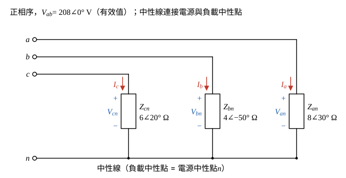

# 110 年電路學第 4 題｜Y–Y 不平衡三相四線制總功率

## 已知與所求

\(Z_{an}=8\angle30^\circ\)、\(Z_{bn}=4\angle-50^\circ\)、\(Z_{cn}=6\angle20^\circ\ \Omega\)；平衡正相序線電壓 \(V_{ab}=208\angle0^\circ\ \mathrm V_{rms}\)；Y–Y 四線制。求總平均功率 \(P_T\)（25 分）。

## 考場標準作答

**解題邏輯**：四線制的中性線把負載中性點 \(n\) 固定在電源中性點，所以負載雖不平衡，每相仍跨在平衡相電壓 \(V_L/\sqrt3\) 上，不必求中性點位移。主線：由線電壓求相電壓 → 每相各自以 \(P=\dfrac{V_\phi^2}{|Z|}\cos\theta_Z\) 求實功率 → 三相相加。前提：題給電壓為有效值；中性線阻抗為零；各相功率只與相電壓大小及該相阻抗角有關，相電壓的相角不影響 \(P\)。

### 步驟 1：每相電壓

畫法：

- 電源中性點與負載中性點以中性線直接相連（同為 \(n\)），三個阻抗 \(\mathbf Z_{an}\)、\(\mathbf Z_{bn}\)、\(\mathbf Z_{cn}\) 各自跨在一個相電壓上。
- 相電流 \(\mathbf I_a,\mathbf I_b,\mathbf I_c\) 參考方向由線端流入負載、經中性點流回。

\[
V_\phi=\frac{V_L}{\sqrt3}=\frac{208}{\sqrt3}=120.09\ \mathrm V
\]
\[
V_\phi^2=\frac{208^2}{3}=\frac{43264}{3}\ \mathrm{V^2}
\]
正相序且 \(\mathbf V_{ab}=208\angle0^\circ\) 時，\(\mathbf V_{an}=V_\phi\angle-30^\circ\)、\(\mathbf V_{bn}=V_\phi\angle-150^\circ\)、\(\mathbf V_{cn}=V_\phi\angle90^\circ\)（大小相同，下面只用到 \(V_\phi\)）。

### 步驟 2：每相實功率公式

\(\mathbf I=\mathbf V/\mathbf Z\)，所以 \(|\mathbf I|=V_\phi/|Z|\)，且電壓超前電流的角度等於阻抗角 \(\theta_Z\)：
\[
P=V_\phi|\mathbf I|\cos\theta_Z=\frac{V_\phi^2}{|Z|}\cos\theta_Z
\]

### 總平均功率 \(P_T\)（25 分）

**邏輯**：中性線使三相彼此獨立，各相功率分別計算後直接相加；容性相（\(\theta_Z<0\)）的 \(\cos\theta_Z\) 仍為正，照樣吸收實功率。

\(a\) 相（\(|Z|=8\ \Omega\)、\(\theta_Z=30^\circ\)）：
\[
P_a=\frac{43264}{3\times8}\cos30^\circ=1802.6667\times0.8660254=1561.16\ \mathrm W
\]
\(b\) 相（\(|Z|=4\ \Omega\)、\(\theta_Z=-50^\circ\)，\(\cos(-50^\circ)=\cos50^\circ\)）：
\[
P_b=\frac{43264}{3\times4}\cos50^\circ=3605.3333\times0.6427876=2317.46\ \mathrm W
\]
\(c\) 相（\(|Z|=6\ \Omega\)、\(\theta_Z=20^\circ\)）：
\[
P_c=\frac{43264}{3\times6}\cos20^\circ=2403.5556\times0.9396926=2258.60\ \mathrm W
\]
三相相加：
\[
P_T=P_a+P_b+P_c=1561.16+2317.46+2258.60
\]
\[
\boxed{P_T=6137.22\ \mathrm W}
\]

## 驗算

改由 \(|\mathbf I|^2R\) 計算，\(|\mathbf I|^2=V_\phi^2/|Z|^2\)、\(R=|Z|\cos\theta_Z\)：

- \(a\) 相：\(|\mathbf I_a|^2=\frac{43264}{3\times64}=\frac{676}{3}\ \mathrm{A^2}\)，\(R_a=8\cos30^\circ=6.928203\ \Omega\)，\(\frac{676}{3}\times6.928203=1561.16\ \mathrm W\)。
- \(b\) 相：\(|\mathbf I_b|^2=\frac{43264}{3\times16}=\frac{2704}{3}\ \mathrm{A^2}\)，\(R_b=4\cos50^\circ=2.571150\ \Omega\)，\(\frac{2704}{3}\times2.571150=2317.46\ \mathrm W\)。
- \(c\) 相：\(|\mathbf I_c|^2=\frac{43264}{3\times36}=\frac{10816}{27}\ \mathrm{A^2}\)，\(R_c=6\cos20^\circ=5.638156\ \Omega\)，\(\frac{10816}{27}\times5.638156=2258.60\ \mathrm W\)。

合計 \(6137.22\ \mathrm W\)，與上式相同。另核相電壓：\(\mathbf V_{an}-\mathbf V_{bn}=V_\phi(\angle-30^\circ-\angle-150^\circ)=V_\phi\sqrt3\angle0^\circ=208\angle0^\circ\ \mathrm V\)，與題給 \(\mathbf V_{ab}\) 一致。

## 失分點

- 把 208 V 線電壓直接當相電壓，功率放大 3 倍。
- \(Z_{bn}\) 的 \(-50^\circ\) 是電容性，\(\cos(-50^\circ)=\cos50^\circ>0\)，仍吸收實功率，不可取負。
