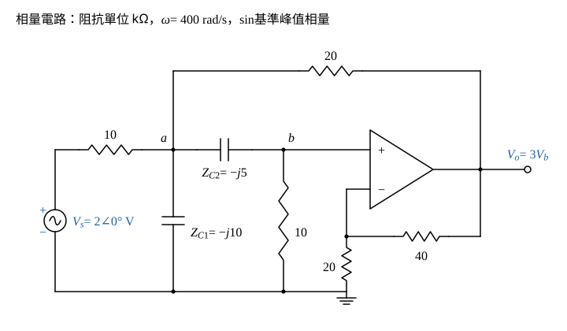

# 111 年電路學第 1 題｜含運算放大器交流穩態

## 已知與所求

\(v_s=2\sin(400t)\ \mathrm V\) 經 \(10\ \mathrm{k\Omega}\) 接節點 \(a\)；節點 \(a\) 另接 \(0.25\ \mu\mathrm F\) 對地、\(20\ \mathrm{k\Omega}\) 至 \(v_o\)、\(0.5\ \mu\mathrm F\) 至節點 \(b\)；節點 \(b\) 接 \(10\ \mathrm{k\Omega}\) 對地並接運算放大器同相端；反相端由 \(40\ \mathrm{k\Omega}\)（回授）與 \(20\ \mathrm{k\Omega}\)（接地）分壓。求 \(v_o(t)\)（25 分）。

## 考場標準作答

### 步驟 1：非反相放大器增益

設運放理想（虛短、虛斷）；弦波穩態，以 \(\sin\) 為基準的峰值相量 \(V_s=2\angle0^\circ\ \mathrm V\)，阻抗以 \(\mathrm{k\Omega}\)、電流以 mA 計。\(20\ \mathrm{k\Omega}\) 把 \(V_o\) 回授到節點 \(a\)，前後級互相牽動，須聯立節點方程。

虛短 \(V_-=V_+=V_b\)；虛斷使反相端兩電阻串聯分壓：
\[
V_b=\frac{20}{20+40}V_o\ \Rightarrow\ V_o=\left(1+\frac{40}{20}\right)V_b=3V_b
\]

### 步驟 2：相量阻抗

\(\omega=400\ \mathrm{rad/s}\)：
\[
Z_{C1}=\frac{1}{j\omega C_1}=\frac{1}{j400\times0.25\times10^{-6}}=\frac{1}{j10^{-4}}=-j10\ \mathrm{k\Omega}
\]
\[
Z_{C2}=\frac{1}{j\omega C_2}=\frac{1}{j400\times0.5\times10^{-6}}=\frac{1}{j2\times10^{-4}}=-j5\ \mathrm{k\Omega}
\]
（\(C_1=0.25\ \mu\mathrm F\) 由 \(a\) 接地，\(C_2=0.5\ \mu\mathrm F\) 接 \(a\)、\(b\)。）

### 步驟 3：節點 \(b\)

運放輸入電流為零，流經 \(C_2\) 的電流全進入 \(10\ \mathrm{k\Omega}\)：
\[
\frac{V_b-V_a}{-j5}+\frac{V_b}{10}=0
\]
全式乘 10（\(\frac{10}{-j5}=j2\)）：
\[
j2(V_b-V_a)+V_b=0\ \Rightarrow\ (1+j2)V_b=j2V_a
\]
\[
V_a=\frac{1+j2}{j2}V_b
\]

### 步驟 4：節點 \(a\)

流出 \(a\) 的電流總和為零（經 \(10\ \mathrm{k\Omega}\) 往電源、經 \(C_1\) 往地、經 \(C_2\) 往 \(b\)、經 \(20\ \mathrm{k\Omega}\) 往 \(V_o=3V_b\)）：
\[
\frac{V_a-V_s}{10}+\frac{V_a}{-j10}+\frac{V_a-V_b}{-j5}+\frac{V_a-3V_b}{20}=0
\]
全式乘 20（\(\frac{20}{-j10}=j2\)、\(\frac{20}{-j5}=j4\)）：
\[
2(V_a-V_s)+j2V_a+j4(V_a-V_b)+(V_a-3V_b)=0
\]
\[
(2+j2+j4+1)V_a-(j4+3)V_b=2V_s
\]
\[
(3+j6)V_a-(3+j4)V_b=2V_s
\]

### 輸出電壓 \(v_o(t)\)（25 分）

代入 \(V_a=\frac{1+j2}{j2}V_b\)：
\[
(3+j6)\frac{1+j2}{j2}V_b-(3+j4)V_b=2V_s
\]
\[
(3+j6)(1+j2)=3+j6+j6+j^2\times12=-9+j12
\]
\[
\frac{-9+j12}{j2}=\frac{(-9+j12)(-j)}{2}=\frac{12+j9}{2}=6+j4.5
\]
\[
(6+j4.5)-(3+j4)=3+j0.5
\]
\[
(3+j0.5)V_b=2V_s\ \Rightarrow\ V_b=\frac{2V_s}{3+j0.5}=\frac{4V_s}{6+j1}
\]
\[
V_o=3V_b=\frac{12V_s}{6+j1}=\frac{12(6-j1)}{6^2+1^2}V_s=\frac{72-j12}{37}V_s
\]
代入 \(V_s=2\)：
\[
V_o=\frac{144-j24}{37}\ \mathrm V
\]
化成極式：
\[
|V_o|=\frac{\sqrt{144^2+24^2}}{37}=\frac{24\sqrt{37}}{37}=\frac{24}{\sqrt{37}}=\frac{24}{6.0828}=3.9456\ \mathrm V
\]
\[
\angle V_o=\tan^{-1}\frac{-24}{144}=-\tan^{-1}\frac16=-9.46^\circ\quad(\text{第四象限})
\]
\[
\boxed{v_o(t)=\frac{24}{\sqrt{37}}\sin\left(400t-\tan^{-1}\frac16\right)=3.95\sin(400t-9.46^\circ)\ \mathrm V}
\]

## 驗算

改求轉移函數再代頻率。以 \(s\) 表示兩個節點方程並消去 \(V_a\)，得
\[
H(s)=\frac{V_o}{V_s}=\frac{1200s}{s^2+600s+120000}
\]
\(s=j400\)：\(H=\frac{j480000}{-40000+j240000}=\frac{j12}{-1+j6}=\frac{72-j12}{37}\)，\(|H|=\frac{12}{\sqrt{37}}=1.97\)，乘以 2 V 得 \(3.95\ \mathrm V\)，與節點相量解一致。

## 失分點

- 忽略 \(20\ \mathrm{k\Omega}\) 由 \(v_o\) 回授至節點 \(a\) 的支路，把電路拆成兩級獨立放大器，會得 \(5.66\sin(400t+45^\circ)\) 之類的錯解。
- 非反相增益寫成 \(40/20=2\)，漏了「\(1+\)」。
- 題目以 \(\sin\) 為基準，回時域時誤寫成 \(\cos\)。
