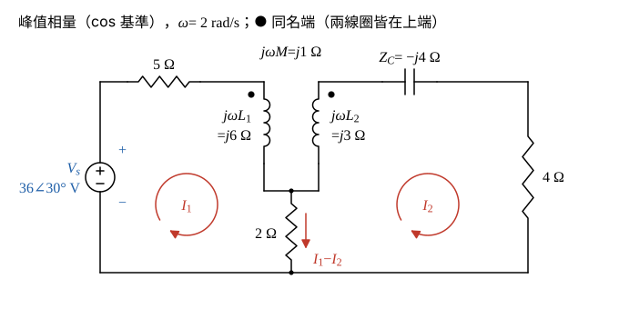

# 111 年電路學第 2 題｜互感耦合電路

## 已知與所求

\(v_s=36\cos(2t+30^\circ)\ \mathrm V\) 串 \(5\ \Omega\) 接 \(L_1=3\ \mathrm H\) 上端（同名端在上）；\(L_2=1.5\ \mathrm H\)（同名端在上）上端串 \(0.125\ \mathrm F\) 與 \(4\ \Omega\)；兩線圈下端共接，經 \(2\ \Omega\) 接地；\(M=0.5\ \mathrm H\)。\(I_1,I_2\) 為順時針網目電流。求 \(I_1\)、\(I_2\) 及 \(4\ \Omega\) 吸收功率（25 分）。

## 考場標準作答

**解題邏輯**：題目指定順時針網目電流 \(\mathbf I_1\)、\(\mathbf I_2\)，故用網目分析。先把元件換成 \(\omega=2\) 的相量阻抗，再依同名端判定互感項正負，列兩網目 KVL 成 \(2\times2\) 矩陣，以克拉瑪法則求 \(\mathbf I_1\)、\(\mathbf I_2\)（模與角分列）；\(4\ \Omega\) 只流過 \(\mathbf I_2\)，平均功率 \(P=\frac12|\mathbf I_2|^2R\)。全題用 \(\cos\) 基準的峰值相量（\(\mathbf V_s=36\angle30^\circ\ \mathrm V\)），弦波穩態。

### 步驟 1：相量與阻抗

\(\omega=2\ \mathrm{rad/s}\)：
\[
j\omega L_1=j(2)(3)=j6\ \Omega,\qquad j\omega L_2=j(2)(1.5)=j3\ \Omega,\qquad j\omega M=j(2)(0.5)=j1\ \Omega
\]
\[
Z_C=\frac{1}{j\omega C}=\frac{1}{j(2)(0.125)}=\frac{1}{j0.25}=-j4\ \Omega
\]

### 步驟 2：網目方向與互感符號

畫法：

- \(\mathbf I_1\)（左網目順時針）經 \(5\ \Omega\) 後由上而下流過 \(L_1\)，由 \(L_1\) 的點端流入。
- \(\mathbf I_2\)（右網目順時針）由下而上流過 \(2\ \Omega\) 與 \(L_2\)，由 \(L_2\) 的點端流出；換言之流入 \(L_2\) 點端的電流為 \(-\mathbf I_2\)，故互感項取負號。
- 共用的 \(2\ \Omega\) 由上而下的電流為 \(\mathbf I_1-\mathbf I_2\)。
- 線圈電壓（上端減下端）：\(L_1\) 為 \(j6\mathbf I_1+j1(-\mathbf I_2)=j6\mathbf I_1-j\mathbf I_2\)；\(L_2\) 為 \(j3(-\mathbf I_2)+j1\mathbf I_1=-j3\mathbf I_2+j\mathbf I_1\)。

左網目（順時針，各元件壓降和等於電源電壓）：
\[
5\mathbf I_1+(j6\mathbf I_1-j\mathbf I_2)+2(\mathbf I_1-\mathbf I_2)=36\angle30^\circ
\]
右網目（順時針經 \(L_2\) 時由下而上，壓降取線圈電壓的負值 \(j3\mathbf I_2-j\mathbf I_1\)）：
\[
2(\mathbf I_2-\mathbf I_1)+(j3\mathbf I_2-j\mathbf I_1)+(4-j4)\mathbf I_2=0
\]

### 步驟 3：矩陣與行列式

合併同類項：左網目 \(\mathbf I_1\) 係數 \(5+j6+2=7+j6\)，\(\mathbf I_2\) 係數 \(-j-2\)；右網目 \(\mathbf I_1\) 係數 \(-2-j\)，\(\mathbf I_2\) 係數 \(2+j3+4-j4=6-j\)。
\[
\begin{bmatrix}7+j6&-2-j\\-2-j&6-j\end{bmatrix}
\begin{bmatrix}\mathbf I_1\\\mathbf I_2\end{bmatrix}=\begin{bmatrix}36\angle30^\circ\\0\end{bmatrix}
\]
\[
(7+j6)(6-j)=42-j7+j36-j^2\,6=48+j29
\]
\[
(-2-j)^2=4+j4+j^2=3+j4
\]
\[
\Delta=(48+j29)-(3+j4)=45+j25
\]
\[
|\Delta|=\sqrt{45^2+25^2}=\sqrt{2650}=51.48,\qquad \angle\Delta=\tan^{-1}\frac{25}{45}=29.055^\circ
\]

### \(\mathbf I_1\)、\(\mathbf I_2\)

**邏輯**：克拉瑪法則——以右邊常數向量替換對應行；\(\mathbf I_1\) 的分子為 \((6-j)\times36\angle30^\circ\)，\(\mathbf I_2\) 的分子為 \(-(-2-j)\times36\angle30^\circ=(2+j)\times36\angle30^\circ\)。

\[
\mathbf I_1=\frac{(6-j)\,36\angle30^\circ}{45+j25},\qquad \mathbf I_2=\frac{(2+j)\,36\angle30^\circ}{45+j25}
\]
分子複數化為極式：
\[
|6-j|=\sqrt{6^2+1^2}=\sqrt{37}=6.083,\qquad \angle(6-j)=-\tan^{-1}\frac16=-9.462^\circ
\]
\[
|2+j|=\sqrt{2^2+1^2}=\sqrt5=2.236,\qquad \angle(2+j)=\tan^{-1}\frac12=26.565^\circ
\]
\(\mathbf I_1\) 的模與角：
\[
|\mathbf I_1|=\frac{6.083\times36}{51.48}=\frac{218.99}{51.48}=4.254\ \mathrm A
\]
\[
\angle\mathbf I_1=-9.462^\circ+30^\circ-29.055^\circ=-8.517^\circ
\]
直角座標：\(4.254\cos(-8.517^\circ)=4.207\)，\(4.254\sin(-8.517^\circ)=-0.6300\)：
\[
\boxed{\mathbf I_1=4.21-j0.63=4.25\angle-8.52^\circ\ \mathrm A}
\]
\(\mathbf I_2\) 的模與角：
\[
|\mathbf I_2|=\frac{2.236\times36}{51.48}=\frac{80.50}{51.48}=1.564\ \mathrm A
\]
\[
\angle\mathbf I_2=26.565^\circ+30^\circ-29.055^\circ=27.510^\circ
\]
直角座標：\(1.564\cos27.510^\circ=1.387\)，\(1.564\sin27.510^\circ=0.7224\)：
\[
\boxed{\mathbf I_2=1.39+j0.72=1.56\angle27.51^\circ\ \mathrm A}
\]

### \(4\ \Omega\) 吸收功率

**邏輯**：\(4\ \Omega\) 位於右網目外側支路，只流過 \(\mathbf I_2\)；相量為峰值，平均功率要乘 \(\frac12\)。為避免四捨五入累積，\(|\mathbf I_2|^2\) 用精確式計算。

\[
|\mathbf I_2|^2=\frac{|2+j|^2\times36^2}{|\Delta|^2}=\frac{5\times1296}{2650}=\frac{6480}{2650}=2.445\ \mathrm{A^2}
\]
\[
P_4=\frac12|\mathbf I_2|^2R=\frac12\times2.445\times4
\]
\[
\boxed{P_4=4.89\ \mathrm W}
\]

## 驗算

改用節點法：令 \(L_1\) 上端電壓 \(V_x\)、線圈共接點 \(V_m\)、\(L_2\) 上端 \(V_y\)，以線圈電流為未知數：
\[
V_x-V_m=j6\mathbf I_1-j\mathbf I_2,\quad V_y-V_m=-j3\mathbf I_2+j\mathbf I_1,\quad \frac{V_m}{2}=\mathbf I_1-\mathbf I_2,\quad \mathbf I_2=\frac{V_y}{4-j4}
\]
連同 \(\mathbf I_1=(\mathbf V_s-V_x)/5\) 聯立，解得同一組 \(\mathbf I_1,\mathbf I_2\)。另以 \(V_4=4\mathbf I_2=4(1.387+j0.7224)=5.548+j2.890\ \mathrm V\)，\(\frac12\mathrm{Re}\{V_4\mathbf I_2^*\}=\frac12\times4|\mathbf I_2|^2=2\times2.445=4.890\ \mathrm W\)。

## 失分點

- 互感項只看電流箭頭不對同名端，非對角項寫成 \(-2+j\) 而解錯。
- 共用 \(2\ \Omega\) 只放進其中一個網目，或兩網目都寫成同號的 \(2(\mathbf I_1-\mathbf I_2)\)。
- 峰值相量直接用 \(P=RI^2\)，功率多一倍成 \(9.78\ \mathrm W\)。
