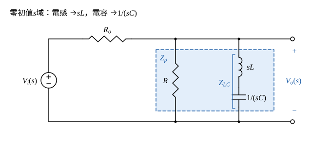
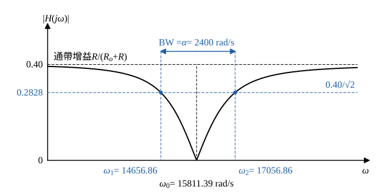

# 111 年電路學第 3 題｜RLC 轉移函數與截止頻率

## 已知與所求

\(v_i\) 串 \(R_o\) 後接一節點；該節點對地並聯兩支路：\(R\)，以及串聯的 \(L\)、\(C\)；\(v_o\) 取該節點對地電壓。求（一）\(H(s)=V_o/V_i\)（10 分）；（二）\(R_o=6\ \Omega\)、\(R=4\ \Omega\)、\(L=1\ \mathrm{mH}\)、\(C=4\ \mu\mathrm F\) 時的 \(\mathrm{BW}\) 與 \(\omega_1,\omega_2\)（15 分）。

## 考場標準作答

**解題邏輯**：\(v_o\) 是 \(R\) 與串聯 \(LC\) 並聯後的節點電壓；電路為初始能量為零的線性非時變網路，\(H(s)\) 以零初值的 \(s\) 域阻抗求得。
1. 先在 \(s\) 域把 \(Z_{LC}=sL+\frac1{sC}\) 與 \(R\) 並聯成 \(Z_p\)。
2. 再由 \(R_o\) 與 \(Z_p\) 分壓得 \(H(s)\)，整理成標準二階帶拒形式並讀出 \(\omega_0^2\)、\(\alpha\)。
3. （二）代入元件值，以「\(|H(j\omega)|\) 降為通帶增益的 \(1/\sqrt2\)」為截止條件。
4. 解兩個二次式得 \(\omega_1,\omega_2\)，相減即頻寬。

### 步驟 1：\(s\) 域阻抗

畫法：

- 電源 \(V_i(s)\) 串 \(R_o\) 到上方節點；節點對地兩支路為 \(R\) 與串聯的 \(sL\)、\(\frac1{sC}\)；\(V_o(s)\) 為該節點對地電壓。
- \(Z_{LC}\) 為 \(L\)、\(C\) 串聯支路，\(Z_p=R\parallel Z_{LC}\) 為節點對地的總阻抗。

\[
Z_{LC}=sL+\frac1{sC}=\frac{s^2LC+1}{sC}
\]
\[
Z_p=\frac{R\,Z_{LC}}{R+Z_{LC}}=\frac{R\,\dfrac{s^2LC+1}{sC}}{R+\dfrac{s^2LC+1}{sC}}=\frac{R(s^2LC+1)}{s^2LC+sRC+1}
\]

### （一）轉移函數 \(H(s)\)（10 分）

**邏輯**：\(R_o\) 與 \(Z_p\) 串聯、\(V_o\) 取 \(Z_p\) 兩端，直接用分壓定則；再把分子分母同除 \((R_o+R)LC\)，使 \(s^2\) 係數為 1。

分壓：
\[
H(s)=\frac{V_o(s)}{V_i(s)}=\frac{Z_p}{R_o+Z_p}
\]
代入 \(Z_p\)，分子分母同乘 \(s^2LC+sRC+1\)：
\[
H(s)=\frac{R(s^2LC+1)}{R_o(s^2LC+sRC+1)+R(s^2LC+1)}
\]
分母按 \(s\) 的次方整理：
\[
H(s)=\frac{R(s^2LC+1)}{(R_o+R)(s^2LC+1)+R_oRCs}
\]
分子分母同除 \((R_o+R)LC\)：
\[
\frac{R_oRCs}{(R_o+R)LC}=\frac{R_oR}{(R_o+R)L}\,s,\qquad \frac{s^2LC+1}{LC}=s^2+\frac1{LC}
\]
\[
\boxed{H(s)=\frac{R}{R_o+R}\cdot\frac{s^2+\omega_0^2}{s^2+\alpha s+\omega_0^2},\quad \omega_0^2=\frac1{LC},\ \alpha=\frac{R_oR}{(R_o+R)L}}
\]
零點在 \(\pm j\omega_0\)，為帶拒（notch）響應，通帶增益 \(R/(R_o+R)\)。

### （二）頻寬與截止頻率（15 分）

**邏輯**：本題通帶增益不是 1，半功率點應取 \(|H(j\omega)|=\frac{R}{R_o+R}\cdot\frac1{\sqrt2}\)；代入（一）的標準式可化成 \(|\omega_0^2-\omega^2|=\alpha\omega\)，分 \(\omega<\omega_0\)、\(\omega>\omega_0\) 兩個二次式各取正根。

**代入元件值**（\(L=1\ \mathrm{mH}=10^{-3}\ \mathrm H\)、\(C=4\ \mu\mathrm F=4\times10^{-6}\ \mathrm F\)）：
\[
\omega_0^2=\frac{1}{LC}=\frac{1}{(10^{-3})(4\times10^{-6})}=\frac{1}{4\times10^{-9}}=2.5\times10^8\ \mathrm{rad^2/s^2}
\]
\[
\omega_0=\sqrt{2.5\times10^8}=15811.39\ \mathrm{rad/s}
\]
\[
\alpha=\frac{R_oR}{(R_o+R)L}=\frac{6\times4}{(6+4)\times10^{-3}}=\frac{24}{0.01}=2400\ \mathrm{rad/s}
\]
\[
\frac{R}{R_o+R}=\frac{4}{6+4}=0.40
\]
\[
H(s)=0.40\,\frac{s^2+2.5\times10^8}{s^2+2400s+2.5\times10^8}
\]

**截止條件**：令 \(s=j\omega\)：
\[
|H(j\omega)|=0.40\,\frac{|\omega_0^2-\omega^2|}{\sqrt{(\omega_0^2-\omega^2)^2+\alpha^2\omega^2}}=\frac{0.40}{\sqrt2}=0.2828
\]
兩邊除以 \(0.40\)：
\[
\frac{|\omega_0^2-\omega^2|}{\sqrt{(\omega_0^2-\omega^2)^2+\alpha^2\omega^2}}=\frac{1}{\sqrt2}
\]
兩邊平方：
\[
\frac{(\omega_0^2-\omega^2)^2}{(\omega_0^2-\omega^2)^2+\alpha^2\omega^2}=\frac12
\]
交叉相乘：
\[
2(\omega_0^2-\omega^2)^2=(\omega_0^2-\omega^2)^2+\alpha^2\omega^2
\]
\[
(\omega_0^2-\omega^2)^2=\alpha^2\omega^2\ \Rightarrow\ |\omega_0^2-\omega^2|=\alpha\omega
\]

**解二次式**：

- \(\omega<\omega_0\)：\(\omega_0^2-\omega^2=\alpha\omega\)，即 \(\omega^2+\alpha\omega-\omega_0^2=0\)，正根 \(\omega_1=\dfrac{-\alpha+\sqrt{\alpha^2+4\omega_0^2}}{2}\)。
- \(\omega>\omega_0\)：\(\omega^2-\omega_0^2=\alpha\omega\)，即 \(\omega^2-\alpha\omega-\omega_0^2=0\)，正根 \(\omega_2=\dfrac{\alpha+\sqrt{\alpha^2+4\omega_0^2}}{2}\)。

共同的根號：
\[
\alpha^2+4\omega_0^2=2400^2+4\times2.5\times10^8=5.76\times10^6+1.0\times10^9=1.00576\times10^9
\]
\[
\sqrt{\alpha^2+4\omega_0^2}=\sqrt{1.00576\times10^9}=31713.72\ \mathrm{rad/s}
\]
\[
\omega_1=\frac{31713.72-2400}{2}=\frac{29313.72}{2}
\]
\[
\boxed{\omega_1=14656.86\ \mathrm{rad/s}}
\]
\[
\omega_2=\frac{31713.72+2400}{2}=\frac{34113.72}{2}
\]
\[
\boxed{\omega_2=17056.86\ \mathrm{rad/s}}
\]
頻寬：
\[
\mathrm{BW}=\omega_2-\omega_1=17056.86-14656.86=2400.00\ \mathrm{rad/s}
\]
\[
\boxed{\mathrm{BW}=2400\ \mathrm{rad/s}\ (=\alpha)}
\]
兩根滿足 \(\omega_1\omega_2=\omega_0^2=2.5\times10^8\)，\(\omega_0=15811.39\ \mathrm{rad/s}\) 為兩者幾何平均。

## 驗算

- 端點：\(\omega\to0\) 或 \(\infty\) 時 \(Z_{LC}\to\infty\)，\(H\to\frac{4}{10}=0.40\)；\(\omega=\omega_0\) 時 \(Z_{LC}=0\)，\(H=0\)，與帶拒形式一致。
- 直接代回 \(\omega_1=14656.86\)：\(\omega_1^2=2.1482\times10^8\)，\(\omega_0^2-\omega_1^2=2.5\times10^8-2.1482\times10^8=3.518\times10^7\)；\(\alpha\omega_1=2400\times14656.86=3.518\times10^7\)，兩者相等，故 \(|H(j\omega_1)|=0.40/\sqrt2=0.2828\)；以數值搜尋 \(|H(j\omega)|\) 的半功率點亦得同一組根。

## 失分點

- 把圖看成 \(R_o,R,L,C\) 全串聯並取 \(R\) 上電壓，寫成 \(H=\frac{R}{R_o+R+sL+1/(sC)}\)、\(\mathrm{BW}=(R_o+R)/L=10000\ \mathrm{rad/s}\)；官方圖中 \(R\) 與串聯 \(LC\) 並聯，應用上方的並聯負載分壓式。
- 以 \(|H|=1/\sqrt2\) 為截止條件；本題通帶增益是 \(0.40\)，應以 \(0.40/\sqrt2\) 為準。
- \(\alpha\) 誤用 \(R/L\) 或 \(R_o/L\)；有效電阻是 \(R_o\parallel R=2.40\ \Omega\)，\(\alpha=2.40/10^{-3}=2400\ \mathrm{rad/s}\)。
