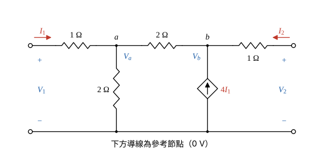

# 111 年電路學第 4 題｜受控電流源雙埠網路的 h 參數

## 已知與所求

埠 1（\(V_1\)，\(I_1\) 流入）串 \(1\ \Omega\) 至節點 \(a\)；\(a\) 經 \(2\ \Omega\) 接地、經 \(2\ \Omega\) 至節點 \(b\)；\(b\) 有由地指向 \(b\) 的受控電流源 \(4I_1\)，並串 \(1\ \Omega\) 至埠 2（\(V_2\)，\(I_2\) 流入）。求 \(h\) 參數（25 分）：
\[
\begin{bmatrix}V_1\\I_2\end{bmatrix}=\begin{bmatrix}h_{11}&h_{12}\\h_{21}&h_{22}\end{bmatrix}\begin{bmatrix}I_1\\V_2\end{bmatrix}
\]

## 考場標準作答

**解題邏輯**：\(h\) 參數以 \(I_1\)、\(V_2\) 為自變數，依定義分兩次求；前提為受控電流源 \(4I_1\) 由地指向 \(b\)（注入 \(b\)），\(I_1=0\) 時受控源電流為 0，相當於開路。
1. 埠 2 短路（\(V_2=0\)）得 \(h_{11}=V_1/I_1\)、\(h_{21}=I_2/I_1\)。
2. 埠 1 開路（\(I_1=0\)）得 \(h_{12}=V_1/V_2\)、\(h_{22}=I_2/V_2\)。
3. 兩種情況都以下方導線為參考，對節點 \(a\)、\(b\) 列 KCL。
4. 給自變數一個測試值（\(I_1=1\ \mathrm A\) 或 \(V_2=1\ \mathrm V\)），讓每一行都是有單位的數值。

### 步驟 1：節點與通用方程式

畫法：

- 下方導線為參考（\(0\ \mathrm V\)）；左 \(1\ \Omega\) 與 \(2\ \Omega\)（接地）相接處為節點 \(a\)（電壓 \(V_a\)），\(2\ \Omega\)（串）、受控源與右 \(1\ \Omega\) 相接處為節點 \(b\)（電壓 \(V_b\)）。
- \(I_1\) 由埠 1 正端流入，\(I_2\) 由埠 2 正端流入（右 \(1\ \Omega\) 中由埠 2 流向 \(b\)）。

\[
V_1=V_a+(1\ \Omega)\,I_1,\qquad V_2=V_b+(1\ \Omega)\,I_2
\]
節點 \(a\) 的 KCL（\(I_1\) 流入，經兩個 \(2\ \Omega\) 流出）：
\[
I_1=\frac{V_a}{2\ \Omega}+\frac{V_a-V_b}{2\ \Omega}
\]
節點 \(b\) 的 KCL（流出 \(b\) 的電流和 = 受控源注入；流向埠 2 的電流為 \(-I_2\)）：
\[
\frac{V_b-V_a}{2\ \Omega}-I_2=4I_1
\]

### 步驟 2：埠 2 短路（\(V_2=0\)），取 \(I_1=1\ \mathrm A\)

以下電壓以 V、電流以 A、電阻以 Ω 計。由 \(V_2=V_b+I_2\times1\ \Omega=0\)：
\[
I_2=-\frac{V_b}{1\ \Omega}
\]
節點 \(a\)（乘以 \(2\ \Omega\)）：
\[
2\times1=V_a+(V_a-V_b)\ \Rightarrow\ 2V_a=2+V_b\ \Rightarrow\ V_a=1+\frac{V_b}{2}\ \ (\mathrm V)
\]
節點 \(b\)：
\[
\frac{V_b-\left(1+\frac{V_b}{2}\right)}{2}+V_b=4\times1
\]
\[
\frac{V_b}{4}-\frac12+V_b=4
\]
\[
1.25\,V_b=4.5
\]
\[
V_b=\frac{4.5}{1.25}=3.6\ \mathrm V
\]
\[
V_a=1+\frac{3.6}{2}=2.8\ \mathrm V
\]
\[
V_1=V_a+1\times I_1=2.8+1=3.8\ \mathrm V
\]
\[
I_2=-\frac{3.6\ \mathrm V}{1\ \Omega}=-3.6\ \mathrm A
\]

### 步驟 3：埠 1 開路（\(I_1=0\)），取 \(V_2=1\ \mathrm V\)

\(I_1=0\Rightarrow4I_1=0\)，受控源開路；左 \(1\ \Omega\) 無電流，\(V_1=V_a\)。

節點 \(a\)：
\[
0=\frac{V_a}{2}+\frac{V_a-V_b}{2}\ \Rightarrow\ 2V_a=V_b\ \Rightarrow\ V_a=\frac{V_b}{2}
\]
節點 \(b\)（\(I_2=\frac{V_2-V_b}{1\ \Omega}=1-V_b\)）：
\[
\frac{V_b-\frac{V_b}{2}}{2}-(1-V_b)=0
\]
\[
\frac{V_b}{4}+V_b=1
\]
\[
1.25\,V_b=1\ \Rightarrow\ V_b=\frac{1}{1.25}=0.8\ \mathrm V
\]
\[
V_1=V_a=\frac{0.8}{2}=0.4\ \mathrm V
\]
\[
I_2=1-0.8=0.2\ \mathrm A
\]

### \(h\) 參數（25 分）

**邏輯**：依 \(h\) 參數定義，把步驟 2（\(V_2=0\)）與步驟 3（\(I_1=0\)）的結果除以各自的測試量。

\[
h_{11}=\left.\frac{V_1}{I_1}\right|_{V_2=0}=\frac{3.8\ \mathrm V}{1\ \mathrm A}=3.8\ \Omega,\qquad
h_{21}=\left.\frac{I_2}{I_1}\right|_{V_2=0}=\frac{-3.6\ \mathrm A}{1\ \mathrm A}=-3.6
\]
\[
h_{12}=\left.\frac{V_1}{V_2}\right|_{I_1=0}=\frac{0.4\ \mathrm V}{1\ \mathrm V}=0.4,\qquad
h_{22}=\left.\frac{I_2}{V_2}\right|_{I_1=0}=\frac{0.2\ \mathrm A}{1\ \mathrm V}=0.2\ \mathrm S
\]
\[
\boxed{\begin{bmatrix}h_{11}&h_{12}\\h_{21}&h_{22}\end{bmatrix}=\begin{bmatrix}3.80\ \Omega&0.40\\-3.60&0.20\ \mathrm S\end{bmatrix}}
\]
\(h_{21}\) 為負：埠 2 短路時實際電流由埠 2 流出（與 \(I_2\) 參考方向相反）。

## 驗算

任取 \(I_1=1\ \mathrm A\)、\(V_2=5\ \mathrm V\)，由矩陣得 \(V_1=3.80+2=5.80\ \mathrm V\)、\(I_2=-3.60+1=-2.60\ \mathrm A\)。回代電路：\(V_b=V_2-1\times I_2=5-(-2.60)=7.60\ \mathrm V\)、\(V_a=V_1-1\times I_1=4.80\ \mathrm V\)；\(a\) 點 \(\frac{4.80}{2}+\frac{4.80-7.60}{2}=2.40-1.40=1\ \mathrm A=I_1\)；\(b\) 點 \(\frac{7.60-4.80}{2}-(-2.60)=1.40+2.60=4\ \mathrm A=4I_1\)。兩點 KCL 同時成立。

## 失分點

- \(I_2\) 定義為流入埠 2，\(b\) 點流向右埠的電流是 \(-I_2\)；方向弄反會得 \(h_{21}=+3.60\)。
- 受控源方向為由地指向 \(b\)（注入 \(b\)），寫成流出會使 \(h_{11}\)、\(h_{21}\) 全錯。
- \(h_{11}\) 單位為 \(\Omega\)、\(h_{22}\) 為 S，\(h_{12},h_{21}\) 無因次，作答時單位不可混寫。
