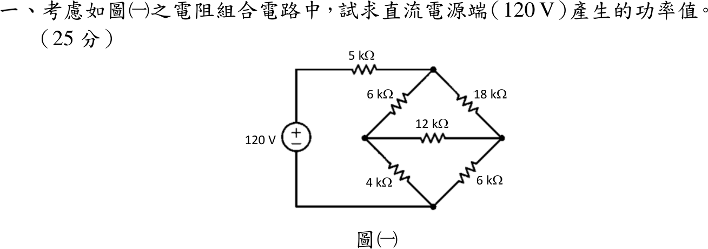
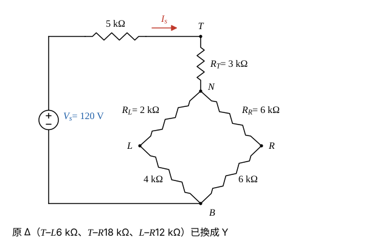

# 112 年電路學第 1 題｜電阻等效與電源功率

## 已知與所求

120 V 電源正端經 5 kΩ 接橋頂點 \(T\)，負端接橋底點 \(B\)。橋內：\(T\)–\(L\) 6 kΩ、\(T\)–\(R\) 18 kΩ、\(L\)–\(R\) 12 kΩ、\(L\)–\(B\) 4 kΩ、\(R\)–\(B\) 6 kΩ。求 120 V 電源產生的功率（25 分）。

## 考場標準作答

**解題邏輯**：電源功率 \(P_s=V_sI_s\)，只需電源電流 \(I_s\)，也就是電源看入的總電阻。橋內 \(6/4\neq18/6\)，不平衡，\(12\ \mathrm{k\Omega}\) 有電流、無法直接用串並聯；故先把 \(T\)–\(L\)–\(R\) 三個電阻構成的 Δ 換成 Y，橋即成串並聯 → 求橋等效電阻 → 加上 \(5\ \mathrm{k\Omega}\) 得 \(I_s\) → \(P_s\)。前提：理想直流電壓源；\(I_s\) 由正端流出，故算得的 \(P_s\) 為電源提供的功率。

### 步驟 1：Δ → Y 等效

Δ 三邊：\(R_{TL}=6\ \mathrm{k\Omega}\)、\(R_{TR}=18\ \mathrm{k\Omega}\)、\(R_{LR}=12\ \mathrm{k\Omega}\)。
\[
\Sigma R=R_{TL}+R_{TR}+R_{LR}=6+18+12=36\ \mathrm{k\Omega}
\]
Y 臂電阻 = 相鄰兩邊乘積 ÷ 三邊和：
\[
R_T=\frac{R_{TL}R_{TR}}{\Sigma R}=\frac{6\times18}{36}=\frac{108}{36}=3\ \mathrm{k\Omega}
\]
\[
R_L=\frac{R_{TL}R_{LR}}{\Sigma R}=\frac{6\times12}{36}=\frac{72}{36}=2\ \mathrm{k\Omega}
\]
\[
R_R=\frac{R_{TR}R_{LR}}{\Sigma R}=\frac{18\times12}{36}=\frac{216}{36}=6\ \mathrm{k\Omega}
\]

畫法：

- Y 的中心點記為 \(N\)；\(R_T\) 接 \(T\)–\(N\)，\(R_L\) 接 \(N\)–\(L\)，\(R_R\) 接 \(N\)–\(R\)；原 \(4\ \mathrm{k\Omega}\)（\(L\)–\(B\)）、\(6\ \mathrm{k\Omega}\)（\(R\)–\(B\)）不變。

### 步驟 2：橋的等效電阻

\(N\to L\to B\) 支路與 \(N\to R\to B\) 支路各為串聯，兩者並聯於 \(N\)–\(B\)：
\[
R_{NLB}=R_L+4=2+4=6\ \mathrm{k\Omega}
\]
\[
R_{NRB}=R_R+6=6+6=12\ \mathrm{k\Omega}
\]
\[
R_{NB}=\frac{R_{NLB}R_{NRB}}{R_{NLB}+R_{NRB}}=\frac{6\times12}{6+12}=\frac{72}{18}=4\ \mathrm{k\Omega}
\]
\[
R_{TB}=R_T+R_{NB}=3+4=7\ \mathrm{k\Omega}
\]

### 電源產生的功率（25 分）

**邏輯**：電源看入為 \(5\ \mathrm{k\Omega}\) 串 \(R_{TB}\)，由歐姆定律得 \(I_s\)，再以 \(P_s=V_sI_s\) 求功率；\(I_s\) 由正端流出，功率為提供。

\[
R_{in}=5+R_{TB}=5+7=12\ \mathrm{k\Omega}
\]
\[
I_s=\frac{V_s}{R_{in}}=\frac{120\ \mathrm V}{12\ \mathrm{k\Omega}}=10\ \mathrm{mA}
\]
\[
P_s=V_sI_s=120\ \mathrm V\times10\ \mathrm{mA}=1200\ \mathrm{mW}=1.20\ \mathrm W
\]
\[
\boxed{P_s=1.20\ \mathrm W\ \text{（提供）}}
\]

## 驗算

以 \(B\) 為參考，改用原電路的節點法檢查：橋兩端 \(V_{TB}=I_sR_{TB}=10\ \mathrm{mA}\times7\ \mathrm{k\Omega}=70\ \mathrm V\)。節點 \(L\)：\(\frac{v_L-70}{6}+\frac{v_L-v_R}{12}+\frac{v_L}{4}=0\Rightarrow6v_L-v_R=140\)；節點 \(R\)：\(\frac{v_R-70}{18}+\frac{v_R-v_L}{12}+\frac{v_R}{6}=0\Rightarrow11v_R-3v_L=140\)；聯立得 \(v_L=\frac{80}{3}\ \mathrm V\)、\(v_R=20\ \mathrm V\)。由 \(T\) 流出 \(\frac{70-80/3}{6}+\frac{70-20}{18}=\frac{65}{9}+\frac{25}{9}=10\ \mathrm{mA}=I_s\)；各電阻功率（\(5,6,18,12,4,6\ \mathrm{k\Omega}\) 依序）\(500+313.0+138.9+3.704+177.8+66.67\approx1200\ \mathrm{mW}=1.20\ \mathrm W\)，與 \(P_s\) 相符。

## 失分點

- 此橋 \(6/4\neq18/6\) 不平衡，12 kΩ 有電流，不能直接刪去（刪去會得 \(10\parallel24=7.06\ \mathrm{k\Omega}\)）。
- 漏掉外部 5 kΩ 而得 \(120^2/7\mathrm k=2.06\ \mathrm W\)。
