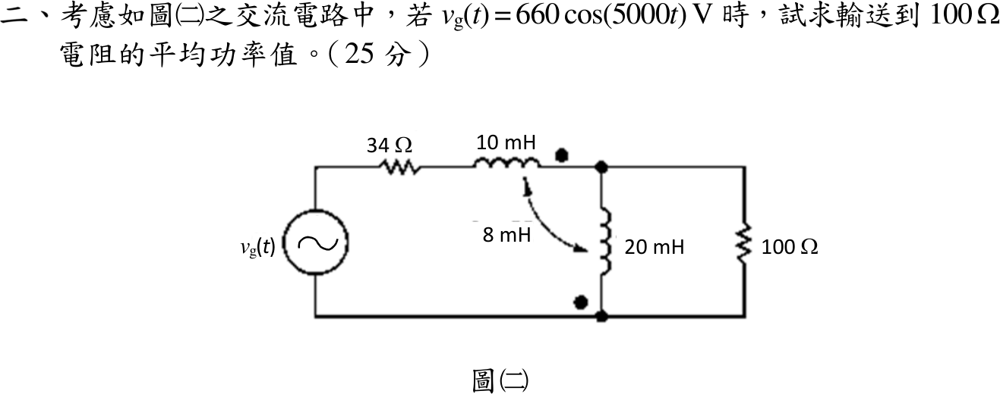
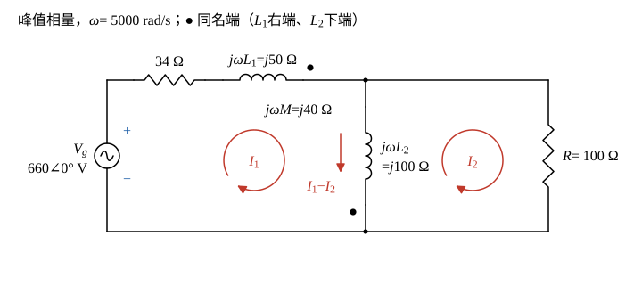

# 112 年電路學第 2 題｜互感電路與負載平均功率

## 已知與所求

\(v_g=660\cos(5000t)\ \mathrm V\) 串 34 Ω、\(L_1=10\ \mathrm{mH}\)（同名端在右端）至上方節點；\(L_2=20\ \mathrm{mH}\) 由上方節點接到底線（同名端在下端），\(M=8\ \mathrm{mH}\)；100 Ω 與 \(L_2\) 並聯。求 100 Ω 的平均功率（25 分）。

## 考場標準作答

### 步驟 1：電抗

全題用 cos 基準的峰值相量（\(\mathbf V_g=660\angle0^\circ\ \mathrm V\)），平均功率須除以 2；題圖電源未標極性，取上正下負（反號只使所有電流反相，不影響功率）。兩線圈有互感，採網目分析，依同名端決定互感項正負。

\(\omega=5000\ \mathrm{rad/s}\)：
\[
\omega L_1=5000\times0.01=50\ \Omega,\qquad
\omega L_2=5000\times0.02=100\ \Omega,\qquad
\omega M=5000\times0.008=40\ \Omega
\]

### 步驟 2：網目電流與互感符號

畫法：

- 網目電流 \(\mathbf I_1\)（左網目順時針）、\(\mathbf I_2\)（右網目順時針），\(L_2\) 由上往下的電流為 \(\mathbf I_1-\mathbf I_2\)。
- \(\mathbf I_1\) 由 \(L_1\) 左端（非點端）流入，\(\mathbf I_1-\mathbf I_2\) 由 \(L_2\) 上端（非點端）流入；兩者同由非點端流入（與同由點端流入等效），互感電壓與自感電壓同號，取 \(+j\omega M\)。
- \(L_1\) 由左到右的壓降 \(=j50\mathbf I_1+j40(\mathbf I_1-\mathbf I_2)\)；\(L_2\) 由上到下的壓降 \(=j100(\mathbf I_1-\mathbf I_2)+j40\mathbf I_1\)。

兩網目 KVL（右網目順時針經 \(L_2\) 時由下往上，取 \(L_2\) 壓降的負值）：
\[
\begin{aligned}
\text{左網目：}&\ 660=34\mathbf I_1+\left[j50\mathbf I_1+j40(\mathbf I_1-\mathbf I_2)\right]+\left[j100(\mathbf I_1-\mathbf I_2)+j40\mathbf I_1\right]\\
\text{右網目：}&\ 0=100\mathbf I_2-\left[j100(\mathbf I_1-\mathbf I_2)+j40\mathbf I_1\right]
\end{aligned}
\]

### 100 Ω 平均功率（25 分）

100 Ω 只流過右網目電流 \(\mathbf I_2\)，故 \(P=\frac12|\mathbf I_2|^2R\)。

右網目展開：
\[
100\mathbf I_2-j100\mathbf I_1+j100\mathbf I_2-j40\mathbf I_1=0\ \Rightarrow\ (100+j100)\mathbf I_2=j140\mathbf I_1
\]
\[
\frac{j140}{100+j100}=\frac{j140(100-j100)}{100^2+100^2}=\frac{14000+j14000}{20000}=0.70+j0.70
\]
\[
\mathbf I_2=(0.70+j0.70)\mathbf I_1
\]
左網目依 \(\mathbf I_1\)、\(\mathbf I_2\) 整理：
\[
660=(34+j50+j40+j100+j40)\mathbf I_1-(j40+j100)\mathbf I_2=(34+j230)\mathbf I_1-j140\mathbf I_2
\]
代入 \(\mathbf I_2\)：
\[
j140(0.70+j0.70)=j98+j^2\,98=-98+j98
\]
\[
660=\left[34+j230-(-98+j98)\right]\mathbf I_1=(132+j132)\mathbf I_1
\]
\[
\mathbf I_1=\frac{660}{132+j132}=\frac{5}{1+j}
\]
分母化為極式：
\[
|1+j|=\sqrt{1^2+1^2}=\sqrt2,\qquad \angle(1+j)=\tan^{-1}\frac11=45^\circ
\]
\[
|\mathbf I_1|=\frac{5}{\sqrt2}=3.536\ \mathrm A,\qquad \angle\mathbf I_1=0^\circ-45^\circ=-45^\circ
\]
直角式以精確分式計算（避免 \(3.536\cos45^\circ\) 的捨入）：
\[
\mathbf I_1=\frac{5(1-j)}{(1+j)(1-j)}=\frac{5-j5}{2}=2.50-j2.50\ \mathrm A
\]
\[
\mathbf I_2=(0.70+j0.70)(2.50-j2.50)=0.70\times2.50\times(1+j)(1-j)
\]
\[
(1+j)(1-j)=1-j^2=2,\qquad 0.70\times2.50=1.75
\]
\[
\mathbf I_2=1.75\times2=3.50\ \mathrm A
\]
\(\mathbf I_2\) 為正實數：\(|\mathbf I_2|=3.50\ \mathrm A\)、相角 \(0^\circ\)。
\[
P_{100\Omega}=\frac12|\mathbf I_2|^2R=\frac{3.50^2}{2}\times100=\frac{12.25}{2}\times100
\]
\[
P_{100\Omega}=6.125\times100
\]
\[
\boxed{P_{100\Omega}=612.50\ \mathrm W}
\]

## 驗算

T 型等效：兩線圈共接上方節點，該處為 \(L_1\) 點端、\(L_2\) 非點端（異名端相接），等效為 \(L_1+M=18\ \mathrm{mH}\)（\(j90\ \Omega\)）、\(L_2+M=28\ \mathrm{mH}\)（\(j140\ \Omega\)），共同支路 \(-M\)（\(-j40\ \Omega\)）接上方節點。由內部節點看出：
\[
j140\parallel(100-j40)=\frac{j140(100-j40)}{100+j100}=98+j42\ \Omega,\qquad Z_{\mathrm{in}}=34+j90+98+j42=132+j132\ \Omega
\]
100 Ω 分流 \(\mathbf I_1\dfrac{j140}{100+j100}=\mathbf I_1(0.70+j0.70)=3.50\ \mathrm A\)。功率守恆：電源 \(\frac12\mathrm{Re}(660\,\mathbf I_1^*)=\frac12\times660\times2.50=825\ \mathrm W\)；34 Ω 吸收 \(\frac12|\mathbf I_1|^2\times34=\frac12\times12.50\times34=212.50\ \mathrm W\)；\(212.50+612.50=825\ \mathrm W\)。

## 失分點

- \(L_2\) 上的互感電壓寫成 \(-j40\mathbf I_1\)，且漏掉 \(L_1\) 上由 \(L_2\) 電流感應的 \(j40(\mathbf I_1-\mathbf I_2)\)，會得錯誤的 \(373.51\ \mathrm W\)。
- 峰值相量求平均功率須除以 2；若用 \(|\mathbf I|^2R\) 會得 1225 W。
