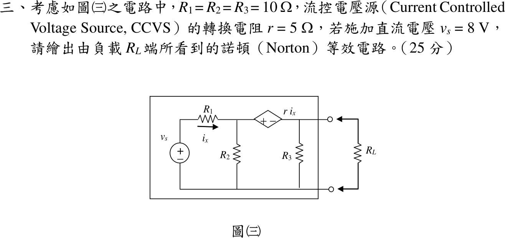
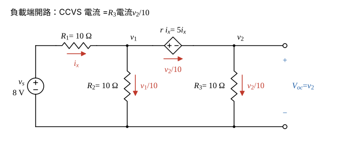
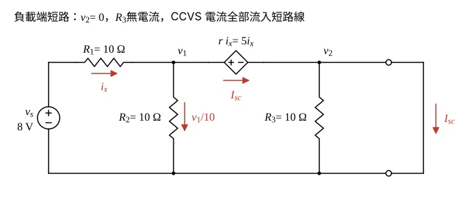
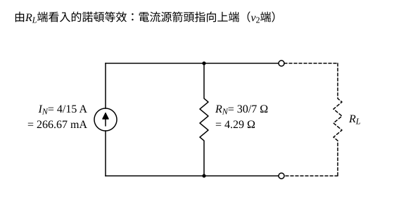

# 112 年電路學第 3 題｜含 CCVS 的諾頓等效

## 已知與所求

\(v_s=8\ \mathrm V\) 串 \(R_1\)（\(i_x\) 向右）至節點 \(v_1\)，\(R_2\) 由 \(v_1\) 接地；CCVS \(ri_x\)（\(r=5\ \Omega\)）左正右負接於 \(v_1\) 與輸出節點 \(v_2\) 之間；\(R_3\) 由 \(v_2\) 接地，\(R_L\) 接在 \(v_2\) 與地。\(R_1=R_2=R_3=10\ \Omega\)。求 \(R_L\) 端看入的諾頓等效（25 分）。

## 考場標準作答

### 步驟 1：兩條共用關係

電路含 CCVS，求 \(R_N\) 不能把相依源歸零，故移除 \(R_L\) 後分別在負載端開路求 \(V_{oc}\)、短路求 \(I_{sc}\)，取 \(R_N=V_{oc}/I_{sc}\)；控制量 \(i_x\) 隨負載端條件改變，兩種狀態都要重新求。以底線為參考，\(v_1\) 為 \(R_2\) 上端節點、\(v_2\) 為輸出（上端）節點。

\(R_1\) 的歐姆定律（\(i_x\) 向右）與 CCVS 約束（左正右負）：
\[
i_x=\frac{v_s-v_1}{R_1}=\frac{8-v_1}{10},\qquad v_1-v_2=r\,i_x=5i_x
\]

### 步驟 2：開路電壓 \(V_{oc}\)

負載端開路，CCVS 電流全部經 \(R_3\)，等於 \(v_2/10\)。節點 \(v_1\) 的 KCL：
\[
i_x=\frac{v_1}{10}+\frac{v_2}{10}
\]
代入 \(i_x=\frac{8-v_1}{10}\)，兩邊乘 10：
\[
8-v_1=v_1+v_2\ \Rightarrow\ 2v_1+v_2=8
\]
CCVS 約束代入 \(i_x\)：
\[
v_2=v_1-5\cdot\frac{8-v_1}{10}=v_1-4+\frac{v_1}{2}=\frac32v_1-4
\]
代入 \(2v_1+v_2=8\)：
\[
2v_1+\frac32v_1-4=8\ \Rightarrow\ \frac72v_1=12\ \Rightarrow\ v_1=\frac{24}{7}\ \mathrm V
\]
\[
v_2=\frac32\cdot\frac{24}{7}-4=\frac{36}{7}-\frac{28}{7}=\frac87
\]
\[
V_{oc}=v_2=\frac87=1.143\ \mathrm V
\]
（此時 \(i_x=\frac{8-24/7}{10}=\frac{16}{35}\ \mathrm A\)。）

### 步驟 3：短路電流 \(I_{sc}\)

負載端短路使 \(v_2=0\)，\(R_3\) 兩端電壓為零、無電流。CCVS 約束：
\[
v_1-0=5\cdot\frac{8-v_1}{10}=\frac{8-v_1}{2}
\]
\[
2v_1=8-v_1\ \Rightarrow\ 3v_1=8\ \Rightarrow\ v_1=\frac83\ \mathrm V
\]
\[
i_x=\frac{8-\frac83}{10}=\frac{16/3}{10}=\frac8{15}\ \mathrm A
\]
節點 \(v_1\) 的 KCL：CCVS 電流 = \(i_x\) 減去 \(R_2\) 電流，且它全部流入短路線：
\[
I_{sc}=i_x-\frac{v_1}{10}=\frac8{15}-\frac{8/3}{10}=\frac8{15}-\frac4{15}=\frac4{15}\ \mathrm A
\]

### 諾頓等效電路（25 分）

\[
I_N=I_{sc}=\frac4{15}\ \mathrm A
\]
\[
R_N=\frac{V_{oc}}{I_{sc}}=\frac{8/7}{4/15}=\frac87\times\frac{15}4=\frac{30}7\ \Omega
\]
\[
\boxed{I_N=\frac4{15}=266.67\ \mathrm{mA}},\qquad
\boxed{R_N=\frac{V_{oc}}{I_{sc}}=\frac{30}{7}=4.29\ \Omega}
\]
畫法：\(I_N\) 與 \(R_N\) 並聯接於負載兩端，電流源箭頭指向上端（\(v_2\) 端），使開路時 \(V_{oc}=I_NR_N=\frac4{15}\times\frac{30}7=\frac87\ \mathrm V\)，與步驟 2 一致。

## 驗算

測試源法：\(v_s\) 短路、保留 CCVS，在輸出端加 \(v_2\)。\(i_x=-v_1/10\)，\(v_1-v_2=-v_1/2\Rightarrow v_1=\frac23v_2\)。測試電流 \(i_t=\frac{v_2}{10}+\frac{v_1}{10}+\frac{v_1}{10}=\frac{v_2}{10}+\frac{2v_2}{15}=\frac7{30}v_2\)，\(R_N=\frac{30}7\ \Omega\)，與 \(V_{oc}/I_{sc}\) 一致。

## 失分點

- 求 \(R_N\) 時把 CCVS 短路（相依源歸零），會得 \(10\parallel(10\parallel10)=3.33\ \Omega\)。
- 短路時 \(i_x\) 會改變（\(\frac{16}{35}\to\frac8{15}\ \mathrm A\)），不可沿用開路時的 \(i_x\)。
