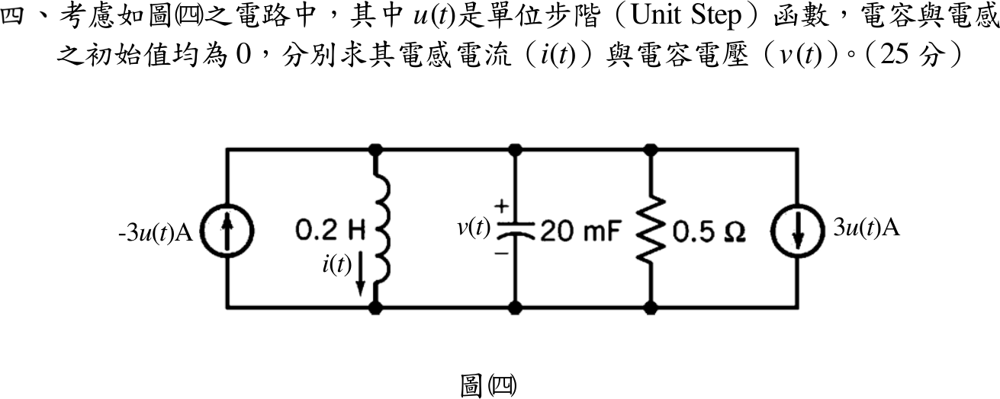
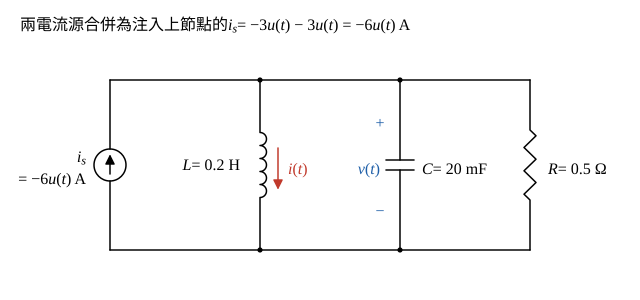

# 112 年電路學第 4 題｜並聯 RLC 步階響應

## 已知與所求

上下兩節點間並接：\(-3u(t)\ \mathrm A\) 電流源（箭頭向上）、\(0.2\ \mathrm H\)（\(i\) 向下）、\(20\ \mathrm{mF}\)（\(v\) 上正）、\(0.5\ \Omega\)、\(3u(t)\ \mathrm A\) 電流源（箭頭向下）。初值皆為 0。求 \(i(t)\) 與 \(v(t)\)（25 分）。

## 考場標準作答

### 步驟 1：合併兩電流源

所有元件與兩電流源並接在同一對節點之間，為並聯 RLC 的步階響應；設初值皆為 0，電感電流與電容電壓連續。

左源箭頭向上（流入上節點），值 \(-3u(t)\)；右源箭頭向下（流出上節點），值 \(3u(t)\)，等同流入 \(-3u(t)\)。注入上節點的總電流：
\[
i_s=-3u(t)+\bigl(-3u(t)\bigr)=-6u(t)\ \mathrm A
\]

### 步驟 2：KCL 化為 \(i\) 的二階方程

\(t>0\) 時上節點 KCL（注入 = 經 \(L\)、\(C\)、\(R\) 流出）：
\[
i+C\frac{dv}{dt}+\frac vR=-6
\]
電感電壓 \(v=L\dot i\)，故 \(\dot v=L\ddot i\)，代入：
\[
i+LC\,\ddot i+\frac LR\,\dot i=-6
\]
同除 \(LC\)：
\[
\ddot i+\frac1{RC}\dot i+\frac1{LC}i=-\frac6{LC}
\]
係數：
\[
\frac1{RC}=\frac1{0.5\times0.02}=100\ \mathrm{s^{-1}},\qquad
\frac1{LC}=\frac1{0.2\times0.02}=250\ \mathrm{s^{-2}},\qquad
-\frac6{LC}=-6\times250=-1500
\]
\[
\ddot i+100\dot i+250i=-1500
\]

### 步驟 3：特徵根與初值

\[
s^2+100s+250=0\ \Rightarrow\ s=\frac{-100\pm\sqrt{100^2-4\times250}}{2}=\frac{-100\pm\sqrt{9000}}{2}
\]
\(\sqrt{9000}=30\sqrt{10}\)，所以
\[
s_1=-50+15\sqrt{10}=-2.566\ \mathrm{s^{-1}},\qquad s_2=-50-15\sqrt{10}=-97.43\ \mathrm{s^{-1}}
\]
兩相異負實根，過阻尼（\(\alpha=\frac1{2RC}=50>\omega_0=\sqrt{250}=15.81\ \mathrm{rad/s}\)）。

初值：\(i(0^+)=i(0^-)=0\)，\(v(0^+)=v(0^-)=0\)，故 \(\dot i(0^+)=\dfrac{v(0^+)}{L}=0\)。

### 電感電流 \(i(t)\) 與電容電壓 \(v(t)\)（25 分）

**\(i(t)\)**：特解為常數，代入方程 \(250\,i_p=-1500\Rightarrow i_p=-6\,\mathrm A\)。
\[
i(t)=-6+A_1e^{s_1t}+A_2e^{s_2t}
\]
由 \(i(0^+)=0\)：
\[
-6+A_1+A_2=0\ \Rightarrow\ A_1+A_2=6
\]
由 \(\dot i(0^+)=0\)：
\[
s_1A_1+s_2A_2=0
\]
以 \(A_2=6-A_1\) 代入：
\[
s_1A_1+s_2(6-A_1)=0\ \Rightarrow\ A_1(s_1-s_2)=-6s_2
\]
\(s_1-s_2=30\sqrt{10}\)，\(-6s_2=300+90\sqrt{10}\)：
\[
A_1=\frac{300+90\sqrt{10}}{30\sqrt{10}}=\frac{10}{\sqrt{10}}+3=3+\sqrt{10}=6.162
\]
\[
A_2=6-A_1=6-(3+\sqrt{10})=3-\sqrt{10}=-0.1623
\]
\[
\boxed{i(t)=\left[-6+(3+\sqrt{10})e^{(-50+15\sqrt{10})t}+(3-\sqrt{10})e^{(-50-15\sqrt{10})t}\right]u(t)\ \mathrm A}
\]
（數值：\(i(t)=-6+6.162e^{-2.566t}-0.1623e^{-97.43t}\ \mathrm A\)，\(t>0\)。）

**\(v(t)\)**：
\[
v=L\frac{di}{dt}=LA_1s_1e^{s_1t}+LA_2s_2e^{s_2t}
\]
\[
LA_1s_1=0.2(3+\sqrt{10})(-50+15\sqrt{10})=0.2(-150+45\sqrt{10}-50\sqrt{10}+150)=0.2(-5\sqrt{10})=-\sqrt{10}
\]
\[
LA_2s_2=0.2(3-\sqrt{10})(-50-15\sqrt{10})=0.2(-150-45\sqrt{10}+50\sqrt{10}+150)=0.2(5\sqrt{10})=\sqrt{10}
\]
\[
\boxed{v(t)=\sqrt{10}\left[e^{(-50-15\sqrt{10})t}-e^{(-50+15\sqrt{10})t}\right]u(t)\ \mathrm V}
\]
（數值：\(\sqrt{10}=3.162\)，\(v(t)=3.162\left(e^{-97.43t}-e^{-2.566t}\right)\ \mathrm V\)，\(t>0\)。）

## 驗算

拉氏轉換：\(V(s)=\dfrac{-6/s}{\frac{5}{s}+0.02s+2}=\dfrac{-300}{s^2+100s+250}\)，反轉換
\[
v(t)=\frac{-300}{s_1-s_2}\left(e^{s_1t}-e^{s_2t}\right)=\frac{-300}{30\sqrt{10}}\left(e^{s_1t}-e^{s_2t}\right)=-\sqrt{10}\left(e^{s_1t}-e^{s_2t}\right)
\]
與上式相同；終值定理 \(i(\infty)=\lim_{s\to0}s\frac{V(s)}{0.2s}=\frac{-300}{0.2(250)}=-6\ \mathrm A\)。

## 失分點

- 左源箭頭向上但數值為 \(-3u(t)\)，等同 3 A 流出；誤判兩源相消會得 \(i=v=0\)。
- \(C=20\ \mathrm{mF}=0.02\ \mathrm F\)；誤用 \(20\ \mu\mathrm F\) 會使特徵根全錯。
- 只寫自然響應，漏掉直流特解 \(-6\ \mathrm A\)。
