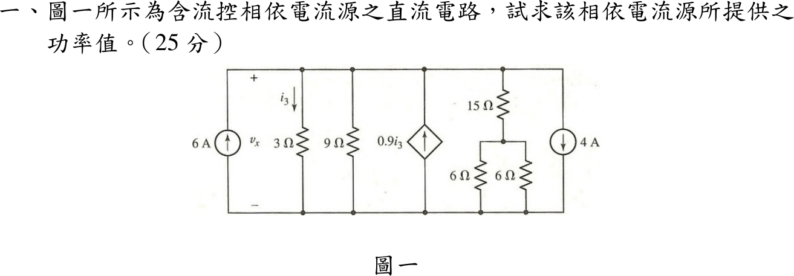
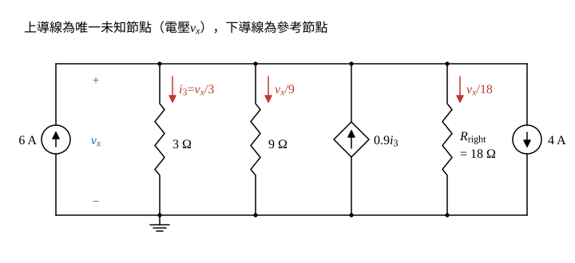

# 113 年電路學第 1 題｜相依電流源提供功率

## 已知與所求

所有元件並接於上、下兩條導線之間，上端電壓為 \(v_x\)（下端為參考）：6 A 向上、3 Ω（\(i_3\) 向下）、9 Ω、相依源 \(0.9i_3\) 向上、\(15\,\Omega+(6\parallel6)\)、4 A 向下。求相依電流源提供的功率（25 分）。

## 考場標準作答

**解題邏輯**：所有元件都並接在上導線與下導線之間，只有一個未知節點電壓 \(v_x\)，用單一節點 KCL 最直接。主線：先把右側 \(15\ \Omega+(6\parallel6)\) 化成一個等效電阻 → 把控制量 \(i_3\) 寫成 \(v_x\) 的式子 → 節點 KCL 解 \(v_x\) → 求相依源電流 \(0.9i_3\) → 由電流方向與電壓極性判斷相依源是提供或吸收功率。直流穩態，下導線為參考節點。

### 步驟 1：化簡右側支路

右側為 \(15\ \Omega\) 串接 \(6\ \Omega\parallel6\ \Omega\)。並聯部分：
\[
6\parallel6=\frac{6\times6}{6+6}=\frac{36}{12}=3\ \Omega
\]
再串 \(15\ \Omega\)：
\[
R_{\mathrm{right}}=15+3=18\ \Omega
\]

### 步驟 2：節點 KCL 求 \(v_x\)

畫法與方向：

- 上導線為唯一未知節點，電壓 \(v_x\)（上正下負）；下導線為參考節點。
- 三條電阻支路電流參考方向一律向下（由節點流出）：\(i_3=v_x/3\)、\(v_x/9\)、\(v_x/R_{\mathrm{right}}\)。
- 6 A 與 \(0.9i_3\) 箭頭向上（注入節點）；4 A 箭頭向下（流出節點）。

控制量 \(i_3\) 為 3 Ω 由上往下的電流：
\[
i_3=\frac{v_x}{3}
\]
節點 KCL（注入＝流出）：
\[
6+0.9i_3=\frac{v_x}{3}+\frac{v_x}{9}+\frac{v_x}{R_{\mathrm{right}}}+4
\]
代入 \(i_3=v_x/3\) 與 \(R_{\mathrm{right}}=18\ \Omega\)：
\[
6+0.9\cdot\frac{v_x}{3}=\frac{v_x}{3}+\frac{v_x}{9}+\frac{v_x}{18}+4
\]
左邊係數：
\[
0.9\cdot\frac{v_x}{3}=0.3\,v_x
\]
右邊電導和（通分為 18）：
\[
\frac13+\frac19+\frac1{18}=\frac{6+2+1}{18}=\frac{9}{18}=0.5\ \mathrm S
\]
方程化為：
\[
6+0.3\,v_x=0.5\,v_x+4
\]
移項：
\[
6-4=(0.5-0.3)\,v_x
\]
\[
2=0.2\,v_x
\]
\[
v_x=\frac{2}{0.2}=10\ \mathrm V
\]

### 相依電流源提供的功率（25 分）

**邏輯**：相依源兩端電壓就是 \(v_x\)，電流為 \(0.9i_3\)；電流由電壓正端（上端）流出時，元件提供功率 \(P=v_x\cdot0.9i_3\)。

控制量：
\[
i_3=\frac{v_x}{3}=\frac{10}{3}=3.333\ \mathrm A
\]
相依源電流：
\[
0.9i_3=0.9\times\frac{10}{3}=\frac{9}{3}=3\ \mathrm A
\]
方向判斷：箭頭向上，電流由上端流出；上端電位 \(v_x=10\ \mathrm V>0\) 為正端，電流離開正端，故為**提供**功率。
\[
P_{\mathrm{dep}}=v_x\,(0.9i_3)=10\ \mathrm V\times3\ \mathrm A
\]
\[
\boxed{P_{\mathrm{dep}}=30\ \mathrm W\ \text{（提供）}}
\]

## 驗算

功率守恆。電源提供：6 A 源 \(6\times10=60\ \mathrm W\)，相依源 \(30\ \mathrm W\)，合計 \(90\ \mathrm W\)。電阻吸收：\(\frac{10^2}{3}+\frac{10^2}{9}+\frac{10^2}{18}=33.33+11.11+5.556=50.00\ \mathrm W\)；4 A 源電流由上端流入，吸收 \(4\times10=40\ \mathrm W\)；合計 \(90\ \mathrm W\)，平衡。

## 失分點

- 4 A 向下是由節點流出；當成注入會得 \(10=0.2\,v_x\)、\(v_x=50\ \mathrm V\)。
- 右側 6 Ω 兩電阻為並聯（3 Ω）後再串 15 Ω，不是 \(15\parallel6\parallel6\)。
- 只算 \(P=v_x\cdot0.9i_3\) 而不判斷電流是否離開正端，提供／吸收結論會失分。
