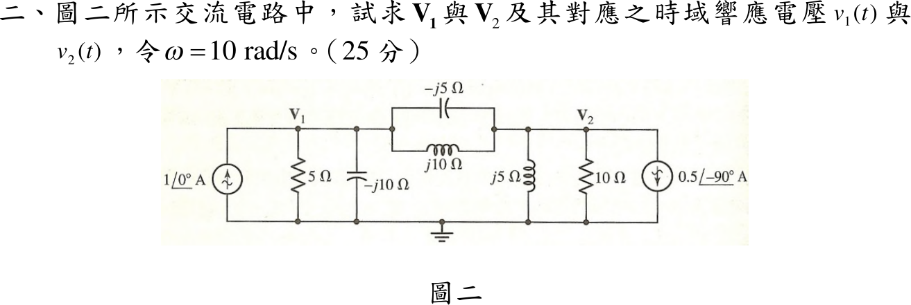
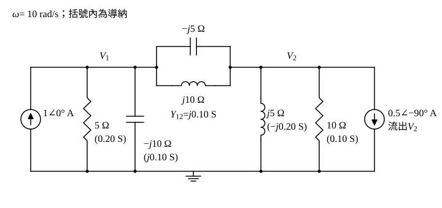

# 113 年電路學第 2 題｜交流節點相量與時域電壓

## 已知與所求

\(\omega=10\ \mathrm{rad/s}\)。節點 \(\mathbf V_1\)：\(1\angle0^\circ\ \mathrm A\) 向上注入、5 Ω 與 \(-j10\ \Omega\) 接地；\(\mathbf V_1\)–\(\mathbf V_2\) 間為 \(-j5\ \Omega\) 與 \(j10\ \Omega\) 並聯；節點 \(\mathbf V_2\)：\(j5\ \Omega\)、10 Ω 接地，\(0.5\angle-90^\circ\ \mathrm A\) 電流源箭頭向下（流出 \(\mathbf V_2\)）。求 \(\mathbf V_1,\mathbf V_2\) 及 \(v_1(t),v_2(t)\)（25 分）。

## 考場標準作答

### 步驟 1：元件導納與等效注入電流

只有兩個未知節點電壓，用節點電壓法（導納形式）。設為弦波穩態；題目只給相量，依慣例以 \(\cos\) 為基準、電流源數值視為峰值，\(\omega=10\ \mathrm{rad/s}\)。

\(\mathbf V_1\) 節點對地：
\[
Y_{5\Omega}=\frac15=0.20\ \mathrm S,\qquad Y_{-j10}=\frac{1}{-j10}=j0.10\ \mathrm S
\]
\(\mathbf V_2\) 節點對地：
\[
Y_{j5}=\frac{1}{j5}=-j0.20\ \mathrm S,\qquad Y_{10\Omega}=\frac1{10}=0.10\ \mathrm S
\]
\(\mathbf V_1\)–\(\mathbf V_2\) 之間 \(-j5\ \Omega\) 與 \(j10\ \Omega\) 並聯：
\[
Z_{12}=\frac{(-j5)(j10)}{-j5+j10}=\frac{50}{j5}=-j10\ \Omega,\qquad Y_{12}=\frac{1}{-j10}=j0.10\ \mathrm S
\]
右側電流源 \(0.5\angle-90^\circ=-j0.5\ \mathrm A\)，箭頭向下即「流出 \(\mathbf V_2\)」，等於注入 \(\mathbf V_2\) 的電流：
\[
\mathbf I_{\mathrm{in},2}=-(-j0.5)=+j0.5\ \mathrm A
\]

### 步驟 2：節點方程

\(\mathbf V_1\) 節點（流出 = 注入 \(1\angle0^\circ=1\ \mathrm A\)）：
\[
(0.20+j0.10)\mathbf V_1+j0.10(\mathbf V_1-\mathbf V_2)=1
\]
\[
(0.20+j0.20)\mathbf V_1-j0.10\,\mathbf V_2=1
\]
\(\mathbf V_2\) 節點（流出 = 注入 \(j0.5\ \mathrm A\)）：
\[
(0.10-j0.20)\mathbf V_2+j0.10(\mathbf V_2-\mathbf V_1)=j0.5
\]
\[
-j0.10\,\mathbf V_1+(0.10-j0.10)\mathbf V_2=j0.5
\]

### 相量 \(\mathbf V_1\)、\(\mathbf V_2\)

\[
\Delta=(0.20+j0.20)(0.10-j0.10)-(-j0.10)(-j0.10)
\]
\[
(0.20+j0.20)(0.10-j0.10)=0.02-j0.02+j0.02-j^2\,0.02=0.02+0.02=0.04
\]
\[
(-j0.10)(-j0.10)=j^2\,0.01=-0.01
\]
\[
\Delta=0.04-(-0.01)=0.05
\]
\(\mathbf V_1\)（右邊項換入第 1 行）：
\[
\mathbf V_1=\frac{1\times(0.10-j0.10)-(-j0.10)(j0.5)}{\Delta}
\]
\[
(-j0.10)(j0.5)=-j^2\,0.05=0.05
\]
\[
\mathbf V_1=\frac{0.10-j0.10-0.05}{0.05}=\frac{0.05-j0.10}{0.05}=1-j2\ \mathrm V
\]
\(\mathbf V_2\)（右邊項換入第 2 行）：
\[
\mathbf V_2=\frac{(0.20+j0.20)(j0.5)-(-j0.10)\times1}{\Delta}
\]
\[
(0.20+j0.20)(j0.5)=j0.10+j^2\,0.10=-0.10+j0.10
\]
\[
\mathbf V_2=\frac{-0.10+j0.10+j0.10}{0.05}=\frac{-0.10+j0.20}{0.05}=-2+j4\ \mathrm V
\]
化成極式：
\[
|\mathbf V_1|=\sqrt{1^2+2^2}=\sqrt5=2.236\ \mathrm V,\qquad \angle\mathbf V_1=\tan^{-1}\frac{-2}{1}=-63.43^\circ\ (\text{第四象限})
\]
\[
|\mathbf V_2|=\sqrt{2^2+4^2}=\sqrt{20}=4.472\ \mathrm V,\qquad \angle\mathbf V_2=180^\circ-\tan^{-1}\frac42=180^\circ-63.43^\circ=116.57^\circ\ (\text{第二象限})
\]
\[
\boxed{\mathbf V_1=1-j2=\sqrt5\angle-63.43^\circ\approx2.24\angle-63.43^\circ\ \mathrm V},\qquad
\boxed{\mathbf V_2=-2+j4=\sqrt{20}\angle116.57^\circ\approx4.47\angle116.57^\circ\ \mathrm V}
\]

### 時域 \(v_1(t)\)、\(v_2(t)\)

\[
\boxed{v_1(t)=2.24\cos(10t-63.43^\circ)\ \mathrm V},\qquad
\boxed{v_2(t)=4.47\cos(10t+116.57^\circ)\ \mathrm V}
\]

## 驗算

逐元件 KCL。\(\mathbf V_2\) 節點流出：\(\frac{\mathbf V_2}{j5}=0.80+j0.40\)、\(\frac{\mathbf V_2}{10}=-0.20+j0.40\)、電流源 \(-j0.5\)，合計 \(0.60+j0.30\)；由 \(\mathbf V_1\) 流來 \(j0.10(\mathbf V_1-\mathbf V_2)=j0.10(3-j6)=0.60+j0.30\)，相等。
\(\mathbf V_1\) 節點流出：\(\frac{\mathbf V_1}{5}+\frac{\mathbf V_1}{-j10}+0.60+j0.30=(0.20-j0.40)+(0.20+j0.10)+(0.60+j0.30)=1\ \mathrm A\)，等於注入。

## 失分點

- 右側源箭頭向下（流出節點），若當成注入 \(-j0.5\) 會得 \(V_1=3-j2\ \mathrm V\)、\(V_2=2\ \mathrm V\)。
- \(-j5\) 與 \(j10\) 並聯為 \(-j10\)（容性），不可串聯相加成 \(j5\)。
