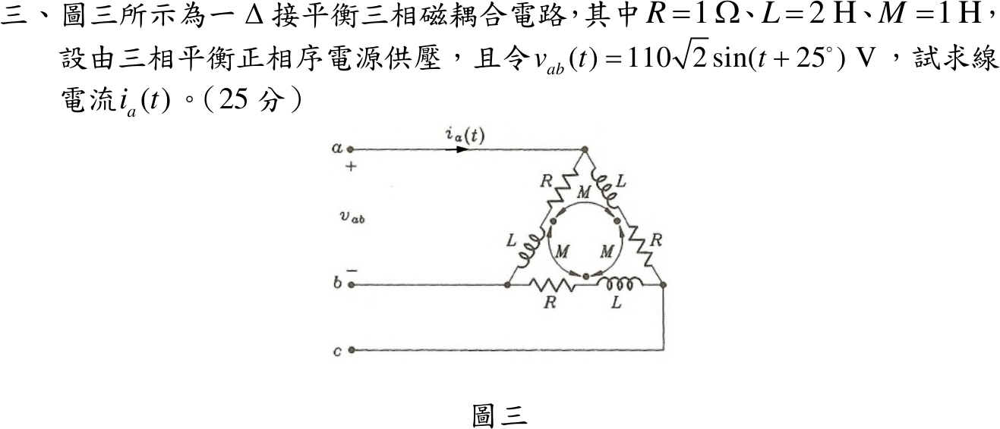
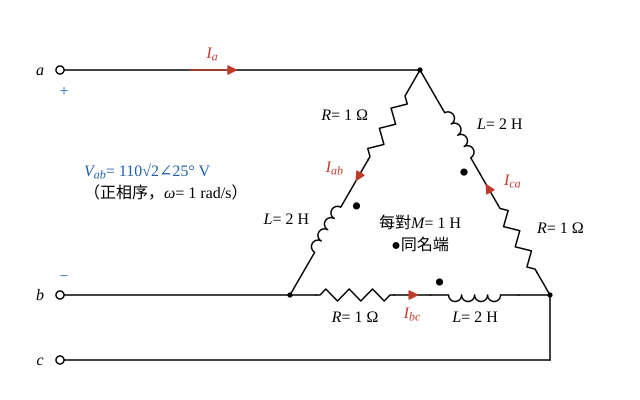
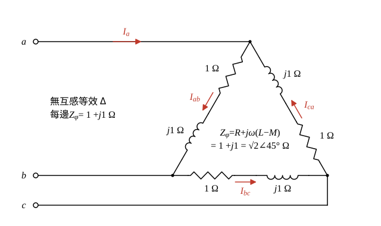
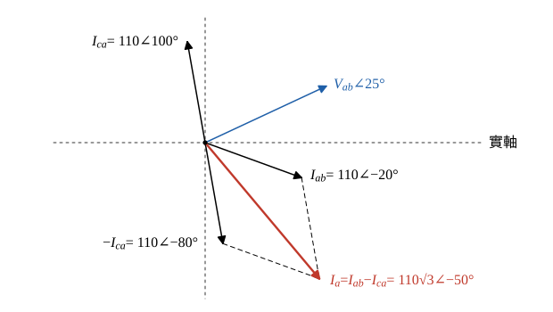

# 113 年電路學第 3 題｜三相 Δ 磁耦合線電流

## 已知與所求

Δ 接負載每邊為 \(R=1\ \Omega\) 串 \(L=2\ \mathrm H\)，任兩電感間互感 \(M=1\ \mathrm H\)；三個同名端都在電感緊鄰電阻的一端，即支路電流取 \(a\to b\)、\(b\to c\)、\(c\to a\) 時皆由點端流入。正相序平衡電源，\(v_{ab}(t)=110\sqrt2\sin(t+25^\circ)\ \mathrm V\)。求 \(i_a(t)\)（25 分）。

## 考場標準作答

**解題邏輯**：互感把三條支路綁在一起，不能直接用 \(Z=R+j\omega L\)。主線是：依同名端列三條支路 KVL → 三式相加證明支路電流和為零 → 代回消去互感耦合項，得每相等效阻抗 \(Z_\phi=R+j\omega(L-M)\) → 求支路電流 \(\mathbf I_{ab}\) → 在節點 \(a\) 用 KCL 得線電流 \(\mathbf I_a=\mathbf I_{ab}-\mathbf I_{ca}\) → 轉回時域。全題採正弦基準的峰值相量（\(\sin\) 對應 \(\angle0^\circ\)），最後直接寫回 \(\sin\)。

### 步驟 1：相量與電抗

- 由 \(v_{ab}(t)=110\sqrt2\sin(t+25^\circ)\) 讀出 \(\omega=1\ \mathrm{rad/s}\)，\(\mathbf V_{ab}=110\sqrt2\angle25^\circ\ \mathrm V\)。
- 電抗：\(\omega L=1\times2=2\ \Omega\)，\(\omega M=1\times1=1\ \Omega\)。
- 正相序：\(\mathbf V_{bc}=\mathbf V_{ab}\angle-120^\circ\)，\(\mathbf V_{ca}=\mathbf V_{ab}\angle+120^\circ\)，且 \(\mathbf V_{ab}+\mathbf V_{bc}+\mathbf V_{ca}=0\)。

### 步驟 2：依同名端列三支路 KVL

畫法：

- 支路電流參考方向取 \(\mathbf I_{ab}\)（\(a\to b\)）、\(\mathbf I_{bc}\)（\(b\to c\)）、\(\mathbf I_{ca}\)（\(c\to a\)），線電流 \(\mathbf I_a\) 由端點 \(a\) 流入負載。
- 依題圖，三個點都在電感靠電阻那一端；三支路電流依上述方向先經 \(R\) 再進 \(L\)，所以三者都由點端流入。
- 兩電流都由點端流入時，互感電壓與自感電壓同號，故另外兩支路在本支路產生 \(+j\omega M\) 乘以該支路電流的壓降。

\[
\begin{aligned}
\mathbf V_{ab}&=(R+j\omega L)\mathbf I_{ab}+j\omega M\,\mathbf I_{bc}+j\omega M\,\mathbf I_{ca}\\
\mathbf V_{bc}&=(R+j\omega L)\mathbf I_{bc}+j\omega M\,\mathbf I_{ca}+j\omega M\,\mathbf I_{ab}\\
\mathbf V_{ca}&=(R+j\omega L)\mathbf I_{ca}+j\omega M\,\mathbf I_{ab}+j\omega M\,\mathbf I_{bc}
\end{aligned}
\]
代入 \(R=1\)、\(\omega L=2\)、\(\omega M=1\)：每式的自阻抗為 \(1+j2\)，互阻抗為 \(j1\)。

### 步驟 3：消去耦合，求每相等效阻抗 \(Z_\phi\)

三式相加，左邊為 \(\mathbf V_{ab}+\mathbf V_{bc}+\mathbf V_{ca}=0\)；右邊每個支路電流各出現一次自阻抗、兩次互阻抗：
\[
0=(R+j\omega L+2j\omega M)(\mathbf I_{ab}+\mathbf I_{bc}+\mathbf I_{ca})=(1+j4)(\mathbf I_{ab}+\mathbf I_{bc}+\mathbf I_{ca})
\]
\(1+j4\neq0\)，所以
\[
\mathbf I_{bc}+\mathbf I_{ca}=-\mathbf I_{ab}
\]
代回第一式：
\[
\mathbf V_{ab}=(R+j\omega L)\mathbf I_{ab}+j\omega M(-\mathbf I_{ab})=\bigl[R+j\omega(L-M)\bigr]\mathbf I_{ab}
\]
\[
Z_\phi=R+j\omega(L-M)=1+j1\times(2-1)=1+j1=\sqrt2\angle45^\circ\ \Omega
\]
三式形式相同，三支路都等效為無互感的 \(Z_\phi\)，負載成為平衡 Δ。

### 線電流 \(i_a(t)\)（25 分）

**邏輯**：等效後為平衡 Δ，支路電流由 \(\mathbf V_{ab}/Z_\phi\) 求得，其餘兩支路依正相序各差 \(\mp120^\circ\)；線電流由節點 \(a\) 的 KCL 求得。

支路電流：
\[
\mathbf I_{ab}=\frac{\mathbf V_{ab}}{Z_\phi}=\frac{110\sqrt2\angle25^\circ}{\sqrt2\angle45^\circ}=110\angle(25^\circ-45^\circ)=110\angle-20^\circ\ \mathrm A
\]
同理 \(\mathbf I_{ca}=\mathbf V_{ca}/Z_\phi=\mathbf I_{ab}\angle+120^\circ=110\angle100^\circ\ \mathrm A\)。

節點 \(a\) 的 KCL（流入 \(\mathbf I_a\)、\(\mathbf I_{ca}\)，流出 \(\mathbf I_{ab}\)）：
\[
\mathbf I_a=\mathbf I_{ab}-\mathbf I_{ca}=\mathbf I_{ab}\,(1-1\angle120^\circ)
\]
\[
1-1\angle120^\circ=1-\left(-\tfrac12+j\tfrac{\sqrt3}{2}\right)=\tfrac32-j\tfrac{\sqrt3}{2}=\sqrt3\angle-30^\circ
\]
\[
\mathbf I_a=110\angle-20^\circ\times\sqrt3\angle-30^\circ=110\sqrt3\angle-50^\circ=190.53\angle-50^\circ\ \mathrm A
\]

正弦基準峰值相量直接寫回 \(\sin\)：
\[
\boxed{i_a(t)=110\sqrt3\sin(t-50^\circ)=190.53\sin(t-50^\circ)\ \mathrm A}
\]

## 驗算

Δ–Y 等效：\(Z_Y=Z_\phi/3=\frac{\sqrt2}{3}\angle45^\circ\)，\(\mathbf V_{an}=\frac{110\sqrt2}{\sqrt3}\angle(25^\circ-30^\circ)\)，
\[
\mathbf I_a=\frac{\mathbf V_{an}}{Z_Y}=\frac{110\sqrt2\cdot3}{\sqrt3\cdot\sqrt2}\angle(-5^\circ-45^\circ)=110\sqrt3\angle-50^\circ\ \mathrm A
\]
另以直角座標相減：\(110\angle-20^\circ=103.37-j37.62\)，\(110\angle100^\circ=-19.10+j108.33\)，相減得 \(122.47-j145.95\)，模 \(\sqrt{122.47^2+145.95^2}=190.53\)、角 \(-\tan^{-1}(145.95/122.47)=-50.00^\circ\)。與直接由支路電流求得者一致。

## 失分點

- 互感當成串聯 \(L+2M\) 或忽略同名端寫 \(L+M\)，會分別得 \(Z_\phi=1+j4\) 或 \(1+j3\)。
- 把支路電流 \(110\angle-20^\circ\) 當作線電流，漏乘 \(\sqrt3\angle-30^\circ\)。
- 正弦基準相量回時域時改寫成 \(\cos\) 而未補 \(90^\circ\)。
