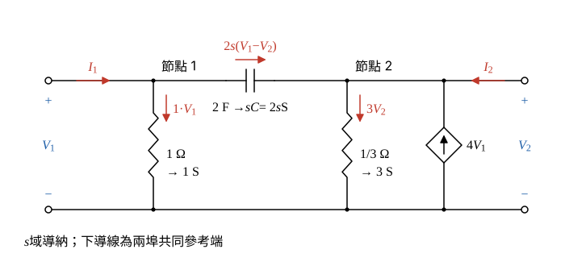

# 113 年電路學第 4 題｜雙埠網路 y 參數

## 已知與所求

埠 1 上端對地接 1 Ω；兩埠上端之間串 2 F 電容；埠 2 上端對地接 \(\frac13\ \Omega\) 及相依電流源 \(4V_1\)（箭頭向上，注入埠 2 上端）。\(I_1,I_2\) 皆流入網路。求短路導納參數（25 分）。

## 考場標準作答

### 步驟 1：元件導納

網路除兩埠上端外沒有內部節點，直接對節點 1、2 各寫一條 KCL，按 \(V_1,V_2\) 合併同類項即得 \(y\) 參數。電容以 \(s\) 域導納 \(sC\) 表示（零初值）；正弦穩態時代 \(s=j\omega\)。

- \(1\ \Omega\)：\(G=\dfrac11=1\ \mathrm S\)。
- \(2\ \mathrm F\)：\(sC=2s\ \mathrm S\)。
- \(\frac13\ \Omega\)：\(G=\dfrac{1}{1/3}=3\ \mathrm S\)。
- 相依源 \(4V_1\)：轉移電導 \(4\ \mathrm S\)，電流 \(4V_1\)，箭頭向上，注入節點 2。

### 步驟 2：兩上端節點 KCL

畫法與方向：

- 下導線為兩埠共同參考端；節點 1 電壓為 \(V_1\)，節點 2 電壓為 \(V_2\)。
- \(I_1\)、\(I_2\) 皆由埠端流入網路，故 KCL 寫成「流入的埠電流＝由該節點流出的支路電流和」。
- 支路電流參考方向：1 S 與 3 S 支路向下；電容支路由節點 1 流向節點 2，電流 \(2s(V_1-V_2)\)；相依源向上注入節點 2，相當於流出 \(-4V_1\)。

節點 1（流出：1 S 支路、電容支路）：
\[
I_1=1\cdot V_1+2s(V_1-V_2)
\]
展開：
\[
I_1=V_1+2sV_1-2sV_2=(1+2s)V_1-2sV_2
\]
節點 2（流出：電容支路以 \(2\to1\) 計為 \(2s(V_2-V_1)\)、3 S 支路 \(3V_2\)；相依源注入 \(4V_1\) 記為流出 \(-4V_1\)）：
\[
I_2=2s(V_2-V_1)+3V_2-4V_1
\]
展開：
\[
I_2=2sV_2-2sV_1+3V_2-4V_1
\]
按 \(V_1,V_2\) 合併同類項：
\[
I_2=(-2s-4)V_1+(2s+3)V_2
\]

### 短路導納參數 \(\mathbf Y(s)\)（25 分）

\(V_2=0\)（埠 2 短路）：
\[
y_{11}=\left.\frac{I_1}{V_1}\right|_{V_2=0}=1+2s\ \mathrm S,\qquad
y_{21}=\left.\frac{I_2}{V_1}\right|_{V_2=0}=-2s-4=-(2s+4)\ \mathrm S
\]
\(V_1=0\)（埠 1 短路）：
\[
y_{12}=\left.\frac{I_1}{V_2}\right|_{V_1=0}=-2s\ \mathrm S,\qquad
y_{22}=\left.\frac{I_2}{V_2}\right|_{V_1=0}=2s+3\ \mathrm S
\]
\[
\boxed{\mathbf Y(s)=\begin{bmatrix}1+2s & -2s\\ -(2s+4) & 2s+3\end{bmatrix}\ \mathrm S}
\]
正弦穩態代 \(s=j\omega\)：\(y_{11}=1+j2\omega\)、\(y_{12}=-j2\omega\)、\(y_{21}=-4-j2\omega\)、\(y_{22}=3+j2\omega\)（單位 S）。

## 驗算

視為四個子雙埠並聯，\(\mathbf Y\) 相加：
\[
\underbrace{\begin{bmatrix}1&0\\0&0\end{bmatrix}}_{1\,\Omega}
+\underbrace{\begin{bmatrix}2s&-2s\\-2s&2s\end{bmatrix}}_{2\,\mathrm F}
+\underbrace{\begin{bmatrix}0&0\\0&3\end{bmatrix}}_{1/3\,\Omega}
+\underbrace{\begin{bmatrix}0&0\\-4&0\end{bmatrix}}_{4V_1}
=\begin{bmatrix}1+2s&-2s\\-2s-4&2s+3\end{bmatrix}\ \mathrm S
\]
與上式相同；且 \(y_{12}\neq y_{21}\)，符合含相依源網路不互易。

## 失分點

- 相依源向上注入節點 2，\(y_{21}\) 應為 \(-(2s+4)\)；符號反向會得 \(4-2s\)。
- 把 \(\frac13\ \Omega\) 的導納寫成 \(\frac13\ \mathrm S\)，\(y_{22}\) 應含 3。
- 電容支路在節點 2 的 KCL 要寫 \(2s(V_2-V_1)\)（以節點 2 為起點流出），寫成 \(2s(V_1-V_2)\) 會使 \(y_{21},y_{22}\) 中的 \(2s\) 項全部變號。
