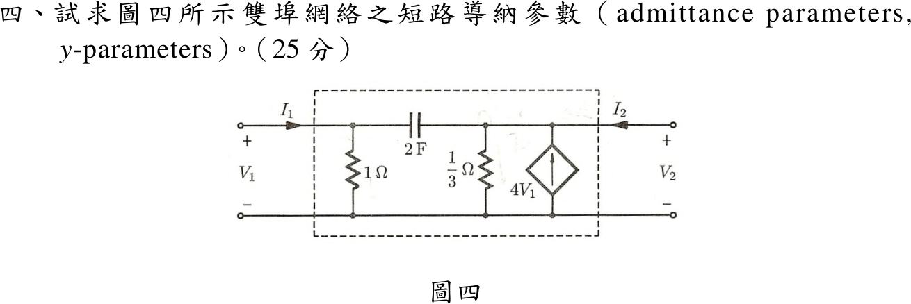

# 113 年電路學第 4 題｜雙埠網路 y 參數

## 已知與所求

埠 1 上端對地接 1 Ω；兩埠上端之間串 2 F 電容；埠 2 上端對地接 \(\frac13\ \Omega\) 及相依電流源 \(4V_1\)（箭頭向上，注入埠 2 上端）。\(I_1,I_2\) 皆流入網路。求短路導納參數（25 分）。

## 考場標準作答

短路導納參數的定義是 \(I_1=y_{11}V_1+y_{12}V_2,\ I_2=y_{21}V_1+y_{22}V_2\)；網路只有兩個埠的上端節點（無內部節點），故直接對兩個上端節點寫 KCL，把每個埠電流表示成 \(V_1,V_2\) 的線性式，係數即 \(y\) 參數。

**畫法與方向**：兩個上端節點對下方共同參考節點；\(I_1,I_2\) 皆流入網路，故 KCL 寫成「流入電流＝由該節點流出的各支路電流之和」。相依源箭頭向上＝注入埠 2 上端，等於流出 \(-4V_1\)。

**元件導納**：\(1\ \Omega\to1\ \mathrm S\)；\(2\ \mathrm F\to sC=2s\)；\(\frac13\ \Omega\to3\ \mathrm S\)。

**埠 1 上端 KCL**（流出：\(1\ \Omega\) 支路與 \(2\ \mathrm F\) 支路）：
\[
I_1=1\cdot V_1+2s(V_1-V_2)=(1+2s)V_1-2sV_2
\]
**埠 2 上端 KCL**（流出：\(2\ \mathrm F\) 支路、\(\frac13\ \Omega\) 支路，相依源注入 \(4V_1\)）：
\[
I_2=2s(V_2-V_1)+3V_2-4V_1
\]
按 \(V_1,V_2\) 合併同類項：
\[
I_2=\bigl(-2s-4\bigr)V_1+\bigl(2s+3\bigr)V_2
\]
**對照定義取係數**：
\[
y_{11}=\left.\frac{I_1}{V_1}\right|_{V_2=0}=1+2s,\quad
y_{12}=\left.\frac{I_1}{V_2}\right|_{V_1=0}=-2s
\]
\[
y_{21}=\left.\frac{I_2}{V_1}\right|_{V_2=0}=-(2s+4),\quad
y_{22}=\left.\frac{I_2}{V_2}\right|_{V_1=0}=2s+3
\]
\[
\boxed{\mathbf Y(s)=\begin{bmatrix}1+2s & -2s\\ -(2s+4) & 2s+3\end{bmatrix}\ \mathrm S}
\]
正弦穩態代 \(s=j\omega\)：\(y_{11}=1+j2\omega\)、\(y_{12}=-j2\omega\)、\(y_{21}=-4-j2\omega\)、\(y_{22}=3+j2\omega\)。

## 驗算

視為四個子雙埠並聯，\(\mathbf Y\) 相加：
\[
\underbrace{\begin{bmatrix}1&0\\0&0\end{bmatrix}}_{1\,\Omega}
+\underbrace{\begin{bmatrix}2s&-2s\\-2s&2s\end{bmatrix}}_{2\,\mathrm F}
+\underbrace{\begin{bmatrix}0&0\\0&3\end{bmatrix}}_{1/3\,\Omega}
+\underbrace{\begin{bmatrix}0&0\\-4&0\end{bmatrix}}_{4V_1}
\]
與上式相同；且 \(y_{12}\neq y_{21}\)，符合含相依源網路不互易。

## 失分點

- 相依源向上注入埠 2，\(y_{21}\) 應為 \(-(2s+4)\)；符號反向會得 \(4-2s\)。
- 把 \(\frac13\ \Omega\) 的導納寫成 \(\frac13\ \mathrm S\)，\(y_{22}\) 應含 3。
