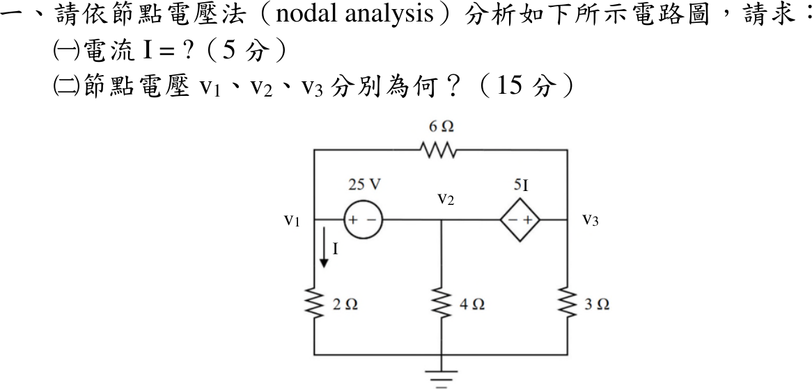
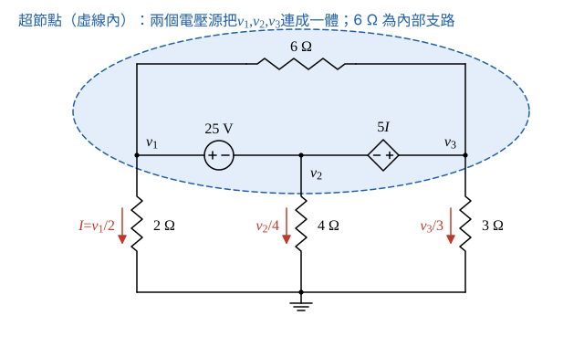

# 114 年電路學第 1 題｜節點電壓法與超節點

## 已知與所求

底線接地。25 V 電壓源正端接 \(v_1\)、負端接 \(v_2\)；相依電壓源 \(5I\) 負端接 \(v_2\)、正端接 \(v_3\)；6 Ω 跨接 \(v_1\)–\(v_3\)；2 Ω、4 Ω、3 Ω 分別由 \(v_1\)、\(v_2\)、\(v_3\) 接地，\(I\) 為 2 Ω 向下電流。求（一）\(I\)（5 分）；（二）\(v_1,v_2,v_3\)（15 分）。

## 考場標準作答

**解題邏輯**：題目指定節點電壓法。25 V 電壓源與相依電壓源 \(5I\) 把 \(v_1,v_2,v_3\) 連成同一個超節點，所以三個未知節點只能列一條超節點邊界 KCL；其餘兩條方程由兩個電壓源的電壓約束提供，控制量 \(I\) 再由 2 Ω 的歐姆定律補上。主線：把 \(v_2,v_3\) 都寫成 \(v_1\) 的函數 → 代入邊界 KCL 解 \(v_1\) → 得 \(I\) → 回推 \(v_2,v_3\)。

### 步驟 1：超節點與約束方程

**畫法與方向**：以底線為參考節點；25 V 源正端在 \(v_1\)、負端在 \(v_2\)；相依源負端在 \(v_2\)、正端在 \(v_3\)；\(I\) 為 2 Ω 由 \(v_1\) 向下流到地的電流。6 Ω 連接 \(v_1\) 與 \(v_3\)，屬超節點內部支路，不列入邊界 KCL。

控制量與兩條電壓約束：
\[
I=\frac{v_1}{2},\qquad v_1-v_2=25,\qquad v_3-v_2=5I
\]
超節點邊界 KCL（流出超節點的只有三條接地電阻電流，和為零）：
\[
\frac{v_1}{2}+\frac{v_2}{4}+\frac{v_3}{3}=0
\]

### 步驟 2：以 \(v_1\) 表示 \(v_2\)、\(v_3\)

由 25 V 源約束：
\[
v_2=v_1-25
\]
由相依源約束，再代入 \(v_2\) 與 \(I=v_1/2\)：
\[
v_3=v_2+5I=(v_1-25)+5\cdot\frac{v_1}{2}
\]
\[
v_3=v_1+\frac52v_1-25=\frac72v_1-25
\]

### （一）電流 \(I\)（5 分）

**邏輯**：\(I=v_1/2\) 只由 \(v_1\) 決定；把步驟 2 的 \(v_2\)、\(v_3\) 代入邊界 KCL，得到只含 \(v_1\) 的一元方程。

代入邊界 KCL：
\[
\frac{v_1}{2}+\frac{v_1-25}{4}+\frac{\frac72v_1-25}{3}=0
\]
同乘 12 去分母：
\[
6v_1+3(v_1-25)+4\left(\tfrac72v_1-25\right)=0
\]
展開：
\[
6v_1+3v_1-75+14v_1-100=0
\]
合併同類項：
\[
23v_1-175=0\ \Rightarrow\ v_1=\frac{175}{23}\ \mathrm V
\]
\[
I=\frac{v_1}{2}=\frac{175}{23\times2}
\]
\[
\boxed{I=\frac{175}{46}=3.80\text{ A}}
\]

### （二）節點電壓（15 分）

**邏輯**：\(v_1\) 已由（一）的 KCL 得到；\(v_2\)、\(v_3\) 直接用步驟 2 的兩條電壓約束回推，全程以精確分數代入。

\[
v_2=v_1-25=\frac{175}{23}-25=\frac{175-575}{23}=-\frac{400}{23}
\]
\[
v_3=\frac72v_1-25=\frac72\cdot\frac{175}{23}-25=\frac{1225}{46}-\frac{1150}{46}=\frac{75}{46}
\]
\[
\boxed{v_1=\frac{175}{23}=7.61\text{ V}},\qquad
\boxed{v_2=-\frac{400}{23}=-17.39\text{ V}},\qquad
\boxed{v_3=\frac{75}{46}=1.63\text{ V}}
\]

## 驗算

功率守恆（精確分數計算，顯示 4 位有效數字）：

- 6 Ω 電流 \((v_1-v_3)/6=\frac{275/46}{6}=\frac{275}{276}=0.9964\ \mathrm A\)（\(v_1\to v_3\)）。
- 25 V 源：節點 \(v_1\) 流出 \(I+\frac{275}{276}=\frac{1050+275}{276}=\frac{1325}{276}=4.801\ \mathrm A\)，全由 25 V 源正端供給，供給功率 \(25\times\frac{1325}{276}=120.0\ \mathrm W\)。
- 電阻吸收：2 Ω \(\frac{v_1^2}{2}=28.95\ \mathrm W\)、6 Ω \(6\left(\frac{275}{276}\right)^2=5.957\ \mathrm W\)、4 Ω \(\frac{v_2^2}{4}=75.61\ \mathrm W\)、3 Ω \(\frac{v_3^2}{3}=0.8861\ \mathrm W\)，合計 \(28.95+5.957+75.61+0.8861=111.4\ \mathrm W\)。
- 相依源：節點 \(v_3\) 由 6 Ω 流入 \(\frac{275}{276}\)、經 3 Ω 流出 \(\frac{v_3}{3}=\frac{150}{276}\)，其餘 \(\frac{125}{276}=0.4529\ \mathrm A\) 由相依源正端流入，吸收 \(5I\times\frac{125}{276}=\frac{875}{46}\times\frac{125}{276}=8.615\ \mathrm W\)。
- \(111.4+8.615=120.0\ \mathrm W\)，與 25 V 源供給相等。

## 失分點

- 把 6 Ω 寫成 \(\frac{v_1-v_3}{6}\) 列入超節點邊界 KCL，等於重複計算內部電流。
- 相依源極性看反寫成 \(v_2-v_3=5I\)，會得 \(3v_1=175\)、\(v_1=58.33\ \mathrm V\)；圖中相依源右端（\(v_3\)）為正。
